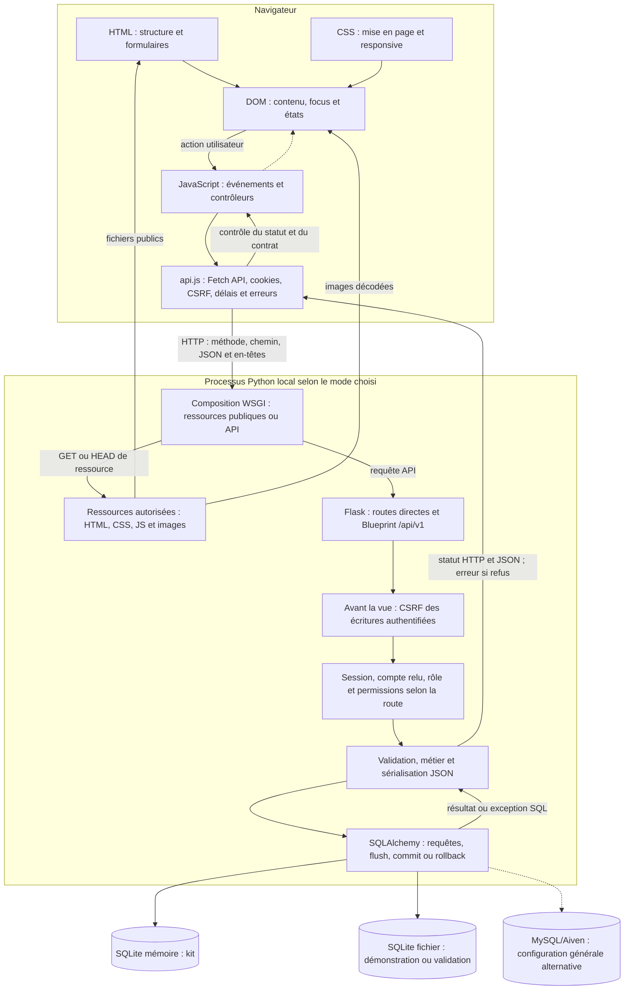
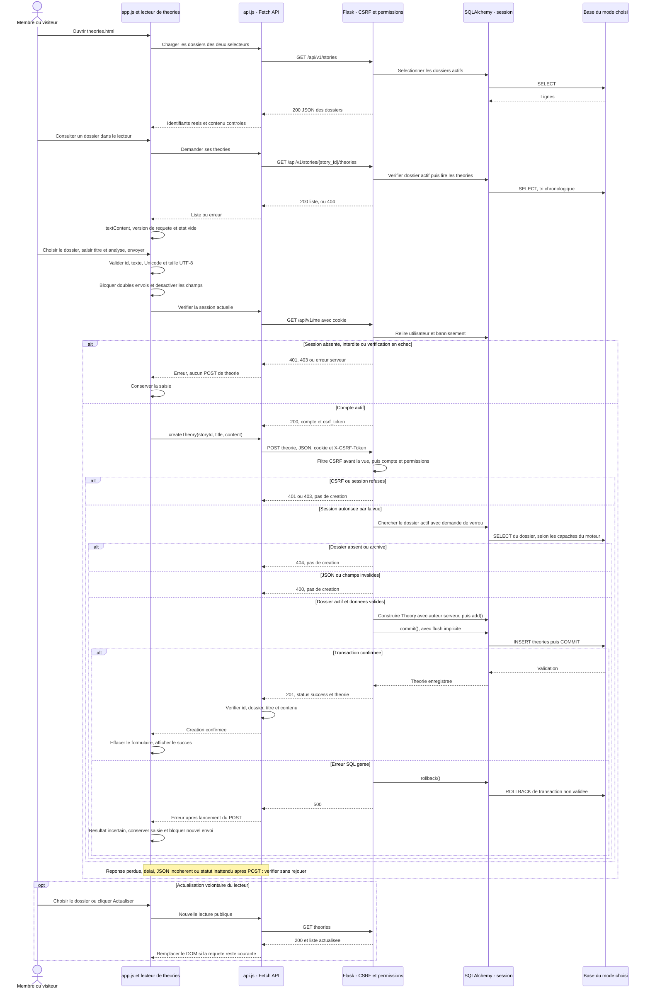

# Les Petits Enquêteurs

**Portfolio Holberton School — plateforme collaborative de dossiers d’enquête, d’analyses et de contributions.**

Les Petits Enquêteurs permet de découvrir des histoires résolues et des Cold Cases, de consulter leurs commentaires et théories, puis de contribuer avec un compte membre. L’administration dispose de vues de suivi, de signalements contextualisés et d’actions contrôlées sur les comptes et les dossiers.

Le projet réunit trois couches : une interface HTML/CSS/JavaScript, une API REST Python/Flask et des données relationnelles manipulées avec SQLAlchemy. Il s’agit d’un MVP pédagogique : une application utilisable dont les fonctions et limites sont explicitées ci-dessous. Ces couches logiques peuvent fonctionner dans un même processus local ; elles ne supposent pas trois serveurs.

**État des sources documenté au 4 novembre 2026 : utilisation locale, sans déploiement public.** La démonstration persistante utilise SQLite sur disque ; le kit scolaire utilise SQLite en mémoire. Le code prévoit aussi une configuration MySQL/Aiven, sans validation récente du service distant ou d’une mise en production.

Ce document décrit la copie locale de `feature/frontend-api-integration`. Des ressources récentes sont encore non suivies par Git, notamment le lanceur persistant, le catalogue original, les six PNG et plusieurs documents. Un clone GitHub ne reproduit pas nécessairement cet état. La dernière livraison documentée du lot 6H.11 correspond au commit `a850919`, distinct du HEAD local conservé `0d77a9a`. Aucune nouvelle publication ni fusion vers `main` n’est annoncée ici.

## Sommaire

- [Fonctionnalités et périmètre](#fonctionnalités-et-périmètre)
- [Les six histoires originales](#les-six-histoires-originales)
- [Technologies et prérequis](#technologies-et-prérequis)
- [Architecture de l’application](#architecture-de-lapplication)
- [Base de données et SQLAlchemy](#base-de-données-et-sqlalchemy)
- [Parcours détaillé : publier une théorie](#parcours-détaillé--publier-une-théorie)
- [API REST complète](#api-rest-complète)
- [Installation](#installation)
- [Configuration et quatre modes de fonctionnement](#configuration-et-quatre-modes-de-fonctionnement)
- [Authentification, sessions et sécurité](#authentification-sessions-et-sécurité)
- [Contributions et modération](#contributions-et-modération)
- [Stockage et affichage des images](#stockage-et-affichage-des-images)
- [Tests automatisés et preuves de validation](#tests-automatisés-et-preuves-de-validation)
- [Procédures manuelles dans Edge](#procédures-manuelles-dans-edge)
- [Information RGPD et décisions restantes](#information-rgpd-et-décisions-restantes)
- [Limites et perspectives](#limites-et-perspectives)
- [Équipe et responsabilités](#équipe-et-responsabilités)
- [Documentation complémentaire](#documentation-complémentaire)

## Fonctionnalités et périmètre

| Public | Fonctionnalités disponibles dans l’interface |
|---|---|
| Visiteur | Accueil avec jusqu’à trois dossiers récents ; listes Histoires et Cold Cases ; recherche locale par titre/résumé ; lecture des six dossiers par slug, des commentaires et des théories ; consultation des formulaires d’inscription et de connexion. |
| Membre connecté, non banni | Publication de commentaires et théories ; proposition d’histoire ; signalement d’un commentaire ; ajout/retrait de ses likes de dossiers et de commentaires compatibles ; état de session et déconnexion communs aux pages. |
| Administrateur actif | Sept indicateurs, propositions et signalements contextualisés ; utilisateurs et bannissement ; lecture et filtres des dossiers actifs/archivés ; archivage/restauration ; suppression conditionnelle d’un dossier déjà archivé. |

Le tableau de bord affiche les dossiers actifs, histoires résolues, Cold Cases, utilisateurs, commentaires, signalements et propositions en attente. Le nombre d’archives est distinct. Un chargement en échec reste une erreur, sans être transformé en compteur nul.

L’API expose en complément la lecture des mises à jour d’un dossier et le like historique d’une théorie. Ce dernier reste un compteur répétable, sans retrait individuel ni parcours complet de like dans l’interface. La route des mises à jour vérifie le dossier actif, mais pas sa catégorie Cold Case.

Les propositions sont enregistrées en `pending` et consultables par l’administration ; leur acceptation et leur publication ne sont pas développées. Le choix de catégorie du formulaire est ajouté au début du contenu, sans création de `Story` ni pièce jointe. Il n’existe pas de compteur de visites ou de page Top Dossiers livrés.

## Les six histoires originales

Le [catalogue de référence](tools/fixtures/dossiers_historiques.json) conserve les titres complets, résumés, textes et références approuvés. « Originales » désigne les versions conservées du projet ; ce terme n’atteste pas la véracité historique de chaque récit ni le caractère fictif de tous les contenus.

| Dossier — intitulé abrégé | Catégorie | Slug stable | Illustration |
|---|---|---|---|
| L’Ombre du Golden State Killer | Histoire résolue | `golden-state-killer` | `golden-state-killer.png` |
| Le Masque de Chris Watts | Histoire résolue | `chris-watts` | `chris-watts.png` |
| Les Mots Mortels de Michelle Carter | Histoire résolue | `michelle-carter` | `michelle-carter.png` |
| Le Mystère d’Anthonioz | Cold Case | `anthonioz` | `mystere-anthonioz.png` |
| L’Inconnue de la Plage de Noirval | Cold Case | `noirval` | `inconnue-noirval.png` |
| Le Secret du Manoir de l’Ombre | Cold Case | `manoir-de-l-ombre` | `manoir-ombre.png` |

Anthonioz et Noirval utilisent les versions B retenues lors de la restauration. Les tests comparent les titres, résumés et textes visibles aux versions approuvées. L’affichage reconstruit paragraphes et intertitres à partir du texte, sans exécuter le HTML historique. Les références de témoignages, sources et galeries sont conservées dans le catalogue ; leur présentation dédiée reste à développer.

Les catégories `1` et `2` restent attendues par le frontend. Les démonstrations les préparent explicitement ; une base générale utilisant d’autres identifiants demanderait une adaptation. Le slug sert au lien éditorial ; l’identifiant numérique sert aux relations SQL et aux routes de contributions.

## Technologies et prérequis

| Couche | Technologies | Utilisation réelle |
|---|---|---|
| Présentation | HTML5, CSS3, JavaScript natif | Pages responsive, DOM, événements, `fetch`, `AbortController`, textes alternatifs et retours d’état. Aucune compilation frontend. |
| Application | Python, Flask, Werkzeug | API JSON, sessions, composition WSGI et serveur local de démonstration. |
| Données | SQLite | Mémoire du kit et fichiers du mode persistant/validations dédiées. |
| ORM | Flask-SQLAlchemy, SQLAlchemy | Modèles, relations, requêtes, contraintes et transactions. |
| Autre moteur configuré | MySQL, PyMySQL, Aiven et certificat CA | Branche de configuration du lanceur général ; connexion distante non revérifiée dans les derniers lots. |
| Migrations | Flask-Migrate, Alembic | Historique de sept révisions ; création neuve et migration d’une base existante sont distinctes. |
| Contrat API | OpenAPI 3.0.3, Swagger UI | Contrat JSON et interface de consultation ; pas d’OAuth implémenté par la vue nommée `oauth_swagger`. |
| Vérification | `unittest`, `node:test`, clients Flask/WSGI, Edge | Intégration réelle SQLite, DOM/API simulés et campagnes navigateur séparées. |

Les neuf dépendances directes fixées dans [backend/requirements.txt](backend/requirements.txt) sont Flask `3.1.3`, flask-restx `1.3.2`, Flask-Cors `6.0.5`, Flask-SQLAlchemy `3.1.1`, SQLAlchemy `2.0.53`, PyMySQL `1.2.0`, python-dotenv `1.0.1`, Werkzeug `3.1.6` et Flask-Migrate `4.1.0`. Installer flask-restx ne signifie pas que les routes sont générées par cette bibliothèque : les vues actuelles utilisent les décorateurs Flask et un contrat JSON maintenu dans le dépôt.

L’environnement attesté est Windows AMD64, PowerShell, Python **3.13.0** et Node.js **24.16.0**. Node sert aux tests, pas au démarrage du site. La recette RGPD 6H.20.3 utilisait Edge **156.0.4314.58**. Ces versions relevées ne constituent pas une validation de tous les autres systèmes ou versions. Le [fichier de contraintes d’installation](docs/soutenance/CONTRAINTES_INSTALLATION_LOT6H2.txt) fixe 25 versions, dépendances transitives comprises, pour la recette Windows historique. Il ne constitue pas un verrou cryptographique des distributions ni une validation universelle des plateformes.

## Architecture de l’application

### Flux entre navigateur, application et stockage



Le diagramme représente les chemins possibles, pas trois bases ouvertes simultanément. Chaque processus choisit son stockage. La flèche MySQL correspond à une possibilité de configuration, sans preuve d’exécution distante actuelle.

| Composant | Responsabilité et interaction |
|---|---|
| HTML/CSS/DOM | HTML définit les champs, labels et notices ; CSS organise les vues ; le DOM représente la page manipulée par les scripts. Les états `aria-busy`, messages et contrôles désactivés rendent les attentes perceptibles. |
| Contrôleurs JavaScript | `app.js` charge les dossiers et gère formulaires/session ; `comments.js` et `likes.js` traitent les contributions ; `theories-list.js` gère le lecteur ; les trois contrôleurs administratifs séparent tableau de bord, comptes et dossiers. |
| Client HTTP | `api.js` centralise `/api/v1`, `credentials: include`, JSON, CSRF, annulation et délai de 10 secondes par défaut. Un HTTP 400/500 n’est pas une exception automatique de `fetch` : le client inspecte le statut. |
| Composition WSGI | `run_local.create_local_app()` sert les ressources de `frontend/` et délègue l’API à Flask, avec `Cache-Control: no-store` pour les fichiers servis. Le kit ajoute une liste publique plus stricte. |
| Flask et Blueprint | `backend/index.py` configure l’application et les routes de session/statistiques ; `app_views` assemble les autres vues sous `/api/v1`. L’entrée de compatibilité `backend/api/v1/app.py` réexporte cette application. |
| Sécurité serveur | Le filtre CSRF intervient avant la vue ; la vue ou son décorateur relit ensuite l’utilisateur et les permissions. La lecture publique n’exige pas systématiquement de session. |
| SQLAlchemy | Les vues construisent les requêtes, manipulent les objets et valident les transactions. Les modèles décrivent les colonnes et relations ; ils ne démarrent pas de serveur ni ne peuplent seuls une base. |
| Réponses et erreurs | Flask produit le statut et le JSON ; le client valide la structure utile ; les contrôleurs mettent le DOM à jour. Une réponse tardive peut être ignorée selon sa version ; une écriture incertaine n’est pas automatiquement rejouée. |

Les contenus externes des interfaces raccordées sont insérés avec `textContent`. Les retours de ligne deviennent des paragraphes ; les contrôles de structure évitent d’interpréter un JSON incohérent comme un succès. Ils ne remplacent pas les validations serveur.

### Organisation du dépôt

```text
portfolio/
├── frontend/
│   ├── *.html, styles.css          # Dix pages publiques et présentation
│   ├── api.js, app.js              # Transport HTTP, dossiers, formulaires, session
│   ├── comments.js, likes.js       # Contributions et likes individuels
│   ├── theories-list.js            # Lecture publique des théories
│   ├── admin-*.js                  # Administration : indicateurs, comptes, dossiers
│   ├── images/                     # Six PNG et SVG de remplacement
│   └── tests/                      # Suites Node et fixtures synthétiques
├── backend/
│   ├── index.py                    # Configuration, sessions, CSRF et routes directes
│   ├── models.py                   # Dix modèles SQLAlchemy
│   ├── requirements.txt            # Neuf dépendances Python directes
│   ├── api/v1/
│   │   ├── app.py                  # Export de compatibilité
│   │   ├── swagger.json            # Contrat OpenAPI
│   │   └── views/                  # Routes, permissions et helpers transactionnels
│   └── tests/                      # Contrats API, métier, intégrité et migrations ciblées
├── migrations/                     # Environnement Alembic et sept révisions
├── tools/
│   ├── recette_lot6g4.py            # Kit scolaire et parcours WSGI mémoire
│   ├── recette_lot6g4_sources.json  # Empreintes des 41 sources contrôlées
│   ├── demo_persistante.py          # Initialiser, servir, contrôler et maintenir SQLite
│   └── fixtures/dossiers_historiques.json
├── tests/                          # Notices, ressources, kit, catalogue et persistance
├── docs/soutenance/                 # Guides, bilans et référentiel pédagogique datés
├── LIVRAISON_SCOLAIRE.md
└── run_local.py                     # Lanceur général sur une seule origine
```

`instance/`, `.venv/`, `.env`, `certs/` et les sauvegardes sont des éléments locaux privés, exclus de Git. `donnees.js` est un héritage non utilisé comme source des vues raccordées. Les anciennes copies pédagogiques de `revision_code/` ne remplacent pas les sources actives. Les futures copies détaillées dans `docs/soutenance/code-commente-mahamadou/` ne sont pas encore créées.

## Base de données et SQLAlchemy

### Dix modèles confirmés dans les sources

Le schéma applicatif de [backend/models.py](backend/models.py) contient **dix tables et treize clés étrangères**. Chaque table possède une clé primaire entière `id`. Le tableau décrit les autres colonnes importantes ; les types et contraintes complets restent dans les modèles.

| Modèle / table | Colonnes principales hors `id` | Contraintes et rôle |
|---|---|---|
| `User` / `users` | `username` String(100), `email` String(150), `password_hash` String(255), `is_admin`, `is_banned`, `created_at` | Pseudo et e-mail uniques séparément ; valeurs obligatoires ; rôle membre et non banni par défaut ORM. |
| `Category` / `categories` | `name` String(100), `description` Text nullable | Nom unique ; classe les dossiers. |
| `Story` / `stories` | `slug` String(150), `title` String(200), `summary`, `content`, `image_url` String(500) nullable, `category_id`, `author_id`, `created_at`, `updated_at`, `archived_at` nullable, `management_revision` String(32) | Slug et révision uniques ; auteur/catégorie obligatoires ; `archived_at = NULL` signifie actif. La révision change aux transitions de gestion. |
| `Theory` / `theories` | `story_id`, `user_id` nullable, `title` String(200), `content`, `likes`, `created_at` | Contribution à un dossier ; compteur historique de likes, sans unicité par compte. |
| `Comment` / `comments` | `story_id`, `user_id` nullable, `username` String(100) nullable, `text`, `likes`, `created_at` | Copie du pseudonyme ; `likes` conserve le compteur historique physique. Les likes individuels et signalements sont comptés depuis leurs tables. |
| `Vote` / `votes` | `story_id`, `user_id`, `created_at` | Couple `(user_id, story_id)` unique, contrainte `unique_user_story_vote` ; représente un like individuel de dossier. |
| `CommentLike` / `comment_likes` | `comment_id` indexé, `user_id`, `created_at` | Couple `(user_id, comment_id)` unique, `unique_user_comment_like` ; table déclarée InnoDB pour MySQL. |
| `Proposal` / `proposals` | `user_id`, `title` String(200), `content`, `status` String(20), `created_at`, `updated_at` | Statut ORM initial `pending`, auteur obligatoire ; aucune conversion automatique en dossier. |
| `Report` / `reports` | `comment_id` indexé, `reason`, `status` String(20), `created_at` | Vraie FK entière vers un commentaire ; pas de colonne identifiant le déclarant. `type` et `target_id` sont des propriétés Python de compatibilité. |
| `ColdCaseUpdate` / `cold_case_updates` | `story_id`, `content`, `created_at` | Mise à jour attachée au dossier ; la FK ne contrôle pas sa catégorie. |

`Report.type` renvoie `comment` ; `Report.target_id` expose l’identifiant comme chaîne pour l’ancien contrat HTTP. Ce ne sont plus deux colonnes SQL. Retirer la référence `user_id` d’une contribution ne retire ni son texte ni le pseudonyme copié : cela ne constitue pas un effacement complet de données personnelles.

### Diagramme entité-relation actuel

```mermaid
erDiagram
  users {
    int id PK
    string username UK
    string email UK
    string password_hash
    boolean is_admin
    boolean is_banned
  }
  categories {
    int id PK
    string name UK
  }
  stories {
    int id PK
    string slug UK
    string management_revision UK
    int category_id FK
    int author_id FK
    string image_url
    datetime archived_at "NULL signifie actif"
  }
  theories {
    int id PK
    int story_id FK
    int user_id FK "NULL autorise"
    string title
    int likes "Compteur historique"
  }
  comments {
    int id PK
    int story_id FK
    int user_id FK "NULL autorise"
    string username "Copie du pseudonyme"
    int likes "Compteur historique conserve"
  }
  votes {
    int id PK
    int story_id FK
    int user_id FK "Unique avec story_id"
  }
  comment_likes {
    int id PK
    int comment_id FK
    int user_id FK "Unique avec comment_id"
  }
  proposals {
    int id PK
    int user_id FK
    string status
  }
  reports {
    int id PK
    int comment_id FK
    string reason
    string status
  }
  cold_case_updates {
    int id PK
    int story_id FK
    string content
  }
  users ||..o{ stories : "author_id : sans ON DELETE explicite"
  categories ||..o{ stories : "category_id : sans ON DELETE explicite"
  stories ||..o{ theories : "story_id : CASCADE"
  users |o..o{ theories : "user_id : SET NULL"
  stories ||..o{ comments : "story_id : CASCADE"
  users |o..o{ comments : "user_id : SET NULL"
  stories ||..o{ votes : "story_id : CASCADE"
  users ||..o{ votes : "user_id : CASCADE"
  comments ||..o{ comment_likes : "comment_id : CASCADE"
  users ||..o{ comment_likes : "user_id : CASCADE"
  users ||..o{ proposals : "user_id : CASCADE"
  comments ||..o{ reports : "comment_id : CASCADE"
  stories ||..o{ cold_case_updates : "story_id : CASCADE"
```



`PK` désigne une clé primaire, `FK` une clé étrangère et `UK` une unicité individuelle. Les deux unicités de couples ne rendent pas chaque colonne unique isolément. `||` signifie exactement un parent, `|o` zéro ou un parent et `o{` zéro à plusieurs enfants ; les traits représentent les références entre tables. Les autres colonnes descriptives et dates sont omises du diagramme pour le garder lisible.

### Treize références, cardinalités et suppression

| Référence enfant → parent | Cardinalité côté enfant / côté parent | `ON DELETE` SQL |
|---|---|---|
| `stories.category_id → categories.id` | Une catégorie obligatoire / zéro à plusieurs dossiers | Non explicité |
| `stories.author_id → users.id` | Un auteur obligatoire / zéro à plusieurs dossiers | Non explicité |
| `theories.story_id → stories.id` | Un dossier obligatoire / zéro à plusieurs théories | `CASCADE` |
| `theories.user_id → users.id` | Zéro ou un auteur / zéro à plusieurs théories | `SET NULL` |
| `comments.story_id → stories.id` | Un dossier obligatoire / zéro à plusieurs commentaires | `CASCADE` |
| `comments.user_id → users.id` | Zéro ou un auteur / zéro à plusieurs commentaires | `SET NULL` |
| `votes.story_id → stories.id` | Un dossier obligatoire / zéro à plusieurs likes | `CASCADE` |
| `votes.user_id → users.id` | Un compte obligatoire / zéro à plusieurs likes | `CASCADE` |
| `comment_likes.comment_id → comments.id` | Un commentaire obligatoire / zéro à plusieurs likes | `CASCADE` |
| `comment_likes.user_id → users.id` | Un compte obligatoire / zéro à plusieurs likes | `CASCADE` |
| `proposals.user_id → users.id` | Un auteur obligatoire / zéro à plusieurs propositions | `CASCADE` |
| `reports.comment_id → comments.id` | Un commentaire obligatoire / zéro à plusieurs signalements | `CASCADE` |
| `cold_case_updates.story_id → stories.id` | Un dossier obligatoire / zéro à plusieurs mises à jour | `CASCADE` |

Une FK assure une référence valide lorsque le moteur applique les contraintes. `CASCADE` supprime les dépendances configurées avec leur parent ; `SET NULL` conserve l’enfant en retirant la référence facultative. L’absence de règle explicite sur l’auteur et la catégorie du dossier ne doit pas être assimilée à une cascade.

Les relations `db.relationship(..., back_populates=...)` permettent de naviguer entre objets Python dans les deux sens : `Story.category`, `Category.stories`, `Story.author`, `User.stories`, puis les contributions et leurs auteurs. Elles ne remplacent pas les clés étrangères SQL.

Les dates `created_at` et les mises à jour `updated_at` utilisent les valeurs et callbacks Python de SQLAlchemy, notamment `datetime.utcnow` : ce ne sont pas des déclencheurs SQL permanents. L’API produit généralement des dates UTC sans suffixe de fuseau. `management_revision` reçoit un UUID hexadécimal côté ORM ; son défaut SQL sentinelle sert à l’évolution du schéma et est refusé par la purge tant qu’une vraie révision n’est pas présente.

Les collections `Story.comments`, `votes`, `theories`, `cold_case_updates` utilisent `cascade='all, delete-orphan'` côté ORM. `Comment.moderation_reports`, `Comment.comment_likes` et `User.comment_likes` déclarent aussi cette cascade avec `passive_deletes=True`. Les autres collections de `User` ne possèdent pas toutes ces options. Une suppression ORM et un `DELETE` SQL direct peuvent donc suivre des mécanismes différents ; les contraintes réellement actives restent nécessaires.

### Requêtes, flush et transactions

Les routes utilisent notamment `db.session.get()` pour une PK, `filter_by()` pour un slug ou un couple, `order_by()` pour les listes et `count()` pour les totaux. `joinedload()` charge le commentaire, le dossier et sa catégorie pour les signalements administratifs. Les listes ne sont pas paginées ; certains comptages sont effectués par élément et pourront être regroupés si le volume augmente.

```python
# Extraits de principes employés dans les vues ; aucun script autonome à exécuter.
story = Story.query.filter_by(slug=slug, archived_at=None).first()
db.session.add(new_vote)
db.session.flush()
vote_count = Vote.query.filter_by(story_id=story_id).count()
db.session.commit()
```

| Opération | Signification dans l’application |
|---|---|
| `add()` / `add_all()` | Place les nouveaux objets dans l’unité de travail de la session. Ne confirme pas leur durabilité. |
| `flush()` | Envoie les changements en attente dans la transaction et peut attribuer les PK ou révéler une contrainte invalide. Ne valide pas la transaction. Le mode autoflush peut également déclencher un flush avant certaines requêtes. |
| `commit()` | Déclenche le flush nécessaire puis valide la transaction. Les objets peuvent ensuite être expirés et nécessiter une nouvelle lecture. |
| `rollback()` | Annule la transaction non validée et rend la session réutilisable après une erreur gérée. Ne garantit pas qu’un commit dont l’accusé a été perdu n’a jamais abouti. |

L’unicité SQL complète les vérifications préalables : deux requêtes peuvent passer le même précontrôle. `is_unique_conflict()` distingue les doublons métier connus SQLite/MySQL des autres erreurs SQL ; les cas MySQL simulés ne prouvent pas une connexion distante.

Les écrivains de contributions demandent un dossier actif avec `with_for_update()` ; l’archivage utilise le même principe. SQLite n’offre pas le même verrou de ligne que MySQL/InnoDB. Les tests séquentiels ou les erreurs de concurrence injectées ne valident pas une concurrence réelle à plusieurs connexions MySQL.

La purge conditionnelle ajoute une vérification d’intégrité, une empreinte du dossier et de ses dépendances, une révision de gestion et une mise à jour conditionnelle avant ses suppressions. Son graphe comprend commentaires, théories, votes, mises à jour, signalements et likes de commentaires. Une transaction en échec est annulée ; une issue de commit incertaine exige une relecture, sans relance automatique du `DELETE`.

### Sept migrations Flask-Migrate / Alembic

La chaîne déclarée dans [migrations/versions/](migrations/versions/) est linéaire :

```text
921687c1bd7c → 3111f5767fc6 → a590c8aac613 → 82deda84bc35
             → c6c100000001 → c6c200000001 → c6g200000001
```

| Révision | Évolution décrite |
|---|---|
| `921687c1bd7c` | Schéma initial : comptes, catégories, dossiers, théories, commentaires, votes et propositions. |
| `3111f5767fc6` | Contraintes nommées et règles `CASCADE` / `SET NULL` sur les références concernées. |
| `a590c8aac613` | Signalements historiques, bannissement et mises à jour de dossiers. |
| `82deda84bc35` | Suppression du compteur redondant `comments.reports` ; comptage depuis les signalements. |
| `c6c100000001` | Ajout de `stories.archived_at`. |
| `c6c200000001` | Reprise contrôlée des cibles de signalement vers `reports.comment_id` et ajout de la révision de gestion du dossier. |
| `c6g200000001` | Table des likes individuels de commentaires, après contrôle des compteurs historiques. |

`migrations/env.py` obtient le moteur et les métadonnées depuis Flask-Migrate. Le mode offline produit des instructions ; le mode online utilise une connexion et exécute les révisions. L’enregistrement de `Migrate(app, db)` ne lance aucune migration.

Les dernières révisions restent des migrations candidates : leur présence ne démontre pas leur application à une base réelle. Les tests ciblés portent sur des schémas synthétiques ; la chaîne complète depuis une SQLite vierge et la migration MySQL/Aiven n’ont pas été validées récemment. Les noms de contraintes historiques et les différences de DDL entre moteurs demandent une vérification propre à la cible.

La reprise des signalements refuse les références incompatibles avant le premier DDL. La migration des likes refuse un compteur historique non nul ou ambigu ; elle ne fabrique pas d’auteurs. Certains retours arrière perdent un état ou suppriment une table, et le downgrade des likes refuse les lignes existantes. Aucune rétrogradation ne recrée les données déjà purgées.

`db.create_all()` crée les tables manquantes à partir des modèles ; il ne met pas à niveau les colonnes d’une ancienne table, ne rejoue pas Alembic et ne marque pas une révision déployée. Le kit et l’initialisation persistante créent un schéma neuf ; ils ne migrent pas une base historique.

### Trois stockages, des usages distincts

| Stockage | Durée et préparation | Intégrité et limites |
|---|---|---|
| SQLite mémoire | Jeu fictif neuf pour un processus ; perdu à l’arrêt | Kit : connexions `:memory:` imposées, FK activées, autres bases et réseau refusés. Les gardes des tests dépendent du harnais. |
| SQLite persistante | Fichier privé `instance/demo-persistante/portfolio.sqlite3` ; préparation unique par `init`, réouverture par `serve` | FK activées à chaque connexion ; journal `DELETE` ; format reconnu et verrou d’opération. SQLite standard ne chiffre pas le fichier. |
| MySQL/Aiven | Service distant sélectionné par six paramètres et certificat CA | PyMySQL/TLS prévu ; contraintes, moteur InnoDB, révision et concurrence à valider sur la cible. Aucune preuve de production déduite de la configuration. |

Le repli général `instance/site.db` est encore un autre fichier SQLite : il n’est pas la base persistante 5066. Les FK sont explicitement activées dans les modes confinés ; le lanceur général ne doit pas être crédité automatiquement des mêmes gardes.

## Parcours détaillé : publier une théorie

Le scénario suit le code actuel de [frontend/app.js](frontend/app.js), [frontend/api.js](frontend/api.js), [theories-list.js](frontend/theories-list.js), [backend/index.py](backend/index.py) et [views/theories.py](backend/api/v1/views/theories.py).



1. Les deux sélecteurs chargent les dossiers depuis l’API et restent indépendants. Une option utilise la vraie PK, jamais le rang dans une liste. Un échec ou une liste vide maintient le formulaire indisponible.
2. Le navigateur vérifie un dossier proposé, un titre et un contenu non vides, un titre de 200 caractères maximum, l’encodage et un contenu de 65 535 octets UTF-8 maximum. Il bloque les doubles soumissions et garde les valeurs avant toute requête.
3. `GET /me` relit le compte et fournit le CSRF actuel. Sans session autorisée, aucun POST de théorie ne part. Être membre actif suffit ; un rôle administrateur n’est pas requis.
4. Le POST transporte seulement `title` et `content`. L’auteur vient du compte relu côté serveur. Le filtre CSRF global précède la vue ; les permissions sont ensuite contrôlées, puis le dossier actif avec demande de verrou et les champs JSON.
5. La vue construit `Theory`, l’ajoute à la session et appelle `commit()`. Le flush implicite envoie l’INSERT. Une `SQLAlchemyError` gérée provoque un rollback et une réponse 500 ; un refus de validation n’insère pas la contribution.
6. Le client exige 201 et une théorie cohérente : identifiant positif, même dossier, titre et contenu attendus. Il n’efface la saisie et n’annonce la publication qu’après cette confirmation.
7. Les refus 400/401/403/404 gardent la saisie avec un message adapté. Une panne réseau, un délai, une réponse incohérente, un statut inattendu ou un 5xx après le lancement du POST laisse un résultat incertain : le formulaire interdit un nouvel envoi sur cette page. L’annulation HTTP côté client ne prouve pas l’absence de commit.
8. La lecture publique utilise annulation et numéro de version pour ignorer une ancienne réponse. Elle affiche les titres/contenus comme texte et les dates selon la convention UTC de l’API, rendues à l’heure de Paris. Après publication, son actualisation reste manuelle.

Le diagramme regroupe des lectures et des réponses de transport pour rester lisible ; il ne représente pas chaque instruction SQL ni une garantie identique de verrouillage entre SQLite et InnoDB.

## API REST complète

Le contrat [OpenAPI 3.0.3](backend/api/v1/swagger.json) et les décorateurs Flask ont été comparés statiquement pour cette version : **36 opérations explicites sur 27 chemins**, sous `/api/v1`. Les méthodes automatiques HEAD/OPTIONS ne sont pas comptées.

**Public** : sans connexion obligatoire. **Membre** : compte connecté et non banni, administrateur compris. **Admin** : membre possédant le rôle administrateur relu en base. Les écritures portant une session authentifiée exigent `X-CSRF-Token`, sauf `/login`. Inscription et déconnexion acceptent l’anonymat ; avec une session existante, le filtre CSRF s’applique. Le contrôle CSRF peut précéder un autre refus.

Les colonnes « Traitement / vue » donnent l’objectif et le nom Python. Les chemins ci-dessous sont complets. Les codes proviennent du contrat, recoupé avec les vues et leurs helpers ; ils ne constituent pas une nouvelle exécution des 36 opérations.

### Comptes et session

| Méthode | Chemin | Traitement / vue | Permission | Paramètres principaux | Codes HTTP |
|---|---|---|---|---|---|
| GET | `/api/v1/users` | Lister les comptes — `get_users` | Admin | Aucun | 200, 401, 403, 500 |
| POST | `/api/v1/users` | Inscrire un membre — `register_user` | Public ; session existante contrôlée | JSON : username, email, password | 201, 400, 401, 403, 500 |
| POST | `/api/v1/login` | Ouvrir la session — `login_user` | Public ; exempt CSRF | JSON : username, password | 200, 400, 401, 403, 500 |
| GET | `/api/v1/me` | Relire compte et CSRF — `get_current_user` | Membre | Cookie de session | 200, 401, 403, 500 |
| POST | `/api/v1/logout` | Fermer la session courante — `logout_user` | Public ; CSRF si connecté | Aucun corps requis | 200, 403, 500 |

### Dossiers et mises à jour

| Méthode | Chemin | Traitement / vue | Permission | Paramètres principaux | Codes HTTP |
|---|---|---|---|---|---|
| GET | `/api/v1/stories` | Lister les dossiers actifs et leurs votes — `get_stories` | Public | Aucun | 200, 500 |
| GET | `/api/v1/stories/slug/{slug}` | Lire un dossier actif — `get_story_by_slug` | Public | Chemin : slug | 200, 404, 500 |
| GET | `/api/v1/coldcases/{case_id}/updates` | Lire les mises à jour — `get_case_updates` | Public | Chemin : case_id | 200, 404, 500 |

### Commentaires et likes individuels

| Méthode | Chemin | Traitement / vue | Permission | Paramètres principaux | Codes HTTP |
|---|---|---|---|---|---|
| GET | `/api/v1/stories/{story_id}/comments` | Lire les commentaires — `get_story_comments` | Public | Chemin : story_id | 200, 404, 500 |
| POST | `/api/v1/stories/{story_id}/comments` | Publier un commentaire — `post_story_comment` | Membre | Chemin : story_id ; JSON : text | 201, 400, 401, 403, 404, 500 |
| POST | `/api/v1/comments/{comment_id}/like` | Ajouter son like au commentaire — `like_comment` | Membre | Chemin : comment_id | 200, 401, 403, 404, 409, 500 |
| POST | `/api/v1/votes/{story_id}` | Ajouter son like au dossier — `post_story_vote` | Membre | Chemin : story_id | 201, 401, 403, 404, 409, 500 |
| GET | `/api/v1/votes/{story_id}` | Lire ou retirer son like — `personal_story_like` | Membre | Chemin : story_id | 200, 401, 403, 404, 500 |
| DELETE | `/api/v1/votes/{story_id}` | Lire ou retirer son like — `personal_story_like` | Membre | Chemin : story_id | 200, 401, 403, 404, 500 |
| GET | `/api/v1/comments/{comment_id}/like` | Lire ou retirer son like — `personal_comment_like` | Membre | Chemin : comment_id | 200, 401, 403, 404, 409, 500 |
| DELETE | `/api/v1/comments/{comment_id}/like` | Lire ou retirer son like — `personal_comment_like` | Membre | Chemin : comment_id | 200, 401, 403, 404, 409, 500 |

### Théories et propositions

| Méthode | Chemin | Traitement / vue | Permission | Paramètres principaux | Codes HTTP |
|---|---|---|---|---|---|
| GET | `/api/v1/proposals` | Lire les propositions — `get_proposals` | Admin | Aucun | 200, 401, 403, 500 |
| POST | `/api/v1/proposals` | Enregistrer une proposition pending — `create_proposal` | Membre | JSON : title, content | 201, 400, 401, 403, 500 |
| GET | `/api/v1/stories/{story_id}/theories` | Lire les théories — `get_theories` | Public | Chemin : story_id | 200, 404, 500 |
| POST | `/api/v1/stories/{story_id}/theories` | Publier une théorie — `post_theory` | Membre | Chemin : story_id ; JSON : title, content | 201, 400, 401, 403, 404, 500 |
| POST | `/api/v1/theories/{theory_id}/like` | Incrémenter le compteur historique — `like_theory` | Membre | Chemin : theory_id | 200, 401, 403, 404, 500 |

### Signalements et comptes administrés

| Méthode | Chemin | Traitement / vue | Permission | Paramètres principaux | Codes HTTP |
|---|---|---|---|---|---|
| POST | `/api/v1/comments/{comment_id}/report` | Signaler le commentaire ciblé — `report_comment` | Membre | Chemin : comment_id ; JSON : reason | 201, 400, 401, 403, 404, 500 |
| POST | `/api/v1/reports` | Signaler par ancien contrat générique — `post_report` | Membre | JSON : type=comment, target_id chaîne positive, reason | 201, 400, 401, 403, 404, 500 |
| GET | `/api/v1/admin/reports` | Lire motifs et contexte des signalements — `get_admin_reports` | Admin | Aucun | 200, 401, 403, 500 |
| DELETE | `/api/v1/admin/users/{username}/ban` | Bannir sans supprimer le compte — `ban_user` | Admin | Chemin : username | 200, 401, 403, 404, 409, 500 |
| POST | `/api/v1/admin/users/{user_id}/ban` | Bannir par identifiant stable — `ban_user_by_id` | Admin | Chemin : user_id | 200, 401, 403, 404, 409, 500 |

### Dossiers administrés

| Méthode | Chemin | Traitement / vue | Permission | Paramètres principaux | Codes HTTP |
|---|---|---|---|---|---|
| GET | `/api/v1/admin/stories` | Lister les dossiers administratifs — `get_admin_stories` | Admin | Requête : state=active, archived ou all | 200, 400, 401, 403, 500 |
| GET | `/api/v1/admin/stories/{story_id}` | Lire dossier et contributions, archives incluses — `get_admin_story` | Admin | Chemin : story_id | 200, 401, 403, 404, 500 |
| POST | `/api/v1/admin/stories/{story_id}/archive` | Archiver le dossier — `archive_story` | Admin | Chemin : story_id | 200, 401, 403, 404, 500 |
| POST | `/api/v1/admin/stories/{story_id}/restore` | Restaurer le dossier — `restore_story` | Admin | Chemin : story_id | 200, 401, 403, 404, 500 |
| GET | `/api/v1/admin/stories/{story_id}/deletion-preview` | Préparer un aperçu de purge — `get_story_deletion_preview` | Admin | Chemin : story_id ; dossier déjà archivé | 200, 401, 403, 404, 409, 500, 503 |
| POST | `/api/v1/admin/stories/{story_id}/deletion-confirmations` | Confirmer le titre et les contributions — `confirm_story_deletion` | Admin | Chemin : story_id ; JSON : preview_token, typed_title, confirm_contributions=true | 200, 400, 401, 403, 404, 409, 412, 428, 500, 503 |
| DELETE | `/api/v1/admin/stories/{story_id}` | Supprimer le graphe confirmé — `delete_story_permanently` | Admin | Chemin : story_id ; en-têtes : If-Match, X-Deletion-Confirmation ; aucun corps | 200, 400, 401, 403, 404, 409, 412, 428, 500, 503 |

### Statistiques et documentation

| Méthode | Chemin | Traitement / vue | Permission | Paramètres principaux | Codes HTTP |
|---|---|---|---|---|---|
| GET | `/api/v1/swagger.json` | Lire le contrat JSON — `get_swagger_json` | Public | Aucun | 200, 404, 500 |
| GET | `/api/v1/swagger` | Afficher Swagger UI — `oauth_swagger` | Public | Aucun | 200, 500 |
| GET | `/api/v1/stats` | Lire trois nombres agrégés — `get_stats` | Public | Aucun | 200, 500 |

Le bannissement historique en DELETE conserve le compte et ses contributions : la méthode HTTP ne signifie pas ici suppression de ligne. La route POST par identifiant stable est celle du parcours récent. Une répétition d’archivage/restauration peut réussir avec `changed: false` ; un like déjà présent est un conflit 409, et un retrait déjà effectué peut réussir sans changement.

Le parcours de suppression exige un dossier archivé, un aperçu, le titre exact et l’accord explicite, puis un jeton de confirmation et un `If-Match` fort. Les confirmations sont liées à la session et à l’état du dossier, avec une durée de cinq minutes à partir de l’aperçu. Les codes 409, 412, 428 et 503 distinguent les conditions métier, l’état périmé, les préconditions absentes et l’indisponibilité ou issue incertaine. Aucun exemple de suppression sur une base existante n’est proposé comme simple essai.

### Corps et réponses

Exemple structurel de publication d’une théorie, sur une cible de validation autorisée :

```json
{
  "title": "Une analyse de démonstration",
  "content": "Une hypothèse destinée exclusivement au jeu de validation."
}
```

L’auteur n’est pas transmis. Le succès 201 contient `status: success` et `theory` ; la lecture GET des théories retourne une liste, éventuellement vide. D’autres routes renvoient un objet métier ou une enveloppe différente : le contrat doit être lu route par route.

Les erreurs de validation communes utilisent souvent `status` et `message`, mais certaines routes conservent un champ `error`. Les erreurs HTTP du framework sur l’API sont normalisées en JSON, avec conservation du statut et des en-têtes utiles. Il n’existe pas d’enveloppe JSON unique pour toutes les réponses. Le client accepte ces variantes tout en contrôlant le contrat attendu.

`/api/v1/stats` ne renvoie que trois agrégats publics : utilisateurs, commentaires et signalements. Les sept indicateurs administratifs combinent plusieurs sources ; ils ne sont pas tous contenus dans cette seule réponse.

### Consultation Swagger

Sur le serveur choisi, ouvrir `/api/v1/swagger` ou lire `/api/v1/swagger.json`. Swagger UI charge ses ressources depuis cdnjs ; la réussite des pages ordinaires sans requête externe n’atteste pas son fonctionnement hors ligne. Aucun intercepteur n’ajoute automatiquement le CSRF à « Try it out ». Consulter la documentation ne valide pas un POST authentifié et ne donne pas d’autorisation de modifier la démonstration persistante.

## Installation

Les commandes suivantes concernent une **nouvelle copie**, depuis PowerShell. Elles ne doivent pas recréer l’environnement ou le jeu d’une démonstration active. Elles sont documentées et contrôlées par lecture ; l’installation n’est pas réexécutée dans ce lot documentaire.

### Récupérer la version publiée sur main

```powershell
git clone --branch main --single-branch https://github.com/Leyvsi/portfolio.git
Set-Location portfolio
git log -1 --oneline
```

Vérifier la présence des fichiers nécessaires au mode choisi. Les derniers ajouts locaux non publiés ne peuvent pas être obtenus par ce clone tant que leur livraison n’a pas été autorisée et réalisée.

### Créer et activer Python

```powershell
if (Test-Path -LiteralPath '.venv') { throw 'Choisir une copie neuve sans environnement existant.' }
python -I -B -m venv .venv
```

Activation facultative :

```powershell
.\.venv\Scripts\Activate.ps1
```

Les commandes documentées utilisent le chemin explicite du Python du projet ; elles fonctionnent sans activation. Si PowerShell bloque le script d’activation, conserver ce chemin explicite. Aucune modification de politique d’exécution n’est requise par cette procédure.

### Installer les dépendances

Installation avec accès au registre de paquets :

```powershell
.\.venv\Scripts\python.exe -I -B -m pip --isolated install --disable-pip-version-check --no-cache-dir --requirement backend/requirements.txt
.\.venv\Scripts\python.exe -I -B -m pip --isolated check
```

Variante hors ligne, avec un dossier de roues préalablement vérifiées et compatibles Windows/Python 3.13 AMD64 :

```powershell
$rouesPortfolio = Read-Host 'Dossier des roues Python vérifiées'
.\.venv\Scripts\python.exe -I -B -m pip --isolated install --disable-pip-version-check --no-cache-dir --no-index --only-binary=:all: --find-links $rouesPortfolio --requirement backend/requirements.txt --constraint docs/soutenance/CONTRAINTES_INSTALLATION_LOT6H2.txt
.\.venv\Scripts\python.exe -I -B -m pip --isolated check
```

Les roues ne sont pas fournies dans Git. L’installation neuve attestée en 6H.11 utilisait les requirements, les contraintes versionnées, des roues locales vérifiées et `pip check` ; elle concerne la sélection livrée alors, sans attester un nouveau clone contenant tous les ajouts actuels. La variante en ligne résout les dépendances transitives sans ce fichier ; ses résultats ne sont donc pas supposés identiques. Vérifier la réussite de chaque commande avant de poursuivre.

Les anciennes automatisations internes de recette ne sont pas distribuées dans cette sélection publique. Elles ne remplacent pas les commandes de lancement ci-dessous. Les campagnes historiques restent documentées avec leurs limites.

## Configuration et quatre modes de fonctionnement

| Mode | Données | Préparation | Serveur ou transport |
|---|---|---|---|
| Kit scolaire | SQLite mémoire ; jeu recréé à chaque processus | Seed fictif interne ; deux dossiers par défaut, six avec option | Boucle locale 5064 si `--serve` |
| Démonstration persistante | SQLite privée sur disque | `init` une fois sur une nouvelle installation, puis `serve` | Boucle locale 5066 |
| Lanceur général | Base choisie par `backend/index.py` | Configuration privée et schéma déjà préparés | Boucle locale 5000 |
| Validation isolée | Mémoire ou fichier temporaire dédié | Fixtures et gardes propres à chaque harnais | Clients WSGI sans écoute, ou serveur temporaire explicitement prévu par la campagne |

### 1. Kit scolaire en mémoire

Le kit inspecte les **41 empreintes SHA-256 normalisées en LF**, exige SQLAlchemy `2.0.53`, neutralise dotenv/Aiven et impose SQLite mémoire. Il ne lit pas la base persistante. Les connexions externes, autres SQLite, migrations et écritures du dépôt sont interdites par ses gardes. Un manifeste refusé demande une revue des sources, sans régénération destinée à contourner le refus.

Pour une nouvelle séance dont le lancement a été autorisé séparément :

```powershell
.\.venv\Scripts\python.exe -I -B tools/recette_lot6g4.py --serve --autorisation-execution-confirmee
```

Pour présenter les six textes originaux dans une autre séance mémoire :

```powershell
.\.venv\Scripts\python.exe -I -B tools/recette_lot6g4.py --histoires-originales --serve --autorisation-execution-confirmee
```

Le marqueur confirme une autorisation préalable ; il ne l’obtient pas. Les accès fictifs éphémères de trois comptes sont générés et affichés dans la console privée du processus. Ne pas projeter ou enregistrer cette console. Ouvrir ensuite `http://127.0.0.1:5064/`.

Le jeu par défaut contient deux dossiers scolaires ; l’option prépare trois histoires résolues et trois Cold Cases, avec trois utilisateurs et sans contribution initiale. Tous disparaissent à l’arrêt. Le kit ne publie parmi les images que `default-story.svg` : les six PNG ne figurent pas dans sa liste publique. Une adresse 5064 ne doit donc pas être présentée comme preuve d’affichage des PNG du mode persistant.

Arrêter uniquement le processus lancé pour cette séance, avec `Ctrl+C` dans sa console. Cela termine le serveur et perd sa mémoire. Aucune donnée n’est transférée automatiquement vers 5066.

### 2. SQLite persistante : créer puis servir

Le [guide persistant](docs/soutenance/DEMO_PERSISTANTE.md) détaille les contrôles. **Initialisation unique, sur une installation neuve uniquement :**

```powershell
.\.venv\Scripts\python.exe -I -B tools/demo_persistante.py init
```

Cette commande écrit une nouvelle base : dix tables, deux catégories, six histoires originales et trois comptes, dont un administrateur. Les e-mails et mots de passe sont saisis dans une console privée, les mots de passe sans écho puis hachés ; aucune valeur d’accès n’est fournie ici. Une destination existante, même incomplète, est refusée. Il ne s’agit pas d’une commande ordinaire de redémarrage.

Les fichiers privés, la clé de session et les sauvegardes restent exclus de Git. Sur Windows, le dossier reçoit des droits limités au compte exécutant l’initialisation ; le même contexte autorisé doit pouvoir le rouvrir.

Pour une nouvelle séance autorisée sur le jeu existant :

```powershell
.\.venv\Scripts\python.exe -I -B tools/demo_persistante.py serve
```

Ouvrir `http://127.0.0.1:5066/`. Le lanceur vérifie le format et les sources puis ouvre le fichier reconnu en mode sans création implicite. Il ne recrée pas les comptes, le schéma ou les histoires ; il neutralise dotenv/Aiven, garde les FK actives et refuse un autre fichier SQLite. Un port occupé ne provoque pas le remplacement d’un autre processus.

Arrêter uniquement une séance dont on a la charge avec `Ctrl+C` dans sa propre console, puis relancer `serve` lors d’une séance suivante pour retrouver les données. **Le serveur 5066 déjà actif pendant la préparation de ce README est conservé ; ces instructions ne demandent pas son arrêt ou son redémarrage.**

Le contrôle hors service suivant n’effectue pas de réparation :

```powershell
.\.venv\Scripts\python.exe -I -B tools/demo_persistante.py check
```

Il partage le verrou des opérations persistantes : ne pas le lancer pendant `serve`, ni arrêter une démonstration existante pour ce seul contrôle. Les sous-commandes `backup` et `restore` sont des opérations de maintenance séparées. Une restauration peut remplacer contributions, rôles et bannissements postérieurs ; elle n’appartient pas à la séquence de démarrage.

### 3. Lanceur général : choisir et configurer une base

Ce mode charge `.env`, contrairement aux démonstrations confinées. Le dépôt ne fournit pas de `.env.example` actuel. Les paramètres réels restent privés et ne doivent pas être copiés dans Git ou les rapports.

| Variable | Effet exact dans le lanceur général |
|---|---|
| `SECRET_KEY` | Obligatoire ; signature des sessions. Une clé absente interrompt la configuration. |
| `CORS_ALLOWED_ORIGINS` | Obligatoire ; origines séparées par des virgules, sans chemin ; pour ce lanceur : `http://127.0.0.1:5000`. |
| `SESSION_COOKIE_SECURE` | Vrai pour réserver le cookie à HTTPS ; faux pour la boucle locale HTTP. |
| `DATABASE_URL` | URI alternative si le groupe Aiven est incomplet ; à défaut, SQLite `instance/site.db`. |
| `AIVEN_DB_HOST`, `AIVEN_DB_PORT`, `AIVEN_DB_USER`, `AIVEN_DB_PASSWORD`, `AIVEN_DB_NAME`, `AIVEN_CA_CERT` | Si les six valeurs existent, MySQL/PyMySQL avec certificat CA devient prioritaire sur `DATABASE_URL`. |

Exemple de configuration limitée à une **nouvelle copie sans `.env`**, pour un fichier SQLite de validation déjà préparé et explicitement choisi. Les variables changent seulement dans le processus PowerShell courant ; le fichier sélectionné n’est pas créé par ces instructions :

```powershell
if (Test-Path -LiteralPath '.env') { throw 'Examiner la configuration privée avant de poursuivre.' }
$baseValidationPortfolio = (Resolve-Path -LiteralPath (Read-Host 'Fichier SQLite de validation déjà préparé')).Path.Replace('\', '/')
$env:SECRET_KEY = & .\.venv\Scripts\python.exe -I -B -c "import secrets; print(secrets.token_urlsafe(32))"
$env:CORS_ALLOWED_ORIGINS = 'http://127.0.0.1:5000'
$env:SESSION_COOKIE_SECURE = 'false'
$env:DATABASE_URL = 'sqlite:///' + $baseValidationPortfolio
foreach ($parametreAiven in @('AIVEN_DB_HOST', 'AIVEN_DB_PORT', 'AIVEN_DB_USER', 'AIVEN_DB_PASSWORD', 'AIVEN_DB_NAME', 'AIVEN_CA_CERT')) {
    Remove-Item -LiteralPath ('Env:' + $parametreAiven) -ErrorAction SilentlyContinue
}
```

La clé générée est capturée dans la variable d’environnement, sans valeur reproduite dans le document. Cet exemple n’est pas une procédure de maintenance de la SQLite 5066. Une clé éphémère changera à la prochaine préparation ; une application durable exige sa conservation privée appropriée.

Après vérification du schéma et de la cible :

```powershell
.\.venv\Scripts\python.exe -B run_local.py
```

Ouvrir `http://127.0.0.1:5000/`, puis arrêter uniquement son propre processus avec `Ctrl+C`. Le lanceur écoute sur `127.0.0.1`, sans debug/reloader, et ne crée ni données ni tables. Ouvrir directement un HTML par `file://` ou utiliser un second serveur frontend ne reproduit pas ce montage sur une origine commune.

**Maintenance Alembic distincte du démarrage.** Sur une base préparée pour cette opération et après vérification de sa configuration, les points d’entrée réels sont :

```powershell
$env:PYTHONPATH = Join-Path (Get-Location) 'backend'
.\.venv\Scripts\python.exe -B -m flask --app index:app db current --directory migrations
```

L’application est importée et la cible configurée est consultée. Ce contrôle n’a pas été exécuté sur la base persistante. L’application des révisions, seulement pour une maintenance séparément autorisée et validée sur une copie, utilise :

```powershell
.\.venv\Scripts\python.exe -B -m flask --app index:app db upgrade --directory migrations
```

`upgrade` peut modifier schéma et données ; ce n’est pas une commande nécessaire au lancement du kit ou de 5066. Ne pas lancer `db init`, `downgrade`, `stamp` ou une génération de migration pour préparer une démonstration ordinaire. Le peuplement fictif reproductible existe dans les deux lanceurs dédiés ; une base générale seulement migrée n’obtient pas automatiquement leurs comptes et histoires.

### 4. Environnements de validation isolés

Les clients Flask/WSGI exécutent les routes sans serveur TCP ; les suites Node simulent le DOM et l’API. Les essais de persistance utilisent des fichiers temporaires dédiés. Les campagnes Edge précédentes utilisaient soit un serveur fictif propre, soit une instance existante en lecture seule selon leur autorisation.

`-I` isole le démarrage Python et `-B` évite le bytecode ; ces options seules ne bloquent ni dotenv, ni SQL, ni le réseau. Chaque harnais doit imposer la cible avant l’import applicatif, neutraliser Aiven et appliquer les gardes adaptées. Il n’existe pas de quatrième sous-commande universelle qui reproduirait toutes les campagnes.

## Authentification, sessions et sécurité

La connexion classique et l’entrée administrateur appellent la même route `/login` avec le pseudonyme. L’écran administrateur vérifie le rôle avant sa redirection ; la protection effective des données reste dans les vues Flask.

L’inscription vérifie JSON, pseudonyme, adresse e-mail et mot de passe. La règle actuelle impose 8 à 50 caractères, majuscule, minuscule, chiffre et caractère spécial reconnu. Les espaces du mot de passe sont préservés. Les contraintes uniques protègent séparément pseudo et e-mail. Un champ client `is_admin` ne crée pas un administrateur.

| Mécanisme | Mise en œuvre et limite |
|---|---|
| Hachage | `User.set_password()` utilise Werkzeug ; `check_password()` vérifie le hachage salé. Aucun mot de passe brut n’est prévu dans la base ou la session. |
| Session | Cookie Flask signé, non chiffré ; identité et CSRF dans la session. La signature empêche une modification valide sans la clé, sans rendre son contenu secret. |
| Attributs | `HttpOnly=True`, `SameSite=Lax`, `Secure` configurable. Le mode HTTP de boucle locale ne revendique pas une configuration HTTPS de production. |
| CSRF | Jeton aléatoire lié à la session, renouvelé à la connexion, transmis par `X-CSRF-Token`. Vérification des écritures authentifiées, exemption `/login` et requêtes anonymes. |
| Permissions | `get_authenticated_user()` relit le compte ; absent/supprimé : 401, banni : 403. Les routes admin vérifient `is_admin` en base. |
| Frontend | CSRF gardé en mémoire JavaScript ; cookies transmis par Fetch. Contrôles de contrat et nettoyage des vues protégées après refus. |
| Déconnexion | Efface la session et émet la suppression du cookie courant. Aucun registre central ne révoque toutes les copies antérieures d’un cookie signé. |
| CORS | Origines explicitement configurées avec cookies ; ne remplace ni les permissions ni le CSRF. |
| Fichiers privés | `.env`, certificats, bases, clés et sauvegardes exclus du suivi par les règles du projet ; ces exclusions ne remplacent pas une revue de livraison. |

Le mode persistant utilise un nom distinct `lpe_persistante` et sa propre clé. Les cookies d’un même hôte ne sont pas isolés par le port : pour comparer plusieurs identités, utiliser des contextes réellement séparés, sans exporter leurs cookies. Deux onglets d’un même profil partagent la session.

La validation des textes et identifiants est répétée côté serveur. Certaines chaînes Text sont bornées à 65 535 octets UTF-8 ; les contrôles exacts diffèrent selon les routes. La récupération de mot de passe, la vérification d’e-mail, la limitation des tentatives et un audit de sécurité de production restent absents ou non validés.

## Contributions et modération

| Fonction | Écriture et visibilité | Conservation / limites |
|---|---|---|
| Commentaire | Compte actif, dossier actif ; texte et pseudonyme consultables publiquement | Copie du pseudo maintenue même si la référence auteur devient nulle. |
| Théorie | Titre et analyse publiés après confirmation serveur, sans modération préalable | Lecteur public actualisé manuellement ; likes de théorie encore répétables. |
| Like de dossier | Une ligne `Vote` par couple compte/dossier | Ajout 201, doublon 409, retrait de son seul like ; total relu sur le serveur. |
| Like de commentaire | Une ligne `CommentLike` par couple compte/commentaire | Ancien compteur nul exigé ; un historique ambigu produit `LEGACY_LIKES_UNRESOLVED` et 409, sans remise à zéro silencieuse. |
| Proposition | Titre/contenu enregistrés en attente ; lecture admin | Pas d’acceptation/publication implémentée ni de transfert automatique vers Story. |
| Signalement | Commentaire existant d’un dossier actif ; motif réservé à l’administration | Pas de masquage automatique ni de traitement complet de statut ; plusieurs signalements possibles. Aucun déclarant stocké par FK, sans garantie d’anonymat du texte saisi. |
| Bannissement | Administrateur actif ; refus des comptes protégés | Compte et contributions conservés ; aucun débannissement dans l’interface. |
| Archivage/restauration | Administration, retrait/réouverture des lectures publiques prévues | Conserve les données ; transitions avec révision de gestion, idempotence explicitée. |
| Suppression conditionnelle | Dossier déjà archivé, aperçu et confirmations propres | Supprime un graphe éditorial défini ; ne constitue pas un effacement complet d’un compte ou de ses sauvegardes. |

Les boutons et messages gèrent attente, doubles clics et erreurs. Les parcours récents de commentaires, théories, likes et suppression distinguent les résultats incertains et demandent une vérification. Cette précaution ne constitue pas une garantie d’exécution « exactement une fois » de toutes les routes ; aucune relance automatique d’écriture n’est effectuée par `apiRequest()`.

## Stockage et affichage des images

Les six fichiers PNG sont stockés localement dans [frontend/images/](frontend/images/), pour environ **15,1 Mio** au total. Leurs noms et slugs sont détaillés dans le catalogue plus haut et dans le [registre des images](frontend/images/README.md).

| Niveau | Données et traitement |
|---|---|
| Disque | Les octets des six PNG et du SVG restent des fichiers du dossier d’images. Aucun téléversement de pièce jointe n’est implémenté. |
| Base | `Story.image_url` peut conserver une référence textuelle ; aucune colonne BLOB ne stocke ces six illustrations. |
| Association frontend | `originalStoryIllustrations` dans `app.js` associe les six fichiers par slug stable, indépendamment de l’ordre ou du numéro des histoires reçues. |
| HTTP | La composition WSGI/Flask autorise `/images/...` et transmet les fichiers avec leur type, notamment `image/png` dans le mode persistant. Le kit strict n’autorise que son SVG. |
| Navigateur | L’image est décodée et affichée avec proportions conservées, `object-fit: contain`, texte alternatif et légende « Illustration générée par IA ». |

L’ordre de sélection est une URL HTTP(S) utilisable fournie par l’API, puis l’image locale du slug, puis [default-story.svg](frontend/images/default-story.svg). Si ce dernier échoue, un message d’indisponibilité remplace l’image. La mention IA est associée aux illustrations locales reconnues ; une URL externe arbitraire ou le SVG ne reçoit pas indûment cette attribution.

Ces illustrations ne sont pas des photographies ou preuves authentiques des affaires. L’outil, l’opérateur, la date précise de génération et une licence libre des six PNG ne sont pas établis par leur seule présence. Le SVG de remplacement possède une provenance documentaire distincte.

Pour un clone GitHub complet, les PNG, le catalogue et les correspondances nécessaires doivent figurer dans une sélection de publication autorisée. À l’état examiné, les PNG sont non suivis localement : leur publication actuelle n’est pas présumée. Un futur déploiement devra livrer les fichiers au serveur, vérifier les chemins, types MIME, droits de diffusion et cache. Publier le code ne déploie pas le service. Les anciens WebP retirés localement ne sont pas requis pour ces six dossiers et ne sont pas réintroduits.

## Tests automatisés et preuves de validation

### Lire les résultats selon leur périmètre

Un test API peut intégrer les vraies vues Flask, SQLAlchemy et SQLite sans serveur réseau. Un test frontend simulé exécute les vrais scripts avec DOM et Fetch fabriqués ; il ne valide pas le rendu Edge. Un test de migration ciblée part d’un schéma synthétique, sans prouver la chaîne historique complète. Une vérification documentaire ne vaut pas exécution fonctionnelle.

Les commandes ci-dessous sont lancées depuis la racine d’une **copie de validation** avec les dépendances installées. Node est nécessaire pour le frontend ; les suites Python utilisent le venv. Les résultats cités proviennent des campagnes datées. **Aucune suite applicative n’est relancée pendant cette refonte documentaire.**

### Commandes directement documentées des suites ciblées

```powershell
.\.venv\Scripts\python.exe -B -m unittest discover -s tests -p 'test_rgpd_information.py' -v
.\.venv\Scripts\python.exe -B -m unittest discover -s tests -p 'test_run_local.py' -v
.\.venv\Scripts\python.exe -B -m unittest discover -s tests -p 'test_recette_lot6g4.py' -v
.\.venv\Scripts\python.exe -B -m unittest discover -s tests -p 'test_histoires_originales.py' -v
.\.venv\Scripts\python.exe -B -m unittest discover -s backend/tests -p 'test_api_errors_stats_login.py' -v
.\.venv\Scripts\python.exe -B -m unittest discover -s backend/tests -p 'test_csrf.py' -v
.\.venv\Scripts\python.exe -I -B tests/test_demo_persistante.py
node --test 'frontend/tests/*.test.cjs'
```

Les suites notices/lanceur utilisent les contrats HTML et clients WSGI sans écoute. Le harnais commun `test_reports.py` utilisé par les deux suites backend ci-dessus neutralise dotenv/Aiven avant import et impose SQLite mémoire aux moteurs SQLAlchemy. Les tests persistants travaillent dans des répertoires temporaires dédiés, avec comptes synthétiques générés en mémoire.

Ces protections ont une portée définie : toutes les suites backend n’installent pas seules les mêmes contrôles de FK, réseau et fichiers. Ne pas remplacer cette sélection par une découverte générale supposée équivalente à la campagne protégée 6G.5.

### Inventaire par famille

Dans ce tableau, **B** désigne le point d’entrée exact `.\.venv\Scripts\python.exe -B -m unittest discover -s backend/tests -p 'FICHIER' -v`, en remplaçant FICHIER par le nom cité. **N** désigne `node --test frontend/tests/FICHIER`. Ces notations évitent de répéter les commandes longues, sans désigner de nouveaux scripts du dépôt.

| Famille | Fichiers | Commande / prérequis particulier | Objectif et résultat attendu | Dernière validation confirmée | Limites |
|---|---|---|---|---|---|
| Notices et confidentialité | tests/test_rgpd_information.py | Commande complète ci-dessus | Champs/notices, aria-describedby et refus des brouillons ; WSGI sans SQL/réseau | 6H.20.2 : 13 réussis, 4 novembre | HTML et HTTP ciblés, sans preuve de rendu ou conformité juridique. |
| Ressources et lanceur | tests/test_run_local.py | Commande complète ci-dessus | Octets et types des fichiers autorisés, API déléguée, chemins privés refusés, arguments de lancement simulés | 6H.20.2 : 10 réussis, 4 novembre | Pas de vrai serveur réseau ni de base. |
| Kit et catalogue | tests/test_recette_lot6g4.py ; tests/test_histoires_originales.py | Deux commandes complètes ci-dessus | Gardes, modes, ressources et textes exacts ; toute sortie doit être sans échec | 6H.20.2 : 13 + 13 dans la même campagne, 4 novembre | Tests de contrats distincts des parcours WSGI complets. |
| Connexion, erreurs et agrégats | backend/tests/test_api_errors_stats_login.py | B : test_api_errors_stats_login.py | Harnais commun mémoire ; codes, JSON et rollback attendu, zéro réseau | 6H.20.2 : 14 réussis, 4 novembre | Erreurs injectées, pas de service MySQL. |
| CSRF | backend/tests/test_csrf.py | B : test_csrf.py | Méthodes protégées, exemptions, tokens absents/invalides et absence d’effet interdit | 6H.20.2 : 29 réussis, 4 novembre ; contrôle réel 6H.18.4 séparé | Ne remplace pas une vérification de l’en-tête d’un navigateur particulier. |
| Comptes et votes | backend/tests/test_users_votes.py | B : test_users_votes.py | Mémoire commune, validations, unicité, auteur serveur, conflits et rollback | Campagne finale 6G.5, 1er novembre ; compte individuel non reconfirmé ici | MySQL simulé, pas de concurrence réelle InnoDB. |
| Commentaires, théories, propositions et bannissement | backend/tests/test_comments_theories.py ; backend/tests/test_proposals_ban.py | B séparément pour les deux noms | Mémoire commune ; permissions, champs, écritures et erreurs gérées | 6G.5, 1er novembre, dans la campagne backend | Ne valide pas le rendu ou la publication de propositions non implémentée. |
| Signalements et administration en lecture | backend/tests/test_reports.py ; test_admin_users.py ; test_admin_pending_stats.py ; test_admin_report_context.py ; test_admin_stories_read.py | B séparément pour chacun des cinq noms | Base synthétique et harnais commun ; accès, comptes protégés, agrégats, contexte et données JSON | 6G.5, 1er novembre, dans la campagne backend | Cas séquentiels et mocks ; pas d’audit des données permanentes. |
| Archivage et SQLAlchemy | backend/tests/test_story_archiving.py | B : test_story_archiving.py | FK activées par la suite ; visibilité, idempotence, conservation, restauration et rollback | 6G.5, 1er novembre, pour le périmètre alors exécuté | Inclut des essais synthétiques ; pas de preuve de chaîne Alembic complète. |
| Purge et likes individuels | backend/tests/test_story_deletion.py ; backend/tests/test_likes.py | B pour chaque nom, uniquement sous le harnais de campagne avec FK actives à chaque connexion | Contraintes réelles, graphe témoin, rollback, préconditions, doublons/retraits et issues incertaines | 6G.5, 1er novembre, périmètre backend | Le harnais public proposé est décrit plus bas ; seuls ses 72 tests ciblés sont reconfirmés dans ce lot, pas la campagne entière. |
| Migrations ciblées | backend/tests/test_report_migration.py ; backend/tests/test_comment_likes_migration.py | B pour chaque nom ; harnais FK requis pour comment_likes | Schéma mémoire synthétique, Alembic Operations, refus avant DDL, FK et unicités | Six essais likes consignés en 6G.5, 1er novembre ; autres essais historiques : bilans 6C.2 | Les sept tests historiques exclus de 6G.5 ne sont pas présentés comme exécutés ; aucune cible réelle migrée. |
| Contrat OpenAPI | backend/tests/test_swagger.py | B : test_swagger.py | Comparer opérations Flask, paramètres, réponses et sécurité ; vérifier HTML de Swagger | 6G.5, 1er novembre, dans la campagne backend | Aucune preuve de CDN disponible ou de POST Try it out. |
| Parcours de modération intégré | backend/tests/test_moderation_journey.py | Bootstrap inspecté 6E.3 ; pas d’exécution B seule | Marqueur et dossier de preuves fournis par le harnais ; vrais utilisateurs/routes/SQL en mémoire | Campagnes historiques 6E.3/6G.5 décrites dans leurs bilans | Le harnais public proposé fournit marqueur, preuves et gardes ; ce scénario reste à reconfirmer dans la campagne complète. |
| Persistance et intégrité fichier | tests/test_demo_persistante.py | Commande complète ci-dessus | SQLite temporaires, réouverture entre processus, hachages/rôles, sauvegarde/restauration et refus des cibles invalides | Implémentation après 6H.16B.1 : 21 réussis, 3 novembre | Tests jetables, aucune nouvelle lecture de la SQLite 5066 dans ce lot. |
| Frontend : formulaires et session | frontend/tests/session.test.cjs ; proposals.test.cjs ; theories.test.cjs ; theories-list.test.cjs | N pour chaque nom, ou suite complète ci-dessus | DOM/Fetch simulés ; session, CSRF, délais, double clic et réponses tardives | 6H.20.2, 4 novembre : suite complète sortie 0 ; 567 au lot 6H.18.2 | Aucun compte de tests frontend chiffré ajouté au bilan 6H.20.2. |
| Frontend : contributions et administration | frontend/tests/comments.test.cjs ; likes.test.cjs ; admin-dashboard.test.cjs ; admin-users.test.cjs ; admin-stories.test.cjs ; admin-archives.test.cjs ; admin-deletion.test.cjs | N pour chaque nom, ou suite complète | Messages, état personnel, refus et confirmations ; véritables scripts dans des DOM fabriqués | 6H.20.2, 4 novembre : suite complète sortie 0 | Les simulations d’erreur et de concurrence ne sont pas des transactions réseau réelles. |
| Frontend : images et six histoires | frontend/tests/images.test.cjs ; histoires-originales.test.cjs | Commande ciblée ci-dessous | Associations par slug, PNG, replis, textes/intertitres et navigation simulée | 6H.20.2 : suite complète réussie ; détail antérieur 6H.17.3 | Décodage et rendu réels contrôlés séparément dans Edge. |
| Edge et accessibilité ciblée | Protocole manuel 6H.20.2 ; contrôleur externe 6H.20.3 | Parcours manuels décrits plus bas ; aucun script Edge universel livré | Profil temporaire, largeurs et critères explicités ; consigner PASS/FAIL/non exécuté | 6H.20.3, 4 novembre : PASS AVEC RÉSERVES | Anonyme, sans envoi ; preuve externe non incluse dans le clone. |

Les tests de migrations des signalements et d’archivage construisent leur schéma synthétique et vérifient les FK ; ceux des likes exigent aussi leur activation par le harnais de campagne. Les suites `test_likes.py` et `test_story_deletion.py` attendent les FK actives dès la création de leurs connexions. Une simple exécution isolée de B peut donc manquer un prérequis, même si elle ne touche pas la base persistante.

Le parcours `test_moderation_journey.py` exige explicitement le marqueur `PORTFOLIO_ISOLATED_TESTS=6e3-memory-only` et un répertoire de preuves fourni par son bootstrap inspecté. Positionner ce marqueur à la main ne remplace pas l’installation des gardes. Les commandes complètes historiques avec bootstrap sont conservées dans les [preuves et procédures de tests](docs/soutenance/TESTS_ET_VALIDATION.md) et les bilans correspondants ; leurs fichiers temporaires ne sont pas distribués par un clone ordinaire.

La candidate 6H.22.2 propose désormais [un harnais public et ses commandes](docs/soutenance/VALIDATION_PUBLIQUE_LOT6H22_2.md), avec SQLite mémoire, FK actives, dotenv neutralisé et écritures temporaires bornées. Les suites CSRF/likes/purge y ont passé 72 tests ; la campagne complète et les scénarios historiques de migrations restent à exécuter et analyser. Aucun total général nouveau n’est annoncé.

### Contrôles du kit sans serveur

Ces trois commandes sont séparées ; aucune ne nécessite d’arrêter 5066 :

```powershell
.\.venv\Scripts\python.exe -I -B tools/recette_lot6g4.py --probe-isolation
.\.venv\Scripts\python.exe -I -B tools/recette_lot6g4.py --check-journey
.\.venv\Scripts\python.exe -I -B tools/recette_lot6g4.py --histoires-originales --check-histoires
```

La première attend un reçu PASS de refus avant accès ; les deux suivantes préparent une application READY avec un parcours `journey: PASS`, en mémoire et sans écoute. Le premier parcours métier ajoute un compte fictif pour son scénario ; le parcours historique utilise les six textes et des contributions de contrôle. Les preuves temporaires restent hors du dépôt. Le catalogue et le manifeste sont vérifiés avant l’import applicatif.

Ne pas combiner ces modes avec `--serve`, ni `--check-journey` ou `--probe-isolation` avec `--histoires-originales` : ces combinaisons sont refusées par le parseur.

### Vérifications frontend ciblées

```powershell
node --test frontend/tests/images.test.cjs frontend/tests/histoires-originales.test.cjs
node --test frontend/tests/likes.test.cjs frontend/tests/comments.test.cjs frontend/tests/theories.test.cjs frontend/tests/theories-list.test.cjs
```

Le résultat attendu est une sortie sans échec ni annulation, avec code de sortie 0. Le nombre de déclarations `test()` dans les fichiers ne permet pas de déduire le nombre exécuté : des cas sont générés par boucles et des sous-cas ont leurs propres règles de comptage.

### Dernières validations confirmées et historiques utiles

| Date / campagne | Résultat réellement consigné | Périmètre et limites |
|---|---|---|
| 25 octobre 2026, README historique de main ; réexécution documentée le 29 octobre | 205 backend, 226 frontend et 8 lanceur, soit 439 dans chacune de ces campagnes distinctes | Ancien périmètre ; ne valide pas les fonctions ajoutées depuis. Les campagnes ne s’additionnent pas. |
| 1er novembre 2026, correctifs 6G.5 | 311 backend, 513 frontend et 30 contrats/lanceur : 854 dans cette seule campagne finale | Après correctif de cache ; sept tests historiques de migrations exclus, six essais de migration des likes sur mémoire synthétique sous garde ; aucun MySQL. |
| 3 novembre 2026, livraison scolaire 6H.11 | Installation hors ligne et `pip check` ; 30 tests Python, 12 tests frontend d’images ; 43 requêtes WSGI, sept groupes PASS | Sélection livrée de 118 fichiers, sans les six nouveaux PNG ; aucune relance générale des 854 tests. |
| 3 novembre 2026, implémentation persistante après 6H.16B.1 | 21 tests persistants réussis ; 26 tests kit/catalogue et deux parcours mémoire réussis séparément | SQLite jetables, réouverture entre processus, sauvegarde/restauration ; rapport d’exécution externe, distinct du bilan de préparation 6H.16B.1. |
| 4 novembre 2026, 6H.17.3 | 53 tests frontend ciblés, puis 590 frontend complets ; 13 tests kit | Campagnes ciblée/complète qui se recouvrent ; images/texte aussi vérifiés dans Edge en lecture seule. |
| 4 novembre 2026, 6H.18.2 | 265 tests frontend ciblés, puis 567 frontend complets, sans échec | Messages, confirmations et résultats incertains ; DOM/API simulés. La baisse par rapport à 590 ne démontre pas à elle seule une perte de couverture. |
| 4 novembre 2026, 6H.18.3 | Parcours Edge authentifiés autorisés documentés ; réserve sur un essai CSRF négatif | Le contrôleur n’avait pas établi l’en-tête réellement envoyé ; un envoi a eu lieu, sans preuve de contournement. Pas de requalification de ce bilan. |
| 4 novembre 2026, 6H.18.4 | Neuf variantes : 27 refus CSRF 403 sans changement SQL, neuf requêtes valides avec les effets attendus | Application réelle et nouvelle SQLite temporaire, sans serveur ni Edge ; lève la réserve backend ciblée, sans reconstituer l’ancien essai navigateur. |
| 4 novembre 2026, 6H.20.2 | 92 tests Python ciblés : 13 notices, 10 lanceur, 13 kit, 13 catalogue, 29 CSRF, 14 erreurs/session ; suite frontend complète réussie, sortie 0 | Copie isolée après notices ; aucun nouveau total frontend chiffré dans le bilan. Cycle de session complémentaire réussi en mémoire. |
| 4 novembre 2026, 6H.20.3 | Edge : 33 combinaisons page/largeur et trois états de signalement ; 46 captures ; PASS AVEC RÉSERVES | Anonyme, GET/HEAD locaux, aucune soumission ; mesures détaillées dans la section suivante. Preuves externes non publiées. |
| 4 novembre 2026, 6H.21.1 | Référentiel statique : 27 modules, 20 classes, 212 entrées de fonctions dont 23 lambda ; 76 questions préservées | Inventaire pédagogique, pas une campagne de tests applicatifs ; aucune copie commentée créée. |

Les comptes des lignes précédentes ne sont jamais additionnés en total global. Les sous-cas, requêtes HTTP, vues Edge et méthodes de test sont des unités différentes. Les avertissements existants sur `datetime.utcnow()` et certains flux statiques non fermés sont documentés sans correction dans le lot RGPD. Aucun pourcentage global de couverture, validation de charge, concurrence réelle MySQL ou audit de production n’est revendiqué.

## Procédures manuelles dans Edge

### Dernière recette visuelle RGPD confirmée

Le lot 6H.20.3 a utilisé un profil Edge temporaire isolé et un contexte anonyme. Pages examinées : inscription, connexion membre, connexion administrateur, théories, proposition d’histoire et les six fiches ; largeurs **1280, 390 et 320 pixels CSS**, hauteur 900. Le signalement a été ouvert puis annulé aux trois largeurs, sans confirmation.

Les 36 états finaux comportent 72 observations de notices, un contraste minimal mesuré de **9,57:1** pour ces notices, 234 arrêts de tabulation avec contour calculé non nul et aucun débordement horizontal détecté. Les six PNG ont été servis en HTTP 200 `image/png`, comparés aux fichiers et décodés dans les 18 vues de fiches. Aucun défaut visuel apparent ou erreur JavaScript n’a été relevé dans ce périmètre. Les 46 captures finales restent hors du dépôt et ne sont pas incluses dans ce README.

Le verdict est **PASS AVEC RÉSERVES** : aucune connexion, saisie ou soumission ; vues mobiles simulées sur ordinateur ; pas de téléphone physique, lecteur d’écran, zoom 200 % ou audit exhaustif d’accessibilité. L’observation de ces notices ne certifie pas le contraste de tout le site. Les captures de commentaires comportent des masques de confidentialité qui ne font pas partie du design.

### Recette à reproduire sur une instance dédiée

Préparer un jeu fictif isolé pour les essais d’écriture, avec des profils/contextes indépendants selon les rôles. Conserver l’instance persistante et les profils habituels. Une ouverture de formulaire pour inspection ne donne pas l’autorisation d’envoyer une contribution.

| Parcours | Étapes | Résultat attendu et preuve à relever |
|---|---|---|
| Visiteur | Accueil, listes, recherches par titre/résumé, recherche vide puis remise à zéro ; six liens de dossiers ; slug absent | Dossiers corrects, textes et images associés, état vide distinct d’une erreur ; 404 explicite pour un slug inconnu. |
| Notices et clavier | Inscription, deux connexions, théories, proposition, commentaires, likes ; ouverture/annulation du signalement | Notice lisible avant l’action, associations de labels, Tab et focus visibles, champs conservés ; aucun envoi pendant ce contrôle. |
| Membre fictif | Inscription, connexion, commentaire, théorie, proposition, signalement d’une cible fictive | Identité serveur correcte ; message après confirmation ; relire la contribution et son dossier. Aucun e-mail réel ou texte personnel dans la preuve. |
| Likes de deux membres | Ajouter, constater le total, retirer son like, relire depuis le second contexte | Un seul like par couple, comptes indépendants, aucun retrait d’un like tiers ; ancien compteur ambigu refusé sur une fixture dédiée. |
| Session | Vérifier le rôle visible, déconnexion, retour sur une page protégée, contexte anonyme | L’interface suit `/me` ; 401/403 attendus, pas de données administratives résiduelles. Ne pas enregistrer les cookies ou jetons. |
| Administration fictive | Sept indicateurs, propositions, motifs et contexte des signalements, utilisateurs, filtres actifs/archives | Agrégats et détails cohérents ; motif réservé à l’administration ; refus des mêmes lectures au membre. |
| Modération sur cibles dédiées | Bannir un membre fictif, archiver puis restaurer un dossier fictif | Accès suspendu après relecture du compte ; retrait public puis retour du dossier, contributions conservées ; comptes admin protégés. |
| Purge, scénario distinct | Aperçu d’un dossier fictif déjà archivé, titre exact, accord et confirmations ; autre dossier témoin | Suppression du seul graphe prévu après autorisation ; refus d’une confirmation périmée ; preuve SQL isolée. Ne pas inclure ce parcours dans une recette visuelle sans écriture. |
| Images et affichage | 1280/390/320 px ; contrôler six fichiers, proportions, légende IA, alt et repli | Pas de débordement ; SVG puis message borné en cas d’échec simulé dans le contexte de validation, sans supprimer d’image. |
| Erreurs et accessibilité complémentaire | Réponses tardives/pannes dans un harnais, zoom et lecteur d’écran à prévoir | Saisie et état cohérents, aucun faux succès ou renvoi automatique ; signaler les contrôles non exécutés. |
| Confidentialité | Vérifier les chemins des brouillons internes et l’absence de publication accidentelle | Refus d’accès HTTP ; cette absence n’équivaut pas à une conformité RGPD. |

Pour chaque campagne, noter date, version des sources, mode de base, version Edge, rôle, largeur, étapes, statut PASS/FAIL/NON EXÉCUTÉ et limites. Les captures publiables doivent être relues et expurgées ; aucune capture privée, réponse d’authentification, cookie, jeton ou HAR n’est requis dans GitHub. Le [protocole des notices](docs/soutenance/RECETTE_MANUELLE_LOT6H20_2.md) reste un guide ; ses cases ne prouvent pas son exécution.

## Information RGPD et décisions restantes

Les mécanismes documentés ici sont ceux du code : information avant les actions, cookies de session nécessaires à l’authentification, accès protégés, validation et gestion transactionnelle. Ils ne constituent pas une certification de conformité.

| Emplacement | Information actuellement fournie |
|---|---|
| Inscription | Données du compte et usage du pseudonyme ; information complète encore en préparation. |
| Connexion membre et administrateur | Usage des informations de connexion et du cookie de session ; rôle administratif et accès concernés. |
| Commentaires et théories | Publication consultable sans connexion sur le dossier actif ; invitation à éviter coordonnées privées et données inutiles. |
| Proposition | Transmission pour examen par l’administration, sans publication automatique. |
| Signalement | Motif destiné à l’administration ; absence de masquage automatique de la cible. |
| Likes de dossiers et commentaires | Lien avec le compte, ajout/retrait individuel et visibilité des totaux. |

Ces notices sont présentes sur six pages, avec sept formulaires et les zones dynamiques concernées ; `aria-describedby` relie les informations aux contrôles prévus. Les cookies signés ne contiennent pas le mot de passe. Aucune case générale « J’accepte le RGPD » ou bannière de consentement n’a été ajoutée pour ce mécanisme de session.

La politique de confidentialité demeure un **brouillon interne incomplet, non publié**, hors de `frontend/`. La page publique `frontend/confidentialite.html` et les liens publics n’existent pas encore. Les chemins contrôlés ont renvoyé 404 pendant la recette Edge ; cela protège un document de travail, sans constituer un succès de conformité. Le lanceur général servirait un HTML placé à la racine de `frontend/` même sans lien : un simple `noindex` ne rendrait pas un futur brouillon privé.

Avant une ouverture publique, les décisions juridiques et organisationnelles restent à prendre et à valider : identité et statut du responsable, éventuelle responsabilité conjointe et place de l’école ; contact effectivement suivi ; finalités et minimisation ; bases légales ; conservation et sort des contributions ; destinataires, hébergement, sous-traitants et transferts ; public visé et mineurs ; récits de personnes réelles et droits de diffusion ; procédure de droits, incidents, journaux et sauvegardes.

Les procédures internes de droits sont préparées, sans contact public opérationnel confirmé. Il n’existe pas d’effacement complet de compte ni de purge programmée. Bannir conserve les données ; archiver conserve le dossier ; retirer une FK ne nettoie pas le texte ; supprimer un dossier ne traite pas toutes les données d’une personne ou les sauvegardes. **Aucune conformité RGPD définitive n’est annoncée.**

## Limites et perspectives

| Limite actuelle | Travail restant |
|---|---|
| Ajouts locaux non publiés | Préparer une sélection revue, vérifier fichiers/liens et images sur la branche livrée avant d’annoncer la reproductibilité d’un clone. |
| Aucune mise en ligne publique | Définir hébergement, HTTPS, secrets, configuration cookies/CORS, exploitation et supervision. |
| Propositions en attente | Concevoir l’acceptation, le refus et la publication avec règles éditoriales. |
| Signalements et administration partiels | Compléter le traitement de statut, l’édition et le débannissement selon les besoins retenus. |
| Catégories 1/2 et listes non paginées | Découpler les identifiants fixes, ajouter pagination et comptages groupés. |
| Likes historiques de théories / commentaires | Décider la reprise sans attribution fictive ; les compteurs ambigus ne sont pas convertis silencieusement. |
| Dates UTC souvent sans suffixe | Uniformiser la représentation tout en conservant une lecture explicite du fuseau. |
| Chaîne de migration et MySQL non revérifiés | Tester la cible, les sept révisions, intégrité et concurrence sur des bases de validation appropriées. |
| Harnais de campagnes hors dépôt | Préparer une reproduction protégée distribuable et des preuves datées, sans secrets. |
| Accessibilité ciblée seulement | Étendre les essais au zoom, lecteur d’écran, appareils physiques et composants non mesurés. |
| Sécurité et droit incomplets | Finaliser information publique, droits, conservation, tentatives de connexion et procédures d’exploitation. |
| Provenance de ressources incomplète | Confirmer droits et conditions de diffusion des textes et illustrations. |

Les diagrammes décrivent les sources actuelles ; leur rendu local contrôlé ne garantit pas à lui seul le rendu du moteur Mermaid de GitHub. Les améliorations de ce tableau ne sont pas présentées comme déjà réalisées.

## Équipe et responsabilités

| Membre | Responsabilité pédagogique principale | Modules et sujets de référence |
|---|---|---|
| Mélissa | Frontend HTML, CSS et JavaScript | Pages, responsive, DOM, formulaires, appels HTTP, images et retours d’état ; tests Node. |
| Sylvie | Backend Python/Flask et API REST | Routes, validation, authentification, permissions, modération et contrats JSON. |
| Mahamadou | Base de données et intégration | Modèles, contraintes, relations, requêtes, transactions, migrations et articulation des modes de stockage. |

Cette répartition ne constitue pas une propriété exclusive des fichiers. `backend/index.py`, `run_local.py` et les deux lanceurs sont des points d’intégration partagés. Les requêtes et transactions des vues API se travaillent notamment entre Sylvie et Mahamadou ; les contrats JSON relient les trois rôles.

Le référentiel 6H.21.1 distingue neuf modules BDD, quatre d’intégration et quatorze vues/helpers partagés. Son index de fonctions est un repère pédagogique figé ; les futures copies commentées restent une étape distincte. Les quatre fiches conservent leurs **76 questions-réponses** : 18 Mahamadou, 18 Mélissa, 18 Sylvie et 22 communes. Des explications historiques et liens de ces fiches demandent encore une actualisation autorisée ; ils ne sont pas modifiés par ce README.

## Documentation complémentaire

La [validation 6H.22.4](docs/soutenance/VALIDATION_LOT6H22_4.md) distingue les essais
de la candidate corrigée des résultats historiques. Le [complément des migrations](docs/soutenance/ERRATA_MIGRATIONS_LOT6H22_4.md)
précise les évolutions SQLite par rapport aux repères figés du référentiel 6H.21.1.
La [correction ciblée 6H.22.6](docs/soutenance/VALIDATION_LOT6H22_6.md) traite les
constructeurs SQLite et la sélection documentaire. Les gardes Python servent aux
tests de confiance ; aucun confinement système propre au harnais n’est attesté.

Les documents suivants existent dans la copie locale. Certains ne sont pas encore suivis/livrés : leurs liens relatifs devront accompagner une publication documentaire autorisée. Les rapports historiques doivent être lus avec leur date et périmètre ; ils ne remplacent pas ce relevé des sources actuelles.

| Ressource | Utilité |
|---|---|
| [Livraison scolaire](LIVRAISON_SCOLAIRE.md) | Périmètre du kit, installation et distinction avec le mode persistant. |
| [Démonstration persistante](docs/soutenance/DEMO_PERSISTANTE.md) | Initialisation unique, service existant, contrôle, sauvegarde et restauration séparés. |
| [Index des supports](docs/soutenance/README.md) | Navigation dans la documentation de soutenance, avec éléments historiques conservés. |
| [Guide technique](docs/soutenance/GUIDE_TECHNIQUE.md) | Compléments d’architecture à confronter aux sources datées. |
| [Tests et validation](docs/soutenance/TESTS_ET_VALIDATION.md) | Familles, méthodes, harnais, preuves historiques et limites. |
| [Correctifs 6G.5](docs/soutenance/BILAN_CORRECTIFS_LOT6G5.md) | Campagne finale 854 et recette distincte. |
| Livraison 6H.11 (archive interne non diffusée) | Sélection de 118 fichiers et installation alors vérifiée. |
| [Illustrations des dossiers](frontend/images/README.md) | Six associations PNG par slug, dimensions, légendes IA et repli SVG ; aucun nouveau rendu Edge revendiqué. |
| [Comportement de l’interface](frontend/README.md) | Fonctionnement public des formulaires et confirmations ; les bilans locaux restent hors publication. |
| [Recette Edge 6H.18.3](docs/soutenance/BILAN_LOT6H18_3.md) | Parcours authentifiés antérieurs et réserve historique conservée. |
| [Contrôle CSRF 6H.18.4](docs/soutenance/BILAN_LOT6H18_4.md) | Refus sans écriture et succès attendus sur SQLite temporaire. |
| [Notices 6H.20.2](docs/soutenance/BILAN_LOT6H20_2.md) | Mécanismes d’information, 92 tests ciblés et décisions restantes. |
| [Protocole manuel des notices](docs/soutenance/RECETTE_MANUELLE_LOT6H20_2.md) | Vérifications à reproduire, sans les considérer exécutées par défaut. |
| [Référentiel pédagogique 6H.21.1](docs/soutenance/REFERENTIEL_PEDAGOGIQUE_LOT6H21_1.md) | Fichiers, responsabilités, classes et fonctions expliqués. |
| [Inventaire pédagogique structuré](docs/soutenance/INVENTAIRE_PEDAGOGIQUE_LOT6H21_1.json) | Identifiants, signatures, contrats et empreintes. |
| [Conventions pédagogiques](docs/soutenance/CONVENTIONS_COPIES_PEDAGOGIQUES_LOT6H21_1.md) | Numérotation et règles des futures copies, non encore réalisées. |
| [Fiche Mahamadou](docs/soutenance/fiche-mahamadou.md), [Mélissa](docs/soutenance/fiche-melissa.md), [Sylvie](docs/soutenance/fiche-sylvie.md), [commune](docs/soutenance/fiche-commune.md) | Questions-réponses conservées ; mise à jour distincte à prévoir. |
| [Documentation frontend](frontend/README.md) et [registre des images](frontend/images/README.md) | Organisation de l’interface et ressources graphiques. |

Les preuves Edge 6H.20.3 et le rapport d’exécution persistant sont conservés hors du dépôt. Aucun lien vers une capture privée ou un chemin personnel local n’est ajouté ici. Les brouillons juridiques internes ne sont pas transformés en pages publiques par cette documentation.
