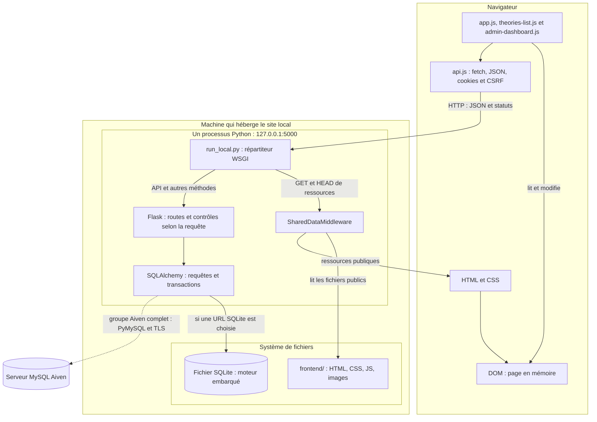
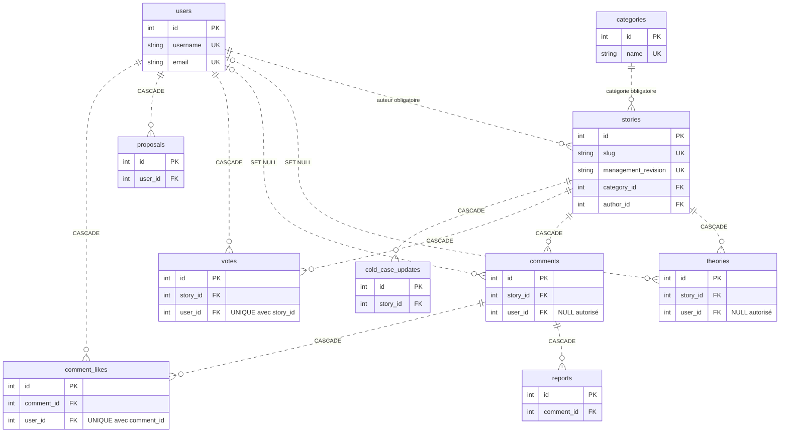
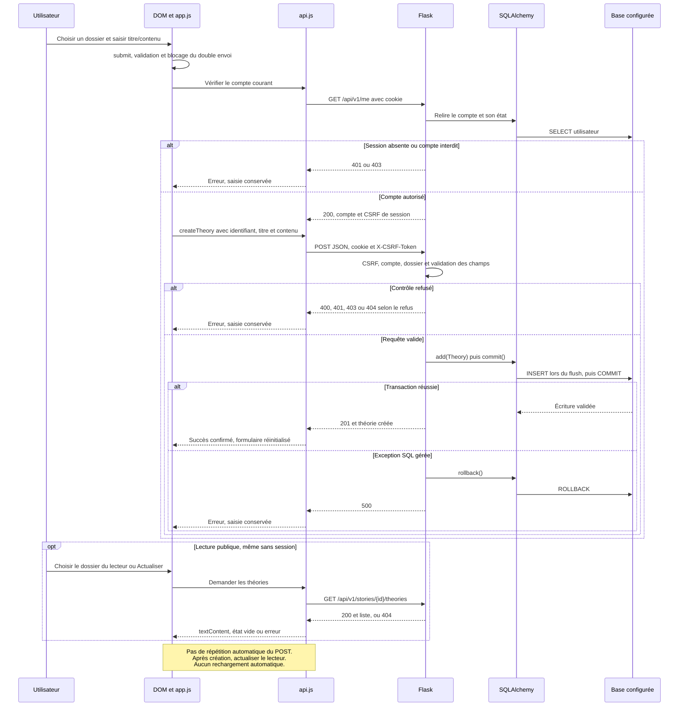

# Les Petits Enquêteurs

Portfolio scolaire Holberton de Mélissa, Sylvie et Mahamadou. Le site permet de lire des histoires et des Cold Cases, proposer des théories, commenter et signaler des contributions. Le projet est présenté en démonstration locale avec des données fictives.

## Installer et présenter

Commencer par le [guide d'installation scolaire](LIVRAISON_SCOLAIRE.md). Il décrit l'installation des dépendances et la recette SQLite mémoire, reproductible sans base distante. La livraison du code sur GitHub ne déploie pas l'application.

Les [supports de soutenance](docs/soutenance/README.md) regroupent les fiches de l'équipe, le parcours de démonstration, les diagrammes et les [résultats de validation](docs/soutenance/VALIDATION_SCOLAIRE.md).

## Équipe et technologies

| Membre | Responsabilités déclarées |
|---|---|
| Mélissa | Frontend HTML, CSS, JavaScript et DOM |
| Sylvie | Backend Flask, API REST et permissions |
| Mahamadou | Modèles SQLAlchemy, base de données et intégration |

Le navigateur échange du JSON avec Flask. SQLAlchemy gère les requêtes et transactions. Le backend utilise MySQL/PyMySQL lorsqu'il est configuré pour ce moteur ; le kit scolaire impose SQLite en mémoire. Les [dépendances Python](backend/requirements.txt) sont versionnées. Le frontend n'exige aucune compilation ; Node.js sert aux tests.

## Fonctionnalités livrées

- Histoires, Cold Cases, recherche locale et fiche de dossier.
- Inscription, connexion, session commune et déconnexion.
- Théories, propositions en attente, commentaires et signalements contextualisés.
- Likes individuels des dossiers et commentaires compatibles, ajout/retrait et contrôle d'unicité.
- Dashboard avec sept compteurs issus du serveur, consultation des utilisateurs et dossiers.
- Bannissement des membres, archivage/restauration et suppression conditionnelle d'un dossier archivé.
- Contrôles serveur des rôles, mots de passe hachés, sessions signées, CSRF et transactions.

Les propositions ne sont pas publiées automatiquement. Le débannissement, la récupération de mot de passe, les pièces jointes et la pagination ne sont pas fournis. Les compteurs historiques incompatibles restent protégés ; aucune réattribution de likes n'est inventée.

## Code et ressources

Voir le [frontend](frontend/README.md), les [modèles](backend/models.py), les [routes](backend/api/v1/views/) et les [migrations candidates](migrations/versions/). Les migrations sont conservées comme sources : la recette scolaire ne les exécute pas et ne certifie pas la migration d'une base réelle.

Le [SVG de remplacement](frontend/images/default-story.svg) est une composition géométrique créée pour cette livraison, sans ressource externe. Sa [provenance](docs/soutenance/PROVENANCE_RESSOURCES.md) est documentée. Les URL d'images fournies par une autre base relèvent de son propre contenu ; la recette utilise uniquement le SVG local.

Les tests sont conservés dans [backend/tests](backend/tests/), [frontend/tests](frontend/tests/) et [tests](tests/). Les campagnes historiques et la recette actuelle sont distinguées dans la validation ; elles ne constituent pas une validation MySQL ni une ouverture publique.

## Diagrammes

Les rendus [SVG/PNG et sources Mermaid](docs/soutenance/preuves-lot6h4/diagrammes/) sont versionnés. Les schémas suivants décrivent l'architecture et les modèles ; la présence d'un moteur dans un schéma n'affirme pas son déploiement.

## Données et confidentialité

La démonstration utilise des données synthétiques. Aucune base réelle, configuration privée ou liste d'accès n'est fournie. Les notices présentes ne constituent pas une politique RGPD définitive ; les décisions d'une éventuelle exploitation réelle restent à valider. Ne pas utiliser le lanceur normal avec une configuration distante pour reproduire la recette scolaire.
