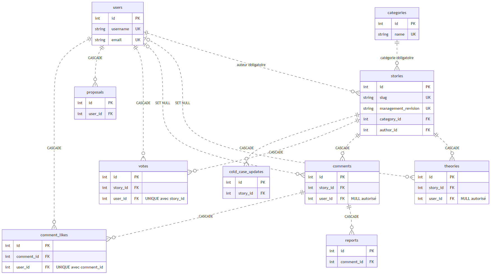

# Les Petits Enquêteurs

**Portfolio Holberton School — plateforme collaborative de dossiers d’enquête.**

Les Petits Enquêteurs permet de consulter des histoires résolues et des Cold Cases, de commenter un dossier et de partager des théories. Le projet met en pratique une interface web JavaScript, une API REST Flask et une base relationnelle décrite avec SQLAlchemy. Un espace administrateur rassemble les contributions et les outils de gestion disponibles.

## État du projet

| Périmètre | État au 3 novembre 2026 |
|---|---|
| Code GitHub | Livraison `a850919` publiée sur [`feature/frontend-api-integration`](https://github.com/Leyvsi/portfolio/tree/feature/frontend-api-integration), dépôt `Leyvsi/portfolio` |
| Démonstration locale | Parcours vérifiés dans Edge avec données fictives et SQLite en mémoire ; un administrateur et deux membres |
| Site public | Application non déployée publiquement |
| MySQL / Aiven | Configuration prévue dans le code ; fonctionnement en production et migrations sur une base réelle non validés |

Cette documentation décrit le code livré et les résultats des lots 6H.11–6H.12. Les modifications documentaires 6H.13 sont préparées séparément ; elles ne constituent pas encore une nouvelle livraison GitHub.

## Fonctionnalités disponibles

| Parcours | Fonctions livrées dans l’interface |
|---|---|
| Visiteur | Accueil avec dossiers récents, listes Histoires et Cold Cases, recherche locale par titre/résumé, lecture d’un dossier par son slug et de ses contributions |
| Membre | Inscription, connexion, déconnexion, commentaire, théorie, proposition d’histoire, signalement d’un commentaire et likes individuels sur dossiers/commentaires compatibles |
| Administrateur | Sept indicateurs, consultation des propositions et signalements contextualisés, liste des utilisateurs, bannissement des membres, consultation et filtres des dossiers, archivage/restauration, suppression conditionnelle d’un dossier déjà archivé |

Les likes de dossiers et de commentaires permettent l’ajout et le retrait personnels ; leur état est relu sur le serveur. Les théories sont publiées sans validation préalable. Les propositions d’histoires sont enregistrées en attente : leur acceptation et leur publication ne sont pas implémentées.

Les mises à jour de Cold Cases et les likes historiques de théories sont accessibles par l’API, sans parcours complet dans l’interface. Les likes de théories restent répétables. Voir les [limites techniques](#limites-techniques).

## Technologies

| Couche | Choix techniques |
|---|---|
| Frontend | HTML5, CSS3, JavaScript, DOM et `fetch` ; sans compilation frontend |
| Backend | Python, Flask, API REST JSON sous `/api/v1`, Flask-Cors, documentation Flask-RESTX |
| Données | Flask-SQLAlchemy, SQLAlchemy ; SQLite en mémoire pour la démonstration ; configuration MySQL/PyMySQL disponible |
| Évolution du schéma | Flask-Migrate et Alembic ; migrations candidates à valider sur le moteur cible |
| Authentification | Sessions Flask, hachage Werkzeug, contrôles de rôle et protection CSRF |
| Tests | Python `unittest`, Node.js `node:test`, DOM/API simulés et parcours WSGI isolés ; recette Edge distincte |

Les neuf dépendances Python directes sont fixées dans [backend/requirements.txt](backend/requirements.txt). Les dépendances transitives ne disposent pas d’un verrou complet versionné. Node.js sert aux tests JavaScript ; il n’est pas nécessaire pour servir le site.

## Architecture

Le navigateur charge les pages et interroge l’API sur la même origine. La composition WSGI sert les fichiers publics du frontend et transmet les requêtes API à Flask. SQLAlchemy gère les modèles, les requêtes et les transactions.

Le [diagramme d’architecture](docs/soutenance/preuves-lot6h4/diagrammes/diagram-1.png) représente le lanceur général, son stockage éventuel et le navigateur. Le kit scolaire remplace cette cible par SQLite en mémoire.

Le kit scolaire écoute uniquement sur `127.0.0.1:5064`. Le lanceur général `run_local.py` utilise une autre procédure et peut sélectionner une base persistante ; il ne remplace pas le kit pour cette démonstration.

```text
portfolio/
├── frontend/                 # Pages, styles, scripts et tests JavaScript
├── backend/
│   ├── index.py              # Configuration Flask, session et authentification
│   ├── models.py             # Modèles SQLAlchemy utilisés par l’application
│   ├── api/v1/views/         # Routes REST et permissions
│   └── tests/                # Tests backend
├── migrations/versions/      # Révisions candidates Alembic
├── tests/                    # Tests du lanceur, notices et kit scolaire
├── tools/recette_lot6g4.py    # Préparation et recette synthétiques isolées
├── docs/soutenance/          # Supports publics et diagrammes
└── run_local.py              # Composition WSGI et lanceur général
```

## Modèles SQLAlchemy

Le modèle applicatif contient **dix tables et treize clés étrangères** dans [backend/models.py](backend/models.py).

| Modèle | Table | Rôle |
|---|---|---|
| `User` | `users` | Comptes, hachage, rôle administrateur et bannissement |
| `Category` | `categories` | Catégories des dossiers |
| `Story` | `stories` | Dossiers, slug, auteur, catégorie et état d’archivage |
| `Theory` | `theories` | Théories rattachées à un dossier |
| `Comment` | `comments` | Commentaires rattachés à un dossier |
| `Vote` | `votes` | Likes individuels des dossiers |
| `CommentLike` | `comment_likes` | Likes individuels des commentaires compatibles |
| `Proposal` | `proposals` | Propositions d’histoires, initialement `pending` |
| `Report` | `reports` | Signalements rattachés exclusivement à un commentaire |
| `ColdCaseUpdate` | `cold_case_updates` | Mises à jour rattachées à un dossier |

### Schéma relationnel

Les contraintes uniques interdisent deux likes du même compte sur un même dossier ou commentaire. Les clés étrangères et les cascades SQL sont distinctes des relations ORM. Le [guide technique](docs/soutenance/GUIDE_TECHNIQUE.md) explique ces relations et les limites des migrations.



### Parcours d’une théorie

Une action membre passe par le contrôleur JavaScript, l’API, les contrôles de session/CSRF, puis une transaction SQLAlchemy. Les contrôleurs évitent de répéter automatiquement une écriture ; les opérations de gestion concernées relisent ensuite le serveur. Le [diagramme de séquence](docs/soutenance/preuves-lot6h4/diagrammes/diagram-3.png) illustre ce flux.

## Authentification et rôles

Les deux formulaires de connexion utilisent `POST /api/v1/login`. Le serveur vérifie le hachage et le bannissement, renouvelle la session et fournit le jeton CSRF. L’entrée administrateur vérifie aussi le rôle avant sa redirection ; les routes privées relisent les permissions côté serveur. L’inscription publique crée uniquement un membre.

Le cookie de session est `HttpOnly` avec `SameSite=Lax`. Son attribut `Secure` dépend de la configuration ; le kit utilise HTTP sur la boucle locale. Les écritures authentifiées utilisent la protection CSRF, avec les exceptions décrites dans le [guide technique](docs/soutenance/GUIDE_TECHNIQUE.md#authentification-et-csrf). Ces mécanismes ne constituent pas une validation de sécurité en production.

## Administration : sept indicateurs

Le tableau affiche **dossiers actifs, histoires résolues, Cold Cases, utilisateurs, commentaires, signalements et propositions en attente**. Les dossiers archivés sont comptés séparément. Les trois premiers indicateurs portent sur les dossiers actifs ; les autres gardent leur périmètre global. Les propositions en attente sont calculées depuis la liste administrative, avec le statut exact `pending`.

Les valeurs proviennent des réponses serveur. Un chargement ou une erreur n’est pas présenté comme un zéro. Les signalements donnent le contexte du commentaire, du dossier et de sa catégorie. Le bannissement protège tous les comptes administrateurs ; aucun débannissement n’est proposé dans l’interface.

## Installation locale

Environnement vérifié : **Windows AMD64, PowerShell, Python 3.13.0**. Utiliser une nouvelle copie pour éviter de perturber une séance déjà ouverte.

```powershell
git clone --branch feature/frontend-api-integration --single-branch https://github.com/Leyvsi/portfolio.git
cd portfolio
python -I -B -m venv .venv
.\.venv\Scripts\python.exe -I -B -m pip --isolated install --disable-pip-version-check --no-cache-dir --requirement backend/requirements.txt
.\.venv\Scripts\python.exe -I -B -m pip --isolated check
```

L’installation ci-dessus nécessite l’accès au registre de paquets. La variante hors ligne et les contrôles avant lancement sont dans [LIVRAISON_SCOLAIRE.md](LIVRAISON_SCOLAIRE.md). Aucun fichier `.env`, certificat distant ou base réelle n’est nécessaire au kit scolaire. L’installation seule ne lance ni serveur, ni navigateur, ni migration.

## Démonstration sécurisée

**Si une démonstration est déjà active, conservez son processus et sa console privée : ne relancez pas cette commande.** Pour une nouvelle séance autorisée, depuis une console privée hors projection et sans transcription/redirection :

```powershell
.\.venv\Scripts\python.exe -I -B tools/recette_lot6g4.py --serve --autorisation-execution-confirmee
```

Le marqueur confirme une autorisation obtenue séparément ; il ne la remplace pas. Le kit vérifie les sources, neutralise dotenv et les paramètres Aiven, impose SQLite `:memory:` et génère automatiquement **un administrateur et deux membres fictifs**, ainsi que deux dossiers. Aucun compte réel n’est requis.

Les accès sont affichés uniquement dans la console privée du processus courant. Ne les recopiez pas dans Git, un chat, un rapport, une capture ou un journal. Les mots de passe sont renouvelés à chaque démarrage ; les données disparaissent à l’arrêt. Ouvrir ensuite manuellement `http://127.0.0.1:5064/`. Le kit n’ouvre pas de navigateur.

Le [guide scolaire](LIVRAISON_SCOLAIRE.md#démonstration-humaine) précise la séparation des contextes navigateur et les vérifications des trois rôles. La recette automatique `--check-journey` est un autre mode : elle crée un quatrième compte de test et ne doit pas être combinée avec `--serve`.

## Tests et validation

| Campagne réellement exécutée | Résultat et portée |
|---|---|
| 6G.5, historique | 854 tests : 311 backend, 513 frontend et 30 lanceur ; recette Edge séparée |
| 6H.11, livraison | Installation neuve hors ligne et `pip check` ; 30 tests Python ciblés, 12 tests frontend d’images et 43 requêtes WSGI en sept groupes réussis |
| 6H.12, démonstration | Formulaires réels dans Edge : trois connexions et rôles, commentaire, likes, signalement, administration et bannissement ; puis nouvelle session avec trois connexions vérifiées |
| 6H.13, documentation | Contrôles documentaires uniquement ; aucune nouvelle campagne applicative |

Ces résultats ne s’additionnent pas et ne représentent pas autant de tests navigateur. Les tests sont répartis dans [backend/tests](backend/tests/), [frontend/tests](frontend/tests/) et [tests](tests/). La [validation scolaire](docs/soutenance/VALIDATION_SCOLAIRE.md) donne les fichiers, l’organisation et les limites d’isolation. Les preuves brutes et les accès restent privés.

## Documentation et diagrammes

- [Installation et lancement scolaire](LIVRAISON_SCOLAIRE.md)
- [Guide technique : architecture, données, API et sécurité](docs/soutenance/GUIDE_TECHNIQUE.md)
- [Validation scolaire et organisation des tests](docs/soutenance/VALIDATION_SCOLAIRE.md)
- [Supports de soutenance et fiches de l’équipe](docs/soutenance/README.md)
- Diagrammes : [architecture](docs/soutenance/preuves-lot6h4/diagrammes/diagram-1.png), [relations](docs/soutenance/preuves-lot6h4/diagrammes/diagram-2.png), [séquence](docs/soutenance/preuves-lot6h4/diagrammes/diagram-3.png). Les sources Mermaid et les versions SVG sont accessibles dans l’index de soutenance.
- [Provenance des ressources livrées](docs/soutenance/PROVENANCE_RESSOURCES.md)

## Limites techniques

- Propositions en attente sans acceptation/publication ; pas d’édition complète des dossiers ni de traitement complet des signalements.
- Aucun parcours de récupération de mot de passe, débannissement, pièces jointes, pagination ou Top Dossiers livré dans l’interface.
- Likes de théories répétables ; signalements multiples autorisés. Les anciens compteurs de likes de commentaires incompatibles bloquent la reprise, sans remise à zéro silencieuse.
- La suppression définitive exige un dossier archivé et des confirmations ; elle n’a pas été rejouée dans la recette ciblée 6H.11 ni dans le parcours 6H.12. Aucun reçu persistant de suppression ni purge programmée.
- SQLite mémoire ne prouve ni la durabilité, ni les migrations d’une base existante, ni les comportements de concurrence MySQL. Aucun MySQL/Aiven en production validé.
- La recette Edge reste ciblée : aucune certification exhaustive d’accessibilité, de rendu multi-navigateurs ou de sécurité.
- Notices présentes, mais politique, conservation et procédures RGPD encore à finaliser avant une exploitation réelle. **Aucune conformité RGPD complète annoncée.**
- La diffusion du code ne constitue ni un déploiement du site, ni une licence générale sur tous les contenus ou illustrations.

## Équipe

| Membre | Responsabilité déclarée |
|---|---|
| Mélissa | Frontend |
| Sylvie | Backend Flask et API REST |
| Mahamadou | Base de données SQLAlchemy et intégration |

Cette répartition décrit les responsabilités communiquées par l’équipe ; elle n’attribue pas individuellement chaque fonctionnalité, fichier ou correction.
