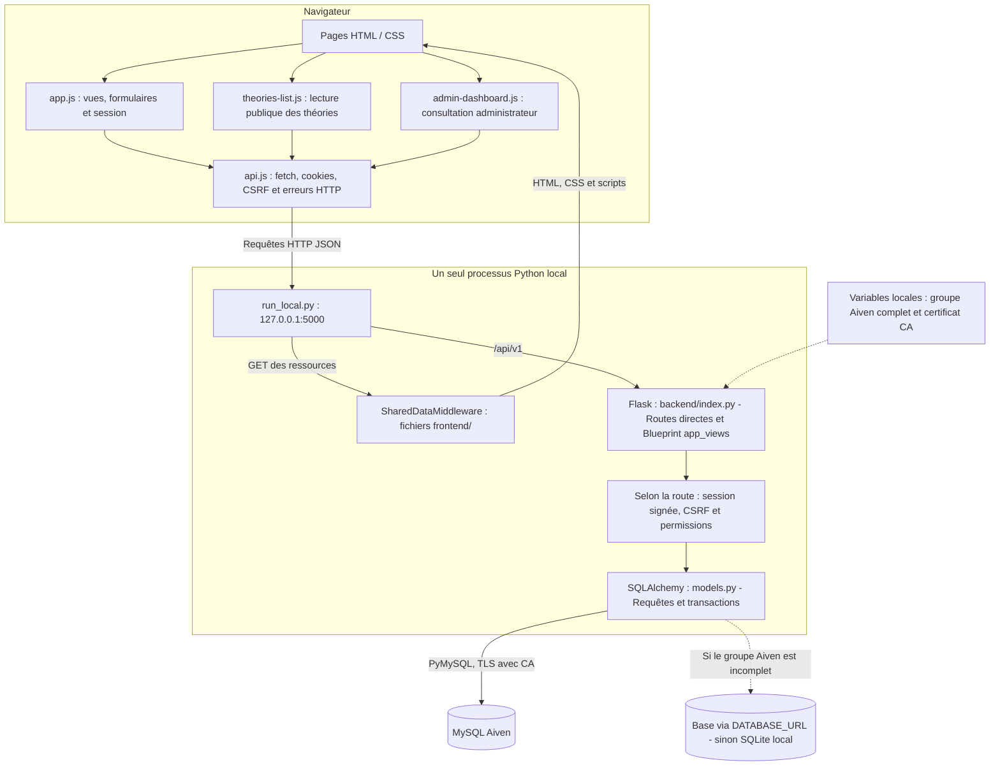
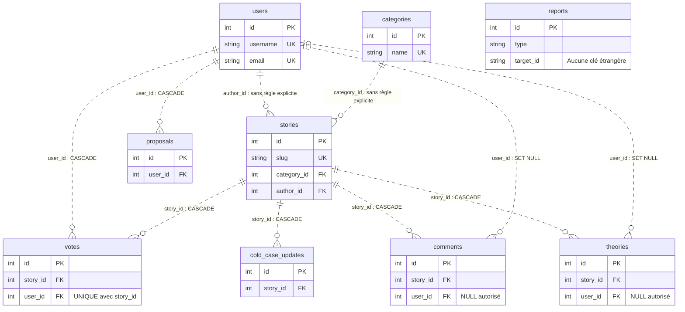
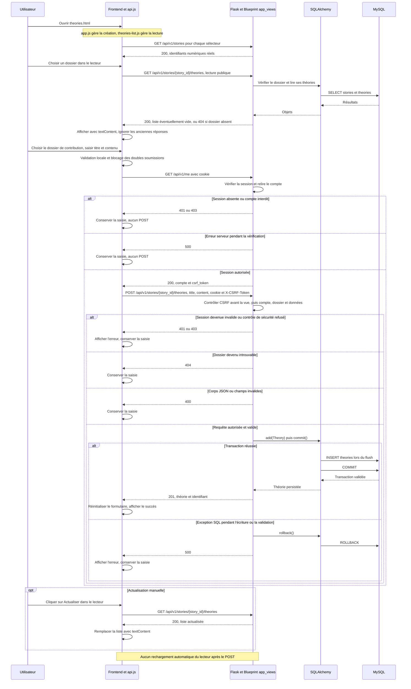

# Les Petits Enquêteurs

Les Petits Enquêteurs est un projet de portfolio réalisé dans le cadre de Holberton School. Le site permet de consulter des dossiers d’enquête, de partager des théories et de proposer de nouvelles histoires à l’équipe.

Il s’adresse aux visiteurs qui souhaitent découvrir les dossiers, aux membres qui contribuent aux analyses et aux administrateurs qui consultent les propositions et signalements.

## Équipe

Répartition des responsabilités communiquée par l’équipe :

| Membre | Responsabilités |
|---|---|
| Mahamadou | Base de données MySQL, modèles SQLAlchemy et intégration |
| Mélissa | Frontend HTML, CSS et JavaScript |
| Sylvie | Backend Flask et API REST |

## Technologies

| Couche | Technologies et rôle |
|---|---|
| Interface | HTML5 pour la structure, CSS3 pour la présentation responsive, JavaScript pour les interactions |
| Serveur | Python et Flask |
| Échanges | API REST, HTTP et JSON |
| Accès aux données | Flask-SQLAlchemy et SQLAlchemy |
| Base principale | MySQL avec le pilote PyMySQL ; configuration Aiven et certificat CA |
| Migrations | Flask-Migrate et Alembic |
| Sécurité | Sessions Flask, hachage Werkzeug, contrôles serveur et protection CSRF |
| Tests | `unittest` pour Python ; Node.js, `node:test` et DOM/API simulés pour JavaScript |
| Versionnement | Git et GitHub |

Les versions des dépendances Python sont fixées dans [backend/requirements.txt](backend/requirements.txt). Node.js sert à lancer les tests JavaScript ; le site ne nécessite pas de compilation frontend.

## Fonctionnalités

### Disponibles dans le site

- Consultation publique des histoires et des Cold Cases depuis l’API.
- Accueil présentant jusqu’à trois dossiers récents.
- Recherche locale dans les titres et résumés de la page Histoires.
- Lecture d’un dossier à partir de son slug.
- Images des dossiers avec replis vers les illustrations locales puis un SVG.
- Inscription, connexion classique et entrée administrateur.
- Restauration de l’affichage de session et déconnexion depuis l’accueil.
- Envoi d’une proposition d’histoire par un membre connecté.
- Création d’une théorie par un membre connecté.
- Consultation publique des théories par dossier et actualisation manuelle.
- Tableau administrateur de consultation : compteurs, répartition des dossiers, propositions et signalements.
- Messages de chargement, états vides et erreurs sur les interfaces raccordées.

### Disponibles uniquement dans l’API

- Lecture et création de commentaires.
- Vote pour une histoire, limité à un vote par utilisateur et par histoire.
- Likes de commentaires et de théories.
- Signalement de commentaires.
- Consultation administrateur de la liste des utilisateurs.
- Bannissement d’un utilisateur par un administrateur.
- Consultation des mises à jour associées à un dossier.

Les pages actuelles ne proposent pas de boutons pour ces parcours. Les likes répétés et les signalements multiples sont autorisés par l’API.

### Fonctions partielles ou non développées

Le tableau administrateur permet de consulter les données. Il ne propose aucune action de modération, publication, suppression ou bannissement.

Une proposition est enregistrée avec le statut `pending`. Aucun parcours d’acceptation ou de transformation automatique en histoire n’est implémenté.

Le formulaire de proposition transmet un titre et un contenu ; la catégorie choisie est intégrée au début du contenu. Il ne prend pas en charge les pièces jointes.

Les théories sont consultables après leur enregistrement, sans étape de modération préalable. La récupération de mot de passe, le compteur de visites et une interface Top Dossiers ne font pas partie du périmètre livré.

## Architecture

Les pages et scripts s’exécutent dans le navigateur. Un seul processus Python local sert les fichiers frontend et l’API.

- [api.js](frontend/api.js) centralise les requêtes, cookies, CSRF, délais et erreurs.
- [app.js](frontend/app.js) gère les histoires, formulaires et contrôles de session.
- [theories-list.js](frontend/theories-list.js) gère la consultation publique des théories.
- [admin-dashboard.js](frontend/admin-dashboard.js) vérifie le rôle puis charge les données de consultation.
- [run_local.py](run_local.py) sert les ressources frontend et délègue les routes API à Flask.
- [backend/index.py](backend/index.py) configure Flask, la base, les sessions et le CSRF.
- Le Blueprint `app_views` regroupe les routes sous `/api/v1`.
- [backend/models.py](backend/models.py) définit les modèles SQLAlchemy.

Les trois diagrammes de ce document ont été contrôlés structurellement et comparés aux sources. Leur syntaxe, leur rendu dans un navigateur local et la validité XML des SVG bruts ont été validés le 25 octobre 2026 avec Mermaid 11.16.0. Leur affichage sur GitHub n’a pas été vérifié.



### Explication simple du diagramme d’architecture

**Type : diagramme d’architecture générale** (schéma montrant les grandes parties du site web et leurs échanges).

> **À dire au jury :** « Ce diagramme montre comment fonctionne notre site web. Le frontend (partie visible dans le navigateur) envoie les demandes au backend (partie qui traite les demandes). Flask (outil Python qui reçoit et traite les requêtes web) utilise SQLAlchemy (outil Python permettant de manipuler les données) pour accéder à la base. La réponse revient ensuite vers le navigateur. »

**Modèle d’architecture : trois couches logiques** (présentation, traitement et données). « Trois couches » décrit leurs rôles différents : cela ne signifie pas trois serveurs séparés. En local, `run_local.py` sert le site et l’interface de programmation dans un seul processus Python. Selon la configuration, le stockage utilise MySQL sur Aiven ou une solution de repli prévue dans le code. **La présence de la configuration Aiven ne prouve pas qu’une connexion distante a été testée avec succès.**

**MVP — Minimum Viable Product (produit minimum viable)** : première version utilisable d’un produit, limitée aux fonctionnalités essentielles pour présenter et tester l’idée. Notre site est un **MVP pédagogique à architecture simplifiée** (une première version fonctionnelle réalisée dans le cadre du projet scolaire). Il n’existe pas de catégorie technique officielle appelée « MVP normal ». Les fonctionnalités disponibles et les limites sont détaillées plus haut dans ce README.

**À retenir :** le navigateur demande, Flask traite, SQLAlchemy accède aux données.

Le lanceur écoute sur `http://127.0.0.1:5000/`, sans debug ni reloader. Il n’applique aucune migration et ne crée aucune donnée.

Organisation principale :

```text
portfolio/
├── backend/
│   ├── index.py
│   ├── models.py
│   ├── requirements.txt
│   ├── api/v1/
│   │   ├── app.py
│   │   ├── swagger.json
│   │   └── views/
│   └── tests/
├── frontend/
│   ├── index.html
│   ├── histoires.html
│   ├── coldcases.html
│   ├── dossier.html
│   ├── connexion.html
│   ├── admin-connexion.html
│   ├── inscription.html
│   ├── proposer-histoire.html
│   ├── theories.html
│   ├── admin-dashboard.html
│   ├── styles.css
│   ├── api.js
│   ├── app.js
│   ├── theories-list.js
│   ├── admin-dashboard.js
│   ├── donnees.js
│   ├── images/
│   └── tests/
├── migrations/
│   └── versions/
├── tests/
│   └── test_run_local.py
└── run_local.py
```

`donnees.js` contient un ancien jeu de données encore chargé par certaines pages, mais son tableau n’est plus consommé par les scripts actifs. Les histoires et théories présentées dans les interfaces raccordées proviennent de l’API.

## Données et relations

### Les neuf tables

| Modèle | Table | Utilité |
|---|---|---|
| `User` | `users` | Comptes, mot de passe haché, rôles et état de bannissement |
| `Category` | `categories` | Classement des histoires |
| `Story` | `stories` | Dossiers, slugs, récits, résumés et références d’images |
| `Theory` | `theories` | Analyses proposées pour une histoire |
| `Comment` | `comments` | Commentaires d’une histoire |
| `Vote` | `votes` | Votes individuels pour une histoire |
| `Proposal` | `proposals` | Propositions d’histoires soumises par les membres |
| `Report` | `reports` | Signalements destinés à la consultation administrative |
| `ColdCaseUpdate` | `cold_case_updates` | Mises à jour rattachées à une histoire |

### Notions essentielles

- **Clé primaire** : identifie une ligne de façon unique, par exemple `stories.id`.
- **Clé étrangère** : référence une ligne d’une autre table, par exemple `theories.story_id` vers `stories.id`.
- **Relation un-à-plusieurs** : une histoire peut recevoir plusieurs théories ; chaque théorie appartient à une histoire.
- **Contrainte unique** : interdit un doublon, par exemple un même couple utilisateur/histoire dans `votes`.
- **Transaction** : regroupe les opérations SQL ; `commit` valide les changements et `rollback` annule les opérations non validées.
- **Modèle SQLAlchemy** : décrit les objets, colonnes et relations utilisés par le code Python.
- **Migration Alembic** : décrit une évolution versionnée du schéma de la base.

Les modèles ne prouvent pas à eux seuls que les migrations ont été appliquées à une base donnée.

### Schéma relationnel

Le diagramme représente les neuf tables, leurs clés et les unicités importantes. Les colonnes descriptives et les dates sont omises pour conserver sa lisibilité.

`PK` signifie clé primaire, `FK` clé étrangère et `UK` unicité individuelle. Dans `votes`, seul le couple `(user_id, story_id)` est unique.



### Explication simple du diagramme relationnel

**Type : diagramme entité-relation** (schéma représentant les tables d’une base de données et les liens entre elles).

> **À dire au jury :** « Chaque rectangle représente une table (un ensemble de données organisées). Les lignes montrent les relations entre les tables. Par exemple, un utilisateur peut être associé à plusieurs histoires ou commentaires, et une histoire peut recevoir plusieurs commentaires. Une clé primaire (identifiant unique d’une ligne) permet de reconnaître un enregistrement ; une clé étrangère (colonne qui fait référence à une autre table) permet de relier les informations. »

Ce schéma présente les **neuf tables** du projet et seulement certaines colonnes pour rester lisible. La cardinalité (nombre d’enregistrements pouvant être associés) est indiquée par les symboles au bout des liens. `CASCADE` (suppression automatique des enregistrements dépendants dans les cas configurés) et `SET NULL` (conservation de l’enregistrement en effaçant sa référence) décrivent des règles de suppression déclarées dans les relations concernées. Ces règles ne doivent pas être généralisées à toutes les tables.

**À retenir :** les tables conservent les données ; leurs relations évitent de recopier inutilement les informations.

| Référence | Relation | `ON DELETE` déclaré |
|---|---|---|
| `stories.category_id → categories.id` | Une catégorie par histoire ; plusieurs histoires possibles | Aucune règle explicite |
| `stories.author_id → users.id` | Un auteur par histoire ; plusieurs histoires possibles | Aucune règle explicite |
| `theories.story_id → stories.id` | Une histoire par théorie ; plusieurs théories possibles | `CASCADE` |
| `theories.user_id → users.id` | Auteur facultatif ; plusieurs théories possibles | `SET NULL` |
| `comments.story_id → stories.id` | Une histoire par commentaire ; plusieurs commentaires possibles | `CASCADE` |
| `comments.user_id → users.id` | Auteur facultatif ; plusieurs commentaires possibles | `SET NULL` |
| `votes.story_id → stories.id` | Une histoire par vote ; plusieurs votes possibles | `CASCADE` |
| `votes.user_id → users.id` | Un utilisateur par vote ; plusieurs votes possibles | `CASCADE` |
| `proposals.user_id → users.id` | Un auteur par proposition ; plusieurs propositions possibles | `CASCADE` |
| `cold_case_updates.story_id → stories.id` | Une histoire par mise à jour ; plusieurs mises à jour possibles | `CASCADE` |

`CASCADE` supprime les lignes dépendantes lorsque la contrainte SQL est appliquée. `SET NULL` conserve la contribution et retire sa référence à l’utilisateur.

`reports.target_id` est une chaîne et ne constitue pas une clé étrangère. L’API vérifie actuellement l’existence d’un commentaire avant de créer son signalement. Aucun auteur de signalement n’est stocké dans cette table.

Les contraintes uniques portent sur `users.username`, `users.email`, `categories.name`, `stories.slug` et le couple `votes(user_id, story_id)`.

### ORM et migrations

Les cascades SQL et les cascades ORM ont des responsabilités différentes. Les collections de `Story` déclarent `delete-orphan` ; les collections de `User` n’ont pas toutes une cascade de suppression équivalente aux contraintes SQL.

Les valeurs par défaut des modèles et les mises à jour de `updated_at` sont appliquées côté SQLAlchemy. Elles ne doivent pas être assimilées à des valeurs par défaut ou déclencheurs SQL permanents.

La chaîne de migrations existante est :

```text
921687c1bd7c → 3111f5767fc6 → a590c8aac613 → 82deda84bc35
```

La dernière révision supprime l’ancien compteur `comments.reports`. Le nombre de signalements renvoyé pour un commentaire est désormais calculé depuis `reports`.

## Parcours d’une théorie

Le lecteur et le formulaire possèdent des sélecteurs indépendants, alimentés par les identifiants réels de l’API. La consultation est publique ; la création nécessite un compte connecté et non banni.

Le frontend conserve la saisie en cas d’échec et bloque les doubles soumissions. Le lecteur ne se recharge pas automatiquement après une création.



### Explication simple du diagramme de séquence

**Type : diagramme de séquence** (schéma montrant dans quel ordre les acteurs et les parties du site échangent des messages).

> **À dire au jury :** « Le diagramme suit le parcours d’une théorie. Un visiteur peut d’abord consulter les théories d’un dossier. Pour en créer une, le membre renseigne le formulaire. Le frontend (partie visible du site) transmet la demande à Flask (serveur Python). Flask vérifie le compte, les autorisations et les informations saisies. Si tout est correct, SQLAlchemy enregistre la théorie dans la base, puis le site affiche le résultat. En cas d’erreur, l’enregistrement n’est pas validé. »

**Quelques mots du schéma :** `GET` (demande de lecture), `POST` (demande d’envoi de données), `commit()` (validation d’une transaction, c’est-à-dire d’un ensemble de modifications), `rollback()` (annulation des modifications non validées après une erreur), `CSRF` (protection contre des requêtes frauduleuses faites à l’insu de l’utilisateur). Les réponses `400`, `401`, `403`, `404` et `500` indiquent différents types d’erreurs HTTP (messages normalisés entre navigateur et serveur).

**À retenir :** ce diagramme montre le déroulement des échanges, depuis l’action de l’utilisateur jusqu’à la réponse du site. Il indique aussi qu’une actualisation manuelle est nécessaire pour rafraîchir la liste des théories après une création.

Les lectures SQL de contrôle sont regroupées dans ce schéma. Les erreurs réseau ou réponses illisibles ne sont pas développées en branches supplémentaires ; elles ne déclenchent pas de répétition automatique du POST.

## API REST

L’API compte **24 opérations** déclarées sous `/api/v1`. Les paramètres entre accolades représentent les valeurs du chemin. Les méthodes automatiques `HEAD` et `OPTIONS` ne sont pas répétées.

**Public** signifie sans connexion obligatoire. **Membre** signifie compte connecté et non banni. **Admin** ajoute l’exigence du rôle administrateur vérifié côté serveur.

Les écritures utilisant une session exigent `X-CSRF-Token`, à l’exception de la connexion. L’inscription et la déconnexion acceptent aussi les requêtes anonymes ; avec une session existante, le contrôle CSRF s’applique.

### Authentification et utilisateurs

| Méthode | Route | Permission | Fonction |
|---|---|---|---|
| POST | `/api/v1/users` | Public ; compte existant contrôlé si session présente | Inscription d’un compte classique |
| GET | `/api/v1/users` | Admin | Liste des comptes |
| POST | `/api/v1/login` | Public ; exemption CSRF | Connexion classique ou administrateur |
| GET | `/api/v1/me` | Membre | Compte courant et CSRF |
| POST | `/api/v1/logout` | Public ; CSRF si session présente | Déconnexion |

### Histoires

| Méthode | Route | Permission | Fonction |
|---|---|---|---|
| GET | `/api/v1/stories` | Public | Histoires et nombres de votes |
| GET | `/api/v1/stories/slug/{slug}` | Public | Dossier identifié par son slug |
| GET | `/api/v1/coldcases/{case_id}/updates` | Public | Mises à jour du dossier |

La route des mises à jour vérifie l’existence de l’histoire ; elle ne vérifie pas son appartenance à la catégorie Cold Case.

### Théories

| Méthode | Route | Permission | Fonction |
|---|---|---|---|
| GET | `/api/v1/stories/{story_id}/theories` | Public | Théories du dossier |
| POST | `/api/v1/stories/{story_id}/theories` | Membre | Création d’une théorie |
| POST | `/api/v1/theories/{theory_id}/like` | Membre | Ajout d’un like |

### Commentaires et votes

| Méthode | Route | Permission | Fonction |
|---|---|---|---|
| GET | `/api/v1/stories/{story_id}/comments` | Public | Commentaires du dossier |
| POST | `/api/v1/stories/{story_id}/comments` | Membre | Création d’un commentaire |
| POST | `/api/v1/comments/{comment_id}/like` | Membre | Ajout d’un like |
| POST | `/api/v1/votes/{story_id}` | Membre | Vote unique pour l’histoire |

### Propositions

| Méthode | Route | Permission | Fonction |
|---|---|---|---|
| POST | `/api/v1/proposals` | Membre | Proposition enregistrée en `pending` |
| GET | `/api/v1/proposals` | Admin | Consultation des propositions |

### Signalements et administration

| Méthode | Route | Permission | Fonction |
|---|---|---|---|
| POST | `/api/v1/comments/{comment_id}/report` | Membre | Signalement du commentaire |
| POST | `/api/v1/reports` | Membre | Signalement ; seul le type `comment` est accepté |
| GET | `/api/v1/admin/reports` | Admin | Consultation des signalements |
| DELETE | `/api/v1/admin/users/{username}/ban` | Admin | Bannissement ; le compte n’est pas supprimé |

### Statistiques et Swagger

| Méthode | Route | Permission | Fonction |
|---|---|---|---|
| GET | `/api/v1/stats` | Public | Nombres d’utilisateurs, commentaires et signalements |
| GET | `/api/v1/swagger.json` | Public | Document OpenAPI |
| GET | `/api/v1/swagger` | Public | Interface Swagger UI |

Les statistiques comptent tous les signalements, sans filtrage sur leur statut. L’interface administrateur utilise cette route publique et protège séparément les lectures de propositions et signalements.

La documentation [OpenAPI 3.0.3](backend/api/v1/swagger.json) correspond aux 24 opérations déclarées. Swagger UI utilise des ressources provenant d’un CDN ; son affichage complet nécessite l’accès à ce CDN.

Les réponses principales comprennent :

| Code | Signification dans le projet |
|---|---|
| 200 | Lecture ou opération réussie |
| 201 | Création réussie |
| 400 | Entrées invalides |
| 401 | Authentification absente ou invalide |
| 403 | Refus d’accès ou de CSRF |
| 404 | Ressource absente |
| 409 | Vote déjà enregistré |
| 500 | Erreur serveur |

## Installation et configuration

### 1. Cloner le dépôt

Depuis PowerShell :

```powershell
git clone --branch feature/frontend-api-integration https://github.com/Leyvsi/portfolio.git
Set-Location portfolio
```

Le point de référence documentaire est le commit `dec5c7ef4c753970bd94014b37b59b035e1877f1`.

### 2. Créer l’environnement Python

La campagne de référence a utilisé Python 3.13 et Node.js 24. Les commandes suivantes utilisent directement l’interpréteur de l’environnement virtuel.

```powershell
python -m venv .venv
```

### 3. Installer les dépendances

```powershell
.\.venv\Scripts\python.exe -m pip install -r backend/requirements.txt
```

### 4. Préparer la configuration privée

Créer à la racine un fichier `.env` en UTF-8 sans BOM et renseigner les variables adaptées à la cible choisie. Le dépôt ne fournit actuellement aucun fichier `.env.example`.

| Variable | Rôle |
|---|---|
| `SECRET_KEY` | Clé privée de signature des sessions |
| `CORS_ALLOWED_ORIGINS` | Origines autorisées, séparées par des virgules |
| `SESSION_COOKIE_SECURE` | `true` pour un cookie réservé à HTTPS ; `false` pour le serveur HTTP local |
| `AIVEN_DB_HOST` | Hôte du service MySQL |
| `AIVEN_DB_PORT` | Port du service MySQL |
| `AIVEN_DB_USER` | Compte de connexion |
| `AIVEN_DB_PASSWORD` | Mot de passe du compte MySQL |
| `AIVEN_DB_NAME` | Base cible |
| `AIVEN_CA_CERT` | Chemin du certificat CA local |
| `DATABASE_URL` | Configuration alternative lorsque le groupe Aiven n’est pas complet |

`SECRET_KEY` et `CORS_ALLOWED_ORIGINS` sont obligatoires. Pour le lancement local décrit ici, l’origine du site est `http://127.0.0.1:5000/`.

Obtenir les accès MySQL et le certificat auprès du responsable de la base. Conserver les valeurs privées localement ; ne pas les copier dans la documentation, les journaux ou Git.

### 5. Choisir explicitement la base

Pour MySQL Aiven, les six variables `AIVEN_DB_HOST`, `AIVEN_DB_PORT`, `AIVEN_DB_USER`, `AIVEN_DB_PASSWORD`, `AIVEN_DB_NAME` et `AIVEN_CA_CERT` doivent toutes être renseignées. Le backend configure alors PyMySQL avec le certificat CA.

Si ce groupe est incomplet, le backend utilise `DATABASE_URL` lorsqu’elle est définie, sinon le fichier SQLite local `instance/site.db`.

Vérifier la cible avant de lancer une migration. La procédure de reproduction doit utiliser une base préparée à cet effet ; une base partagée ne doit pas être migrée sans accord de son responsable.

Le repli SQLite existe dans le code, mais l’exécution complète des migrations historiques sur une base SQLite vierge n’a pas été validée.

### 6. Appliquer les migrations existantes

Depuis la racine, après préparation et vérification de la base cible :

```powershell
$env:PYTHONPATH = (Join-Path (Get-Location) 'backend')
.\.venv\Scripts\python.exe -B -m flask --app index:app db upgrade --directory migrations
```

Le dépôt contient déjà son répertoire de migrations. Aucune commande `db init` n’est nécessaire.

Les migrations créent ou font évoluer le schéma. Elles ne créent automatiquement ni histoires, ni catégories, ni comptes de présentation. Aucun script de peuplement initial entièrement reproductible n’est fourni.

Une base vide migrée ne reproduit donc pas à elle seule les données utilisées lors de la démonstration.

### 7. Démarrer le site

Depuis la racine :

```powershell
.\.venv\Scripts\python.exe -B run_local.py
```

### 8. Ouvrir le site

Ouvrir `http://127.0.0.1:5000/` dans le navigateur. L’API et les ressources utilisent la même origine.

Swagger est accessible à `http://127.0.0.1:5000/api/v1/swagger`.

Arrêter le serveur avec `Ctrl+C`.

**Limite de reproductibilité :** l’installation depuis un clone vierge, avec création du schéma et préparation des données initiales, n’a pas encore été validée de bout en bout.

## Tests et validation

### Suites existantes

| Suite | Emplacement | Dernier résultat historique |
|---|---|---|
| Backend Python | `backend/tests/` | 205 réussis |
| Frontend JavaScript | `frontend/tests/` | 226 réussis |
| Lanceur local | `tests/test_run_local.py` | 8 réussis |
| **Total** | | **439 réussis, aucun échec** |

Cette campagne a été exécutée le 25 octobre 2026 après correction de la comparaison CRLF/LF du formulaire de théories. Les sources fonctionnelles correspondantes ont ensuite été intégrées au commit de référence.

Les tests backend utilisent SQLite en mémoire, une configuration isolée et des protections contre les connexions externes. Les tests JavaScript utilisent des API et DOM simulés. Les tests du lanceur utilisent un client WSGI et interdisent les connexions SQL et réseau.

Ces tests vérifient notamment les contrats HTTP, permissions, CSRF, validations, erreurs, transactions, doubles soumissions et réponses tardives. La comparaison du formulaire de théories a également été vérifiée avec les contenus Git normalisés en LF et les fichiers locaux CRLF.

Ils ne constituent pas une preuve complète du schéma, des contraintes ou du fonctionnement du service MySQL distant. Les audits documentaires n’ont pas revérifié Aiven et n’ont pas relancé cette campagne.

### Commandes

Depuis la racine, après installation des dépendances :

```powershell
.\.venv\Scripts\python.exe -B -m unittest discover -s backend/tests -p 'test_*.py' -v
.\.venv\Scripts\python.exe -B -m unittest discover -s tests -p test_run_local.py -v
node --test --test-isolation=none frontend/tests/images.test.cjs frontend/tests/proposals.test.cjs frontend/tests/theories.test.cjs frontend/tests/theories-list.test.cjs frontend/tests/admin-dashboard.test.cjs
```

Les tests créent leurs données synthétiques en mémoire ; ils ne nécessitent pas les comptes privés ou les données de présentation Aiven. Les migrations historiques ne sont pas exécutées par ces suites.

## Sécurité

- **Mots de passe** : hachés avec Werkzeug ; la vérification utilise `check_password_hash`. L’inscription applique les critères serveur de longueur et de composition.
- **Session** : cookie Flask signé, protégé contre les modifications non autorisées par sa signature. Une signature ne chiffre pas le contenu.
- **Cookie** : `HttpOnly` est activé, `SameSite` vaut `Lax` et `Secure` est configurable selon HTTP local ou HTTPS.
- **CSRF** : les écritures avec session exigent le jeton transmis dans `X-CSRF-Token`, sauf la route de connexion.
- **Autorisation serveur** : les contrôles protégés relisent le compte et son état de bannissement. Les routes administrateur vérifient le rôle en base.
- **Identité des contributions** : l’auteur provient de la session, sans confiance dans un identifiant ou rôle envoyé par le navigateur.
- **Validation** : JSON, types, champs obligatoires, identifiants, limites de longueur et UTF-8 sont contrôlés côté serveur selon les routes.
- **Transactions** : les écritures prévues sont validées par `commit` ; les erreurs SQL gérées déclenchent un `rollback`.
- **Affichage** : les interfaces raccordées utilisent `textContent` pour les contenus externes.
- **Configuration** : `.env`, certificats et fichiers locaux sensibles sont exclus du suivi par les règles du dépôt.

Les propositions et théories acceptent un titre de 200 caractères maximum et un contenu limité à 65 535 octets UTF-8. La métadonnée de catégorie ajoutée à une proposition compte dans cette limite.

CORS définit les origines autorisées pour les échanges navigateur. Il ne remplace pas les permissions serveur ni la protection CSRF.

## Limites et améliorations possibles

### Limites actuelles

- Aucune interface de commentaires, votes, likes ou signalements.
- Administration limitée à la consultation.
- Aucune publication automatique des propositions.
- Aucun téléchargement d’image depuis le formulaire de proposition.
- Aucune procédure complète de récupération de mot de passe.
- Aucun peuplement initial entièrement reproductible.
- Identifiants de catégories `1` et `2` utilisés directement dans le frontend.
- Listes non paginées et requêtes de comptage supplémentaires pour certains éléments.
- Dates produites selon une convention UTC, sans fuseau explicite dans les chaînes de l’API.
- État Aiven et révision Alembic déployée non revérifiés pendant les audits documentaires.
- Provenance et droits des illustrations à documenter à partir d’informations confirmées.
- Affichage des diagrammes Mermaid sur GitHub non vérifié.

### Pistes d’amélioration

- Valider une installation complète sur une base vierge isolée.
- Fournir un exemple de configuration sans secret et un peuplement fictif reproductible.
- Rendre le classement des catégories moins dépendant d’identifiants fixes.
- Ajouter pagination et comptages groupés.
- Développer des interfaces pour les API déjà disponibles.
- Concevoir un parcours de modération et de récupération de mot de passe avec des contrôles adaptés.
- Uniformiser les dates et compléter les preuves de migration et d’intégrité MySQL.

Ces pistes ne sont pas présentées comme des fonctionnalités déjà réalisées.
