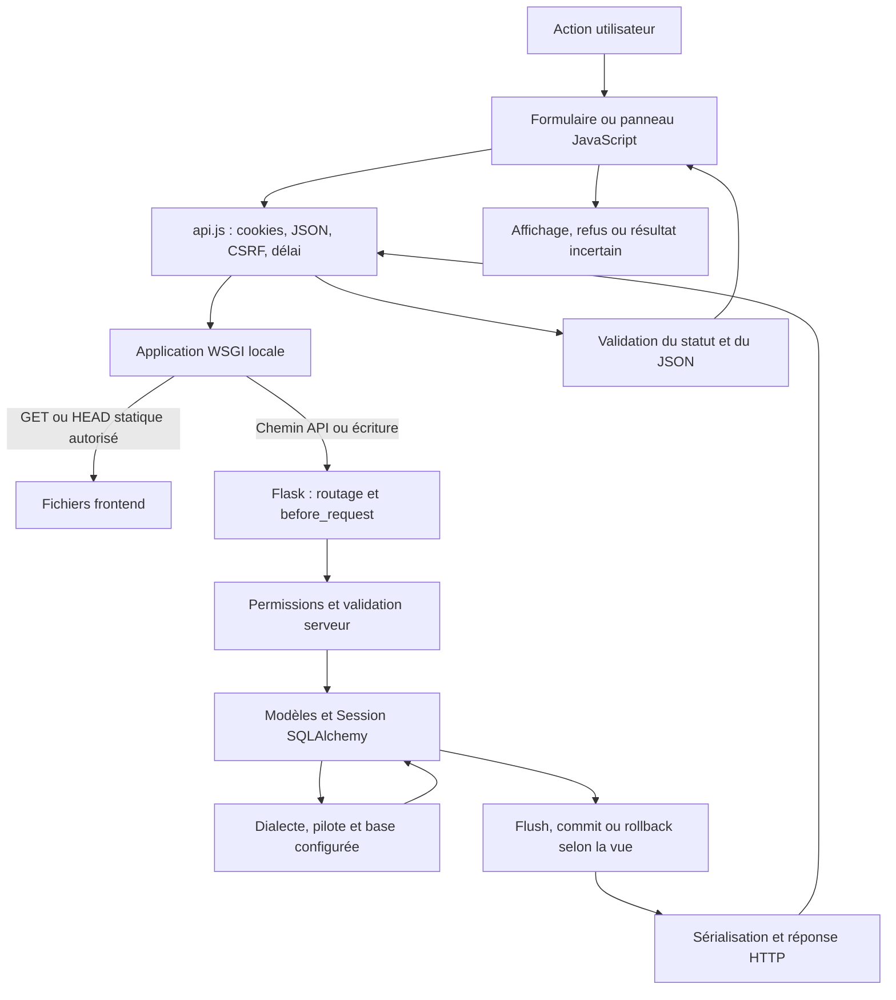
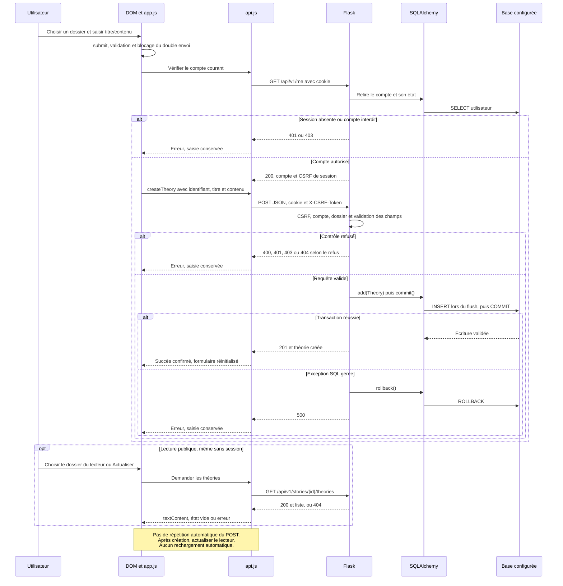

# Intégration Flask, API et SQLAlchemy — lot 6H.21.5

Les Petits Enquêteurs — préparation pour Mahamadou — **5 novembre 2026, Europe/Paris**.

**Proposition documentaire externe, sans installation autorisée.** Référence : 203 fichiers de la copie intégrée, vérifiés par empreintes. Aucun module applicatif importé, aucun accès SQL, aucune migration, aucun test applicatif ni intervention sur le serveur 5066. Les exemples sont des illustrations non exécutées, pas des commandes à lancer sur une base réelle. Les responsabilités BDD de Mahamadou sont distinguées des composants partagés avec Sylvie et du frontend de Mélissa.

[Sommaire des huit guides](01_GUIDE_REQUETES_SQLALCHEMY_LOT6H21_5.md#sommaire) · [Références exactes et soutenance](07_CORRESPONDANCE_SOUTENANCE_LOT6H21_5.md) · [Contrôles et limites](08_VALIDATION_DOCUMENTAIRE_LOT6H21_5.md)

## Une requête traverse plusieurs contrats

Le navigateur ne contacte pas SQLAlchemy. Il produit une requête HTTP avec une URL, une méthode, des en-têtes et parfois un corps JSON. Flask choisit une route ; ses contrôles récupèrent les données utiles, puis les modèles et la Session interagissent avec le moteur configuré. Une réponse JSON indépendante des objets ORM est ensuite interprétée par le frontend.

| Couche | Fichiers réellement impliqués | Responsabilité | Limite |
|---|---|---|---|
| HTML et DOM | frontend/*.html, app.js et panneaux | Saisie, choix de cible, états d’attente et affichage | Le DOM n’est pas une autorisation serveur |
| Client HTTP commun | frontend/api.js | Origine relative /api/v1, cookies, CSRF, timeout et décodage | Une annulation locale ne prouve pas une annulation SQL |
| Distribution WSGI locale | run_local.py | Statique autorisée de frontend et API sur la même origine | Ce middleware ne choisit pas une base et n’est pas un confinement système |
| Application | backend/index.py | Configuration, extensions, CSRF, routes directes, Blueprint | L’import normal lit la configuration ; il n’est pas réalisé pour cette étude |
| Vues et services | backend/api/v1/views | Permissions, validations, sérialiseurs, SQL métier | Les traitements d’erreur diffèrent entre parcours |
| Modèles | backend/models.py | Dix classes, colonnes, relations et contraintes déclarées | Métadonnées déclarées ≠ preuve de schéma déployé |
| Session et moteur | Flask-SQLAlchemy/SQLAlchemy | Suivi d’objets, requêtes, transactions et dialecte | L’état du moteur dépend de la configuration réelle |
| Base | SQLite ou MySQL selon le mode | Stockage et contraintes effectivement actives | Pas de base réelle inspectée dans ce lot |

## Schéma du trajet complet

Ce schéma est pédagogique : une lecture simple n’exécute pas nécessairement un flush explicite ou un commit métier ; une réponse peut aussi sortir avant toute requête SQL. L’ordre exact d’une sérialisation avant/après commit est détaillé par parcours, pas imposé par cette flèche générale.

## run_local.py et la même origine

[MAH-F0044 — create_local_app](07_CORRESPONDANCE_SOUTENANCE_LOT6H21_5.md#code-mah-f0044) reçoit une application WSGI API, pas une liste de modèles. Il construit SharedDataMiddleware pour frontend et une fonction de distribution. Les méthodes autres que GET/HEAD, /api et les chemins /api/ sont envoyés à Flask. La racine devient index.html. Les fichiers HTML/CSS/JS de premier niveau et les images d’extensions autorisées suivent le chemin statique ; le reste revient à l’API.

Le wrapper des réponses statiques remplace Cache-Control par no-store. La liste d’extensions d’images inclut encore webp comme capacité du serveur de fichiers ; cela n’affirme pas que les anciens assets WebP sont encore les illustrations actives. Les six PNG du catalogue sont des fichiers préservés, sans ouverture de base pour les contrôler ici.

[MAH-F0048 — main](07_CORRESPONDANCE_SOUTENANCE_LOT6H21_5.md#code-mah-f0048) ancre le répertoire de travail sur le projet, charge .env sans l’écraser, ajoute backend au chemin Python, importe l’application puis l’enveloppe et écoute localement sans debug/reloader. Ce lanceur général vise le port 5000 dans le code ; il ne faut pas l’assimiler au serveur persistant 5066 ou au kit scolaire 5064. Il ne crée ni tables ni jeu de démonstration.

L’API et les pages partagent alors protocole/hôte/port, ce qui simplifie les cookies. Une origine identique n’authentifie pas un utilisateur et ne dispense pas du CSRF. Le démarrage de ce lanceur n’est pas une vérification documentaire autorisée ; il n’a pas été exécuté.

## backend/index.py : configuration puis enregistrement

Le module normal appelle load_dotenv et exige SECRET_KEY ainsi que CORS_ALLOWED_ORIGINS. Il choisit la configuration MySQL si les six variables Aiven sont présentes ; sinon il utilise DATABASE_URL ou le repli SQLite déclaré. Ce choix explique pourquoi une simple URL mémoire ne suffit pas si le groupe Aiven reste rempli dans un environnement de test.

db.init_app lie l’extension à l’application configurée. Migrate(app, db) expose le mécanisme de migrations, sans appliquer upgrade. Les décorateurs de routes directes sont ensuite enregistrés ; app.register_blueprint ajoute app_views. La branche __main__ historique a une écoute et un debug différents du lanceur local ; la documentation n’en fait pas une commande recommandée de publication.

Le fichier backend/requirements.txt épingle notamment SQLAlchemy 2.0.53, Flask-SQLAlchemy 3.1.1, Flask 3.1.3 et Flask-Migrate 4.1.0. Les documentations officielles consultées peuvent afficher un correctif plus récent de leur branche ; elles éclairent les mécanismes généraux et ne prouvent ni la version installée du service actuel ni une nouvelle validation de compatibilité.

Les configurations de session, le token CSRF et les erreurs HTTP sont des préoccupations Flask. La Session SQLAlchemy est liée au contexte applicatif ; l’application a son contexte lors d’une requête. Les scripts de peuplement emploient explicitement app.app_context dans leurs modes autorisés. Cela ne justifie pas d’importer backend/index.py depuis un audit : l’import normal lit des paramètres locaux.

## Le Blueprint et ses imports

[Préfixe du Blueprint app_views](07_CORRESPONDANCE_SOUTENANCE_LOT6H21_5.md#source-ca9977daa9b1) fixe /api/v1. Les imports des modules index, users, histoires, theories, comments, proposals, admin_stories et likes enregistrent leurs décorateurs sur ce même objet. Les helpers permissions, write_support, story_visibility, admin_users_support et story_deletion_support sont appelés par les vues ; ce ne sont pas des applications Flask séparées.

backend/api/v1/app.py est une compatibilité qui réexporte l’application configurée dans backend/index.py ; il ne prouve pas un second service indépendant. L’ordre des imports et les chemins Python contrôlés par les lanceurs participent au choix de l’objet app. Les différents wrappers de tests/persistance configurent avant le chargement, plutôt que de changer au hasard la configuration après initialisation.

## Registre complet des routes déclarées

Les chemins ci-dessous proviennent des décorateurs des sources lues. Le préfixe est ajouté seulement pour app_views. Les méthodes HEAD/OPTIONS automatiques possibles du framework ne sont pas comptées comme des opérations métier supplémentaires. Aucune application n’a été importée pour obtenir cette liste.

| Méthodes explicites | Route | Vue et emplacement de déclaration | Décorateurs d’accès |
|---|---|---|---|
| GET | `/api/v1/admin/reports` | [MAH-F0166 — get_admin_reports](07_CORRESPONDANCE_SOUTENANCE_LOT6H21_5.md#code-mah-f0166) ; `backend/api/v1/views/index.py:107` | `admin_required` |
| GET | `/api/v1/admin/stories` | [MAH-F0145 — get_admin_stories](07_CORRESPONDANCE_SOUTENANCE_LOT6H21_5.md#code-mah-f0145) ; `backend/api/v1/views/admin_stories.py:50` | `archive_admin_required` |
| DELETE | `/api/v1/admin/stories/<int:story_id>` | [MAH-F0152 — delete_story_permanently](07_CORRESPONDANCE_SOUTENANCE_LOT6H21_5.md#code-mah-f0152) ; `backend/api/v1/views/admin_stories.py:141` | `archive_admin_required` |
| GET | `/api/v1/admin/stories/<int:story_id>` | [MAH-F0146 — get_admin_story](07_CORRESPONDANCE_SOUTENANCE_LOT6H21_5.md#code-mah-f0146) ; `backend/api/v1/views/admin_stories.py:69` | `archive_admin_required` |
| POST | `/api/v1/admin/stories/<int:story_id>/archive` | [MAH-F0148 — archive_story](07_CORRESPONDANCE_SOUTENANCE_LOT6H21_5.md#code-mah-f0148) ; `backend/api/v1/views/admin_stories.py:115` | `archive_admin_required` |
| POST | `/api/v1/admin/stories/<int:story_id>/deletion-confirmations` | [MAH-F0151 — confirm_story_deletion](07_CORRESPONDANCE_SOUTENANCE_LOT6H21_5.md#code-mah-f0151) ; `backend/api/v1/views/admin_stories.py:134` | `archive_admin_required` |
| GET | `/api/v1/admin/stories/<int:story_id>/deletion-preview` | [MAH-F0150 — get_story_deletion_preview](07_CORRESPONDANCE_SOUTENANCE_LOT6H21_5.md#code-mah-f0150) ; `backend/api/v1/views/admin_stories.py:127` | `archive_admin_required` |
| POST | `/api/v1/admin/stories/<int:story_id>/restore` | [MAH-F0149 — restore_story](07_CORRESPONDANCE_SOUTENANCE_LOT6H21_5.md#code-mah-f0149) ; `backend/api/v1/views/admin_stories.py:121` | `archive_admin_required` |
| POST | `/api/v1/admin/users/<int:user_id>/ban` | [MAH-F0168 — ban_user_by_id](07_CORRESPONDANCE_SOUTENANCE_LOT6H21_5.md#code-mah-f0168) ; `backend/api/v1/views/index.py:143` | `admin_required` |
| DELETE | `/api/v1/admin/users/<string:username>/ban` | [MAH-F0167 — ban_user](07_CORRESPONDANCE_SOUTENANCE_LOT6H21_5.md#code-mah-f0167) ; `backend/api/v1/views/index.py:135` | `admin_required` |
| GET | `/api/v1/coldcases/<int:case_id>/updates` | [MAH-F0163 — get_case_updates](07_CORRESPONDANCE_SOUTENANCE_LOT6H21_5.md#code-mah-f0163) ; `backend/api/v1/views/histoires.py:121` | Contrôles dans la vue ou lecture publique selon le parcours |
| GET, DELETE | `/api/v1/comments/<int:comment_id>/like` | [MAH-F0175 — personal_comment_like](07_CORRESPONDANCE_SOUTENANCE_LOT6H21_5.md#code-mah-f0175) ; `backend/api/v1/views/likes.py:89` | Contrôles dans la vue ou lecture publique selon le parcours |
| POST | `/api/v1/comments/<int:comment_id>/like` | [MAH-F0158 — like_comment](07_CORRESPONDANCE_SOUTENANCE_LOT6H21_5.md#code-mah-f0158) ; `backend/api/v1/views/comments.py:100` | Contrôles dans la vue ou lecture publique selon le parcours |
| POST | `/api/v1/comments/<int:comment_id>/report` | [MAH-F0159 — report_comment](07_CORRESPONDANCE_SOUTENANCE_LOT6H21_5.md#code-mah-f0159) ; `backend/api/v1/views/comments.py:108` | Contrôles dans la vue ou lecture publique selon le parcours |
| POST | `/api/v1/login` | [MAH-F0041 — login_user](07_CORRESPONDANCE_SOUTENANCE_LOT6H21_5.md#code-mah-f0041) ; `backend/index.py:266` | Contrôles dans la vue ou lecture publique selon le parcours |
| POST | `/api/v1/logout` | [MAH-F0043 — logout_user](07_CORRESPONDANCE_SOUTENANCE_LOT6H21_5.md#code-mah-f0043) ; `backend/index.py:363` | Contrôles dans la vue ou lecture publique selon le parcours |
| GET | `/api/v1/me` | [MAH-F0042 — get_current_user](07_CORRESPONDANCE_SOUTENANCE_LOT6H21_5.md#code-mah-f0042) ; `backend/index.py:339` | Contrôles dans la vue ou lecture publique selon le parcours |
| GET | `/api/v1/proposals` | [MAH-F0181 — get_proposals](07_CORRESPONDANCE_SOUTENANCE_LOT6H21_5.md#code-mah-f0181) ; `backend/api/v1/views/proposals.py:33` | `admin_required` |
| POST | `/api/v1/proposals` | [MAH-F0182 — create_proposal](07_CORRESPONDANCE_SOUTENANCE_LOT6H21_5.md#code-mah-f0182) ; `backend/api/v1/views/proposals.py:49` | Contrôles dans la vue ou lecture publique selon le parcours |
| POST | `/api/v1/reports` | [MAH-F0164 — post_report](07_CORRESPONDANCE_SOUTENANCE_LOT6H21_5.md#code-mah-f0164) ; `backend/api/v1/views/index.py:13` | Contrôles dans la vue ou lecture publique selon le parcours |
| GET | `/api/v1/stats` | [MAH-F0040 — get_stats](07_CORRESPONDANCE_SOUTENANCE_LOT6H21_5.md#code-mah-f0040) ; `backend/index.py:242` | Contrôles dans la vue ou lecture publique selon le parcours |
| GET | `/api/v1/stories` | [MAH-F0160 — get_stories](07_CORRESPONDANCE_SOUTENANCE_LOT6H21_5.md#code-mah-f0160) ; `backend/api/v1/views/histoires.py:11` | Contrôles dans la vue ou lecture publique selon le parcours |
| GET | `/api/v1/stories/<int:story_id>/comments` | [MAH-F0156 — get_story_comments](07_CORRESPONDANCE_SOUTENANCE_LOT6H21_5.md#code-mah-f0156) ; `backend/api/v1/views/comments.py:29` | Contrôles dans la vue ou lecture publique selon le parcours |
| POST | `/api/v1/stories/<int:story_id>/comments` | [MAH-F0157 — post_story_comment](07_CORRESPONDANCE_SOUTENANCE_LOT6H21_5.md#code-mah-f0157) ; `backend/api/v1/views/comments.py:53` | Contrôles dans la vue ou lecture publique selon le parcours |
| GET | `/api/v1/stories/<int:story_id>/theories` | [MAH-F0202 — get_theories](07_CORRESPONDANCE_SOUTENANCE_LOT6H21_5.md#code-mah-f0202) ; `backend/api/v1/views/theories.py:30` | Contrôles dans la vue ou lecture publique selon le parcours |
| POST | `/api/v1/stories/<int:story_id>/theories` | [MAH-F0203 — post_theory](07_CORRESPONDANCE_SOUTENANCE_LOT6H21_5.md#code-mah-f0203) ; `backend/api/v1/views/theories.py:58` | Contrôles dans la vue ou lecture publique selon le parcours |
| GET | `/api/v1/stories/slug/<string:slug>` | [MAH-F0161 — get_story_by_slug](07_CORRESPONDANCE_SOUTENANCE_LOT6H21_5.md#code-mah-f0161) ; `backend/api/v1/views/histoires.py:42` | Contrôles dans la vue ou lecture publique selon le parcours |
| GET | `/api/v1/swagger` | [MAH-F0170 — oauth_swagger](07_CORRESPONDANCE_SOUTENANCE_LOT6H21_5.md#code-mah-f0170) ; `backend/api/v1/views/index.py:163` | Contrôles dans la vue ou lecture publique selon le parcours |
| GET | `/api/v1/swagger.json` | [MAH-F0169 — get_swagger_json](07_CORRESPONDANCE_SOUTENANCE_LOT6H21_5.md#code-mah-f0169) ; `backend/api/v1/views/index.py:150` | Contrôles dans la vue ou lecture publique selon le parcours |
| POST | `/api/v1/theories/<int:theory_id>/like` | [MAH-F0204 — like_theory](07_CORRESPONDANCE_SOUTENANCE_LOT6H21_5.md#code-mah-f0204) ; `backend/api/v1/views/theories.py:115` | Contrôles dans la vue ou lecture publique selon le parcours |
| GET | `/api/v1/users` | [MAH-F0206 — get_users](07_CORRESPONDANCE_SOUTENANCE_LOT6H21_5.md#code-mah-f0206) ; `backend/api/v1/views/users.py:34` | `admin_required` |
| POST | `/api/v1/users` | [MAH-F0207 — register_user](07_CORRESPONDANCE_SOUTENANCE_LOT6H21_5.md#code-mah-f0207) ; `backend/api/v1/views/users.py:47` | Contrôles dans la vue ou lecture publique selon le parcours |
| GET, DELETE | `/api/v1/votes/<int:story_id>` | [MAH-F0174 — personal_story_like](07_CORRESPONDANCE_SOUTENANCE_LOT6H21_5.md#code-mah-f0174) ; `backend/api/v1/views/likes.py:84` | Contrôles dans la vue ou lecture publique selon le parcours |
| POST | `/api/v1/votes/<int:story_id>` | [MAH-F0162 — post_story_vote](07_CORRESPONDANCE_SOUTENANCE_LOT6H21_5.md#code-mah-f0162) ; `backend/api/v1/views/histoires.py:63` | Contrôles dans la vue ou lecture publique selon le parcours |

**Total statique : 34 déclarations, 36 couples méthode/route explicites.** Le registre ROUTES_DECLAREES.json donne les fonctions, lignes et décorateurs. Des routes partagent un chemin avec des méthodes distinctes ; cette distinction évite de confondre GET public et POST protégé.

La lecture de Swagger est un contrat complémentaire, pas le registre d’autorité de ce lot. /swagger.json lit le document public ; /swagger sert une interface depuis des ressources CDN. Le nom oauth_swagger n’implémente pas OAuth. Le code de cette page ne fournit pas un requestInterceptor CSRF pour toutes les écritures Try it out ; son affichage seul ne démontre pas leur réussite.

## api.js : contrat HTTP centralisé

[apiRequest](07_CORRESPONDANCE_SOUTENANCE_LOT6H21_5.md#js-d39f6f0be41e) fixe API_BASE à /api/v1 et le délai par défaut à 10000 ms. Il n’utilise pas une URL distante enregistrée dans les formulaires. Les options contrôlent les signaux, délais et callback d’accès ; les en-têtes conditionnels supplémentaires sont limités à If-Match et X-Deletion-Confirmation pour la purge.

1. Le délai doit être un nombre fini strictement positif dans sa borne ; une erreur de paramètre peut donc se produire avant fetch.
2. Un corps implique Content-Type application/json. Le token CSRF de mémoire est ajouté aux méthodes d’écriture prévues sauf /login.
3. credentials: include laisse le navigateur gérer le cookie ; le JavaScript n’a pas besoin de lire le cookie HttpOnly.
4. AbortController coordonne le délai et l’annulation demandée. Les ressources du minuteur et de l’écouteur sont libérées dans finally.
5. Un refus 401/403 peut être transmis au panneau avant même le décodage JSON, pour masquer les données protégées. /me efface le token local pour ces statuts.
6. La réponse est décodée en JSON ; un statut HTTP d’erreur produit HTTP_ERROR, tandis qu’un JSON illisible sur succès peut produire INVALID_JSON.
7. Si une fonction impose un statut attendu différent, UNEXPECTED_STATUS est levé. Le contrat métier est encore validé par le helper de l’opération.
8. Une erreur de transport ou de délai devient NETWORK_ERROR ou TIMEOUT. La fonction n’a pas de boucle de retry automatique des écritures.

fetch ne rejette pas, à lui seul, chaque 400/500 HTTP ; le client doit examiner response.ok/status. Une annulation locale met fin à l’attente du client, pas à une transaction serveur déjà validée. [Référence Fetch de MDN](https://developer.mozilla.org/en-US/docs/Web/API/Fetch_API/Using_Fetch).

La fonction générique ne valide pas tous les schémas JSON d’un seul coup : register attend notamment un 201 lisible, tandis que createComment/createTheory/les fonctions admin contrôlent des champs supplémentaires propres à leur contrat. Les pages ne possèdent pas toutes le même traitement d’incertitude. Il faut donc lire ensemble le helper api.js et son appelant DOM.

## Modèles, sérialisation et contrats de noms

Un objet ORM n’est pas une réponse JSON. to_dict et les sérialiseurs de vues sélectionnent les clés, convertissent les dates et peuvent déclencher des lectures d’attributs. comment_to_dict ajoute les décomptes, admin_user_to_dict ajoute le bannissement et admin_story_data ajoute l’archive et la révision. Le modèle Report conserve type/target_id comme propriétés Python pour son contrat, mais la vraie FK est comment_id.

La sérialisation n’autorise pas la divulgation : User.to_dict conserve l’adresse e-mail ; Report.to_dict conserve reason. Les permissions de routes sont nécessaires avant de rendre un contenu sensible. Dans les panneaux, textContent et createElement évitent de traiter la contribution comme du HTML exécutable dans les branches examinées ; cela ne prétend pas couvrir toutes les attaques du navigateur.

## Diagramme validé réutilisé : publication d’une théorie

Le diagramme suivant est repris sans modification de la source publique validée diagram-3.mmd. Il décrit un parcours conceptuel, pas une capture réseau ou SQL exécutée pendant ce lot. Les raffinements sur Session.get, verrous, lectures après commit et incertitude sont détaillés dans les autres guides.

Référence : [Diagramme de parcours validé 6H.4](07_CORRESPONDANCE_SOUTENANCE_LOT6H21_5.md#source-a942fcd0fb9c).

## Lecture d’erreur de bout en bout

Un refus de validation renvoie le statut prévu avant le DML. Une IntegrityError attendue est interprétée précisément ; une panne SQL peut être capturée par le try local ou remonter si elle arrive hors de sa portée. Le handler HTTPException préserve les statuts/en-têtes du framework pour les chemins API ; ce n’est pas un except SQLAlchemyError universel de toutes les vues.

Le frontend examine le statut et le JSON. Les panneaux administratifs effacent les données après refus ou échec de chargement ; une liste vide n’est pas utilisée comme faux remplacement d’une lecture ratée. Les compteurs de version et l’annulation de lectures empêchent d’afficher une réponse ancienne après une demande plus récente. Ces mécanismes ne sont pas une transaction SQL répartie sur toutes les réponses du dashboard.

## Préparer une explication orale transversale

« La page collecte une intention et un id réel. api.js construit une requête relative avec le cookie et le CSRF. Flask choisit la route, vérifie le compte et valide les champs. SQLAlchemy construit puis exécute les requêtes dans une Session. Le commit appartient au parcours d’écriture, pas au formulaire. La réponse est ensuite vérifiée avant d’actualiser l’écran. Une erreur de transport peut arriver après le commit : je distingue état serveur et confirmation reçue. »

Mahamadou explique la cohérence des requêtes, clés et transactions. Sylvie porte le parcours backend partagé ; Mélissa porte les interactions et états de l’interface. Le préfixe MAH des identifiants est pédagogique, sans attribution de création exclusive des modules.
