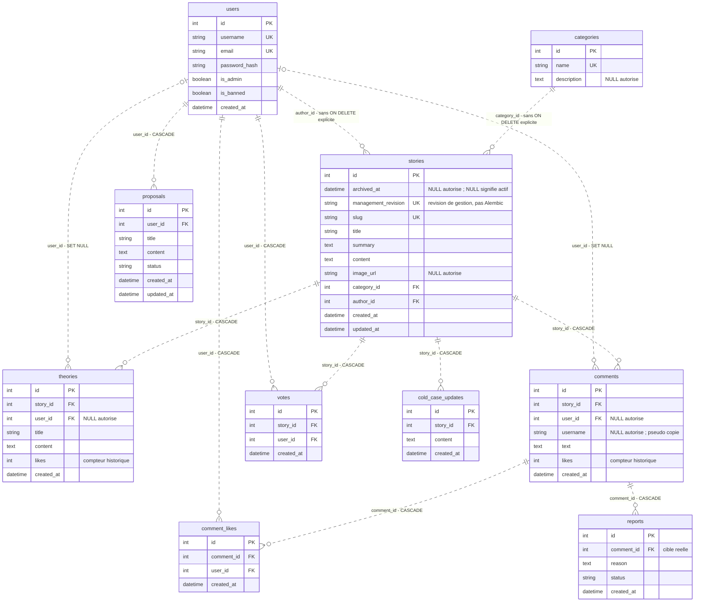

# Diagramme relationnel complet et commenté

Les Petits Enquêteurs — lot 6H.21.4 — 4 novembre 2026, Europe/Paris.

**Proposition externe à lire et à approuver avant installation.** Sources : copie intégrée locale, photographiée par SHA-256 ; pas la seule version du commit Git. Analyse statique : aucun import de l’application, accès SQL, test applicatif ni migration exécutée pour cette rédaction. Les exemples sont pédagogiques et non exécutés. Leur éventuelle exécution exige un contexte temporaire distinct, préparé et autorisé ; ils ne constituent pas des scripts de démarrage du projet.

[Sommaire de soutenance](README.md) · [Correspondance avec les sources](06_CORRESPONDANCE_SOURCES.md) · [Validation documentaire](07_VALIDATION_DOCUMENTAIRE.md)

Le diagramme représente les **soixante colonnes** des dix modèles actuels et les treize références déclarées. Il ne représente pas une introspection de la base persistante. Source : backend/models.py, MAH-M001 ; les détails par colonne figurent dans le [guide des modèles](01_GUIDE_DIX_MODELES.md).

Une source Mermaid autonome est fournie : `05_DIAGRAMME_RELATIONNEL.mmd` (annexe externe conservée avec la sauvegarde). Le contrôle de cette session vérifie sa couverture structurelle ; aucun rendu graphique n’est revendiqué.

## Lire les symboles sans inverser parent et enfant

Le parent est à gauche, la table qui porte la FK à droite. `||` signifie exactement un parent pour l’enfant ; `|o` côté gauche signifie zéro ou un parent ; `o{` côté droit signifie zéro à plusieurs enfants pour le parent. Les traits pointillés indiquent ici des relations non identifiantes : chaque enfant a sa propre PK id, sa PK n’est pas composée des FK.

Les marqueurs de cardinalité, de clé et les commentaires suivent la [syntaxe officielle des diagrammes Mermaid](https://mermaid.js.org/syntax/entityRelationshipDiagram.html). Cette lecture de syntaxe ne remplace pas un contrôle visuel du futur rendu.

`PK` marque les dix clés primaires. `FK` marque les treize colonnes de référence. `UK` marque les cinq unicités individuelles ; les deux unicités composites doivent être lues dans le tableau ci-dessous. Une absence d’annotation de défaut dans le dessin n’annule pas les defaults Python détaillés dans le guide.

| Association | Unicité métier supplémentaire | Pourquoi ne pas marquer chaque FK UK |
|---|---|---|
| votes | (user_id, story_id) | Chaque compte et chaque dossier peut apparaître plusieurs fois avec des partenaires différents |
| comment_likes | (user_id, comment_id) | Chaque compte et commentaire peut apparaître plusieurs fois avec des partenaires différents |

## Quatre chemins à montrer au jury

**Créer une contribution.** Partir de stories, rejoindre comments par story_id, puis retrouver éventuellement son auteur par user_id. Si user_id vaut NULL, le commentaire reste attaché à son dossier ; il ne faut pas dessiner un compte « Anonyme » fictif comme parent obligatoire.

**Compter les likes.** Pour un dossier, compter votes. Pour un commentaire, compter comment_likes. La colonne comments.likes est un reliquat historique ; les deux FK de comment_likes rendent les nouvelles associations attribuables à des comptes. theories.likes reste un compteur sans association équivalente.

**Modérer.** Partir d’un signalement reports, remonter par comment_id vers comments, puis par story_id vers stories et category_id vers categories. Le modèle Report ne contient ni user_id du déclarant ni colonnes type/target_id. Les propriétés Python de compatibilité appartiennent au contrat exposé, pas à ce diagramme physique.

**Purger un dossier.** Les flèches CASCADE vers comments, theories, votes et cold_case_updates indiquent les enfants supprimés avec le dossier. À partir de comments, la propagation se poursuit vers reports et comment_likes. Aucune flèche ne supprime users ou categories à partir de stories. Une archive ne parcourt aucune cascade de suppression.

## Deux points qui ne doivent pas disparaître à l’oral

Les liens stories.author_id et stories.category_id n’ont pas de ON DELETE explicite. Les deux liens d’auteur facultatif comments.user_id et theories.user_id sont SET NULL. Toutes les autres FK sont CASCADE. Les règles de relationship ORM doivent être examinées en plus de ce dessin SQL : voir le [guide des relations](02_RELATIONS_CONTRAINTES_TRANSACTIONS.md).

Le dessin n’exprime pas les droits d’administration, la visibilité active/archivée, les statuts autorisés ou la catégorie « cold case ». Aucun CHECK supplémentaire n’est inventé. Il décrit le schéma visé par les modèles ; il n’est ni une preuve de déploiement MySQL ni une preuve d’anonymisation.
