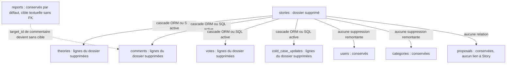

# Lot 6C — audit et conception de la gestion des dossiers

> Archive pédagogique datée : les résultats et descriptions ci-dessous concernent le lot indiqué. Les anciens repères de ligne ne décrivent pas la version candidate. Pour préparer la soutenance actuelle, consulter les quatre fiches et le référentiel reliés au sommaire.

> Copie publique de référence : les chemins personnels et liens de travail internes sont retirés. Les preuves et commandes historiques gardent leur date et leur périmètre ; utiliser le README actuel pour le lancement.

[Sommaire](README.md) · [Suivi des 22 remarques](SUIVI_REMARQUES_JURY.md) · [Index actuel](INDEX_CODE_JURY.md) · [Bilan 6A](BILAN_LOT6A.md) · [Bilan 6B](BILAN_LOT6B.md) · [Bilan 6D validé](BILAN_LOT6D.md)

**30 octobre 2026 — audit et conception uniquement.** Aucun archivage, suppression, changement de code applicatif, route, modèle ou migration réalisé. Les contrats et fonctions proposés ci-dessous sont inexistants à ce stade et restent soumis à décision. Le lot 6E n'est pas développé. Les 561 PASS du lot 6D sont la référence historique acceptée par l'utilisateur, pas une validation de 6C.

## 1. État initial et méthode

| Élément constaté | Valeur |
|---|---|
| Branche | `feature/frontend-api-integration` |
| HEAD | `07a9f03ea0a3bdad4a07066fdd7bab1997cc158b` |
| État Git avant l'audit | **37 fichiers suivis modifiés, 24 fichiers non suivis**, aucune modification indexée. |
| Instantané de conservation | 90 fichiers publics, leurs SHA-256, le statut et les 66 entrées de l'index ; aucun secret ni fichier de base inclus. |
| Référence fonctionnelle | 6A utilisateurs/bannissement, 6B consultation des dossiers, 6D sept compteurs ; 235 backend + 318 frontend + 8 lanceur = **561 PASS historiques**. |

Les trois bilans, la matrice du jury, les neuf modèles, quatre migrations, les routes enregistrées et les scripts frontend concernés ont été consultés. Analyse Python par AST et lecture de texte uniquement : aucun import applicatif, SQLAlchemy ou Alembic. Les sources officielles citées ont été consultées par l'outil documentaire distant ; aucun test réseau local ou accès Aiven n'a été effectué.

Preuves hors dépôt : `$env:TEMP/portfolio-lot6c-audit-20261030-qj4oqpwb`, avec `baseline.json`, `inspect-sources.py`, `source-inventory.json` et reçu final. Aucune opération de nettoyage, reset, checkout ou écrasement du travail antérieur.

## 2. Modèles et dix clés étrangères déclarées

Les conséquences ci-dessous sont **déduites des sources**, non exécutées. « SQL direct » suppose un moteur transactionnel et des FK effectivement présentes et actives. Cette condition n'est pas vérifiée sur une base déployée. `relationship` ne remplace pas une contrainte SQL.

### 2.1. Les neuf tables

| Modèle / source actuelle | Lien au dossier et conséquence principale |
|---|---|
| [Story](../../backend/models.py) / `stories` | Parent supprimable envisagé ; slug unique, auteur et catégorie obligatoires. Aucun champ d'archivage ou de version de concurrence. `image_url` est une chaîne, pas un fichier stocké en SQL. |
| [Theory](../../backend/models.py) / `theories` | `story_id` obligatoire ; titre, contenu, likes et date disparaîtraient avec la ligne. L'auteur peut être NULL. |
| [Comment](../../backend/models.py) / `comments` | `story_id` obligatoire ; texte, pseudo copié, likes et date disparaîtraient avec la ligne. Les signalements sont des lignes séparées. |
| [Vote](../../backend/models.py) / `votes` | `story_id` et `user_id` obligatoires ; UNIQUE sur `(user_id, story_id)`. Les votes du dossier disparaîtraient, les comptes resteraient. |
| [ColdCaseUpdate](../../backend/models.py) / `cold_case_updates` | `story_id` obligatoire ; suit le dossier. Aucune contrainte ne garantit une catégorie Cold Case. |
| [Report](../../backend/models.py) / `reports` | `type` et `target_id` textuels ; **aucune FK et aucune relation ORM**. Ni auteur du signalement, ni `story_id`. Aucun nettoyage automatique lors de la suppression d'un commentaire. |
| [User](../../backend/models.py) / `users` | Auteur du dossier et des contributions ; aucune cascade du dossier vers les utilisateurs. Le bannissement 6A conserve toujours le compte et ses contributions. |
| [Category](../../backend/models.py) / `categories` | Nom UNIQUE et non nul ; catégorie du dossier conservée lors de sa suppression. Les ids 1/2 sont une convention frontend, pas un enum SQL. |
| [Proposal](../../backend/models.py) / `proposals` | Liée uniquement à son utilisateur ; **aucun lien au dossier publié**. Une ressemblance de titre ne justifie aucune suppression. Son statut `pending` et le compteur 6D restent indépendants. |

### 2.2. Chaque FK et ses deux mécanismes de suppression

Le parent à supprimer est indiqué dans la deuxième colonne. Les actions sur User et Category sont analysées pour comprendre le graphe ; elles restent hors périmètre fonctionnel de 6C.

| FK enfant | Parent | SQL déclaré / nullabilité | Relations ORM actuelles | Suppression du parent par `Session.delete` | Suppression SQL directe du parent et risque |
|---|---|---|---|---|---|
| `stories.category_id` | Category | Pas de `ondelete` explicite ; NOT NULL. | `Category.stories` / `Story.category`, sans cascade delete. | Tentative de dissociation par NULL des dossiers dépendants ; échec attendu sur NOT NULL s'ils existent. | Suppression refusée si des dossiers référencent la catégorie et FK active ; référence pendante possible si contrôle absent. |
| `stories.author_id` | User | Pas de `ondelete` explicite ; NOT NULL. | `User.stories` / `Story.author`, sans cascade delete. | Même risque de mise à NULL et d'échec si l'utilisateur possède un dossier. | Suppression refusée si auteur d'un dossier et FK active ; dossiers orphelins possibles sinon. |
| `theories.story_id` | Story | `fk_theories_story`, CASCADE, NOT NULL. | `Story.theories` / `Theory.story`, `all, delete-orphan`. | L'ORM prévoit la suppression des théories liées. | Le moteur supprime les théories si cette cascade est déployée et active ; sinon orphelins ou refus selon le schéma réel. |
| `comments.story_id` | Story | `fk_comments_story`, CASCADE, NOT NULL. | `Story.comments` / `Comment.story`, `all, delete-orphan`. | L'ORM prévoit la suppression des commentaires, **sans supprimer leurs reports**. | Cascade des commentaires si active ; reports conservés et sans cible. Sans FK active : commentaires potentiellement orphelins. |
| `votes.story_id` | Story | `fk_votes_story`, CASCADE, NOT NULL. | `Story.votes` / `Vote.story`, `all, delete-orphan`. | Suppression ORM des votes liés. | Cascade SQL si active ; sinon risque de votes orphelins ou refus selon le schéma réel. |
| `cold_case_updates.story_id` | Story | `fk_cold_case_updates_story`, CASCADE, NOT NULL. | `Story.cold_case_updates` / `ColdCaseUpdate.story`, `all, delete-orphan`. | Suppression ORM des mises à jour liées. | Cascade SQL si active ; sinon risque de mises à jour orphelines ou refus selon le schéma réel. |
| `theories.user_id` | User | `fk_theories_user`, SET NULL, nullable. | `User.theories` / `Theory.author`, sans cascade delete. | Dissociation par NULL attendue ; texte et likes conservés, sous réserve qu'une autre relation ne fasse échouer la transaction. | Auteur mis à NULL si FK active ; sinon ancien id potentiellement conservé sans compte. |
| `comments.user_id` | User | `fk_comments_user`, SET NULL, nullable. | `User.comments` / `Comment.user`, sans cascade delete. | Dissociation par NULL attendue ; **username et texte restent présents**. Même réserve transactionnelle. | Auteur mis à NULL si FK active ; pseudo copié inchangé. Sans contrôle, référence auteur pendante possible. |
| `votes.user_id` | User | `fk_votes_user`, CASCADE, NOT NULL. | `User.votes` / `Vote.user`, sans cascade delete. | L'ORM peut tenter un NULL interdit plutôt que laisser la cascade SQL agir : échec attendu en présence de votes. | Votes supprimés par CASCADE si active et si aucune autre FK ne bloque la suppression du compte. |
| `proposals.user_id` | User | `fk_proposals_user`, CASCADE, NOT NULL. | `User.proposals` / `Proposal.user`, sans cascade delete. | Même risque de NULL interdit et d'échec en présence de propositions. | Propositions supprimées par CASCADE si active et si les autres contraintes autorisent la suppression du compte. |

Les quatre collections de Story ont `all, delete-orphan`, **sans `passive_deletes` configuré** : ne pas présumer que seul le moteur exécutera les suppressions. Retirer un enfant de ces collections peut aussi programmer sa suppression, même sans supprimer Story. Une suppression en masse par `Query.delete()` ou `Session.execute(delete(...))` ne rejoue pas ces cascades ORM ; les FK SQL deviennent essentielles. Ces distinctions suivent la [documentation SQLAlchemy 2.0](https://docs.sqlalchemy.org/en/20/orm/cascades.html).

Supprimer Story ne remonte ni vers son auteur, ni vers sa catégorie, ni vers les propositions. Supprimer un utilisateur est une autre opération : ses FK obligatoires et l'absence de cascade ORM sur ses collections rendent son comportement différent d'un DELETE SQL. **Ne pas transformer le bannissement 6A en suppression de compte.** Le cycle de suppression et de dissociation est décrit dans [SQLAlchemy — Session Basics](https://docs.sqlalchemy.org/en/20/orm/session_basics.html#deleting) ; les effets par modèle ci-dessus restent des déductions statiques à tester.

### 2.3. Migrations lues, jamais exécutées

| Chaîne déclarée | Contenu utile à 6C |
|---|---|
| [921687c1bd7c](../../migrations/versions/921687c1bd7c_baseline_schema.py) | Sept tables initiales ; FK sans actions explicites, auteurs de théorie/commentaire déjà nullable, slug et vote uniques. Les deux FK Story sont nommées `stories_ibfk_1/2` dans cette migration, sans nom explicite dans les modèles actuels. |
| [3111f5767fc6](../../migrations/versions/3111f5767fc6_ajoute_les_regles_on_delete.py) | Remplace sept FK par CASCADE/SET NULL sur commentaires, théories, votes et propositions. Ne change pas les deux FK Story. |
| [a590c8aac613](../../migrations/versions/a590c8aac613_add_reports_bans_and_cold_case_updates.py) | Ajoute reports **sans FK**, cold_case_updates avec CASCADE vers Story et le statut de bannissement. |
| [82deda84bc35](../../migrations/versions/82deda84bc35_remove_legacy_comment_reports_counter.py) | Retire `comments.reports` ; le nombre est calculé depuis la table reports. Dernière révision dans les fichiers, pas révision déployée attestée. |

Cette chaîne est cohérente sur le papier avec les dix FK des modèles. Cela ne prouve ni son application, ni les noms réels des contraintes, ni le moteur MySQL, ni l'activation des contrôles. Aucune commande Alembic, même `current` ou mode offline, n'est lancée : l'environnement de migration utilise la configuration de l'application. `create_all()` ne validerait pas cette chaîne.

## 3. Diagramme des conséquences d'une suppression actuelle

Ce diagramme décrit le comportement déclaré **sans futur traitement de reports**, sous les conditions SQL/ORM précédentes. Il ne représente aucune suppression exécutée. Source Mermaid préparée et relue, sans rendu navigateur.

Un archivage logique ne déclencherait aucune de ces cascades : les neuf tables conserveraient leurs lignes, avec seulement l'état du dossier et, si retenue, une trace d'opération modifiés.

## 4. Problème précis des signalements

[comment_to_dict](../../backend/api/v1/views/comments.py) compte les lignes `type='comment'` et `target_id=str(comment.id)`. Les deux entrées de création, [report_comment](../../backend/api/v1/views/comments.py) et [post_report](../../backend/api/v1/views/index.py), vérifient aujourd'hui que le commentaire existe. La seconde normalise l'identifiant numérique en chaîne canonique ; la première le construit depuis l'id. Cela protège la création courante, **pas la durée de vie de la référence**.

Exemple fictif : dossier 10, commentaire 42, signalement `type=comment,target_id='42'`. Supprimer le dossier et ses commentaires laisse le signalement 42 dans reports. Supprimer les reports de cible `'10'` serait incorrect : 10 est l'id du dossier, pas celui des commentaires. Il faut collecter les ids de commentaires concernés **avant leur disparition**, tenir compte du type, et conserver les signalements de tous les autres commentaires/dossiers.

Conséquences : carte de modération sans cible, compteur `/stats.reports` encore positif, perte de contexte et possible fausse attribution si un id de commentaire est réutilisé. Le modèle ne demande pas `sqlite_autoincrement`; SQLite peut réutiliser des ROWID supprimés dans certaines conditions, et un id peut aussi être réinséré explicitement. Voir [SQLite — Autoincrement](https://www.sqlite.org/autoinc.html). Aucune réutilisation effective n'a été recherchée dans une base.

Les sources n'interdisent pas en SQL des types inconnus, une chaîne non numérique ou d'anciennes formes comme `'00042'`. Leur présence réelle est inconnue. Une future reprise de données doit inventorier ces cas, refuser les ambiguïtés et ne pas utiliser une conversion numérique permissive qui confondrait des cibles. Comparaisons de chaînes et collations peuvent aussi différer entre SQLite et MySQL.

### 4.1. Politiques à faire choisir

| Politique envisagée | Effet | Conditions |
|---|---|---|
| Purger les reports des commentaires supprimés | Pas de dossier de modération conservé sans cible ; le total reports diminue. | Validation explicite de la perte des motifs ; journal minimal de l'opération séparé des contenus. |
| Conserver une trace de modération détachée | La trace dit explicitement « cible supprimée », sans lien actionable ni ambiguïté. | Définir finalité, durée et champs minimaux ; schéma/contrat adaptés, cible nullable et état explicite. Conserver `target_id` seul ne suffit pas. |
| Conserver les lignes actuelles inchangées | Références pendantes, risque de réattribution. | **Solution déconseillée** ; ne résout pas l'intégrité demandée. |

Une suppression applicative ciblée des reports dans la même transaction est possible conceptuellement avec le schéma actuel, mais **ne garantit pas l'absence d'orphelins face à des écritures concurrentes ou SQL directes**. Un report peut être inséré après le nettoyage et avant/après la disparition du commentaire puisqu'aucune FK ne l'en empêche.

Pour une garantie au niveau relationnel, évolution à étudier si purge choisie : cible de commentaire entière avec FK vers `comments.id`, CASCADE si les reports doivent disparaître, ou SET NULL avec état explicite si une trace doit subsister. L'API peut continuer à sérialiser `type` et `target_id` pour compatibilité, sans maintenir deux références indépendantes contradictoires. Les types actuellement supportés sont limités aux commentaires ; une vraie cible polymorphe future demanderait un autre modèle. Migration, traitement des données historiques et changement éventuel du contrat exigent une autorisation distincte.

## 5. Comparaison des trois stratégies

| Critère | Option 1 — archivage logique | Option 2 — suppression définitive | Option 3 — combinaison |
|---|---|---|---|
| Sécurité des données | Réversible ; réduit les erreurs irréversibles. Risque de fuite si une route oublie l'état archivé. | Irréversible dans la base active ; cascades et reports à maîtriser. | Réversibilité ordinaire ; purge distincte plus protégée. |
| Complexité | Champ d'état, migration et politique de visibilité sur **tous** les chemins. | Transactions, intégrité des cibles, concurrence, traces et confirmations. Aucun champ archive nécessaire si option 2 seule, mais fiabilisation des reports/version/journal à chiffrer. | Coût cumulé ; livraison possible en phases autorisées séparément. |
| Expérience utilisateur | Retrait public, liste d'archives privée et restauration compréhensible. | Conséquences lourdes à confirmer ; pas de bouton de restauration. | Actions ordinaires simples ; suppression exceptionnelle clairement séparée. |
| Contributions | Lignes conservées ; lecture/écriture publiques bloquées selon l'état parent. | Théories, commentaires, votes, mises à jour du dossier supprimés ; autres dossiers intacts. | Conservées jusqu'à purge autorisée. |
| Tests | Visibilité, accès directs, écritures, restauration, compteurs, concurrence. | Tout le graphe, rollback réel, SQL direct, reports, double requête, concurrence. | Les deux ensembles et transitions entre eux. |
| Jury C-05 | Répond au retrait réversible ; **ne doit pas être annoncé comme suppression définitive livrée**. | Répond littéralement à la suppression si les garanties sont démontrées. | Explique le cycle de vie complet, avec coût et limites assumés. |
| RGPD | Données encore conservées : ne vaut pas effacement. | Suppression du dossier actif seulement ; autres copies et données de la personne à traiter séparément. | Ne remplace pas une procédure de droits et de conservation. |

### 5.1. Option 1 : politique de visibilité proposée, non adoptée

Champ minimal envisagé : `Story.archived_at`, nullable, horodatage UTC. Les lignes existantes restent actives après une migration à préparer ultérieurement ; aucune migration produite ici. Auteur/motif d'archivage et journal sont des décisions supplémentaires. Slug et id restent réservés pendant l'archive pour permettre une restauration sans collision.

Proposition de comportement :

- `GET /stories` exclut les archives ; cela couvre accueil, Histoires, Cold Cases et sélecteurs de théories utilisant cette liste.
- La fiche publique par slug et les lectures par id des théories, commentaires et mises à jour renvoient **404** pour un parent archivé, même à un administrateur sur ces routes publiques. Une route privée explicite sert la consultation d'archives ; aucun simple paramètre public `include_archived=true` ne contourne les droits.
- Création de théorie/commentaire/vote, likes par id de commentaire/théorie et les **deux routes de signalement** vérifient le parent et refusent un dossier archivé. Vérifier uniquement le formulaire ou la liste de dossiers serait insuffisant. Pour le parcours public, 404 uniforme proposé afin de ne pas révéler l'archive.
- Les données des enfants et leurs reports restent en base ; votes et likes existants ne sont pas remis à zéro. Restaurer rend les mêmes liens/contributions disponibles et conserve la règle de vote unique. Aucun changement de catégorie, d'auteur ou de proposition.
- Les images statiques, les pages déjà chargées et les copies téléchargées ne sont pas rendues privées par ce champ. Un contenu déjà obtenu n'est pas révocable depuis toutes les fenêtres ouvertes.

Les routes à adapter se trouvent dans [histoires.py](../../backend/api/v1/views/histoires.py), [theories.py](../../backend/api/v1/views/theories.py), [comments.py](../../backend/api/v1/views/comments.py) et [index.py du Blueprint](../../backend/api/v1/views/index.py). Un helper de visibilité commun éviterait des règles contradictoires. Les APIs actuelles ne font aucun de ces contrôles d'archive. Une FK garantit l'existence du parent, pas son état actif : une écriture SQL directe pourrait encore ajouter une contribution à une archive en contournant les contrôles API. Aucun trigger de visibilité n'est proposé comme garantie déjà existante.

### 5.2. Option 2 : procédure de suppression envisagée

Une seule unité transactionnelle devrait : relire l'autorisation et la cible, verrouiller selon le moteur, vérifier la précondition de confirmation, établir les ids/counts affectés, appliquer la politique des reports, supprimer les enfants/parent selon la stratégie retenue, inscrire la trace de succès dans la même transaction puis committer **une seule fois**. Une erreur SQL, y compris après un vrai flush ou lors du commit, impose rollback ; aucun succès ne doit être envoyé avant le commit.

Les comptes, catégories, propositions et données des autres dossiers doivent être identiques avant/après. Il n'y a pas de suppression de fichiers à partir de `image_url` : une valeur externe ou un chemin relatif n'est pas un ordre d'effacement. Les images peuvent être partagées et suivies dans Git. Une éventuelle politique de retrait de médias et sauvegardes est distincte, hors transaction SQL ; une restauration de sauvegarde n'est pas un rollback applicatif.

### 5.3. Option 3 : séparation proposée

Archiver/restaurer constitue le parcours courant. Une purge serait réservée à une procédure distincte, désactivée tant que son périmètre n'est pas autorisé, avec aperçu des conséquences, vérification fraîche des droits, confirmation explicite et précondition de concurrence. Proposition pour cette option : exiger un dossier déjà archivé avant purge. Le modèle User n'a aujourd'hui que `is_admin` et `is_banned`, **aucun droit spécifique de purge ni preuve de réauthentification récente** ; une protection supplémentaire doit être décidée et conçue, pas prétendue existante.

## 6. Contrats REST envisagés — Sylvie

Toutes les routes nouvelles ci-dessous seraient sous `/api/v1`, privées et protégées par `admin_required`. Leur présence dans ce rapport ne les crée pas. Le périmètre exact dépend du choix d'option.

| Méthode et chemin proposés | Options | Sens / réponse proposée |
|---|---|---|
| GET `/admin/stories?state=active|archived|all` | 1, 3 ; éventuellement 2 pour gestion | Liste administrative explicite ; 200, liste vide autorisée. Filtre d'état séparé des filtres de catégories 6B. |
| GET `/admin/stories/{story_id}` | 1, 3 | Consultation privée du dossier archivé. Si ses contributions sont consultables, définir des lectures privées dédiées, sans rouvrir leurs routes publiques. |
| GET `/admin/stories/{story_id}/impact` | 2, 3 ; utile à 1 | Aperçu non destructif : identité du dossier, état, nombres d'enfants/reports et version de confirmation. Ni email, ni contenu privé inutile. GET sans mutation. |
| PUT `/admin/stories/{story_id}/archive` | 1, 3 | Demande l'état archivé ; 200 avec état serveur et `changed`. Répétition sur archive déjà conforme : 200, `changed=false`, sans nouvelle transition. |
| DELETE `/admin/stories/{story_id}/archive` | 1, 3 | Retire uniquement l'état d'archive : restauration, **pas purge du dossier**. 200 ; répétition sur dossier actif déjà conforme : `changed=false`. Libellé UI « Restaurer ». |
| DELETE `/admin/stories/{story_id}` | 2, 3 | Purge définitive avec précondition fraîche et confirmation ; 200 JSON contenant identifiant d'opération et nombres réellement supprimés. En option 3, dossier actif refusé en 409. |

DTO administratif envisagé : champs utiles de la liste actuelle, `archived_at` et version explicite. La réponse de purge pourrait contenir `status`, `operation_id`, `story_id`, `deleted_counts` pour stories/theories/comments/votes/updates/reports ; elle ne doit pas exposer les textes supprimés. Le contrat public des propositions et leurs statuts reste indépendant. Les modifications de schéma/contrat doivent être présentées pour accord avant réalisation.

### 6.1. Validation, CSRF et erreurs proposées

| Situation | Réponse prévue dans la conception |
|---|---|
| Session absente / compte disparu | 401. |
| Lecteur, compte banni, droit de purge absent si introduit | 403 ; aucune mutation. |
| CSRF absent/invalide sur écriture authentifiée | 403 par le filtre global existant, qui s'exécute avant la vue. Le détail d'ordre entre rôle et CSRF doit être respecté dans les tests. |
| Id hors domaine, non reconnu par le routeur ou dossier absent | 404 ; domaine entier positif borné à 2147483647 comme `get_resource`. Un id JSON booléen ou une cible différente de celle confirmée est refusé. |
| JSON/filtre/confirmation mal formé | 400, sans modification. |
| Précondition de version requise absente / état modifié depuis l'aperçu | 428 / 412 proposés ; relire et faire confirmer à nouveau, sans relance automatique. |
| Conflit métier : actif à purger en option 3, référence ambiguë, état incompatible | 409 avec code métier distinct, sans perte fictive de la session. |
| Dossier déjà supprimé, nouvelle requête sans reçu d'opération reconnu | 404, aucun autre dossier touché. L'idempotence de l'effet n'impose pas un deuxième succès 200. |
| Erreur SQL | Rollback et 500 JSON générique sans SQL, nom de base ou secret ; erreur de verrou temporaire reconnue : 503 possible, sans retry destructif implicite. |

Réutiliser le [filtre CSRF](../../backend/index.py), [admin_required](../../backend/api/v1/views/permissions.py), les [bornes et erreurs communes](../../backend/api/v1/views/write_support.py). Ne pas accepter un rôle ou un auteur d'action issu du corps JSON. Un GET ne doit déclencher ni suppression ni archivage. Les méthodes PUT/DELETE sont déjà couvertes par le filtre CSRF et `apiRequest`.

Pour la confirmation, un `If-Match` opaque associé à une version fiable est envisagé. **`Story.updated_at` seul ne suffit pas** : il ne change pas automatiquement à chaque commentaire, vote ou report. Une version de gestion monotone, augmentée par tous les auteurs d'écritures concernés, ou un mécanisme équivalent revérifié sous verrou est nécessaire. Ce choix ajoute du travail et potentiellement un champ/migration ; il n'est pas approuvé ici.

Point frontend concret : [apiRequest](../../frontend/api.js) reconstruit actuellement ses en-têtes et ne transmet pas simplement un `headers: {'If-Match': ...}` fourni par un appelant. Si cette précondition est retenue, il faudra ajouter un passage contrôlé de cet en-tête sans permettre d'écraser le CSRF ou les cookies, et tester cette évolution commune. Les erreurs 412/428 devront conserver leur code HTTP dans l'adaptation client ; aujourd'hui le message peut guider une relecture sans que les nouveaux helpers existent.

### 6.2. Atomicité et concurrence : conditions indispensables

Le précontrôle de confirmation ne verrouille rien pendant le temps de réflexion humain. La mutation doit relire l'état après acquisition des verrous et refuser un aperçu devenu ancien. Une transaction SQLAlchemy peut déjà être commencée par `admin_required` et ses lectures : ne pas ouvrir aveuglément un nouveau `session.begin()` imbriqué ; définir un seul propriétaire du commit/rollback pour l'unité de travail.

Un verrou de Story dans la nouvelle route ne suffit pas : les créations de contributions et les deux entrées de reports doivent respecter le même protocole de verrouillage/visibilité. Les likes qui ne vérifient aujourd'hui que leur enfant doivent aussi être pris en compte. Définir un ordre stable des verrous, prévoir conflit/deadlock et fermeture propre de transaction. Une insertion de report SQL directe contournerait toujours une simple convention applicative sans FK. Ne pas promettre cette garantie avec le schéma actuel.

SQLite ne valide pas les verrous de lignes InnoDB. Les [lectures verrouillantes MySQL](https://dev.mysql.com/doc/refman/8.4/en/innodb-locking-reads.html) s'interprètent dans une transaction et selon le moteur ; les [FK MySQL](https://dev.mysql.com/doc/refman/8.4/en/create-table-foreign-keys.html) doivent être réellement installées et actives. Version, moteur, isolation et contraintes de la cible Aiven restent inconnus et non consultés.

### 6.3. Traçabilité envisagée

Aujourd'hui aucun journal métier persistant de gestion des dossiers n'est déclaré. Proposition : trace minimale avec identifiant d'opération, acteur autorisé, objet historique non ambigu, action, horodatage UTC et nombres affectés. Ne pas recopier titres, textes, motifs personnels, mots de passe, cookies ou jetons. Une FK de journal en CASCADE vers Story effacerait justement la preuve de purge : éviter ce couplage. Une référence historique explicite n'est pas une cible de modération encore actionable ; prévoir aussi le risque de réutilisation d'id, par identifiant stable ou contexte de création.

Si la trace de succès est nécessaire à la garantie, son écriture appartient à la même transaction ; son échec annule l'action. Les tentatives échouées peuvent être journalisées séparément sans être annoncées comme succès et avec une durée/accessibilité définies. Un fichier de log externe n'est pas atomique avec le commit SQL. Une clé d'idempotence persistante permettrait de retrouver un reçu après timeout ; elle exige une conception et une contrainte d'unicité, elle n'existe pas aujourd'hui. À défaut, le client relit l'état sans renvoyer automatiquement l'action et sans attribuer avec certitude une suppression à la requête dont la réponse a été perdue.

## 7. Parcours frontend envisagé — Mélissa

Le point d'entrée serait [card/render/display](../../frontend/admin-stories.js) du panneau 6B, coordonné par [loadDashboard](../../frontend/admin-dashboard.js). Aucune interface de gestion n'est ajoutée pendant cet audit.

1. Selon l'option autorisée, afficher des boutons natifs « Archiver », « Restaurer » et, dans un parcours distinct seulement, « Supprimer définitivement ». Les lier à l'id stable, jamais au rang filtré ou à un titre.
2. Archiver : expliquer retrait public, contributions conservées et restauration possible. Purger : annoncer explicitement le dossier, les nombres de théories/commentaires/votes/mises à jour/reports concernés et l'absence de restauration applicative. Une saisie de confirmation peut réduire les erreurs, sans constituer une permission serveur.
3. Ne rien envoyer si la confirmation est annulée. Privilégier un dialogue accessible avec titre, description, Annuler initialement focalisé, navigation clavier, Échap, retour du focus et annonce d'état. Un `window.confirm` serait plus simple mais ne remplace pas un aperçu précis des conséquences.
4. Poser le verrou d'action **avant la première attente**, désactiver les boutons incompatibles et empêcher deux actions de gestion simultanées. Bloquer ou invalider les rechargements concurrents du coordinateur sans modifier inutilement le fonctionnement du panneau utilisateurs.
5. Utiliser la session/CSRF communs, une version de requête et AbortController. Départ de page, 401/403 courant ou nouveau chargement effacent les données ; un ancien succès/403 ne restaure pas l'état. Annuler le navigateur ne prouve pas un rollback serveur.
6. Après succès, relire les listes et les sept compteurs depuis leurs sources définies ; ne pas soustraire des nombres optimistes. Après timeout ou réponse illisible, indiquer résultat incertain et relire l'état/reçu avant toute nouvelle confirmation. Si la relecture échoue, masquer les anciennes actions et conserver `—`, sans faux zéro.
7. Après 409/412/428, conserver l'accès autorisé, expliquer le conflit et demander un nouvel aperçu. Après disparition de la carte, placer le focus sur un repère stable et annoncer l'issue. Les libellés et titres externes restent ajoutés avec `textContent`.

### 7.1. Listes et sept compteurs : décision de périmètre requise

| Indicateur existant | Purge : effet attendu | Archivage : proposition à valider |
|---|---|---|
| Dossiers / résolues / Cold Cases | Le dossier quitte le total et sa catégorie ; les autres catégories restent exactes. | Compter les actifs via le GET public filtré ; une liste privée d'archives ne remplace pas la source des compteurs. |
| Utilisateurs | Inchangé. | Inchangé. |
| Commentaires | Diminue du nombre réellement supprimé. | Conserver l'agrégat global de toutes les lignes pour compatibilité 6D, en l'expliquant ; ou changer explicitement le contrat vers les seuls dossiers actifs. Ne pas changer silencieusement ce sens. |
| Signalements | Diminue uniquement selon la politique de reports retenue. | Global inchangé si les reports restent conservés ; une purge de traces changerait la définition et doit être décidée. |
| Propositions en attente | Inchangé : pas de relation à Story. | Inchangé : seul le statut exact pending compte. |

Pour préserver 6B/6D, une liste privée `all` ne doit donc pas être passée telle quelle à `displayData` comme si elle était la liste publique active. Garder le classement de catégories 1/2 et la recherche locale ; ajouter un filtre d'état séparé seulement si l'option archive est retenue. Les GET séparés ne constituent pas un instantané transactionnel global : annoncer un état relu, pas des agrégats simultanés garantis.

## 8. Fichiers et fonctions envisagés par membre

Cette liste est un **plan conditionnel**, pas un inventaire de code modifié.

| Membre | Fichiers potentiellement concernés | Fonctions ou responsabilités envisagées |
|---|---|---|
| Mélissa | `frontend/admin-dashboard.html`, `admin-stories.js`, `admin-dashboard.js`, `api.js` ; CSS seulement si nécessaire à un dialogue accessible. | Actions dans `card`, état/verrou de gestion, confirmation accessible, annulation, relecture coordonnée ; helpers futurs `getAdminStoryImpact`, `archiveAdminStory`, `restoreAdminStory`, `deleteAdminStory` selon option. Adapter `apiRequest` uniquement si en-têtes de précondition requis. |
| Mélissa | `frontend/app.js`, `theories-list.js`, tests frontend existants et futurs. | Vérifier les 404 des fiches et sélecteurs après retrait ; pas de repli vers des dossiers statiques. Tests de chargement, erreurs, focus, requêtes tardives et maintien 6A/6B/6D. |
| Sylvie | Nouveau module envisagé `backend/api/v1/views/admin_stories.py`, import dans `views/__init__.py`, helper transactionnel envisagé `admin_stories_support.py`, `swagger.json`. | Routes envisagées `get_admin_stories`, `get_admin_story_impact`, `archive_story`, `restore_story`, `delete_story_permanently` ; un service propriétaire de l'unité de travail et une représentation privée limitée. |
| Sylvie | `histoires.py`, `theories.py`, `comments.py`, `views/index.py`, éventuellement `backend/index.py` pour une évolution d'agrégats approuvée. | Politique commune envisagée `get_visible_story` et vérification parent des accès par enfant ; coordination des deux écrivains reports, verrous et erreurs. Réutiliser les permissions/CSRF, conserver les règles du bannissement 6A. |
| Mahamadou | `backend/models.py`, nouvelle migration à concevoir seulement après autorisation, tests SQL/transactionnels. | Selon choix : `archived_at`, version fiable, cible relationnelle de reports et journal minimal. Inventorier préconditions de reprise, contraintes/index et échec explicite sur ambiguïtés. Aucun changement de statut Proposal ou de catégorie. |
| Équipe | README, documentation admin, Swagger, matrice, index, supports oraux et tests. | Décrire le comportement effectivement retenu, recalculer les lignes après développement et séparer preuves automatiques/navigateur. Conserver les 76 questions historiques. |

Le schéma minimal d'archivage n'a pas le même coût que le schéma de purge fiable. Les index utiles à étudier incluent les filtres `archived_at`, les FK d'enfants et la recherche de cible des reports ; leur présence physique ne se déduit pas des seules propriétés ORM. Aucune création d'index, table ou migration pendant l'audit.

## 9. Données personnelles, contributions et conservation

Le champ « archivé » du produit serait un état de visibilité. Il ne prouve pas qu'une politique d'archivage réglementaire est satisfaite. La CNIL demande de définir une conservation adaptée à la finalité ; les durées ne se déduisent pas du choix technique. Aucune durée légale universelle n'est inventée ici. [CNIL — durées de conservation](https://www.cnil.fr/fr/passer-laction/les-durees-de-conservation-des-donnees).

| Sujet | Archivage | Suppression définitive | Combinaison et décision nécessaire |
|---|---|---|---|
| Données du dossier et contributions | Toujours en base, avec accès privé à limiter et durée à fixer. | Retirées de la base active pour ce dossier ; pas nécessairement des sauvegardes/copies. | Définir les critères de retrait et de purge, sans conservation illimitée par défaut. |
| Comptes et autres contributions | Conservés. | Conservés : supprimer un dossier ne traite pas tous les contenus d'une personne. | Distinguer gestion éditoriale, bannissement et traitement d'une demande individuelle. |
| Pseudonymes copiés et textes libres | Restent dans commentaires, récits et autres champs. | Supprimés seulement avec les lignes visées ; copies ailleurs possibles. | Examiner les identifiants présents dans les contenus et motifs, pas seulement les FK. |
| Reports | Motifs conservés et potentiellement personnels. | Purge ou trace détachée selon décision explicite. | Définir finalité, accès, durée et minimisation de la trace. |
| Journaux et sauvegardes | Peuvent contenir les données retirées des écrans. | Aucun effacement physique instantané de ces supports garanti par DELETE SQL. | Prévoir expiration, accès restreint et procédure de restauration évitant une republication involontaire ; aucune sauvegarde inspectée ici. |
| Images et fichiers publics | URL directe potentiellement encore accessible. | Fichiers non supprimés automatiquement par SQL. | Retrait de médias à traiter séparément, avec propriété et usages partagés vérifiés. |

**Archiver ne suffit pas à répondre à une demande d'effacement.** Une demande nécessite d'identifier les données et la situation applicable, y compris les éventuelles exceptions ; aucune conformité globale n'est déclarée. [CNIL — droit à l'effacement](https://www.cnil.fr/fr/comprendre-mes-droits/le-droit-leffacement-supprimer-vos-donnees-en-ligne).

`SET NULL` sur un auteur n'anonymise pas les contributions : `Comment.username` reste une copie, et le texte peut identifier quelqu'un. Un alias ou la suppression d'une FK n'est pas automatiquement une anonymisation irréversible. [CNIL — anonymisation et pseudonymisation](https://www.cnil.fr/fr/technologies/lanonymisation-de-donnees-personnelles).

Le fichier public `donnees.js` contient encore des données statiques, même si les parcours actifs n'en font pas un repli. Le retrait d'un récit doit donc aussi considérer ses éventuelles copies dans les ressources publiques, fichiers médias, exports et caches, sans présumer qu'elles correspondent aux mêmes lignes SQL. Aucun nettoyage de ces ressources ni parcours RGPD 6E n'est développé.

## 10. Plan de tests proposé — tous NON EXÉCUTÉS pour 6C

Préparer ultérieurement une base **entièrement fictive**, avec deux dossiers de catégories différentes, un autre dossier témoin, plusieurs auteurs dont un administrateur, un lecteur et un banni, théories/commentaires/votes/mises à jour et plusieurs reports par commentaire. Prévoir auteurs NULL autorisés, propositions pending/approved/rejected indépendantes et données de l'autre dossier devant rester intactes. Le jeu doit vérifier la copie du pseudo et les contenus personnels fictifs, sans données réelles.

| ID | Scénario à écrire / résultat attendu |
|---|---|
| 6C-01 | Administrateur autorisé : état, id et conséquence conformes à la stratégie retenue ; un seul commit et trace exacte. |
| 6C-02 | Visiteur 401, lecteur/banni 403, rôle de session falsifié refusé ; neuf tables inchangées. |
| 6C-03 | CSRF absent, faux, vide ou non ASCII : 403 avant mutation ; GET d'aperçu sans effet destructif. |
| 6C-04 | Id nul, négatif, immense, mal formé, absent ou cible JSON différente : réponse définie, aucune autre ressource touchée. |
| 6C-05 | Dossier inexistant ou déjà supprimé : 404 ; aucune suppression par titre ou rang de liste. |
| 6C-06 | Confirmation annulée, fermée ou incohérente : aucune requête destructive ; retour du focus correct. |
| 6C-07 | Double clic avant/après une attente et requêtes identiques concurrentes : un seul effet ; reçus/réponses conformes, pas de double journal de transition. |
| 6C-08 | Archiver un actif : id/slug et enfants conservés ; retrait de toutes les listes publiques, dont sélecteurs. |
| 6C-09 | Archiver une archive, restaurer un actif déjà conforme : idempotence d'état et comportement `changed=false` défini. |
| 6C-10 | Restaurer une archive : mêmes contributions et mêmes votes ; unicité du vote conservée, aucune recréation du dossier. |
| 6C-11 | Accès directs au slug, théories, commentaires et updates d'une archive : 404 sur les API publiques ; parcours privé réservé aux droits définis. |
| 6C-12 | POST théorie/commentaire/vote, likes par id d'enfant, deux entrées reports : parent archivé refusé, aucune mutation. |
| 6C-13 | Purge du graphe complet : dossier et quatre familles enfants supprimés ; reports traités selon politique ; aucun enfant/report actif orphelin. |
| 6C-14 | Users, categories, proposals et toutes les lignes de l'autre dossier restent identiques ; statut de bannissement inchangé. |
| 6C-15 | Reports multiples, type différent, id du dossier égal à l'id d'un autre commentaire : ne supprimer que les cibles réellement concernées. |
| 6C-16 | Anciennes cibles textuelles non canoniques, inconnues ou sans cible : diagnostic/refus ou reprise explicitement approuvée ; jamais de suppression large par cast permissif. |
| 6C-17 | Après purge, tentative de réutilisation d'id de commentaire : aucune ancienne accusation réattachée ; contrôle de la cible relationnelle/trace. |
| 6C-18 | Erreur SQL avant mutation, après suppression de reports, après vrai flush d'enfants, puis au commit : rollback complet ; pas de faux journal de succès. |
| 6C-19 | Échec de la trace transactionnelle : toute l'opération est annulée si elle fait partie de la garantie. Aucun texte/secret dans les logs. |
| 6C-20 | Comparer `Session.delete` avec collections chargées/non chargées, suppression SQL directe et suppression en masse : documenter les garanties différentes, FK actives. |
| 6C-21 | FK SQLite activées sur chaque connexion avant transaction, vérifiées ; contrôle d'intégrité après opération. Un cas négatif sans FK doit montrer le défaut et faire échouer le prérequis, pas devenir une configuration admise. |
| 6C-22 | Écriture de report entre aperçu et purge, puis entre nettoyage et suppression ; pas d'orphelin, ou refus sûr. Deux routes reports couvertes. |
| 6C-23 | Commentaire/vote/like simultané, deux administrateurs, archive/restauration/purge concurrentes : versions et ordre de verrou définis ; aucune confirmation ancienne acceptée. |
| 6C-24 | Aperçu périmé, précondition absente/invalide : 412/428 proposés ; nouvel aperçu et nouvelle confirmation obligatoires. |
| 6C-25 | Réponse perdue après commit, timeout, JSON illisible et échec de relecture : état incertain annoncé ; aucun retry destructif automatique. |
| 6C-26 | Sept compteurs après archive/restauration/purge selon le périmètre approuvé ; zéro valide distinct de `—` en erreur ; pending inchangé. |
| 6C-27 | Réponses tardives succès/401/403, départ/retour de page et perte d'accès depuis utilisateurs : aucune donnée ou action ancienne restaurée. |
| 6C-28 | Recherche/catégories/liens 6B et bannissement 6A conservés ; protections des administrateurs, CSRF et relecture de statut inchangés. |
| 6C-29 | Clavier, annonce des conséquences, focus/Échap, libellés, texte hostile traité comme texte et grille responsive ; DOM simulé puis navigateur autorisé séparément. |
| 6C-30 | Volume important de contributions/reports : traitement borné, limites de paramètres et durée des verrous ; pas de liste d'ids arbitrairement tronquée. |
| 6C-31 | Migration sur schéma fictif historique, conservation des lignes, contraintes nouvelles et cas ambigu refusé ; distinguer modèles courants de chaîne Alembic. |
| 6C-32 | Images partagées et externes non effacées par la transaction ; procédure de sauvegarde/restauration et traces vérifiée séparément si ultérieurement autorisée. |

Les tests de rollback doivent provoquer un **vrai flush avant erreur**, puis comparer toutes les tables depuis un état relu, pas seulement vérifier qu'un mock de rollback a été appelé. Si journal/table de gestion ajouté, le comparer aussi : il y aurait alors plus de neuf tables. Pour SQL direct, expirer les objets ORM avant la relecture afin de ne pas prendre le cache de session pour une preuve SQL.

### 10.1. Limites du futur harnais et de SQLite

Les tests existants n'activent pas tous explicitement les FK SQLite ; leurs 561 réussites ne prouvent ni ces cascades ni une future purge. Préparer une fixture 6C dédiée : activation `foreign_keys` à la connexion **avant transaction**, assertion de sa valeur et contrôle des références. SQLite documente que cette activation ne doit pas être présumée et qu'une modification au milieu d'une transaction est sans effet. [SQLite — Foreign Key Support](https://www.sqlite.org/foreignkeys.html).

Un harnais inspecté futur devra bloquer dotenv, paramètres et connexions Aiven, réseau réel et bases non autorisées. Le manifeste 6D ne devra pas accepter automatiquement les nouvelles sources. Aucun de ses scripts n'est exécuté ici. SQLite `:memory:` isolé ne permet pas de prétendre à une preuve de concurrence multi-connexions partagée avec les mêmes données par simple ouverture de deux connexions : ce plan doit choisir un dispositif de test adapté, autorisé séparément. Ne pas élargir les gardes discrètement à une base fichier.

Même correctement testée, SQLite ne prouve ni `SELECT FOR UPDATE` InnoDB, ni deadlocks/isolations MySQL, ni collations, ni moteur et FK réellement déployés, ni migrations Aiven. Les véritables scénarios concurrents sur le moteur cible resteraient à autoriser et attester. La recette Edge 6A/6B reste reportée et la VM NO-GO ; aucune validation navigateur de 6C n'en découle.

## 11. Recommandation et décisions à valider

**Recommandation technique : option 3 en phases distinctes**, si le calendrier permet sa conception complète. L'archivage ordinaire réduit le risque d'une perte irréversible ; la purge peut répondre à la demande explicite du jury après résolution des reports, transactions et confirmations. Cette recommandation **n'adopte aucune stratégie et n'autorise aucune mise en œuvre**.

Pour un périmètre scolaire plus court, l'option 1 seule est proportionnée, à condition d'annoncer clairement « archivage réversible » et de laisser la suppression définitive C-05 non livrée. L'option 2 seule évite un cycle d'archives mais concentre immédiatement les risques irréversibles ; elle ne doit pas être retenue au seul motif que le modèle comporte CASCADE. Laisser reports sans cible n'est recommandé dans aucune option.

| Décision attendue avant code | Choix à confirmer explicitement |
|---|---|
| D1 — Stratégie et première livraison | Option 1, 2 ou 3 ; si 3, autorisation séparée de chaque phase. |
| D2 — Visibilité et restauration | 404 public proposé, contenu consultable en archive privée, écritures refusées sur archive et règles de restauration. |
| D3 — Contributions et reports | Suppression des quatre familles enfants en purge ; purge des reports associés ou trace détachée à durée définie. |
| D4 — Statistiques | Totaux de dossiers actifs ; commentaires/reports globaux pour compatibilité ou définition active explicitement changée. |
| D5 — Schéma et contrat | Autoriser d'abord la conception précise des champs/migrations/FK/journal/version et DTO requis ; aucun changement implicite. |
| D6 — Droit de purge et confirmation | Administrateur seul ou droit plus restrictif à créer ; dossier déjà archivé en option 3 ; aperçu et précondition ; éventuelle réauthentification récente. |
| D7 — Journal et conservation | Champs minimaux, identifiant historique fiable, accès, durée, politique sur échecs, reçus d'opération et copies sauvegardées. |
| D8 — Validation future | Autoriser ultérieurement le développement et les tests fictifs dans un harnais réinspecté ; navigateur/moteur cible restent soumis à autorisations distinctes. |

Les questions de droits d'effacement, sauvegardes, médias et conservation ne sont pas assimilées au développement du lot 6E. Les décisions de conception ne constituent pas une autorisation de connexion, de migration appliquée ou de suppression sur une base réelle.

## 12. Contrôles réalisés et arrêt de l'audit

<!-- CONTROLES_6C_AUDIT_START -->

**PASS statique** : inventaire de neuf modèles, dix FK et quatre migrations par analyse AST, 25 opérations HTTP existantes inchangées. **88 fichiers préexistants identiques octet pour octet** sur les 90 sauvegardés ; seuls le sommaire et la ligne C-05 de la matrice avec son complément documentaire sont actualisés. Un rapport créé ; aucun fichier applicatif ou test modifié. **785 liens internes contrôlés dans 20 Markdown**, dont 254 liens de lignes ; 155 repères de code et les quatre fiches contenant 76 questions/réponses historiques préservés. Matrice de 22 remarques conservée ; C-05 reste À FAIRE pour le développement. Branche, HEAD, index et chemins préexistants conservés ; contrôle des espaces Git passé. Six anciens blocs Mermaid inchangés ; une nouvelle source de diagramme préparée, rendu NON EXÉCUTÉ. **32 scénarios proposés, zéro test fonctionnel 6C exécuté, zéro opération de base.** Reçus : `source-inventory.json`, `final-audit-validation.json`, `document-inventory.json` dans le dossier de preuves hors dépôt.

<!-- CONTROLES_6C_AUDIT_END -->

**Aucune suppression, aucun archivage, aucun changement de code applicatif, aucune création/ouverture de base, aucune migration, aucun accès MySQL/Aiven ou `.env`, aucun Edge/Flask, aucun changement Windows, aucun commit/push ou changement de branche. Les tests fonctionnels 6C sont NON EXÉCUTÉS. Attente d'une autorisation explicite avant tout développement.**
