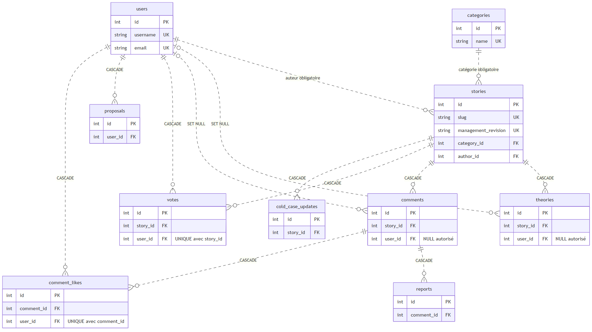

# Guide technique — version scolaire livrée

Ce guide décrit le code publié au commit `a850919` et la démonstration locale vérifiée en 6H.12. Il complète le [README](../../README.md), le [guide d’installation](../../LIVRAISON_SCOLAIRE.md) et la [validation scolaire](VALIDATION_SCOLAIRE.md). Les supports historiques sont conservés séparément ; leurs anciens états ne remplacent pas ce guide.

## Architecture et points d’entrée

| Élément | Source et rôle |
|---|---|
| Composition WSGI | [run_local.py](../../run_local.py) : `create_local_app()` sert les ressources publiques autorisées et délègue l’API à Flask |
| Configuration et session | [backend/index.py](../../backend/index.py) : application Flask, moteur SQLAlchemy, authentification, session et CSRF |
| Routes métier | [backend/api/v1/views](../../backend/api/v1/views/) : Blueprint sous `/api/v1`, contrôles et transactions |
| Modèles | [backend/models.py](../../backend/models.py) : dix tables et treize clés étrangères |
| Transport frontend | [frontend/api.js](../../frontend/api.js) : `fetch`, JSON, cookies, jeton CSRF, délais et erreurs |
| Interface publique | [app.js](../../frontend/app.js), [comments.js](../../frontend/comments.js), [likes.js](../../frontend/likes.js), [theories-list.js](../../frontend/theories-list.js) |
| Administration | [admin-dashboard.js](../../frontend/admin-dashboard.js), [admin-users.js](../../frontend/admin-users.js), [admin-stories.js](../../frontend/admin-stories.js) |
| Démonstration isolée | [tools/recette_lot6g4.py](../../tools/recette_lot6g4.py) : sources vérifiées et SQLite mémoire ; écoute locale optionnelle sur 5064 |

Le frontend et l’API utilisent la même origine. Le DOM vit dans le navigateur ; les fichiers statiques vivent dans le système de fichiers ; SQLite est un moteur embarqué. La configuration générale peut sélectionner MySQL/PyMySQL avec paramètres Aiven ou une URL de base, mais ce chemin n’est pas celui du kit scolaire et n’est pas validé en production. Le lanceur général écoute sur la boucle locale au port 5000, sans debug ni reloader, et ne prépare ni schéma ni données.

## Modèle relationnel

| Modèle | Relations et contraintes principales |
|---|---|
| `User` | Pseudonyme et email uniques ; hachage, rôle et bannissement ; aucune suppression de compte mise en œuvre par le parcours public |
| `Category` | Nom unique ; plusieurs dossiers par catégorie |
| `Story` | Slug unique ; auteur et catégorie obligatoires ; `archived_at` et révision de gestion |
| `Theory` | Dossier obligatoire ; auteur nullable avec `SET NULL` ; compteur de likes historique |
| `Comment` | Dossier obligatoire ; auteur nullable avec `SET NULL` ; pseudonyme copié et ancien compteur conservés |
| `Vote` | Dossier et compte obligatoires ; couple `(user_id, story_id)` unique |
| `CommentLike` | Commentaire et compte obligatoires ; couple `(user_id, comment_id)` unique |
| `Proposal` | Auteur obligatoire ; statut initial `pending` ; pas de conversion automatique en dossier |
| `Report` | FK obligatoire vers `Comment` avec `CASCADE` ; aucun signalement arbitraire d’une autre cible |
| `ColdCaseUpdate` | Dossier obligatoire ; le lien SQL ne garantit pas à lui seul sa catégorie Cold Case |

Les relations ORM et les règles SQL `ON DELETE` sont distinctes. Les contributions peuvent dépendre d’un dossier avec cascade, tandis que les auteurs de théories/commentaires peuvent devenir NULL. Le texte et le pseudonyme copié peuvent subsister : ce mécanisme ne constitue pas une anonymisation complète.

`commit()` valide une transaction ; `rollback()` annule les changements non validés après une erreur interceptée. `create_all()` prépare des tables absentes ; il ne remplace pas une migration. Les sept révisions présentes dans [migrations/versions](../../migrations/versions/) sont des candidates : leur présence et les tests sur schéma synthétique ne prouvent pas leur application sur une base existante ou MySQL.

## Authentification et CSRF

`POST /api/v1/login` est commun aux deux formulaires. Le serveur vérifie le hachage Werkzeug et le bannissement avant d’établir la session. `GET /api/v1/me` relit l’identité ; `POST /api/v1/logout` termine la session. Les routes administratives contrôlent le rôle en base, indépendamment du rôle affiché dans le navigateur. L’inscription publique ne crée pas d’administrateur.

Le cookie de session est signé, `HttpOnly` et `SameSite=Lax` ; l’attribut `Secure` dépend de la configuration. Le kit le désactive pour HTTP sur la boucle locale. Le mot de passe n’entre pas dans le cookie. Le jeton CSRF séparé est conservé dans la mémoire JavaScript et envoyé pour les écritures authentifiées.

La connexion est exemptée du contrôle CSRF. Pour les autres écritures, le contrôle s’applique lorsqu’une session authentifiée est présente ; les vues métier conservent leurs propres permissions. La présence d’une route publique n’autorise pas une action administrative. Le contrat est consultable dans [backend/api/v1/swagger.json](../../backend/api/v1/swagger.json), mais l’interface Swagger charge des ressources externes et n’est pas nécessaire à la démonstration isolée. Elle ne fournit pas automatiquement le jeton CSRF pour tous les essais d’écriture.

La récupération de mot de passe, un parcours OAuth et une gestion complète des droits RGPD ne sont pas implémentés. Ces contrôles ne constituent pas un audit de sécurité ou une validation juridique.

## Contributions et likes

Les commentaires et théories se rattachent à un dossier. Un membre connecté peut proposer une histoire, mais celle-ci reste `pending`. Le formulaire transmet un titre et un contenu ; la catégorie choisie est intégrée au début du contenu et les pièces jointes ne sont pas prises en charge.

Les likes de dossiers utilisent `Vote` ; ceux des commentaires compatibles utilisent `CommentLike`. L’unicité compte/cible, la session et les contrôles serveur permettent l’ajout et le retrait personnels. Les anciens compteurs incompatibles ne sont pas réattribués à des auteurs inventés ni remis à zéro silencieusement. Les likes de théories restent un compteur répétable accessible par l’API.

Le signalement porte sur un commentaire avec motif et confirmation. Plusieurs signalements sont possibles ; l’administration affiche leur contexte. Aucune décision de modération ni publication n’en découle automatiquement. Les mises à jour de Cold Cases restent accessibles par l’API sans interface complète.

Après une réponse réseau incertaine, les contrôleurs de gestion concernés relisent l’état sans répéter automatiquement l’écriture. Cela évite un renvoi involontaire ; une relecture ne constitue pas un reçu d’audit persistant.

## Administration et sept indicateurs

Les indicateurs sont : dossiers actifs, résolus, Cold Cases, utilisateurs, commentaires, signalements, propositions en attente. Le frontend rapproche les listes et les statistiques serveur ; les attentes proviennent de la liste privée des propositions filtrée avec le statut exact `pending`.

Les dossiers archivés sont masqués dans les lectures publiques et comptés séparément. Les compteurs utilisateurs/commentaires/signalements/propositions ne sont pas limités au filtre visible des dossiers. L’interface distingue chargement, zéro confirmé et erreur ; elle nettoie les données après un refus d’accès.

Le bannissement vise uniquement les membres ; tous les administrateurs sont protégés. Les permissions sont relues pour les sessions déjà ouvertes. Aucun débannissement n’est proposé dans l’interface.

L’archivage est réversible et conserve les contributions. La suppression définitive exige une archive, un administrateur actif, le CSRF, le titre exact, un acquittement, une confirmation signée temporaire et `If-Match`. Le dossier et ses dépendances sont supprimés dans une transaction ; les comptes et autres dossiers sont préservés. Aucun reçu persistant de suppression ni purge programmée n’est livré. Ce parcours n’a pas été rejoué dans la recette ciblée 6H.11 ou 6H.12.

## Ressources visuelles et diagrammes

Dans la version livrée, `Story.image_url` est une référence, pas un stockage binaire. Le frontend accepte les URL se résolvant en HTTP(S), puis utilise le SVG géométrique livré en repli borné, puis un texte en cas d’échec. Les anciens WebP exclus ne sont pas nécessaires à la démonstration. Voir la [provenance des ressources](PROVENANCE_RESSOURCES.md).

Les trois [diagrammes](README.md#diagrammes) sont fournis en Mermaid, SVG et PNG. Le diagramme d’architecture général distingue le lanceur normal de la procédure scolaire ; une représentation d’un serveur MySQL ne prouve pas son exploitation.

## Limites avant une exploitation réelle

La base mémoire n’offre pas de persistance après arrêt. La compatibilité des migrations, les verrous/concurrences MySQL, l’hébergement, HTTPS et les cookies effectifs restent à valider sur le moteur et l’infrastructure retenus. Les tests simulés ne certifient pas une accessibilité exhaustive.

Les notices de formulaires ne constituent pas une politique RGPD définitive. Conservation, contact, bases de traitement et procédures d’exercice des droits demandent une validation distincte. Le projet n’est pas annoncé entièrement conforme au RGPD, ni déployé publiquement.
