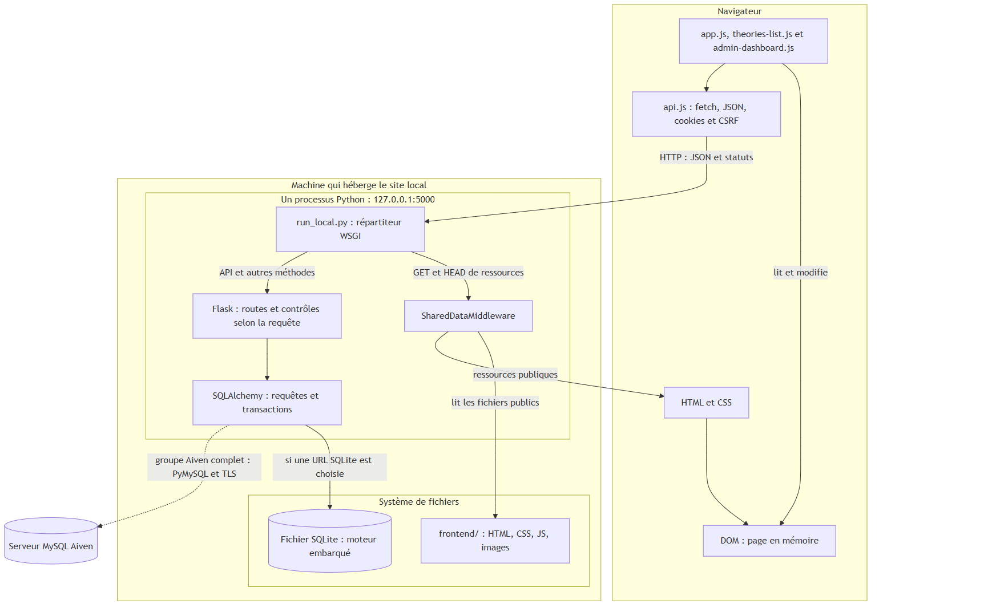

# Soutenance — Les Petits Enquêteurs

Documentation publique actualisée le 3 novembre 2026 pour le portfolio Holberton. Le code a été livré sur GitHub en 6H.11 (`a850919`, branche `feature/frontend-api-integration`). Le lot 6H.12 a confirmé les parcours locaux dans Edge avec SQLite en mémoire. **La publication du code est réalisée ; le site n’est pas déployé publiquement.**

## Documents de référence

| Support | Contenu |
|---|---|
| [README principal](../../README.md) | Objectif, fonctionnalités, technologies, équipe et limites |
| [Installation et lancement scolaire](../../LIVRAISON_SCOLAIRE.md) | Copie neuve, dépendances, kit isolé et création automatique des comptes fictifs |
| [Guide technique](GUIDE_TECHNIQUE.md) | Architecture, dix modèles SQLAlchemy, API, authentification, indicateurs et limites |
| [Validation scolaire](VALIDATION_SCOLAIRE.md) | Campagnes effectivement exécutées, organisation des tests et périmètre des preuves |
| [Provenance des ressources livrées](PROVENANCE_RESSOURCES.md) | SVG fourni et diagrammes, sans licence globale implicite |

Ces documents décrivent la version publique actuelle. Les bilans internes 6H.11–6H.13, sorties de console privée, accès, reçus bruts et scripts ponctuels ne sont pas des pièces à publier.

## Diagrammes

Les trois diagrammes ont été rendus et contrôlés localement en 6H.4, puis livrés en 6H.11. Les PNG permettent leur lecture sans moteur Mermaid. Ils décrivent l’architecture et les relations ; ils ne prouvent pas un déploiement MySQL. Les mentions de port et de base du lanceur général doivent être distinguées du kit scolaire sur `127.0.0.1:5064`, avec SQLite mémoire.

| Sujet | Source Mermaid | SVG | PNG |
|---|---|---|---|
| Architecture | [Source](preuves-lot6h4/diagrammes/diagram-1.mmd) | [SVG](preuves-lot6h4/diagrammes/diagram-1.svg) | [PNG](preuves-lot6h4/diagrammes/diagram-1.png) |
| Dix tables et treize clés étrangères | [Source](preuves-lot6h4/diagrammes/diagram-2.mmd) | [SVG](preuves-lot6h4/diagrammes/diagram-2.svg) | [PNG](preuves-lot6h4/diagrammes/diagram-2.png) |
| Flux d’une contribution | [Source](preuves-lot6h4/diagrammes/diagram-3.mmd) | [SVG](preuves-lot6h4/diagrammes/diagram-3.svg) | [PNG](preuves-lot6h4/diagrammes/diagram-3.png) |

## Fiches de révision de l’équipe

| Fiche | Responsabilité déclarée | Questions historiques |
|---|---|---:|
| [Mélissa](fiche-melissa.md) | Frontend | 18 |
| [Sylvie](fiche-sylvie.md) | Backend Flask et API REST | 18 |
| [Mahamadou](fiche-mahamadou.md) | Base de données SQLAlchemy et intégration | 18 |
| [Fiche commune](fiche-commune.md) | Architecture et explications partagées | 22 |

Ces 76 questions sont conservées avec leurs repères historiques. Certaines réponses et les anciens supports techniques décrivent des étapes antérieures : neuf tables, fonctions alors absentes, recettes alors non exécutées ou publication encore à préparer. Pour l’état actuel, utiliser les documents de référence ci-dessus. Ne pas suivre une ancienne commande de lancement sans vérifier son périmètre.

La répartition reprend les responsabilités communiquées par l’équipe. Les fiches n’établissent pas l’auteur individuel de chaque fichier ou correction.

## Points à expliquer au jury

- Le navigateur, le DOM, Flask, SQLAlchemy et le moteur de base ont des rôles distincts.
- Les contrôles de rôle sont effectués côté serveur ; ouvrir le HTML administrateur ne donne aucun droit.
- Le dashboard affiche sept valeurs issues du serveur, avec un périmètre particulier pour les dossiers archivés.
- Les propositions restent en attente ; un signalement ne déclenche pas une modération automatique.
- SQLite mémoire facilite une démonstration synthétique, mais ne valide pas MySQL, les migrations réelles ou la durabilité.
- Les résultats des tests historiques, des contrôles de livraison et d’Edge ne s’additionnent pas.
- L’application n’est ni déployée publiquement ni annoncée entièrement conforme au RGPD.
