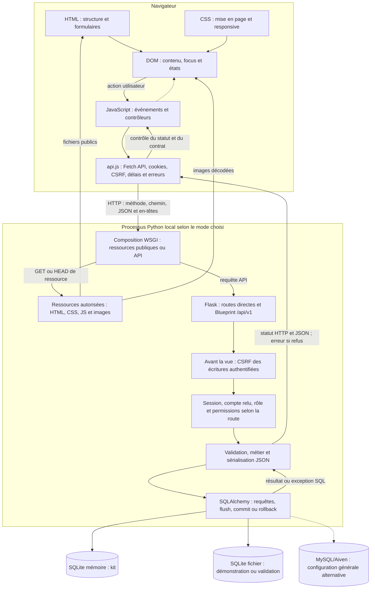
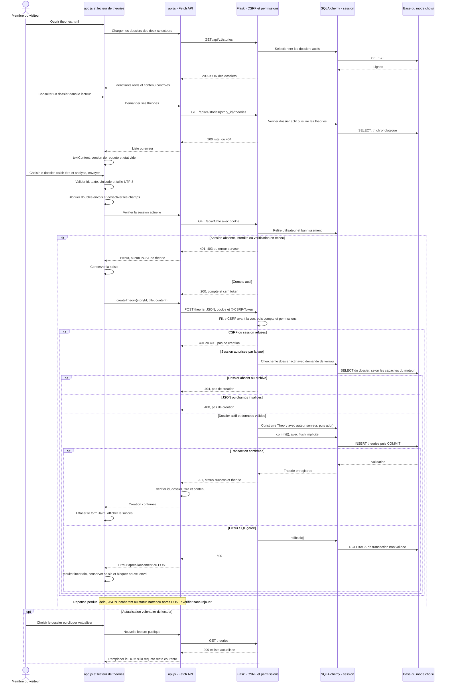

# Fiche commune — Compréhension transversale et soutenance

4 novembre 2026, Europe/Paris — proposition du lot 6H.21.2, fondée sur les sources locales et le README installé au lot 6H.19.3.

**Mode de lecture :** pour chaque identifiant, A à I décrivent la réponse actuelle ; le bloc repliable qui suit conserve la réponse historique. Le statut ancien « VALIDÉE » est archivé, sans valeur de validation actuelle ou de production. Le texte de la question et toutes les réponses historiques sont conservés ; leurs anciennes références sont affichées comme repères archivés, pas comme liens de code actuels.

La réponse B est une proposition orale de l’ordre de 30 à 60 secondes selon le débit, sans chronométrage revendiqué. C permet de comprendre, D relie au projet, E donne les symboles vérifiés, F explique leur coopération, G et H préparent les relances. Le statut I distingue code implémenté, fonction partielle, validation absente et preuve historique.

Les références actives privilégient le fichier et le symbole nommé. Pour les fonctions Python indexées, un lien `MAH-F…` ouvre le contrat correspondant du [référentiel 6H.21.1](REFERENTIEL_PEDAGOGIQUE_LOT6H21_1.md). Ces identifiants sont pédagogiques, sans attribution exclusive d’auteur. Les lignes actuelles et empreintes ont été vérifiées dans le rapport, sans figer de nouveaux liens de ligne fragiles dans la fiche.

**Périmètre de cette préparation :** lecture statique et validation documentaire ; aucun test applicatif nouveau, accès SQL, serveur ou navigateur du site, migration ou action de compte. Exemples à lire, sans exécution sur la démonstration. Les copies pédagogiques commentées restent futures. Les anciennes fiches et les deux autres fiches restent intactes pendant cette proposition.

## Accès aux questions

[COM-01](#com-01) · [COM-02](#com-02) · [COM-03](#com-03) · [COM-04](#com-04) · [COM-05](#com-05) · [COM-06](#com-06) · [COM-07](#com-07) · [COM-08](#com-08) · [COM-09](#com-09) · [COM-10](#com-10) · [COM-11](#com-11) · [COM-12](#com-12) · [COM-13](#com-13) · [COM-14](#com-14) · [COM-15](#com-15) · [COM-16](#com-16) · [COM-17](#com-17) · [COM-18](#com-18) · [COM-19](#com-19) · [COM-20](#com-20) · [COM-21](#com-21) · [COM-22](#com-22)

## Repères transversaux actualisés

### État à annoncer sans mélanger les preuves

| Sujet | État courant et limite |
|---|---|
| Application | Locale, pas de déploiement public ; six textes approuvés et six PNG. |
| Données | Dix modèles, treize FK et sept migrations présentes ; aucun état MySQL déployé déduit de ces sources. |
| API | 36 opérations explicites sur 27 chemins, comparées à OpenAPI ; HEAD/OPTIONS automatiques exclus. |
| Rôles | Visiteur, membre actif, administrateur ; permissions relues côté serveur. |
| Démonstration | Kit mémoire 5064, persistance 5066, lanceur général 5000 et validations isolées distincts. |
| Soutenance | Mélissa frontend, Sylvie API, Mahamadou BDD/intégration ; points d’intégration partagés. |
| RGPD | Notices présentes ; brouillon interne non publié, décisions juridiques et information publique à finaliser. |

### Architecture et lecture du diagramme

Le diagramme suivant reprend exactement celui du [README](../../README.md#architecture-de-lapplication), déjà rendu lors du lot 6H.19.3. Le DOM représente la page, les contrôleurs réagissent aux événements, api.js centralise HTTP et Flask traite l’API. SQLAlchemy s’adresse au stockage choisi par le processus, pas aux trois moteurs simultanément. Les retours JSON ou erreurs sont contrôlés avant affichage. La ressource PNG suit une requête HTTP distincte.

### Méthodes et codes : expliquer le contrat réel

| Méthode | Opérations déclarées | Rôle actuel |
|---|---:|---|
| GET | 17 | Lectures publiques, personnelles ou administratives selon la route ; contrat et Swagger inclus. |
| POST | 15 | Créations, connexion/déconnexion et transitions explicites comme archive/restore. |
| DELETE | 4 | Retraits personnels de likes, purge conditionnelle et ancien bannissement conservant le compte. |
| PUT | 0 | Sens habituel de remplacement, mais aucune opération PUT déclarée ici. |
| PATCH | 0 | Sens habituel de modification partielle, mais aucune opération PATCH déclarée ici. |

Les principales réponses sont 200 pour une lecture/action confirmée, 201 pour certaines créations, 400 pour des entrées invalides, 401 pour l’authentification, 403 pour un refus de rôle/CSRF, 404 pour une ressource absente et 409 pour un conflit métier. La purge ajoute 412 pour un état périmé, 428 pour une précondition manquante et 503 pour certaines indisponibilités ou issues incertaines. Les formats JSON varient : consulter le [tableau complet](../../README.md#api-rest-complète), sans inventer une enveloppe uniforme.

### Cycle d’une théorie et explication de la séquence

Ce second diagramme est également repris sans modification du [README](../../README.md#parcours-détaillé--publier-une-théorie). La lecture publique et la création authentifiée sont distinctes. Après validation locale, /me relit le compte ; le POST contrôle encore CSRF, compte, dossier actif et champs. L’auteur est serveur. Commit valide la transaction ; le client exige une réponse cohérente avant d’effacer la saisie. Une issue incertaine oblige à vérifier, et le lecteur reste actualisé volontairement.

### Les six dossiers du catalogue

| Dossier — intitulé abrégé | Catégorie | Slug stable | Illustration |
|---|---|---|---|
| L’Ombre du Golden State Killer | Histoire résolue | `golden-state-killer` | `golden-state-killer.png` |
| Le Masque de Chris Watts | Histoire résolue | `chris-watts` | `chris-watts.png` |
| Les Mots Mortels de Michelle Carter | Histoire résolue | `michelle-carter` | `michelle-carter.png` |
| Le Mystère d’Anthonioz | Cold Case | `anthonioz` | `mystere-anthonioz.png` |
| L’Inconnue de la Plage de Noirval | Cold Case | `noirval` | `inconnue-noirval.png` |
| Le Secret du Manoir de l’Ombre | Cold Case | `manoir-de-l-ombre` | `manoir-ombre.png` |

Les titres ci-dessus sont abrégés, les textes restent ceux du catalogue approuvé. Les versions B d’Anthonioz et de Noirval sont conservées.

### Images : disque, référence, HTTP et affichage

Les six fichiers PNG sont stockés localement dans [frontend/images/](../../frontend/images/), pour environ **15,1 Mio** au total. Leurs noms et slugs sont détaillés dans le catalogue plus haut et dans le [registre des images](../../frontend/images/README.md).

| Niveau | Données et traitement |
|---|---|
| Disque | Les octets des six PNG et du SVG restent des fichiers du dossier d’images. Aucun téléversement de pièce jointe n’est implémenté. |
| Base | `Story.image_url` peut conserver une référence textuelle ; aucune colonne BLOB ne stocke ces six illustrations. |
| Association frontend | `originalStoryIllustrations` dans `app.js` associe les six fichiers par slug stable, indépendamment de l’ordre ou du numéro des histoires reçues. |
| HTTP | La composition WSGI/Flask autorise `/images/...` et transmet les fichiers avec leur type, notamment `image/png` dans le mode persistant. Le kit strict n’autorise que son SVG. |
| Navigateur | L’image est décodée et affichée avec proportions conservées, `object-fit: contain`, texte alternatif et légende « Illustration générée par IA ». |

L’ordre de sélection est une URL HTTP(S) utilisable fournie par l’API, puis l’image locale du slug, puis [default-story.svg](../../frontend/images/default-story.svg). Si ce dernier échoue, un message d’indisponibilité remplace l’image. La mention IA est associée aux illustrations locales reconnues ; une URL externe arbitraire ou le SVG ne reçoit pas indûment cette attribution.

Ces illustrations ne sont pas des photographies ou preuves authentiques des affaires. L’outil, l’opérateur, la date précise de génération et une licence libre des six PNG ne sont pas établis par leur seule présence. Le SVG de remplacement possède une provenance documentaire distincte.

Pour un clone GitHub complet, les PNG, le catalogue et les correspondances nécessaires doivent figurer dans une sélection de publication autorisée. À l’état examiné, les PNG sont non suivis localement : leur publication actuelle n’est pas présumée. Un futur déploiement devra livrer les fichiers au serveur, vérifier les chemins, types MIME, droits de diffusion et cache. Publier le code ne déploie pas le service. Les anciens WebP retirés localement ne sont pas requis pour ces six dossiers et ne sont pas réintroduits.

### Campagnes distinctes, jamais additionnées

| Date / campagne | Résultat réellement consigné | Périmètre et limites |
|---|---|---|
| 25 octobre 2026, README historique de main ; réexécution documentée le 29 octobre | 205 backend, 226 frontend et 8 lanceur, soit 439 dans chacune de ces campagnes distinctes | Ancien périmètre ; ne valide pas les fonctions ajoutées depuis. Les campagnes ne s’additionnent pas. |
| 1er novembre 2026, correctifs 6G.5 | 311 backend, 513 frontend et 30 contrats/lanceur : 854 dans cette seule campagne finale | Après correctif de cache ; sept tests historiques de migrations exclus, six essais de migration des likes sur mémoire synthétique sous garde ; aucun MySQL. |
| 3 novembre 2026, livraison scolaire 6H.11 | Installation hors ligne et `pip check` ; 30 tests Python, 12 tests frontend d’images ; 43 requêtes WSGI, sept groupes PASS | Sélection livrée de 118 fichiers, sans les six nouveaux PNG ; aucune relance générale des 854 tests. |
| 3 novembre 2026, implémentation persistante après 6H.16B.1 | 21 tests persistants réussis ; 26 tests kit/catalogue et deux parcours mémoire réussis séparément | SQLite jetables, réouverture entre processus, sauvegarde/restauration ; rapport d’exécution externe, distinct du bilan de préparation 6H.16B.1. |
| 4 novembre 2026, 6H.17.3 | 53 tests frontend ciblés, puis 590 frontend complets ; 13 tests kit | Campagnes ciblée/complète qui se recouvrent ; images/texte aussi vérifiés dans Edge en lecture seule. |
| 4 novembre 2026, 6H.18.2 | 265 tests frontend ciblés, puis 567 frontend complets, sans échec | Messages, confirmations et résultats incertains ; DOM/API simulés. La baisse par rapport à 590 ne démontre pas à elle seule une perte de couverture. |
| 4 novembre 2026, 6H.18.3 | Parcours Edge authentifiés autorisés documentés ; réserve sur un essai CSRF négatif | Le contrôleur n’avait pas établi l’en-tête réellement envoyé ; un envoi a eu lieu, sans preuve de contournement. Pas de requalification de ce bilan. |
| 4 novembre 2026, 6H.18.4 | Neuf variantes : 27 refus CSRF 403 sans changement SQL, neuf requêtes valides avec les effets attendus | Application réelle et nouvelle SQLite temporaire, sans serveur ni Edge ; lève la réserve backend ciblée, sans reconstituer l’ancien essai navigateur. |
| 4 novembre 2026, 6H.20.2 | 92 tests Python ciblés : 13 notices, 10 lanceur, 13 kit, 13 catalogue, 29 CSRF, 14 erreurs/session ; suite frontend complète réussie, sortie 0 | Copie isolée après notices ; aucun nouveau total frontend chiffré dans le bilan. Cycle de session complémentaire réussi en mémoire. |
| 4 novembre 2026, 6H.20.3 | Edge : 33 combinaisons page/largeur et trois états de signalement ; 46 captures ; PASS AVEC RÉSERVES | Anonyme, GET/HEAD locaux, aucune soumission ; mesures détaillées dans la section suivante. Preuves externes non publiées. |
| 4 novembre 2026, 6H.21.1 | Référentiel statique : 27 modules, 20 classes, 212 entrées de fonctions dont 23 lambda ; 76 questions préservées | Inventaire pédagogique, pas une campagne de tests applicatifs ; aucune copie commentée créée. |

Les comptes des lignes précédentes ne sont jamais additionnés en total global. Les sous-cas, requêtes HTTP, vues Edge et méthodes de test sont des unités différentes. Les avertissements existants sur `datetime.utcnow()` et certains flux statiques non fermés sont documentés sans correction dans le lot RGPD. Aucun pourcentage global de couverture, validation de charge, concurrence réelle MySQL ou audit de production n’est revendiqué.

### Recette manuelle : préparer, observer, consigner

Le protocole suivant est une préparation, pas une nouvelle recette effectuée dans ce lot. Utiliser un profil Edge temporaire et une base fictive dédiée pour tout envoi autorisé ; conserver le serveur 5066 existant, ses comptes et les profils habituels. Deux onglets d’un même profil ne séparent pas les sessions.

| Parcours | Vérifications | Preuve et limite |
|---|---|---|
| Visiteur | Accueil/listes/recherche, six fiches, slug absent, textes, images et lecteur de théories | Contenu correct, 200/404/état vide distingués ; aucune connexion nécessaire. |
| Notices et affichage | Six pages concernées, 1280/390/320 px, Tab, focus, champs, ouverture/annulation du signalement | Ne pas soumettre pendant ce contrôle ; contraste et débordement à relever dans leur périmètre. |
| Membre fictif autorisé | Compte/session, commentaire, théorie, proposition, signalement et like/retrait | Relire la contribution sur sa cible ; aucune valeur d’accès dans capture ou journal. |
| Administrateur fictif | Sept indicateurs, motifs/contextes, utilisateurs et dossiers | Refus au membre ; bannissement, archive/restauration seulement sur cibles dédiées autorisées. |
| Purge | Scénario séparé sur archive fictive, aperçu/titre/accord/préconditions et dossier témoin | Ce n’est pas une validation visuelle en lecture seule ; contrôler l’effet SQL isolé. |
| Accessibilité complémentaire | Zoom, lecteur d’écran et appareil physique | Ne pas déduire ces succès des seules vues mobiles simulées. |

Consigner date, version des sources, mode, rôle, largeur, étapes et PASS/FAIL/NON EXÉCUTÉ. Les 46 captures 6H.20.3 restent privées hors dépôt. La dernière recette anonyme comptait 33 combinaisons page/largeur et trois états de signalement, sans envoi ; elle ne valide pas les parcours authentifiés ci-dessus. Voir le [protocole RGPD](RECETTE_MANUELLE_LOT6H20_2.md) et le [README](../../README.md#procédures-manuelles-dans-edge).

### Limites RGPD et difficultés documentées

Les notices précèdent inscription, connexions et contributions, et expliquent la visibilité ou la destination administrative. Le cookie de session nécessaire est signé, non chiffré ; il ne contient pas le mot de passe. L’absence d’une page publique de confidentialité protège aujourd’hui un brouillon incomplet mais ne vaut pas conformité. Responsable/contact, bases légales, conservation, hébergement/destinataires, droits, sauvegardes et incidents restent à finaliser avant ouverture publique. Aucun effacement complet ne découle d’un ban ou d’une archive.

Les bilans documentent notamment les comparaisons CRLF/LF, le cache des pages, les confirmations de contribution et un ancien essai CSRF non concluant dans Edge. Le contrôle isolé ultérieur étaye le backend sans effacer cet historique. Ces faits sont cités comme des preuves de projet, sans attribuer personnellement un incident à un étudiant. Les questions COM-14 à COM-21 développent les réponses et limites correspondantes.

## Questions du jury

### COM-01

#### A. Question originale

Quel problème votre projet traite-t-il ?

#### B. Réponse courte pour l’oral — état actuel

Les Petits Enquêteurs rassemble des dossiers d’enquête et les analyses de la communauté dans une même application. Un visiteur découvre les récits ; un membre connecté peut contribuer ; l’administration suit les comptes, propositions et signalements. Le projet sert aussi à démontrer notre capacité à relier une interface, une API et une base relationnelle. Notre périmètre actuel est local, avec six histoires et leurs illustrations. Nous ne présentons pas cette plateforme comme un service public de police, une source de preuves authentiques ou une application déjà déployée : nous montrons les fonctions livrées et les limites restantes.

#### C. Explication technique approfondie

Le besoin fonctionnel relie consultation et contribution autour d’un même dossier. Le slug donne une adresse lisible, tandis que l’identifiant renvoyé par l’API relie commentaires, théories et likes à la bonne ligne. Le compte et les permissions permettent ensuite de distinguer une lecture publique d’une création attribuée à un membre.

Techniquement, le MVP combine HTML/CSS/JavaScript, Flask, SQLAlchemy et le moteur choisi par le lanceur. La démonstration persistante utilise un fichier SQLite ; le kit scolaire reste en mémoire. Cette réalisation locale n’inclut pas encore l’exploitation d’un service public, une conformité juridique définitive ou une validation MySQL récente.

Les six textes sont les versions approuvées du catalogue, avec trois histoires résolues et trois Cold Cases. Leur conservation dans le projet n’atteste pas la véracité historique de chaque phrase. Les images locales portent une mention IA, sans valeur de photographie ou de preuve authentique.

#### D. Exemple concret du projet

Le parcours peut ouvrir le dossier public par son slug, lire les théories existantes, puis publier une analyse sur un jeu fictif de validation autorisé. La nouvelle ligne Theory porte la référence de ce dossier et l’auteur de session. La même logique relie une intention utilisateur aux contrôles et au stockage.

#### E. Fichiers et symboles actuels vérifiés

- [frontend/app.js — `loadStory`](../../frontend/app.js).
- [frontend/api.js — `getStoryBySlug`](../../frontend/api.js).
- [backend/api/v1/views/theories.py — `post_theory`](../../backend/api/v1/views/theories.py) ; [MAH-F0203](REFERENTIEL_PEDAGOGIQUE_LOT6H21_1.md#mah-f0203--post_theory).
- [backend/models.py — `Theory`](../../backend/models.py).

#### F. Rôle des fonctions et interactions

`loadStory()` demande le dossier à `getStoryBySlug()`. Ce client utilise le transport commun `apiRequest()`. Flask résout le slug, et la création éventuelle passe par une autre vue protégée. Les modèles rendent les liens durables dans le mode fichier ; le DOM présente les réponses confirmées.

#### G. Erreurs fréquentes et confusions

- Présenter un projet local comme un déploiement public ou une preuve juridique/historique.
- Décrire seulement les technologies sans expliquer le parcours qu’elles rendent possible.

#### H. Relance possible du jury

**Question :** Comment savez-vous que le MVP répond au besoin ?

**Réponse :** Nous relions les parcours observables aux routes et aux tests datés : consultation, comptes, contributions et administration. Nous indiquons aussi ce qui manque, comme la publication des propositions, plutôt que déclarer toute la plateforme achevée.

#### I. Statut et portée des preuves

Implémenté : parcours local décrit. Partiel : exploitation publique, traitement éditorial complet et cadre juridique.

Réponse historique conservée — état antérieur, à ne pas réciter comme état actuel

**Lecture de l’archive :** les formulations ci-dessous restent celles de la fiche initiale. Ses exemples, statuts et anciennes références ont leur contexte historique ; les liens et preuves actuels sont en E et I.

**Réponse courte à dire**

Il rassemble la consultation de dossiers d’enquête et les contributions des membres dans une même application.

**Explication simple**

Le périmètre associe lecture publique et contributions de membres.

**Exemple concret**

Lire un dossier, puis proposer une théorie.

**Référence technique**

`README.md → ../../README.md#les-petits-enqu%C3%AAteurs`

**Statut de validation historique — ne pas confondre avec I**

**VALIDÉE — conforme aux sources.**

### COM-02

#### A. Question originale

À qui s’adresse le site ?

#### B. Réponse courte pour l’oral — état actuel

Le site distingue trois publics. Les visiteurs lisent les dossiers et contributions publiques. Les membres connectés et non bannis peuvent commenter, publier une théorie, proposer une histoire, signaler un commentaire et gérer leurs likes individuels. Les administrateurs disposent en plus de données réservées et d’actions contrôlées comme le bannissement ou l’archivage. Ce rôle n’est pas accordé par un bouton ou un champ du formulaire : le serveur relit le compte. Les notices expliquent la visibilité des actions, mais la page de confidentialité définitive reste à préparer avant une éventuelle ouverture publique.

#### C. Explication technique approfondie

Les profils sont des niveaux de permission, pas nécessairement trois bases ou trois applications. Une même API sert des lectures publiques et des actions protégées. `get_authenticated_user()` vérifie l’existence et le bannissement ; `admin_required()` ajoute le contrôle du rôle en base. Le navigateur adapte l’interface, mais une requête directe reste contrôlée par Flask.

La visibilité varie selon les données : les commentaires et théories d’un dossier actif sont publics ; les motifs des signalements, propositions et e-mails de la liste de comptes exigent l’administration. Un administrateur est aussi un membre actif pour les parcours qui le permettent ; son rôle ne supprime pas l’exigence CSRF.

Deux onglets d’un même profil de navigateur partagent les cookies. Pour présenter plusieurs identités, il faut des contextes réellement indépendants. Les démonstrations ne demandent pas d’exposer leurs e-mails, mots de passe ou cookies sur les supports.

#### D. Exemple concret du projet

GET sur les théories d’un dossier actif est public. GET sur `/api/v1/admin/reports` est réservé à l’administration. Un membre ordinaire qui connaît cette URL reste refusé : l’adresse de la page et la visibilité d’un menu ne constituent pas une permission.

#### E. Fichiers et symboles actuels vérifiés

- [backend/api/v1/views/permissions.py — `get_authenticated_user`](../../backend/api/v1/views/permissions.py) ; [MAH-F0177](REFERENTIEL_PEDAGOGIQUE_LOT6H21_1.md#mah-f0177--get_authenticated_user).
- [backend/api/v1/views/permissions.py — `admin_required`](../../backend/api/v1/views/permissions.py) ; [MAH-F0178](REFERENTIEL_PEDAGOGIQUE_LOT6H21_1.md#mah-f0178--admin_required).
- [backend/api/v1/views/index.py — `get_admin_reports`](../../backend/api/v1/views/index.py) ; [MAH-F0166](REFERENTIEL_PEDAGOGIQUE_LOT6H21_1.md#mah-f0166--get_admin_reports).
- [frontend/app.js — `refreshSession`](../../frontend/app.js).

#### F. Rôle des fonctions et interactions

`refreshSession()` lit `/me` et actualise les commandes de compte. Les vues publiques utilisent la visibilité du dossier ; les vues admin passent par un décorateur qui relit l’utilisateur. Le contrôle CSRF global agit sur les écritures authentifiées avant la vue. Ces mécanismes se complètent plutôt que de se remplacer.

#### G. Erreurs fréquentes et confusions

- Limiter l’administration actuelle à la consultation comme dans l’ancienne réponse.
- Confondre séparation de profils navigateur, rôle en base et absence de connexion.

#### H. Relance possible du jury

**Question :** Un membre banni peut-il continuer avec un ancien onglet ?

**Réponse :** L’onglet peut conserver un affichage périmé, mais les contrôles protégés relisent le compte et refusent son accès. Le frontend doit alors nettoyer l’état affiché ; cela ne correspond pas à une révocation centrale de toutes les copies de cookie.

#### I. Statut et portée des preuves

Implémenté : trois niveaux d’accès et actions récentes. Partiel : information juridique publique complète.

Réponse historique conservée — état antérieur, à ne pas réciter comme état actuel

**Lecture de l’archive :** les formulations ci-dessous restent celles de la fiche initiale. Ses exemples, statuts et anciennes références ont leur contexte historique ; les liens et preuves actuels sont en E et I.

**Réponse courte à dire**

Aux visiteurs qui lisent, aux membres qui contribuent et aux administrateurs qui consultent les données de suivi.

**Explication simple**

Les droits dépendent du rôle et de la connexion.

**Exemple concret**

Visiteur : lecture ; administrateur : consultation des propositions.

**Référence technique**

`README.md → ../../README.md#fonctionnalit%C3%A9s-disponibles`

**Statut de validation historique — ne pas confondre avec I**

**VALIDÉE — conforme aux sources.**

### COM-03

#### A. Question originale

Quel est le parcours principal ?

#### B. Réponse courte pour l’oral — état actuel

Le parcours principal commence par la découverte d’un dossier, depuis l’accueil ou une liste. Son lien utilise un slug ; la réponse API fournit l’identifiant qui permet de charger ses commentaires, théories et likes. La lecture reste publique sur un dossier actif. Pour contribuer, la personne doit se connecter avec un compte autorisé. Le navigateur valide la saisie, Flask vérifie la session et le CSRF, puis la transaction enregistre la contribution. Nous n’affichons un succès qu’après confirmation. Les textes et les images restent associés au bon dossier, même si l’ordre des réponses change.

#### C. Explication technique approfondie

La liste reçue contient des objets dont le frontend contrôle les champs utiles. Les catégories attendues ont les identifiants 1 et 2 ; les démonstrations les préparent explicitement. La recherche se fait localement sur les titres/résumés déjà chargés et ne constitue pas une recherche SQL générale sur tout un catalogue distant.

La fiche lit le slug dans l’adresse, demande le dossier actif et construit le DOM. Les commentaires et le contrôle de like utilisent ensuite l’id reçu, pas la position de la carte. La page de théories dispose de sélecteurs indépendants pour lecture et création, alimentés par les identifiants réels.

Pour les six originaux, les PNG sont associés par slug dans `originalStoryIllustrations`. Le contenu narratif est rendu comme texte avec ses paragraphes et intertitres ; le HTML historique du catalogue n’est pas exécuté dans la page. Une erreur de dossier doit rester distincte d’une fiche inventée de remplacement.

#### D. Exemple concret du projet

Le lien `dossier.html?slug=golden-state-killer` désigne une ressource publique du catalogue. `loadStory()` attend le dossier et monte les zones de contributions avec sa PK. Aucune valeur d’id privée n’est déduite ou reproduite ici ; le slug est une référence éditoriale déjà publique.

#### E. Fichiers et symboles actuels vérifiés

- [frontend/app.js — `loadStories`](../../frontend/app.js).
- [frontend/app.js — `loadStory`](../../frontend/app.js).
- [frontend/app.js — `getOriginalStoryIllustration`](../../frontend/app.js).
- [frontend/comments.js — `mountStoryComments`](../../frontend/comments.js).
- [frontend/theories-list.js — `loadDossiers`](../../frontend/theories-list.js).

#### F. Rôle des fonctions et interactions

Les fonctions de liste demandent `getStories()` puis construisent les cartes. La fiche utilise `getStoryBySlug()` ; les contrôleurs de contributions appellent leurs routes spécifiques. Le lecteur de théories numérote ses requêtes pour ignorer une réponse ancienne. L’image est une ressource HTTP distincte du JSON du dossier.

#### G. Erreurs fréquentes et confusions

- Remplacer le story_id par le rang de la carte ou le numéro romain affiché.
- Présenter un dossier archivé, un dossier absent et une liste de contributions vide comme le même état.

#### H. Relance possible du jury

**Question :** Une théorie apparaît-elle automatiquement dans le lecteur après l’envoi ?

**Réponse :** Non. Le formulaire annonce la création confirmée, mais le lecteur possède son propre état et son bouton Actualiser. La personne choisit le dossier ou actualise pour relire la liste, sans republier l’analyse.

#### I. Statut et portée des preuves

Implémenté : parcours, contrôles et association du catalogue ; tests Edge antérieurs dans leur périmètre.

Réponse historique conservée — état antérieur, à ne pas réciter comme état actuel

**Lecture de l’archive :** les formulations ci-dessous restent celles de la fiche initiale. Ses exemples, statuts et anciennes références ont leur contexte historique ; les liens et preuves actuels sont en E et I.

**Réponse courte à dire**

Lire un dossier, consulter ses théories, puis se connecter pour contribuer.

**Explication simple**

Le parcours relie les écrans à un même dossier identifié par l’API.

**Exemple concret**

Ouvrir dossier.html?slug=..., puis consulter ses théories.

**Référence technique**

`frontend/app.js → ../../frontend/app.js#L154`

**Statut de validation historique — ne pas confondre avec I**

**VALIDÉE — conforme aux sources.**

### COM-04

#### A. Question originale

Comment les trois couches communiquent-elles ?

#### B. Réponse courte pour l’oral — état actuel

Le navigateur et Flask communiquent par HTTP ; le corps des échanges API est généralement du JSON. JavaScript centralise les requêtes dans api.js, avec les cookies, le CSRF, les délais et les erreurs. Flask reçoit la route, contrôle les permissions et les données, puis utilise SQLAlchemy pour accéder au moteur choisi. Le serveur transforme les résultats en JSON avec un statut HTTP. Le frontend vérifie ce résultat avant de modifier le DOM. HTML et CSS organisent l’affichage ; ils ne parlent pas directement à la base. Les trois couches logiques peuvent fonctionner dans un seul processus local.

#### C. Explication technique approfondie

Le navigateur charge d’abord des ressources : HTML, CSS, scripts et images. La composition WSGI décide quels fichiers publics distribuer et quelles requêtes transmettre à Flask. Une requête API contient une méthode, un chemin, des en-têtes et éventuellement un corps ; toutes les requêtes HTTP ne contiennent donc pas du JSON.

Le filtre CSRF intervient avant les vues sur les écritures concernées. La route relit ensuite le compte, contrôle le dossier et les champs, puis demande une lecture ou écriture à la session SQLAlchemy. Le pilote traduit l’échange avec SQLite ou MySQL ; l’application ne renvoie pas l’objet ORM brut au navigateur.

`apiRequest()` examine le statut et tente de lire le JSON. Fetch ne rejette pas automatiquement un HTTP 400 ou 500. Les contrôleurs de page décident ensuite entre chargement, contenu, état vide, refus et résultat incertain. Le diagramme repris du README explicite ce chemin et ses retours.

#### D. Exemple concret du projet

Lors de la publication d’une théorie, le POST transporte `title` et `content`. Le cookie et l’en-tête CSRF accompagnent la requête selon le contexte ; `user_id` ne vient pas du formulaire. Après commit, la réponse 201 contient la théorie sérialisée, dont le client vérifie les champs avant le message de succès.

#### E. Fichiers et symboles actuels vérifiés

- [run_local.py — `create_local_app`](../../run_local.py) ; [MAH-F0044](REFERENTIEL_PEDAGOGIQUE_LOT6H21_1.md#mah-f0044--create_local_app).
- [frontend/api.js — `apiRequest`](../../frontend/api.js).
- [backend/index.py — `protect_session_requests_from_csrf`](../../backend/index.py) ; [MAH-F0037](REFERENTIEL_PEDAGOGIQUE_LOT6H21_1.md#mah-f0037--protect_session_requests_from_csrf).
- [backend/api/v1/views/theories.py — `post_theory`](../../backend/api/v1/views/theories.py) ; [MAH-F0203](REFERENTIEL_PEDAGOGIQUE_LOT6H21_1.md#mah-f0203--post_theory).
- [backend/api/v1/views/theories.py — `theory_to_dict`](../../backend/api/v1/views/theories.py) ; [MAH-F0201](REFERENTIEL_PEDAGOGIQUE_LOT6H21_1.md#mah-f0201--theory_to_dict).

#### F. Rôle des fonctions et interactions

Le middleware distingue ressource et API ; Flask route la demande ; le helper de permissions fournit le compte ; la vue construit les opérations ; la session gère la transaction ; le sérialiseur fournit des valeurs JSON. Le transport client renvoie une donnée contrôlée ou une erreur au contrôleur DOM. Chacun peut donc expliquer sa couche et le passage à la suivante.

#### G. Erreurs fréquentes et confusions

- Dire que CSS ou le navigateur ouvre la connexion MySQL.
- Confondre JSON, protocole HTTP et objet SQLAlchemy ; oublier le contrôle de statut Fetch.

#### H. Relance possible du jury

**Question :** Pourquoi une seule origine locale ?

**Réponse :** Le lanceur sert le frontend et l’API sur le même hôte et port pour simplifier les URL relatives et l’envoi des cookies. Cela ne signifie pas que les permissions ou le CSRF deviennent inutiles, ni que CORS serait une authentification.

#### I. Statut et portée des preuves

Implémenté : architecture locale et cycle de requête ; diagrammes repris de la validation documentaire du README.

Réponse historique conservée — état antérieur, à ne pas réciter comme état actuel

**Lecture de l’archive :** les formulations ci-dessous restent celles de la fiche initiale. Ses exemples, statuts et anciennes références ont leur contexte historique ; les liens et preuves actuels sont en E et I.

**Réponse courte à dire**

Le frontend envoie une requête HTTP JSON à Flask. Flask utilise SQLAlchemy, puis renvoie une réponse au navigateur.

**Explication simple**

Chaque couche remplit une responsabilité avant de transmettre le résultat à la suivante.

**Exemple concret**

Navigateur vers Flask, puis requête SQLAlchemy.

**Référence technique**

`frontend/api.js → ../../frontend/api.js#L46`

**Statut de validation historique — ne pas confondre avec I**

**VALIDÉE — conforme aux sources.**

### COM-05

#### A. Question originale

Pourquoi séparer frontend et backend ?

#### B. Réponse courte pour l’oral — état actuel

La séparation permet de donner une responsabilité claire à chaque partie. Le frontend présente les données et aide à saisir ; le backend vérifie les règles et les droits ; la base conserve les faits et applique ses contraintes. Nous répétons certaines validations côté serveur parce qu’un navigateur peut être modifié ou contourné. Cette séparation facilite aussi les tests : les scripts peuvent être exercés avec une API simulée, puis les routes avec une vraie SQLite isolée. Elle n’impose pas plusieurs serveurs : notre lanceur assemble les ressources et Flask dans un même processus local.

#### C. Explication technique approfondie

Une vérification JavaScript améliore l’expérience : champ vide, titre trop long, bouton indisponible pendant l’attente. Elle ne constitue pas une frontière de confiance. Un client HTTP indépendant peut envoyer un JSON différent, demander un rôle ou choisir une cible absente ; Flask doit rester responsable de la validation et de l’autorisation.

La base assure encore d’autres règles : unicités, FK et transactions. Par exemple, un précontrôle de vote n’empêche pas seul deux insertions proches. La contrainte SQL complète le serveur, comme celui-ci complète les aides du formulaire.

La séparation donne également un contrat entre étudiants. Mélissa peut expliquer les états DOM, Sylvie les entrées/sorties des vues, Mahamadou les modèles et la transaction. Les fichiers d’intégration et les requêtes sont partagés ; une frontière technique ne prouve pas la propriété exclusive des lignes de code.

#### D. Exemple concret du projet

Le formulaire de théorie borne le titre, mais `post_theory()` vérifie aussi `required_text(..., max_length=...)`. Son auteur provient de `get_authenticated_user()`. Même si une personne réactive un bouton désactivé, ces règles continuent de s’appliquer au serveur.

#### E. Fichiers et symboles actuels vérifiés

- [frontend/app.js — `loadTheoryStories`](../../frontend/app.js).
- [backend/api/v1/views/theories.py — `post_theory`](../../backend/api/v1/views/theories.py) ; [MAH-F0203](REFERENTIEL_PEDAGOGIQUE_LOT6H21_1.md#mah-f0203--post_theory).
- [backend/api/v1/views/write_support.py — `required_text`](../../backend/api/v1/views/write_support.py) ; [MAH-F0210](REFERENTIEL_PEDAGOGIQUE_LOT6H21_1.md#mah-f0210--required_text).
- [backend/api/v1/views/permissions.py — `get_authenticated_user`](../../backend/api/v1/views/permissions.py) ; [MAH-F0177](REFERENTIEL_PEDAGOGIQUE_LOT6H21_1.md#mah-f0177--get_authenticated_user).
- [backend/models.py — `Vote`](../../backend/models.py).

#### F. Rôle des fonctions et interactions

Le formulaire collecte et prépare les champs ; `api.js` construit la requête ; les helpers Flask valident des entrées non fiables ; les modèles fournissent la structure et les contraintes ; le moteur valide ou refuse la transaction. Les tests peuvent alors isoler une erreur d’affichage d’un défaut de permission ou d’intégrité.

#### G. Erreurs fréquentes et confusions

- Déplacer la décision administrateur dans JavaScript.
- Croire que l’architecture séparée implique trois processus ou dispense de contraintes SQL.

#### H. Relance possible du jury

**Question :** Pourquoi ne pas tester seulement le backend ?

**Réponse :** Un serveur correct peut être mal utilisé par l’interface : mauvais identifiant, faux message de succès ou réponse tardive affichée. Les tests frontend et le navigateur complètent donc l’intégration API/SQL, sans devenir une preuve MySQL.

#### I. Statut et portée des preuves

Implémenté : séparation logique et validations complémentaires ; responsabilité partagée de l’intégration.

Réponse historique conservée — état antérieur, à ne pas réciter comme état actuel

**Lecture de l’archive :** les formulations ci-dessous restent celles de la fiche initiale. Ses exemples, statuts et anciennes références ont leur contexte historique ; les liens et preuves actuels sont en E et I.

**Réponse courte à dire**

Le frontend gère l’interaction. Le backend centralise les validations, permissions et accès aux données.

**Explication simple**

Les règles de sécurité ne doivent pas dépendre de l’affichage du navigateur.

**Exemple concret**

Les contrôles serveur restent actifs sans bouton visible.

**Référence technique**

`backend/api/v1/views/permissions.py → ../../backend/api/v1/views/permissions.py#L49`

**Statut de validation historique — ne pas confondre avec I**

**VALIDÉE — conforme aux sources.**

### COM-06

#### A. Question originale

Quel est l’intérêt de l’API ?

#### B. Réponse courte pour l’oral — état actuel

L’API définit les opérations que les pages peuvent demander au serveur et les données qu’elles reçoivent. Nous avons confirmé 36 opérations explicites sur 27 chemins, dont des lectures, des créations et des retraits. GET lit, POST sert aux créations ou transitions prévues, et DELETE retire un like ou réalise une action contrôlée selon la route. PUT et PATCH ne sont pas implémentés dans ce contrat actuel, même si le filtre CSRF prévoit ces méthodes. Le JSON facilite les échanges, mais le sens dépend aussi du chemin, du statut HTTP, des permissions et des paramètres.

#### C. Explication technique approfondie

Une API REST organise l’accès à des ressources et à leurs opérations HTTP ; notre contrat OpenAPI décrit les chemins actuels. Le comptage provient des décorateurs Flask comparés aux opérations du JSON : 17 GET, 15 POST, quatre DELETE ; les HEAD/OPTIONS automatiques sont exclus. Deux méthodes sur le même chemin sont deux opérations, pas deux chemins.

GET ne demande pas une contribution. POST `/stories/{story_id}/theories` crée une théorie ; POST archive/restore demande une transition. DELETE d’un like est un retrait personnel ; le DELETE historique de bannissement conserve pourtant le compte. Le comportement exact du projet doit être annoncé, sans supposer qu’un verbe efface toujours une ligne. PUT signifie généralement remplacement et PATCH modification partielle, mais aucune route correspondante n’est livrée ici.

Les codes 200/201, 400, 401, 403, 404 et 409 expriment des résultats différents ; la purge ajoute notamment 412/428/503. Un champ JSON `status` ne remplace pas le statut HTTP, et toutes les réponses n’utilisent pas la même enveloppe.

#### D. Exemple concret du projet

L’accueil et les sélecteurs appellent tous `getStories()`, donc GET `/api/v1/stories`. Le même chemin de likes `/api/v1/votes/{story_id}` propose GET, POST et DELETE avec trois contrats distincts. Cet exemple explique pourquoi 36 opérations ne signifie pas 36 adresses différentes.

#### E. Fichiers et symboles actuels vérifiés

- [frontend/api.js — `getStories`](../../frontend/api.js).
- [backend/api/v1/views/histoires.py — `get_stories`](../../backend/api/v1/views/histoires.py) ; [MAH-F0160](REFERENTIEL_PEDAGOGIQUE_LOT6H21_1.md#mah-f0160--get_stories).
- [backend/api/v1/views/histoires.py — `post_story_vote`](../../backend/api/v1/views/histoires.py) ; [MAH-F0162](REFERENTIEL_PEDAGOGIQUE_LOT6H21_1.md#mah-f0162--post_story_vote).
- [backend/api/v1/views/likes.py — `personal_story_like`](../../backend/api/v1/views/likes.py) ; [MAH-F0174](REFERENTIEL_PEDAGOGIQUE_LOT6H21_1.md#mah-f0174--personal_story_like).
- [backend/index.py — `protect_session_requests_from_csrf`](../../backend/index.py) ; [MAH-F0037](REFERENTIEL_PEDAGOGIQUE_LOT6H21_1.md#mah-f0037--protect_session_requests_from_csrf).

#### F. Rôle des fonctions et interactions

Les décorateurs enregistrent méthode et chemin ; le Blueprint ajoute `/api/v1`. `apiRequest()` envoie la méthode voulue et contrôle les statuts attendus. OpenAPI documente paramètres, corps et réponses ; son accord avec les déclarations est vérifié statiquement, sans exécuter toutes les opérations. Le tableau complet reste dans le README actualisé.

#### G. Erreurs fréquentes et confusions

- Réciter 24 ou 25 opérations, compter HEAD/OPTIONS ou inventer des routes PUT/PATCH.
- Déduire le comportement métier du seul nom de la méthode DELETE.

#### H. Relance possible du jury

**Question :** Que se passe-t-il si on envoie PUT sur un chemin qui ne le prévoit pas ?

**Réponse :** Si le chemin correspond mais pas la méthode, le framework peut répondre 405 ; d’autres filtres, comme le CSRF d’une session authentifiée, peuvent intervenir avant. La présence de PUT dans le filtre n’enregistre pas une opération PUT.

#### I. Statut et portée des preuves

Implémenté : 36 opérations/27 chemins concordants Flask/OpenAPI. Non implémenté : routes PUT/PATCH dans le contrat actuel.

Réponse historique conservée — état antérieur, à ne pas réciter comme état actuel

**Lecture de l’archive :** les formulations ci-dessous restent celles de la fiche initiale. Ses exemples, statuts et anciennes références ont leur contexte historique ; les liens et preuves actuels sont en E et I.

**Réponse courte à dire**

Elle fournit un contrat commun pour consulter et modifier les données. Plusieurs pages peuvent utiliser les mêmes opérations.

**Explication simple**

Le même contrat de données peut être utilisé par plusieurs écrans.

**Exemple concret**

getStories() sert aux listes et aux sélecteurs.

**Référence technique**

`frontend/api.js → ../../frontend/api.js#L178`

**Statut de validation historique — ne pas confondre avec I**

**VALIDÉE — conforme aux sources.**

### COM-07

#### A. Question originale

Combien de tables avez-vous ?

#### B. Réponse courte pour l’oral — état actuel

Nous avons dix modèles applicatifs, donc dix tables déclarées : User, Category, Story, Theory, Comment, Vote, CommentLike, Proposal, Report et ColdCaseUpdate. Ils sont reliés par treize clés étrangères. CommentLike est l’ajout qui rend obsolète l’ancienne réponse à neuf modèles. Ce nombre décrit les sources actuelles, pas une introspection de toute base existante. Les fichiers de migration et les métadonnées doivent être distingués de ce qui est réellement déployé. Nous pouvons expliquer les relations et les contraintes en lisant le modèle, sans ouvrir les comptes ni les données de la démonstration persistante.

#### C. Explication technique approfondie

User porte le compte ; Category classe les Story ; les Theory et Comment sont des contributions au dossier. Vote relie un compte à un dossier et CommentLike un compte à un commentaire, avec unicité du couple. Proposal reste une soumission en attente, Report vise un commentaire et ColdCaseUpdate conserve une mise à jour du dossier.

Chaque modèle possède une PK entière. Les treize FK incluent les liens ajoutés pour les signalements et les likes individuels de commentaires. `Report.type` et `target_id` sont aujourd’hui des propriétés de compatibilité, non des colonnes supplémentaires. Un champ renvoyé en JSON ne se compte donc pas comme une colonne sans lire sa déclaration.

Les métadonnées SQLAlchemy décrivent le schéma voulu. Un ancien fichier ou un service MySQL peut ne pas avoir reçu les mêmes évolutions. Les modes neufs utilisent create_all ; cela ne rejoue pas les sept migrations et ne prouve pas une révision Alembic de production.

#### D. Exemple concret du projet

Un commentaire compatible a un ancien compteur physique `likes` égal à zéro. Les likes courants se comptent depuis les lignes CommentLike ; ces lignes ont leur auteur et leur cible. Ce modèle supplémentaire explique concrètement le passage de neuf à dix tables et une partie des nouvelles FK.

#### E. Fichiers et symboles actuels vérifiés

- [backend/models.py — `User`](../../backend/models.py).
- [backend/models.py — `Story`](../../backend/models.py).
- [backend/models.py — `CommentLike`](../../backend/models.py).
- [backend/models.py — `Report`](../../backend/models.py).
- [backend/api/v1/views/likes.py — `legacy_likes_compatible`](../../backend/api/v1/views/likes.py) ; [MAH-F0171](REFERENTIEL_PEDAGOGIQUE_LOT6H21_1.md#mah-f0171--legacy_likes_compatible).

#### F. Rôle des fonctions et interactions

Les modèles fournissent colonnes et relations. `comment_to_dict()` complète la représentation publique avec le nombre de CommentLike quand l’historique est compatible. Les vues de likes imposent le compte et la cible, puis le moteur applique les contraintes du couple. La sérialisation ne crée pas une nouvelle table ni une nouvelle relation SQL.

#### G. Erreurs fréquentes et confusions

- Réciter neuf tables ou ajouter Alembic et les fichiers d’images comme modèles applicatifs.
- Confondre métadonnées déclarées et schéma effectivement présent sur toutes les bases.

#### H. Relance possible du jury

**Question :** Où est stocké le fichier PNG dans ces dix tables ?

**Réponse :** Il reste sur disque dans frontend/images. Story peut porter une référence d’image, et le frontend fait aussi une association par slug. Aucune des dix tables ne stocke les octets de ces six PNG en BLOB.

#### I. Statut et portée des preuves

Implémenté : dix modèles et treize FK dans les sources. Historique : ancienne réponse à neuf modèles.

Réponse historique conservée — état antérieur, à ne pas réciter comme état actuel

**Lecture de l’archive :** les formulations ci-dessous restent celles de la fiche initiale. Ses exemples, statuts et anciennes références ont leur contexte historique ; les liens et preuves actuels sont en E et I.

**Réponse courte à dire**

Neuf modèles sont présents. Ils séparent les comptes, dossiers et différents types de contribution.

**Explication simple**

Chaque modèle décrit un type de donnée à conserver.

**Exemple concret**

User, Story, Theory et six autres modèles.

**Référence technique**

`backend/models.py → ../../backend/models.py#L18`

**Statut de validation historique — ne pas confondre avec I**

**VALIDÉE — conforme aux sources.**

### COM-08

#### A. Question originale

Pourquoi une proposition n’est-elle pas directement une histoire ?

#### B. Réponse courte pour l’oral — état actuel

Une proposition est un contenu soumis à l’équipe, alors qu’une histoire est un dossier publié et relié à une catégorie et un auteur. Nous les conservons dans deux modèles différents pour ne pas confondre réception et publication. La création d’une Proposal fixe le statut pending et sa consultation demande un administrateur. Le choix de catégorie du formulaire est intégré au texte envoyé, sans devenir un category_id de Story. Aucun parcours d’acceptation, refus éditorial ou conversion automatique en dossier n’est livré actuellement. Nous présentons donc une réception fonctionnelle avec une suite de modération encore partielle.

#### C. Explication technique approfondie

Le formulaire recueille titre, catégorie proposée et présentation. Son contrôleur valide le texte puis construit le contenu avec un préfixe de catégorie. `createProposal()` envoie seulement title/content à `/proposals`. La vue prend l’auteur dans la session, borne le titre et la taille UTF-8, crée Proposal puis commit.

`get_proposals()` retourne les soumissions à l’administration. Le dashboard compte le statut exact `pending` parmi cette liste. Une valeur de statut dans le modèle ne prouve pas l’existence d’une route pour chaque changement de statut.

Publier demanderait des règles supplémentaires : vérification du contenu, catégorie valide, slug unique, auteur et choix de visibilité. Ces opérations ne sont pas implicitement réalisées par l’envoi du formulaire. Le statut pending est donc un état métier concret, pas une promesse de modération déjà terminée.

#### D. Exemple concret du projet

La vue construit `Proposal(user_id=user.id, title=title, content=content, status='pending')`. Elle ne construit pas Story. Le tableau de bord peut afficher cette proposition et son attente ; il ne fournit pas une preuve de publication d’un nouveau dossier.

#### E. Fichiers et symboles actuels vérifiés

- [frontend/api.js — `createProposal`](../../frontend/api.js).
- [backend/api/v1/views/proposals.py — `create_proposal`](../../backend/api/v1/views/proposals.py) ; [MAH-F0182](REFERENTIEL_PEDAGOGIQUE_LOT6H21_1.md#mah-f0182--create_proposal).
- [backend/api/v1/views/proposals.py — `get_proposals`](../../backend/api/v1/views/proposals.py) ; [MAH-F0181](REFERENTIEL_PEDAGOGIQUE_LOT6H21_1.md#mah-f0181--get_proposals).
- [backend/models.py — `Proposal`](../../backend/models.py).
- [frontend/admin-dashboard.js — `displayData`](../../frontend/admin-dashboard.js).

#### F. Rôle des fonctions et interactions

Le contrôleur de formulaire prépare le texte de catégorie, le client HTTP vérifie le statut 201, et Flask valide la transaction. La lecture administrative et le comptage du dashboard utilisent ensuite les données enregistrées. L’absence de route d’acceptation explique la limite, même si plusieurs fonctions de gestion de dossiers existent ailleurs.

#### G. Erreurs fréquentes et confusions

- Dire qu’un POST proposal publie un dossier ou que le champ catégorie alimente une FK Story.
- Déduire des transitions de modération de la simple présence d’une colonne status.

#### H. Relance possible du jury

**Question :** Pourquoi ne pas réutiliser immédiatement Story avec un booléen ?

**Réponse :** Ce serait un autre choix de conception, qui demanderait des règles de visibilité et une évolution des parcours. Le projet actuel sépare explicitement la soumission de la publication ; il faut expliquer ce comportement réel.

#### I. Statut et portée des preuves

Partiel : réception pending et consultation implémentées ; acceptation/publication non implémentées.

Réponse historique conservée — état antérieur, à ne pas réciter comme état actuel

**Lecture de l’archive :** les formulations ci-dessous restent celles de la fiche initiale. Ses exemples, statuts et anciennes références ont leur contexte historique ; les liens et preuves actuels sont en E et I.

**Réponse courte à dire**

Elle représente un contenu soumis à examen. Elle reste en `pending`, et sa transformation en histoire n’est pas implémentée.

**Explication simple**

Recevoir une proposition et publier une histoire sont deux opérations différentes.

**Exemple concret**

La création fixe status='pending'.

**Référence technique**

`backend/api/v1/views/proposals.py → ../../backend/api/v1/views/proposals.py#L52`

**Statut de validation historique — ne pas confondre avec I**

**VALIDÉE — conforme aux sources.**

### COM-09

#### A. Question originale

Les théories sont-elles modérées avant affichage ?

#### B. Réponse courte pour l’oral — état actuel

Les théories ne passent pas par une validation éditoriale préalable. Une théorie enregistrée est consultable sans connexion sur son dossier actif. La création exige toutefois un compte autorisé, un CSRF valide dans la session et des textes acceptés par le serveur. Ces contrôles techniques ne sont pas une modération du contenu. Le lecteur se recharge volontairement et affiche le texte sans interpréter du HTML fourni par un membre. Nous devons expliquer cette visibilité dans la notice et reconnaître qu’une politique éditoriale ou un traitement de modération complet reste à concevoir selon les besoins du projet.

#### C. Explication technique approfondie

Theory ne possède pas de statut de modération comparable à Proposal.pending. `get_theories()` vérifie le dossier actif, filtre ses lignes et les trie par date. `post_theory()` vérifie le compte, le parent et les champs avant l’insertion. Un texte stocké peut donc être public même si personne ne l’a approuvé éditorialement.

Le lecteur possède un sélecteur distinct du formulaire et peut afficher une liste vide. Sa gestion des versions de requête évite qu’une ancienne réponse d’un autre dossier remplace la sélection actuelle. Le rendu par textContent traite les valeurs comme du texte et réduit le risque d’interpréter un HTML injecté, sans transformer la validation technique en jugement sur le contenu.

Les signalements actuellement implémentés ciblent des commentaires. Il ne faut pas inventer un signalement ou une suppression de théorie par une route générique, ni présenter toutes les contributions comme ayant le même cycle éditorial.

#### D. Exemple concret du projet

Après une création confirmée en 201, le formulaire affiche « Théorie publiée ». Le lecteur demande ensuite GET `/stories/{story_id}/theories` lors d’une actualisation manuelle. Il n’existe pas de filtre `status='approved'` dans cette lecture : le dossier actif et les lignes enregistrées définissent le résultat.

#### E. Fichiers et symboles actuels vérifiés

- [backend/models.py — `Theory`](../../backend/models.py).
- [backend/api/v1/views/theories.py — `get_theories`](../../backend/api/v1/views/theories.py) ; [MAH-F0202](REFERENTIEL_PEDAGOGIQUE_LOT6H21_1.md#mah-f0202--get_theories).
- [backend/api/v1/views/theories.py — `post_theory`](../../backend/api/v1/views/theories.py) ; [MAH-F0203](REFERENTIEL_PEDAGOGIQUE_LOT6H21_1.md#mah-f0203--post_theory).
- [frontend/theories-list.js — `theoryCard`](../../frontend/theories-list.js).
- [frontend/theories-list.js — `loadSelectedTheories`](../../frontend/theories-list.js).

#### F. Rôle des fonctions et interactions

La vue sérialise les Theory ; le client contrôle leur structure ; `theoryCard()` construit les éléments texte et la date. La nouvelle notice précède le formulaire. La permission d’écrire, la visibilité de lire et le format d’affichage appartiennent à des fonctions différentes qui doivent être expliquées ensemble.

#### G. Erreurs fréquentes et confusions

- Employer validation, modération et autorisation comme trois synonymes.
- Inventer une file d’attente ou une route de signalement de théorie absente.

#### H. Relance possible du jury

**Question :** Archiver le dossier modère-t-il chaque théorie ?

**Réponse :** L’archivage retire les lectures publiques prévues pour le dossier et conserve ses contributions. Cela n’ajoute pas un statut de modération à chaque théorie et n’équivaut pas à une décision éditoriale individuelle ou à un effacement.

#### I. Statut et portée des preuves

Implémenté : publication sans modération préalable sur dossier actif. Partiel : politique et parcours éditoriaux complets.

Réponse historique conservée — état antérieur, à ne pas réciter comme état actuel

**Lecture de l’archive :** les formulations ci-dessous restent celles de la fiche initiale. Ses exemples, statuts et anciennes références ont leur contexte historique ; les liens et preuves actuels sont en E et I.

**Réponse courte à dire**

Aucune étape de modération préalable n’est implémentée. Une théorie enregistrée est consultable.

**Explication simple**

Le lecteur interroge directement les théories enregistrées du dossier.

**Exemple concret**

GET public sans filtre de statut de modération.

**Référence technique**

`backend/api/v1/views/theories.py → ../../backend/api/v1/views/theories.py#L36`

**Statut de validation historique — ne pas confondre avec I**

**VALIDÉE — conforme aux sources.**

### COM-10

#### A. Question originale

Peut-on contribuer sans compte ?

#### B. Réponse courte pour l’oral — état actuel

Les lectures publiques ne demandent pas de compte, mais les contributions prévues exigent un membre connecté et non banni. Cela concerne les commentaires, théories, propositions, signalements et likes. Le serveur détermine l’auteur à partir de la session, sans faire confiance à un user_id envoyé par le navigateur. Pour une écriture authentifiée, il contrôle aussi le CSRF. Un visiteur peut accéder au formulaire et lire sa notice, mais cela ne lui donne pas l’autorisation de publier. L’inscription et la connexion sont des opérations publiques particulières ; elles ne rendent pas les autres POST anonymes possibles.

#### C. Explication technique approfondie

`get_authenticated_user()` lit l’identifiant dans la session signée et relit User. Sans session ou avec compte absent, il répond 401 ; un compte banni conduit à 403 et à l’effacement de l’état de session concerné. Les routes utilisent le compte relu pour associer l’écriture.

Le filtre CSRF s’applique avant la vue aux méthodes POST/PUT/PATCH/DELETE lorsqu’un user_id de session est présent. Login est exempté et une requête anonyme passe ce filtre, mais doit encore satisfaire la permission de sa route. Une exemption du filtre ne vaut donc pas une permission de contribuer.

Le schéma peut permettre une référence auteur nulle pour conserver une contribution après suppression d’un compte. Ce choix de stockage ne permet pas une création anonyme par la route. Les erreurs et l’affichage de l’interface doivent refléter cette distinction, sans supprimer la saisie inutilement.

#### D. Exemple concret du projet

Dans `post_story_comment()`, `username` et `user_id` viennent de `user`. La personne ne peut pas attribuer son commentaire à un autre membre via le JSON. Les essais de refus utilisent des comptes et sessions synthétiques isolés, pas un accès à un compte privé pour cette documentation.

#### E. Fichiers et symboles actuels vérifiés

- [backend/api/v1/views/permissions.py — `get_authenticated_user`](../../backend/api/v1/views/permissions.py) ; [MAH-F0177](REFERENTIEL_PEDAGOGIQUE_LOT6H21_1.md#mah-f0177--get_authenticated_user).
- [backend/index.py — `protect_session_requests_from_csrf`](../../backend/index.py) ; [MAH-F0037](REFERENTIEL_PEDAGOGIQUE_LOT6H21_1.md#mah-f0037--protect_session_requests_from_csrf).
- [backend/api/v1/views/comments.py — `post_story_comment`](../../backend/api/v1/views/comments.py) ; [MAH-F0157](REFERENTIEL_PEDAGOGIQUE_LOT6H21_1.md#mah-f0157--post_story_comment).
- [backend/api/v1/views/theories.py — `post_theory`](../../backend/api/v1/views/theories.py) ; [MAH-F0203](REFERENTIEL_PEDAGOGIQUE_LOT6H21_1.md#mah-f0203--post_theory).
- [backend/api/v1/views/users.py — `register_user`](../../backend/api/v1/views/users.py) ; [MAH-F0207](REFERENTIEL_PEDAGOGIQUE_LOT6H21_1.md#mah-f0207--register_user).

#### F. Rôle des fonctions et interactions

La session signée fournit une référence, le helper relit son état actuel, puis la vue valide la cible et les champs. Le CSRF empêche certaines écritures utilisant cette session sans le jeton attendu ; il n’est pas l’identité de l’auteur. La FK relie ensuite la contribution au compte en base.

#### G. Erreurs fréquentes et confusions

- Confondre filtre CSRF anonyme exempté et publication anonyme autorisée.
- Croire que nullable=user_id ou bouton accessible remplace l’autorisation Flask.

#### H. Relance possible du jury

**Question :** Pourquoi un refus peut-il être 403 avant 404 ?

**Réponse :** Le filtre CSRF peut refuser avant que la vue cherche la ressource. L’ordre des contrôles compte : un jeton invalide peut empêcher d’atteindre le contrôle du dossier absent, sans prouver que celui-ci existe.

#### I. Statut et portée des preuves

Implémenté : permissions de contribution et auteur serveur ; cas d’exemption CSRF limités et explicités.

Réponse historique conservée — état antérieur, à ne pas réciter comme état actuel

**Lecture de l’archive :** les formulations ci-dessous restent celles de la fiche initiale. Ses exemples, statuts et anciennes références ont leur contexte historique ; les liens et preuves actuels sont en E et I.

**Réponse courte à dire**

Les lectures prévues sont publiques. La création de théories et de propositions exige un compte connecté et non banni.

**Explication simple**

L’auteur des contributions est déterminé à partir de la session côté serveur.

**Exemple concret**

Un utilisateur anonyme reçoit 401.

**Référence technique**

`backend/api/v1/views/theories.py → ../../backend/api/v1/views/theories.py#L64`

**Statut de validation historique — ne pas confondre avec I**

**VALIDÉE — conforme aux sources.**

### COM-11

#### A. Question originale

Comment protégez-vous les mots de passe ?

#### B. Réponse courte pour l’oral — état actuel

Nous conservons un hachage salé du mot de passe avec Werkzeug, puis nous vérifions une saisie avec la fonction dédiée. Nous ne stockons pas le mot de passe brut dans le compte ou le cookie. L’inscription impose aussi une longueur et une composition, mais ces contrôles ne remplacent pas le hachage. La session Flask est signée et non chiffrée : elle contient l’identité et le CSRF nécessaires, pas le secret saisi. HttpOnly limite sa lecture directe par JavaScript. Ces mécanismes existent ; la récupération de mot de passe, la limitation des tentatives et une sécurité de production complète restent à développer ou valider.

#### C. Explication technique approfondie

`User.set_password()` appelle `generate_password_hash()` et affecte password_hash ; cette méthode ne commit pas elle-même. `User.check_password()` utilise `check_password_hash()`. Le code s’appuie sur les fonctions de Werkzeug sans réimplémenter un algorithme maison ni déchiffrer une ancienne valeur.

Le validateur de l’inscription impose 8 à 50 caractères, une majuscule, une minuscule, un chiffre et un caractère spécial reconnu. Les espaces du mot de passe ne sont pas retirés comme ceux du pseudonyme. `register_user()` crée un compte classique, puis valide la transaction ; `login_user()` vérifie le hachage et le bannissement avant de renouveler la session et le CSRF.

La signature du cookie protège contre sa modification non autorisée, sans cacher son contenu. HttpOnly et SameSite=Lax ont une portée propre ; Secure dépend de la configuration HTTPS/HTTP. Aucun de ces attributs n’est un contrôle de mot de passe ou un remplacement du CSRF.

#### D. Exemple concret du projet

Le flux d’inscription appelle `new_user.set_password(password)` avant `db.session.add()` et commit. Le flux de connexion appelle `user.check_password(password)`. L’explication utilise les noms des variables, sans mot de passe de démonstration, hachage, cookie ou valeur de clé dans la fiche.

#### E. Fichiers et symboles actuels vérifiés

- [backend/models.py — `User.set_password`](../../backend/models.py) ; [MAH-F0001](REFERENTIEL_PEDAGOGIQUE_LOT6H21_1.md#mah-f0001--userset_password).
- [backend/models.py — `User.check_password`](../../backend/models.py) ; [MAH-F0002](REFERENTIEL_PEDAGOGIQUE_LOT6H21_1.md#mah-f0002--usercheck_password).
- [backend/api/v1/views/users.py — `is_valid_password`](../../backend/api/v1/views/users.py) ; [MAH-F0205](REFERENTIEL_PEDAGOGIQUE_LOT6H21_1.md#mah-f0205--is_valid_password).
- [backend/api/v1/views/users.py — `register_user`](../../backend/api/v1/views/users.py) ; [MAH-F0207](REFERENTIEL_PEDAGOGIQUE_LOT6H21_1.md#mah-f0207--register_user).
- [backend/index.py — `login_user`](../../backend/index.py) ; [MAH-F0041](REFERENTIEL_PEDAGOGIQUE_LOT6H21_1.md#mah-f0041--login_user).

#### F. Rôle des fonctions et interactions

La vue valide les champs et l’unicité ; le modèle prépare le hachage ; la session ORM conserve l’enregistrement. À la connexion, le contrôle du hachage précède l’ouverture de session. Le frontend efface ensuite la saisie de mot de passe de son formulaire ; le transport HTTPS de production reste une décision distincte du hachage.

#### G. Erreurs fréquentes et confusions

- Dire que le mot de passe est chiffré et déchiffrable dans User.
- Annoncer que le cookie est secret parce qu’il est signé, ou donner des accès réels comme exemple.

#### H. Relance possible du jury

**Question :** Pourquoi un sel ne doit-il pas être un mot de passe partagé ?

**Réponse :** Le sel accompagne le calcul de hachage pour différencier les empreintes ; il n’est pas l’accès de l’utilisateur. La vérification est déléguée à Werkzeug. Nous ne publions ni saisie ni empreinte d’un compte pour démontrer le mécanisme.

#### I. Statut et portée des preuves

Implémenté : hachage, validation, session et attributs de cookie. Partiel : récupération, limitation des tentatives et exploitation sécurisée.

Réponse historique conservée — état antérieur, à ne pas réciter comme état actuel

**Lecture de l’archive :** les formulations ci-dessous restent celles de la fiche initiale. Ses exemples, statuts et anciennes références ont leur contexte historique ; les liens et preuves actuels sont en E et I.

**Réponse courte à dire**

Le backend stocke un hachage Werkzeug et vérifie le mot de passe avec la fonction dédiée.

**Explication simple**

Le hachage sert à vérifier un mot de passe sans conserver sa valeur d’origine en clair.

**Exemple concret**

Le modèle utilise Werkzeug.

**Référence technique**

`backend/models.py → ../../backend/models.py#L43`

**Statut de validation historique — ne pas confondre avec I**

**VALIDÉE — conforme aux sources.**

### COM-12

#### A. Question originale

Qui décide qu’un compte est administrateur ?

#### B. Réponse courte pour l’oral — état actuel

Le rôle administrateur est une donnée contrôlée par le serveur. L’inscription publique crée un membre classique, même si un client envoie is_admin dans son JSON. Pour une route administrative, le backend relit le compte en base et vérifie son rôle et son état de bannissement. Le menu affiché et la page de connexion administrateur ne donnent aucun droit par eux-mêmes. Dans les démonstrations, les comptes et leurs rôles sont préparés par les lanceurs autorisés, sans publier les accès. Il n’existe pas de formulaire public permettant de devenir administrateur.

#### C. Explication technique approfondie

Le modèle User fournit `is_admin=False` par défaut. `register_user()` ne recopie pas un rôle envoyé par le client ; il construit User avec les champs autorisés. La configuration des comptes de démonstration est une opération distincte, réalisée dans un seed mémoire ou une initialisation neuve.

La connexion renvoie le rôle pour aider l’affichage et le garde dans la session signée. Cependant, `admin_required()` ne se contente pas de croire cet ancien booléen : il appelle `get_authenticated_user()` et lit `user.is_admin` sur le compte retrouvé. Un compte supprimé ou banni est également détecté.

L’écran administrateur utilise la même route login que l’écran membre, puis contrôle la réponse avant sa redirection. Une redirection ou un accès au HTML du tableau de bord n’autorise pas ses lectures API. Les opérations administratives d’écriture restent soumises au CSRF.

#### D. Exemple concret du projet

`get_users()` porte le décorateur `admin_required`. Un membre qui appelle directement GET `/api/v1/users` reste refusé, même s’il modifie son DOM pour afficher un bouton. La préparation de cette fiche n’utilise aucun compte ou cookie privé pour faire cet essai.

#### E. Fichiers et symboles actuels vérifiés

- [backend/models.py — `User`](../../backend/models.py).
- [backend/api/v1/views/users.py — `register_user`](../../backend/api/v1/views/users.py) ; [MAH-F0207](REFERENTIEL_PEDAGOGIQUE_LOT6H21_1.md#mah-f0207--register_user).
- [backend/api/v1/views/users.py — `get_users`](../../backend/api/v1/views/users.py) ; [MAH-F0206](REFERENTIEL_PEDAGOGIQUE_LOT6H21_1.md#mah-f0206--get_users).
- [backend/api/v1/views/permissions.py — `admin_required`](../../backend/api/v1/views/permissions.py) ; [MAH-F0178](REFERENTIEL_PEDAGOGIQUE_LOT6H21_1.md#mah-f0178--admin_required).
- [backend/index.py — `login_user`](../../backend/index.py) ; [MAH-F0041](REFERENTIEL_PEDAGOGIQUE_LOT6H21_1.md#mah-f0041--login_user).

#### F. Rôle des fonctions et interactions

L’inscription choisit les attributs admis ; le modèle fournit le défaut membre. Login vérifie le compte puis prépare la session. Chaque contrôle administratif relit encore User avant d’appeler la vue protégée. L’interface consomme le résultat pour afficher les commandes, sans devenir la source de vérité du rôle.

#### G. Erreurs fréquentes et confusions

- Confondre rôle envoyé, rôle affiché et rôle relu en base.
- Dire que connaître l’URL admin suffit ou que la connexion admin utilise une authentification indépendante.

#### H. Relance possible du jury

**Question :** Le champ is_admin de la session sert-il à autoriser seul une route ?

**Réponse :** Non. Il peut participer à l’état de session, mais le décorateur relit le rôle actuel du compte. C’est cette relecture serveur qu’il faut montrer pour expliquer l’autorisation.

#### I. Statut et portée des preuves

Implémenté : inscription membre et contrôle administratif relu en base ; aucun parcours public d’élévation de rôle.

Réponse historique conservée — état antérieur, à ne pas réciter comme état actuel

**Lecture de l’archive :** les formulations ci-dessous restent celles de la fiche initiale. Ses exemples, statuts et anciennes références ont leur contexte historique ; les liens et preuves actuels sont en E et I.

**Réponse courte à dire**

Le backend vérifie le rôle stocké en base. L’inscription publique ne permet pas de choisir ce rôle.

**Explication simple**

Le formulaire public crée un compte classique ; le rôle est une donnée contrôlée côté serveur.

**Exemple concret**

Le JSON client ne permet pas de définir is_admin.

**Référence technique**

`backend/api/v1/views/users.py → ../../backend/api/v1/views/users.py#L47`

**Statut de validation historique — ne pas confondre avec I**

**VALIDÉE — conforme aux sources.**

### COM-13

#### A. Question originale

Pourquoi protéger aussi les routes si le bouton est caché ?

#### B. Réponse courte pour l’oral — état actuel

Cacher un bouton évite de proposer une action inutile, mais cela ne protège pas une route. Une requête peut être envoyée par un autre programme, une console ou un navigateur modifié. Le serveur doit donc vérifier le compte, son rôle, la cible et les données. Le CSRF traite un autre risque : une écriture utilisant la session sans le jeton attendu. CORS règle encore autre chose, les origines autorisées dans le navigateur. Nous combinons ces protections parce qu’aucune ne remplace les autres. Un administrateur ne peut pas contourner le CSRF simplement parce que son rôle est élevé.

#### C. Explication technique approfondie

L’authentification répond à « quel compte est reconnu ? » ; l’autorisation à « ce compte peut-il effectuer cette opération ? ». La vérification de ressource ajoute « cette cible est-elle disponible ? ». Par exemple, la contribution demande un dossier actif et le bannissement refuse les comptes administrateurs comme cibles, même pour un administrateur autorisé.

Le filtre CSRF contrôle les écritures authentifiées avant la vue. Il compare le jeton de session à l’en-tête attendu. Login est exempté et l’anonymat passe ce filtre, mais les routes conservent leurs permissions. CORS ne bloque pas universellement tout client HTTP et ne constitue pas une preuve d’identité.

Les erreurs peuvent donc arriver à des étapes différentes : 401 pour une session absente, 403 pour un rôle ou CSRF refusé, 404 pour une cible absente et 409 pour un compte administrateur protégé du bannissement. Lire seulement le bouton ou un code sans son contexte donne une explication incomplète.

#### D. Exemple concret du projet

GET `/admin/reports` possède un contrôle administrateur pour les motifs. POST de bannissement possède en plus le filtre CSRF et la règle de cible protégée. La notice n’accorde pas de droit ; elle informe sur une action dont l’autorisation est décidée par ces fonctions.

#### E. Fichiers et symboles actuels vérifiés

- [backend/api/v1/views/permissions.py — `admin_required`](../../backend/api/v1/views/permissions.py) ; [MAH-F0178](REFERENTIEL_PEDAGOGIQUE_LOT6H21_1.md#mah-f0178--admin_required).
- [backend/api/v1/views/permissions.py — `get_authenticated_user`](../../backend/api/v1/views/permissions.py) ; [MAH-F0177](REFERENTIEL_PEDAGOGIQUE_LOT6H21_1.md#mah-f0177--get_authenticated_user).
- [backend/index.py — `protect_session_requests_from_csrf`](../../backend/index.py) ; [MAH-F0037](REFERENTIEL_PEDAGOGIQUE_LOT6H21_1.md#mah-f0037--protect_session_requests_from_csrf).
- [backend/api/v1/views/index.py — `get_admin_reports`](../../backend/api/v1/views/index.py) ; [MAH-F0166](REFERENTIEL_PEDAGOGIQUE_LOT6H21_1.md#mah-f0166--get_admin_reports).
- [backend/api/v1/views/admin_users_support.py — `ban_user_account`](../../backend/api/v1/views/admin_users_support.py) ; [MAH-F0154](REFERENTIEL_PEDAGOGIQUE_LOT6H21_1.md#mah-f0154--ban_user_account).

#### F. Rôle des fonctions et interactions

Le filtre peut refuser avant d’atteindre la vue. Le décorateur enveloppe ensuite la fonction et délègue seulement si le rôle convient. Le helper métier revalide la cible puis réalise la transaction. Le frontend masque les données protégées après refus et affiche un message, sans tenter de recréer une autorisation locale.

#### G. Erreurs fréquentes et confusions

- Confondre absence de bouton, contrôle de rôle, CSRF et CORS.
- Présenter un 409 de compte protégé comme un défaut d’authentification.

#### H. Relance possible du jury

**Question :** Pourquoi tester un membre avec un jeton CSRF valide ?

**Réponse :** Pour isoler le contrôle de permission. Un CSRF invalide serait refusé avant la vue et ne démontrerait pas que la vérification du rôle fonctionne. Les tests doivent distinguer les motifs de refus.

#### I. Statut et portée des preuves

Implémenté : permissions, CSRF et règles de cible. Validation antérieure ciblée, sans audit exhaustif de sécurité.

Réponse historique conservée — état antérieur, à ne pas réciter comme état actuel

**Lecture de l’archive :** les formulations ci-dessous restent celles de la fiche initiale. Ses exemples, statuts et anciennes références ont leur contexte historique ; les liens et preuves actuels sont en E et I.

**Réponse courte à dire**

Une requête peut être envoyée sans l’interface. L’autorisation doit donc être vérifiée côté serveur.

**Explication simple**

Un client peut appeler directement une URL même si son bouton est absent.

**Exemple concret**

La lecture des signalements exige admin_required.

**Référence technique**

`backend/api/v1/views/permissions.py → ../../backend/api/v1/views/permissions.py#L49`

**Statut de validation historique — ne pas confondre avec I**

**VALIDÉE — conforme aux sources.**

### COM-14

#### A. Question originale

Comment gérez-vous une API indisponible ?

#### B. Réponse courte pour l’oral — état actuel

Lorsque l’API est indisponible, l’interface affiche une erreur plutôt que fabriquer des dossiers depuis l’ancien donnees.js. Le client distingue les statuts HTTP, les réponses illisibles, le délai et les pannes réseau. Pour les contributions récentes, la saisie reste disponible et un résultat incertain après un POST interdit un nouvel envoi aveugle. Il faut vérifier ce qui a réellement été enregistré. Le repli d’une image vers un SVG est différent : il remplace seulement une ressource visuelle, pas les données du dossier. Une erreur ne doit pas non plus devenir un compteur nul présenté comme fiable.

#### C. Explication technique approfondie

`apiRequest()` utilise un délai par défaut de dix secondes, relaie l’annulation et libère son minuteur. Il vérifie `response.ok`, tente le JSON et peut contrôler le statut attendu. Certaines routes ajoutent une validation métier de la réponse avant de confirmer le résultat. Le dashboard conserve un état d’erreur au lieu de transformer une panne de données en zéro.

Le lecteur de théories combine AbortController et numéro de version : même si une requête ancienne finit, son résultat ne remplace pas la sélection courante. Une annulation locale ne prouve cependant pas l’annulation d’une écriture déjà traitée au serveur.

Le formulaire de théorie et les parcours récents de commentaire/likes distinguent certains résultats incertains. Il ne faut pas généraliser une garantie identique à tous les formulaires : `apiRequest()` ne rejoue pas automatiquement les écritures, mais toutes les pages n’ont pas une clé d’idempotence serveur. Le mot de passe, notamment, est effacé du formulaire de connexion.

#### D. Exemple concret du projet

Après lancement d’un POST de théorie, une panne ou une réponse incohérente active `uncertainTheory` : le bouton reste bloqué sur cette page et le message demande de consulter les théories publiées. Le code n’annonce pas « aucune création » et ne renvoie pas automatiquement le POST.

#### E. Fichiers et symboles actuels vérifiés

- [frontend/api.js — `apiRequest`](../../frontend/api.js).
- [frontend/api.js — `createTheory`](../../frontend/api.js).
- [frontend/theories-list.js — `cancelRequest`](../../frontend/theories-list.js).
- [frontend/theories-list.js — `loadSelectedTheories`](../../frontend/theories-list.js).
- [frontend/admin-dashboard.js — `loadDashboard`](../../frontend/admin-dashboard.js).

#### F. Rôle des fonctions et interactions

Le transport produit une donnée ou une erreur typée ; le contrôleur décide de conserver la saisie, d’ignorer une réponse périmée ou de demander une relecture. Le rendu des images possède son propre mécanisme de repli, sans bascule de la base. Ces deux chemins doivent rester distincts dans l’explication du projet.

#### G. Erreurs fréquentes et confusions

- Dire qu’un timeout prouve que la transaction n’a pas abouti.
- Confondre repli de PNG et fallback des données, ou garantir la conservation du mot de passe comme celle d’une analyse.

#### H. Relance possible du jury

**Question :** Pourquoi ne pas réessayer automatiquement le POST ?

**Réponse :** Sans preuve d’absence de commit ou mécanisme d’idempotence adapté, le premier envoi a peut-être réussi. Un nouvel envoi pourrait créer un doublon. Relire l’état et expliquer l’incertitude est plus exact qu’annoncer un échec certain.

#### I. Statut et portée des preuves

Implémenté : erreurs, absence de repli vers donnees.js et protections ciblées. Partiel : garantie universelle d’idempotence non fournie.

Réponse historique conservée — état antérieur, à ne pas réciter comme état actuel

**Lecture de l’archive :** les formulations ci-dessous restent celles de la fiche initiale. Ses exemples, statuts et anciennes références ont leur contexte historique ; les liens et preuves actuels sont en E et I.

**Réponse courte à dire**

L’interface affiche une erreur et conserve les contributions en cours. Elle ne remplace pas automatiquement les données par `donnees.js`.

**Explication simple**

Les parcours API ne basculent pas sur le tableau historique en cas de panne.

**Exemple concret**

L’erreur est affichée ; la saisie des contributions reste dans la page.

**Référence technique**

`frontend/app.js → ../../frontend/app.js#L121`

**Statut de validation historique — ne pas confondre avec I**

**VALIDÉE — conforme aux sources.**

### COM-15

#### A. Question originale

Que faites-vous contre les doubles soumissions ?

#### B. Réponse courte pour l’oral — état actuel

Nous bloquons les nouveaux envois pendant qu’un formulaire traite une demande, avec un indicateur sending et des champs désactivés. Le client n’effectue pas de répétition automatique du POST. Sur les contributions récentes, une réponse incertaine déclenche aussi une demande de vérification, au lieu d’autoriser immédiatement un nouvel essai. Cette protection locale évite surtout un double clic dans la page ; elle ne contrôle pas tous les onglets ou clients possibles. Les likes individuels disposent en plus d’une contrainte SQL de couple unique. Les autres créations ne possèdent pas automatiquement la même garantie d’unicité métier.

#### C. Explication technique approfondie

Un handler de submit empêche la navigation normale, vérifie l’état d’envoi, valide les champs puis relit la session avant la requête. Le drapeau doit être positionné assez tôt pour empêcher une deuxième entrée pendant cette attente. Les champs sont rétablis selon l’issue ; la saisie n’est effacée que pour le succès attendu, selon le parcours.

La cohérence de la confirmation compte aussi. `createTheory()` contrôle 201, le statut success, un identifiant admissible et les mêmes dossier, titre et contenu. Les lots récents ont renforcé ces confirmations et les résultats incertains : ce changement est décrit dans le bilan 6H.18.2 et testé avec des DOM/API simulés.

L’unicité métier et la concurrence sont un autre niveau : les couples Vote/CommentLike sont protégés en SQL, tandis que deux commentaires de même texte ne sont pas interdits par une contrainte équivalente. Aucun mécanisme universel « exactement une fois » ne découle du bouton désactivé.

#### D. Exemple concret du projet

Deux clics rapides sur le formulaire de théorie rencontrent le même `sending`. En cas de résultat incertain après le POST, `uncertainTheory` maintient ensuite l’interdiction de renvoi. En revanche, un autre contexte possède son propre état : le serveur conserve ses contrôles et contraintes indépendamment.

#### E. Fichiers et symboles actuels vérifiés

- [frontend/api.js — `createTheory`](../../frontend/api.js).
- [frontend/comments.js — `mountStoryComments`](../../frontend/comments.js).
- [frontend/comments.js — `submit`](../../frontend/comments.js).
- [frontend/likes.js — `createLikeControl`](../../frontend/likes.js).
- [backend/models.py — `Vote`](../../backend/models.py).

#### F. Rôle des fonctions et interactions

Le handler de formulaire organise l’attente ; le client HTTP vérifie la confirmation ; Flask contrôle le compte et la cible ; SQL applique les unicités prévues. Les tests frontend provoquent doubles appels, statuts inattendus et réponses perdues simulées pour vérifier que le message reste cohérent avec ce que l’on sait du résultat.

#### G. Erreurs fréquentes et confusions

- Promettre l’unicité de toute création parce que sending existe.
- Effacer la saisie ou annoncer un succès à la seule résolution de fetch sans contrôler la réponse.

#### H. Relance possible du jury

**Question :** Comment vérifier cette protection sans toucher à la démonstration ?

**Réponse :** Les suites Node exécutent les vrais contrôleurs avec un DOM et des réponses fabriqués. Un essai navigateur avec création demanderait une base fictive et une autorisation distinctes ; la préparation de la fiche n’en effectue aucun.

#### I. Statut et portée des preuves

Implémenté : blocage local et confirmations renforcées ; preuves frontend antérieures, pas de concurrence réelle globale démontrée.

Réponse historique conservée — état antérieur, à ne pas réciter comme état actuel

**Lecture de l’archive :** les formulations ci-dessous restent celles de la fiche initiale. Ses exemples, statuts et anciennes références ont leur contexte historique ; les liens et preuves actuels sont en E et I.

**Réponse courte à dire**

Les formulaires bloquent les nouveaux envois pendant la requête. Ils ne répètent pas automatiquement le POST.

**Explication simple**

Bloquer un second clic ne fournit pas une garantie universelle d’unicité côté serveur.

**Exemple concret**

sending bloque les soumissions simultanées du formulaire.

**Référence technique**

`frontend/app.js → ../../frontend/app.js#L337`

**Statut de validation historique — ne pas confondre avec I**

**VALIDÉE — conforme aux sources.**

### COM-16

#### A. Question originale

Que prouvent les 439 tests ?

#### B. Réponse courte pour l’oral — état actuel

Les 439 tests correspondent à une campagne historique, avec 205 backend, 226 frontend et huit lanceur. Ils prouvent les scénarios réellement exécutés dans leurs environnements, pas tout le produit actuel. Des campagnes ultérieures ont ajouté d’autres fonctions et donné leurs propres résultats, comme 854 dans la campagne finale 6G.5 ou 92 Python ciblés au lot 6H.20.2. Nous ne les additionnons pas. Les tests backend intègrent Flask et SQLite ; les tests frontend utilisent des DOM et API simulés. Les essais Edge sont encore une catégorie distincte. Cette fiche n’annonce aucune réexécution applicative nouvelle.

#### C. Explication technique approfondie

Un test unitaire examine une règle isolée ; un test d’intégration associe plusieurs composants réels. Une requête du client Flask peut utiliser les vraies permissions et transactions sans ouvrir de serveur TCP. À l’inverse, Node peut exécuter le vrai JavaScript avec un fetch simulé : cela vérifie les décisions du contrôleur sans prouver un cookie ou un contraste réel de navigateur.

Les nombres doivent garder date, version des sources, sélection et unité. Un subTest ou une série de requêtes n’est pas nécessairement une méthode supplémentaire ; un nombre de déclarations JS ne donne pas le nombre de cas générés. Les campagnes ciblées et complètes peuvent se recouvrir.

La dernière campagne notices rapporte 92 tests Python ciblés et une suite frontend complète avec sortie 0, sans nouveau total frontend chiffré. La recette 6H.20.3 reste anonyme, sans soumission. Les prérequis des suites backend diffèrent : certaines exigent un harnais externe et des FK actives avant la création de leur schéma.

#### D. Exemple concret du projet

`test_csrf.py` couvre les écritures, exemptions et refus de jeton dans la campagne ciblée. `test_run_local.py` contrôle le service WSGI et les chemins privés sans démarrer le serveur. `frontend/tests/theories.test.cjs` teste le formulaire avec des réponses simulées. Aucune de ces trois preuves n’est renommée « validation MySQL de production ».

#### E. Fichiers et symboles actuels vérifiés

- [backend/tests/test_csrf.py — `CsrfTests`](../../backend/tests/test_csrf.py).
- [tests/test_run_local.py — `LocalFrontendTests`](../../tests/test_run_local.py).
- [backend/tests/test_reports.py — `ReportTests.setUpClass`](../../backend/tests/test_reports.py).
- [frontend/api.js — `apiRequest`](../../frontend/api.js).

#### F. Rôle des fonctions et interactions

Les harnais préparent la configuration avant d’importer Flask, les tests appellent la vue ou le contrôleur puis vérifient réponse et effets. Les bilans relient les résultats aux sources et au périmètre. Le README actuel rassemble ces campagnes ; l’étudiant doit choisir celle qui étaye son affirmation, pas réciter le plus grand nombre.

#### G. Erreurs fréquentes et confusions

- Présenter 439 comme le nombre actuel de toutes les suites ou sommer des campagnes qui se recouvrent.
- Confondre méthodes, requêtes, vues Edge, test statique et preuve MySQL.

#### H. Relance possible du jury

**Question :** Comment relancer toutes les suites backend depuis le clone ?

**Réponse :** Il faut d’abord disposer du harnais protégé exact et vérifier ses prérequis. Certaines suites ne sont pas autonomes, notamment le parcours de modération et des essais qui attendent les FK actives. Une découverte globale seule ne reproduit pas la campagne protégée.

#### I. Statut et portée des preuves

Historique : campagne 439 et campagnes datées suivantes. Aucune nouvelle exécution de tests applicatifs pour ce lot.

Réponse historique conservée — état antérieur, à ne pas réciter comme état actuel

**Lecture de l’archive :** les formulations ci-dessous restent celles de la fiche initiale. Ses exemples, statuts et anciennes références ont leur contexte historique ; les liens et preuves actuels sont en E et I.

**Réponse courte à dire**

Le README rapporte leur réussite dans la campagne de référence. Leur portée dépend des environnements isolés et des simulations utilisés.

**Explication simple**

Le nombre de réussites est rapporté par le README, et non observé par une nouvelle campagne ici.

**Exemple concret**

205 + 226 + 8 = 439.

**Référence technique**

`README.md → ../../README.md#tests-et-validation`

**Statut de validation historique — ne pas confondre avec I**

**VALIDÉE — preuve historique rapportée dans le README, sans nouvelle exécution.**

### COM-17

#### A. Question originale

Ces tests prouvent-ils que toute la production fonctionne ?

#### B. Réponse courte pour l’oral — état actuel

Non : une suite réussie ne prouve pas que toute la production fonctionne. Notre application n’est pas encore déployée publiquement. Les preuves SQLite et frontend simulées ne valident ni Aiven, ni les sept migrations sur une vraie cible, ni toute l’accessibilité ou la charge. Nous disposons aussi de contrôles Edge réels, mais leur périmètre est annoncé : la dernière recette RGPD était anonyme et sans envoi. La conformité juridique demande encore des décisions et une information publique complète. Reconnaître ces limites ne retire pas les preuves obtenues ; cela évite de leur attribuer une portée qu’elles n’ont pas.

#### C. Explication technique approfondie

Un environnement de production ajoute hébergement, réseau réel, HTTPS, secrets, journaux, sauvegardes, supervision, exploitation et gestion des incidents. Les attributs de cookie utilisés en HTTP local ne prouvent pas une configuration HTTPS opérationnelle. La présence du pilote MySQL et d’un certificat configuré ne prouve pas la connexion ou la révision déployée.

La recette Edge 6H.20.3 a examiné les formulaires et les six dossiers aux largeurs 1280, 390 et 320 px, avec profil temporaire. Ses 33 combinaisons page/largeur plus trois états de signalement ne couvrent ni une connexion, ni une soumission, ni le lecteur d’écran, le zoom 200 % ou un téléphone physique.

Les notices sont implémentées, mais le brouillon de confidentialité reste interne et incomplet. L’absence de page publique ou le retour 404 d’un brouillon protège un document de travail ; ce n’est pas une preuve de conformité. Aucun effacement complet de compte n’est fourni par le simple bannissement ou l’archivage.

#### D. Exemple concret du projet

Le contrôle 6H.18.4 a obtenu 27 refus CSRF sans modification SQL et neuf écritures valides dans une nouvelle SQLite temporaire. Il étaye le backend de ces routes ; il ne reconstitue pas l’en-tête inconnu d’un ancien essai Edge 6H.18.3, et ne devient pas une recette de déploiement.

#### E. Fichiers et symboles actuels vérifiés

- [backend/index.py — `protect_session_requests_from_csrf`](../../backend/index.py) ; [MAH-F0037](REFERENTIEL_PEDAGOGIQUE_LOT6H21_1.md#mah-f0037--protect_session_requests_from_csrf).
- [run_local.py — `create_local_app`](../../run_local.py) ; [MAH-F0044](REFERENTIEL_PEDAGOGIQUE_LOT6H21_1.md#mah-f0044--create_local_app).
- [tools/demo_persistante.py — `application`](../../tools/demo_persistante.py) ; [MAH-F0068](REFERENTIEL_PEDAGOGIQUE_LOT6H21_1.md#mah-f0068--application).
- [backend/api/v1/views/permissions.py — `admin_required`](../../backend/api/v1/views/permissions.py) ; [MAH-F0178](REFERENTIEL_PEDAGOGIQUE_LOT6H21_1.md#mah-f0178--admin_required).

#### F. Rôle des fonctions et interactions

Les fonctions citées montrent la protection et le service local ; les protocoles de test définissent ce qu’ils exercent. La décision d’ouverture publique nécessite ensuite des preuves techniques et des décisions juridiques propres à la cible. Une fiche relie ces niveaux, sans faire dire à une fonction ou à un bilan plus qu’il ne démontre.

#### G. Erreurs fréquentes et confusions

- Présenter un PASS visuel ciblé comme conformité RGPD ou audit exhaustif d’accessibilité.
- Assimiler configuration Aiven, code de migration présent et état réellement déployé.

#### H. Relance possible du jury

**Question :** Quelles preuves demander avant une ouverture publique ?

**Réponse :** Une installation reproductible sur la cible, migrations et contraintes contrôlées, configuration HTTPS et secrets, parcours par rôle, exploitation/sauvegardes et décisions d’information/droits. Ces travaux sont des suites proposées, pas des résultats déjà obtenus.

#### I. Statut et portée des preuves

Non validé : production, MySQL actuel et conformité juridique finale. Historique : validations ciblées conservées avec leurs limites.

Réponse historique conservée — état antérieur, à ne pas réciter comme état actuel

**Lecture de l’archive :** les formulations ci-dessous restent celles de la fiche initiale. Ses exemples, statuts et anciennes références ont leur contexte historique ; les liens et preuves actuels sont en E et I.

**Réponse courte à dire**

Non. Ils ne valident pas à eux seuls MySQL distant, le rendu réel, le déploiement ou une installation vierge complète.

**Explication simple**

Les simulations et SQLite couvrent un périmètre précis, pas tous les environnements réels.

**Exemple concret**

La connexion Aiven et les migrations déployées restent non vérifiées.

**Référence technique**

`README.md → ../../README.md#limites-techniques`

**Statut de validation historique — ne pas confondre avec I**

**VALIDÉE — conforme aux sources.**

### COM-18

#### A. Question originale

Le tableau de bord peut-il bannir ou publier ?

#### B. Réponse courte pour l’oral — état actuel

Le tableau de bord ne se limite plus à la consultation. Il permet de voir les utilisateurs et de bannir un membre ordinaire, puis de consulter, archiver, restaurer et supprimer conditionnellement un dossier déjà archivé. Chaque action possède des contrôles et confirmations côté serveur. En revanche, accepter et publier une proposition reste à développer : afficher une liste pending ne signifie pas disposer d’une action de publication. Bannir conserve le compte et les contributions ; archiver conserve le dossier. La suppression éditoriale contrôlée est encore distincte d’un effacement complet des données d’une personne.

#### C. Explication technique approfondie

Les contrôleurs administratifs sont séparés entre indicateurs, utilisateurs et dossiers. `createAdminUsersPanel()` organise la lecture et la confirmation de bannissement ; la route par identifiant délègue à `ban_user_account()`, qui protège tous les administrateurs en 409. Il n’existe pas de débannissement livré dans cette interface.

L’archivage utilise `archived_at` et renouvelle `management_revision` ; une répétition peut réussir sans changer la date d’un premier archivage. La restauration remet la date à NULL. La purge exige déjà une archive, un aperçu, le titre exact et un accord, puis des confirmations liées à la session et à l’état courant pendant cinq minutes.

Le graphe purgé comprend les contributions et dépendances prévues, avec contrôle d’intégrité. Une réponse de commit incertaine n’autorise pas à répéter le DELETE. Les propositions restent dans leur cycle pending distinct ; aucun bouton d’acceptation absent n’est déduit de ces fonctions de gestion de Story.

#### D. Exemple concret du projet

La route POST `/admin/users/{user_id}/ban` et l’ancien DELETE par username appellent le même helper. Ce helper positionne is_banned et commit, sans supprimer User. Le panneau des dossiers appelle d’autres routes pour archive/restore et la suppression à préconditions.

#### E. Fichiers et symboles actuels vérifiés

- [frontend/admin-users.js — `createAdminUsersPanel`](../../frontend/admin-users.js).
- [backend/api/v1/views/admin_users_support.py — `ban_user_account`](../../backend/api/v1/views/admin_users_support.py) ; [MAH-F0154](REFERENTIEL_PEDAGOGIQUE_LOT6H21_1.md#mah-f0154--ban_user_account).
- [frontend/admin-stories.js — `createAdminStoriesPanel`](../../frontend/admin-stories.js).
- [backend/api/v1/views/admin_stories.py — `set_story_archive`](../../backend/api/v1/views/admin_stories.py) ; [MAH-F0147](REFERENTIEL_PEDAGOGIQUE_LOT6H21_1.md#mah-f0147--set_story_archive).
- [backend/api/v1/views/story_deletion_support.py — `delete_story`](../../backend/api/v1/views/story_deletion_support.py) ; [MAH-F0198](REFERENTIEL_PEDAGOGIQUE_LOT6H21_1.md#mah-f0198--delete_story).

#### F. Rôle des fonctions et interactions

Le panneau contrôle la réponse avant de recharger les données. Le décorateur relit l’administrateur, le filtre vérifie le CSRF, et le helper métier contrôle la cible. Dans la purge, aperçu et confirmations ne sont pas un simple clic de suppression : la transaction revalide le graphe avant de le retirer.

#### G. Erreurs fréquentes et confusions

- Réciter « administration uniquement consultative » ou prétendre que les propositions sont publiables.
- Assimiler bannissement, archivage, purge et effacement RGPD.

#### H. Relance possible du jury

**Question :** Pourquoi une confirmation de suppression peut-elle devenir périmée ?

**Réponse :** Le dossier ou ses dépendances peuvent changer après l’aperçu. Le serveur compare révision, empreinte, session et délai ; une ancienne confirmation ne doit pas autoriser une suppression fondée sur un état qui n’est plus celui observé.

#### I. Statut et portée des preuves

Partiel : gestion des comptes/dossiers implémentée ; acceptation/publication de propositions et débannissement non livrés.

Réponse historique conservée — état antérieur, à ne pas réciter comme état actuel

**Lecture de l’archive :** les formulations ci-dessous restent celles de la fiche initiale. Ses exemples, statuts et anciennes références ont leur contexte historique ; les liens et preuves actuels sont en E et I.

**Réponse courte à dire**

Son interface permet seulement la consultation. Le bannissement existe dans l’API ; la publication de propositions reste à développer.

**Explication simple**

Une route API peut exister sans qu’un bouton correspondant soit livré.

**Exemple concret**

L’API de bannissement existe ; le tableau ne propose aucune action de bannissement.

**Référence technique**

`frontend/admin-dashboard.js → ../../frontend/admin-dashboard.js#L158`

**Statut de validation historique — ne pas confondre avec I**

**VALIDÉE — conforme aux sources.**

### COM-19

#### A. Question originale

Les votes et les likes suivent-ils la même règle ?

#### B. Réponse courte pour l’oral — état actuel

Nous avons aujourd’hui deux règles. Les likes de dossiers et de commentaires compatibles sont individuels, avec un lien au compte, une contrainte unique et un retrait personnel. Un même membre ne peut pas ajouter deux lignes pour la même cible. Les likes de théories restent un ancien compteur incrémental, sans unicité par membre ni retrait équivalent. Il ne faut donc plus dire que tous les likes sont répétables. Les anciens compteurs de commentaires non attribuables sont aussi protégés : ils déclenchent un refus explicite et ne sont pas remis à zéro ou distribués arbitrairement aux comptes actuels.

#### C. Explication technique approfondie

Vote conserve le couple user_id/story_id. CommentLike conserve user_id/comment_id, avec ses deux FK et son couple unique. Les routes personnelles lisent le total et `liked_by_me`, puis les retraits filtrent le compte et la cible ensemble. Une seconde suppression sans effet peut répondre 200 avec changed=false ; un ajout doublon est un 409.

Comment.likes demeure une colonne historique. `legacy_likes_compatible()` exige un entier Python exactement égal à zéro avant d’utiliser les lignes individuelles. Le sérialiseur ne remplace le nombre que pour ces commentaires compatibles. Un historique positif ou invalide n’est pas converti silencieusement en nouveaux auteurs.

`like_theory()` effectue un UPDATE SQL `likes = likes + 1` après authentification et contrôle du dossier. Cet incrément évite d’écraser simplement un compteur concurrent, sans imposer un like par compte. L’absence de table d’association pour ce cas explique la différence métier.

#### D. Exemple concret du projet

GET `/votes/{story_id}` renvoie notamment l’état personnel ; POST ajoute ; DELETE retire son propre like. POST `/theories/{theory_id}/like` augmente seulement un compteur. Les chemins à paramètres décrivent le contrat et n’emploient aucun identifiant privé de la démonstration.

#### E. Fichiers et symboles actuels vérifiés

- [backend/models.py — `Vote`](../../backend/models.py).
- [backend/models.py — `CommentLike`](../../backend/models.py).
- [backend/api/v1/views/likes.py — `legacy_likes_compatible`](../../backend/api/v1/views/likes.py) ; [MAH-F0171](REFERENTIEL_PEDAGOGIQUE_LOT6H21_1.md#mah-f0171--legacy_likes_compatible).
- [backend/api/v1/views/likes.py — `handle_like`](../../backend/api/v1/views/likes.py) ; [MAH-F0173](REFERENTIEL_PEDAGOGIQUE_LOT6H21_1.md#mah-f0173--handle_like).
- [backend/api/v1/views/theories.py — `like_theory`](../../backend/api/v1/views/theories.py) ; [MAH-F0204](REFERENTIEL_PEDAGOGIQUE_LOT6H21_1.md#mah-f0204--like_theory).

#### F. Rôle des fonctions et interactions

Le contrôle frontend lit l’état courant, puis demande le changement. Les vues relisent compte et cible ; les contraintes protègent les couples ; les compteurs sont recalculés pour la réponse. Le like de théorie utilise un autre chemin SQL et n’hérite pas de cette unicité. Les noms « vote » et « like » doivent être expliqués par les modèles, pas par une analogie générale.

#### G. Erreurs fréquentes et confusions

- Dire que tous les likes sont des compteurs répétables ou tous des couples individuels.
- Réinitialiser un ancien compteur ou lui inventer des auteurs pour rendre le bouton disponible.

#### H. Relance possible du jury

**Question :** Pourquoi refuser un ancien compteur plutôt que le convertir ?

**Réponse :** Il ne contient pas l’identité des personnes ayant cliqué. Une conversion par compte inventerait de l’information et pourrait modifier des contributions historiques. Le projet demande une décision de reprise explicite au lieu de l’automatiser silencieusement.

#### I. Statut et portée des preuves

Implémenté : likes individuels et protection legacy. Historique : compteur répétable conservé pour les théories.

Réponse historique conservée — état antérieur, à ne pas réciter comme état actuel

**Lecture de l’archive :** les formulations ci-dessous restent celles de la fiche initiale. Ses exemples, statuts et anciennes références ont leur contexte historique ; les liens et preuves actuels sont en E et I.

**Réponse courte à dire**

Un vote est unique par utilisateur et histoire. Les likes sont des incréments répétés autorisés.

**Explication simple**

Les votes possèdent une contrainte d’unicité, alors que les likes sont des compteurs.

**Exemple concret**

Un second vote est refusé ; un autre like est accepté.

**Référence technique**

`backend/models.py → ../../backend/models.py#L425`

**Statut de validation historique — ne pas confondre avec I**

**VALIDÉE — conforme aux sources.**

### COM-20

#### A. Question originale

Peut-on reproduire la démonstration depuis une base vide ?

#### B. Réponse courte pour l’oral — état actuel

Une base dont seules les tables sont créées ne suffit pas à montrer les parcours : il faut des catégories, dossiers et comptes adaptés. Le projet dispose désormais d’un kit mémoire avec jeu fictif et d’une initialisation persistante sur une destination neuve. Le kit peut charger les six originaux ; le mode fichier les conserve ensuite entre les séances. Serve ne réinitialise pas ce jeu. La limite qui reste concerne notamment la publication de tous les ajouts locaux et leur installation depuis un clone équivalent. Nous n’initialisons ni ne restaurons la SQLite existante pour préparer cette fiche.

#### C. Explication technique approfondie

Les quatre environnements doivent rester distincts. Le kit mémoire crée son schéma et son seed à chaque processus, avec accès fictifs éphémères. Le mode persistant utilise init une fois, puis ouvre une base reconnue avec serve. Le lanceur général charge une configuration privée et ne crée ni schéma ni jeu. Les validations emploient une mémoire ou un fichier temporaire dédiés selon leur harnais.

Le mode historique du kit prépare les six textes approuvés, mais sa liste publique d’images reste limitée au SVG. La démonstration persistante sert les PNG. Passer de 5064 à 5066 ne signifie donc ni partager les comptes, ni transférer les contributions, ni tester les mêmes ressources.

Les révisions Alembic ne remplissent pas automatiquement les données de ces deux lanceurs. De plus, plusieurs fichiers récents restent non suivis dans la copie locale. Le bilan d’installation 6H.11 concerne une sélection historique livrée, pas un nouveau clone contenant d’office tous les ajouts actuels.

#### D. Exemple concret du projet

`seed()` reçoit l’option des histoires originales dans le kit. `initialize()` prépare une nouvelle destination privée, tandis que `serve()` exige un jeu existant reconnu. Ces fonctions distinctes constituent la preuve de la séparation création/service, sans utiliser de valeur d’accès dans les exemples.

#### E. Fichiers et symboles actuels vérifiés

- [tools/recette_lot6g4.py — `seed`](../../tools/recette_lot6g4.py) ; [MAH-F0113](REFERENTIEL_PEDAGOGIQUE_LOT6H21_1.md#mah-f0113--seed).
- [tools/recette_lot6g4.py — `main`](../../tools/recette_lot6g4.py) ; [MAH-F0121](REFERENTIEL_PEDAGOGIQUE_LOT6H21_1.md#mah-f0121--main).
- [tools/demo_persistante.py — `initialize`](../../tools/demo_persistante.py) ; [MAH-F0083](REFERENTIEL_PEDAGOGIQUE_LOT6H21_1.md#mah-f0083--initialize).
- [tools/demo_persistante.py — `serve`](../../tools/demo_persistante.py) ; [MAH-F0088](REFERENTIEL_PEDAGOGIQUE_LOT6H21_1.md#mah-f0088--serve).
- [run_local.py — `main`](../../run_local.py) ; [MAH-F0048](REFERENTIEL_PEDAGOGIQUE_LOT6H21_1.md#mah-f0048--main).

#### F. Rôle des fonctions et interactions

Le manifeste et le catalogue sont vérifiés, le mode choisi prépare ses objets et transactions, puis la composition WSGI distribue l’interface et l’API. Les tests persistants confirment une réouverture dans un second processus sur des copies temporaires. Ce résultat ne transforme pas le lanceur général en installateur complet de la démonstration.

#### G. Erreurs fréquentes et confusions

- Relancer init ou restore pour redémarrer un service existant.
- Présenter une copie locale non publiée et la sélection d’un clone GitHub comme strictement équivalentes.

#### H. Relance possible du jury

**Question :** Le port suffit-il à isoler les sessions ?

**Réponse :** Non. Les cookies du même hôte ne sont pas isolés par le port. Le mode persistant utilise son propre nom et sa clé, et les essais de plusieurs identités demandent des contextes indépendants ; on ne transfère pas les cookies pour préparer une autre base.

#### I. Statut et portée des preuves

Partiel : jeux reproductibles implémentés et validations historiques ; livraison actuelle complète depuis GitHub non confirmée.

Réponse historique conservée — état antérieur, à ne pas réciter comme état actuel

**Lecture de l’archive :** les formulations ci-dessous restent celles de la fiche initiale. Ses exemples, statuts et anciennes références ont leur contexte historique ; les liens et preuves actuels sont en E et I.

**Réponse courte à dire**

Pas avec les migrations seules. Il faut aussi préparer les dossiers, catégories et comptes nécessaires.

**Explication simple**

Un schéma vide ne contient ni les dossiers ni les comptes nécessaires à la démonstration.

**Exemple concret**

Préparer séparément une base de démonstration isolée.

**Référence technique**

`README.md → ../../README.md#installation-locale`

**Statut de validation historique — ne pas confondre avec I**

**VALIDÉE — conforme aux sources.**

### COM-21

#### A. Question originale

Qu’amélioreriez-vous en priorité ?

#### B. Réponse courte pour l’oral — état actuel

Je proposerais d’abord de sécuriser la livraison et la reproduction de l’état actuel, puis de finaliser les décisions juridiques avant une ouverture publique. Plusieurs ajouts existent localement sans être encore livrés, et certains tests dépendent de harnais externes. La pagination, les comptages groupés et le traitement des propositions restent aussi utiles. Cet ordre est une proposition à discuter avec l’équipe, pas une décision déjà prise. Les difficultés documentées, comme les fins de ligne Windows, les réponses réseau incertaines et l’activation des contraintes, nous montrent qu’il faut vérifier le parcours complet plutôt que multiplier des fonctions sans preuve.

#### C. Explication technique approfondie

Les priorités doivent partir d’un problème observable. Les bilans décrivent une comparaison de formulaire sensible à CRLF/LF, un défaut de cache corrigé par no-store et des confirmations d’écriture renforcées. Le lot 6H.18.3 a également conservé une réserve sur un essai CSRF dont l’en-tête n’était pas établi ; le contrôle isolé 6H.18.4 étaye ensuite le backend, sans réécrire l’incident.

Pour la suite, la reproductibilité inclut les fichiers nécessaires, dépendances directes et contraintes historiques, données fictives, gardes et commandes réellement disponibles. Le fichier de contraintes 6H.2 fixe 25 versions pour une recette Windows ; cela ne remplace pas la vérification d’une nouvelle livraison ou d’un autre système.

Les décisions RGPD concernent responsable/contact, finalités, bases légales, conservation, destinataires et droits. La provenance et les droits de diffusion des contenus restent aussi à confirmer. Une amélioration proposée ne doit pas être déclarée implémentée ou attribuée à une personne sans preuve.

#### D. Exemple concret du projet

La même liste de dossiers effectue actuellement des comptages par élément. Un regroupement des COUNT et une pagination pourraient réduire les requêtes et le volume reçu ; il faudrait mesurer puis tester ce changement. La fiche décrit ce besoin, mais ne modifie aucune requête et n’invente aucun gain de performance chiffré.

#### E. Fichiers et symboles actuels vérifiés

- [backend/api/v1/views/histoires.py — `get_stories`](../../backend/api/v1/views/histoires.py) ; [MAH-F0160](REFERENTIEL_PEDAGOGIQUE_LOT6H21_1.md#mah-f0160--get_stories).
- [backend/api/v1/views/comments.py — `comment_to_dict`](../../backend/api/v1/views/comments.py) ; [MAH-F0155](REFERENTIEL_PEDAGOGIQUE_LOT6H21_1.md#mah-f0155--comment_to_dict).
- [run_local.py — `create_local_app`](../../run_local.py) ; [MAH-F0044](REFERENTIEL_PEDAGOGIQUE_LOT6H21_1.md#mah-f0044--create_local_app).
- [frontend/api.js — `createTheory`](../../frontend/api.js).
- [backend/index.py — `protect_session_requests_from_csrf`](../../backend/index.py) ; [MAH-F0037](REFERENTIEL_PEDAGOGIQUE_LOT6H21_1.md#mah-f0037--protect_session_requests_from_csrf).

#### F. Rôle des fonctions et interactions

Les fonctions montrent le coût ou le comportement à améliorer ; les bilans établissent les incidents réellement rencontrés. Le choix de priorité dépend ensuite de l’équipe et de la cible de livraison. Nous distinguons donc une observation du code, une preuve historique, une mesure à obtenir et une décision future.

#### G. Erreurs fréquentes et confusions

- Présenter une piste comme une fonctionnalité livrée ou une priorité déjà acceptée.
- Inventer un récit personnel de bug, un gain chiffré ou une conformité finale sans preuve.

#### H. Relance possible du jury

**Question :** Pourquoi ne pas prioriser immédiatement de nouvelles fonctionnalités ?

**Réponse :** Elles peuvent être pertinentes, mais une livraison incomplète ou une procédure de validation non reproductible fragilise déjà les fonctions existantes. L’ordre proposé vise d’abord des résultats démontrables ; l’équipe doit confirmer ses contraintes et son choix.

#### I. Statut et portée des preuves

Non validé : ordre de priorité proposé, à confirmer par l’équipe. Implémenté/historique : mécanismes et incidents cités avec leurs preuves.

Réponse historique conservée — état antérieur, à ne pas réciter comme état actuel

**Lecture de l’archive :** les formulations ci-dessous restent celles de la fiche initiale. Ses exemples, statuts et anciennes références ont leur contexte historique ; les liens et preuves actuels sont en E et I.

**Réponse courte à dire**

La reproductibilité de l’installation et des données de démonstration, puis la pagination et les parcours d’administration.

**Explication simple**

Cet ordre d’amélioration est une proposition pédagogique à faire approuver par l’équipe.

**Exemple concret**

Priorité suggérée : rendre l’installation reproductible avant d’étendre l’administration.

**Référence technique**

`README.md → ../../README.md#limites-techniques`

**Statut de validation historique — ne pas confondre avec I**

**NON CONFIRMÉE — priorité proposée, à confirmer par l'équipe.**

### COM-22

#### A. Question originale

Comment avez-vous réparti le travail ?

#### B. Réponse courte pour l’oral — état actuel

La répartition communiquée est Mélissa pour le frontend, Sylvie pour Flask et l’API, et Mahamadou pour la base de données et l’intégration. Chacun doit pouvoir expliquer son domaine et suivre une action à travers les autres couches. Les fichiers d’intégration et les transactions des vues sont partagés : cette répartition ne prouve pas l’auteur exclusif de chaque fichier. Le référentiel 6H.21.1 nous donne des repères communs de modules et de fonctions. Pour une contribution personnelle précise ou un incident, chacun doit citer seulement ce qu’il peut confirmer ; l’inventaire pédagogique ne remplace pas cette confirmation.

#### C. Explication technique approfondie

Mahamadou prépare la compréhension des dix modèles, treize FK, requêtes, transactions et sept migrations. Sylvie explique le contrat REST, la validation, les sessions, les permissions et la logique de route. Mélissa explique HTML/CSS, DOM, Fetch, états d’interface, images et responsive.

La frontière traverse certains fichiers : index configure le moteur et la sécurité ; run_local assemble les ressources et Flask ; les lanceurs imposent le stockage ; les vues contiennent des requêtes et leurs transactions. Le référentiel distingue neuf modules BDD, quatre d’intégration et quatorze modules API partagés. Son préfixe MAH est un repère pédagogique, pas une attribution d’auteur.

Les quatre fiches conservent 76 questions : 18, 18, 18 et 22. Ce lot prépare seulement Mahamadou et commune, soit 40. Les copies commentées restent futures, séparées des sources exécutables. Aucune modification des deux autres fiches n’est nécessaire pour expliquer la coopération.

#### D. Exemple concret du projet

Sur la publication d’une théorie, Mélissa peut suivre submit, createTheory et le DOM ; Sylvie les contrôles CSRF, compte et champs ; Mahamadou la FK, l’unité de travail et le commit. Tous relient le message final au même contrat 201 et reconnaissent le résultat incertain en cas de réponse perdue.

#### E. Fichiers et symboles actuels vérifiés

- [frontend/api.js — `createTheory`](../../frontend/api.js).
- [backend/api/v1/views/theories.py — `post_theory`](../../backend/api/v1/views/theories.py) ; [MAH-F0203](REFERENTIEL_PEDAGOGIQUE_LOT6H21_1.md#mah-f0203--post_theory).
- [backend/models.py — `Theory`](../../backend/models.py).
- [backend/index.py — `protect_session_requests_from_csrf`](../../backend/index.py) ; [MAH-F0037](REFERENTIEL_PEDAGOGIQUE_LOT6H21_1.md#mah-f0037--protect_session_requests_from_csrf).
- [run_local.py — `create_local_app`](../../run_local.py) ; [MAH-F0044](REFERENTIEL_PEDAGOGIQUE_LOT6H21_1.md#mah-f0044--create_local_app).

#### F. Rôle des fonctions et interactions

Les fonctions s’enchaînent par un contrat partagé, et le référentiel associe les sujets aux responsabilités pédagogiques. Les tests simulent ou exécutent des segments de cette chaîne selon leur famille. Expliquer cette articulation permet de répondre à une relance transversale, sans s’approprier le travail d’un autre membre ni prétendre que les copies futures sont déjà livrées.

#### G. Erreurs fréquentes et confusions

- Transformer les responsabilités en propriété exclusive de fichiers ou utiliser MAH-F comme signature d’auteur.
- Présenter l’inventaire comme historique exhaustif des contributions ou annoncer les copies commentées comme réalisées.

#### H. Relance possible du jury

**Question :** Comment gérer une question qui dépasse votre partie ?

**Réponse :** Je peux expliquer le contrat et l’interaction que je comprends, puis donner le relais à la personne responsable du détail. Il faut reconnaître une limite plutôt qu’inventer une contribution ou une validation que l’on ne peut pas étayer.

#### I. Statut et portée des preuves

Implémenté : répartition pédagogique fournie et référentiel. Non validé : attribution individuelle exhaustive des modifications.

Réponse historique conservée — état antérieur, à ne pas réciter comme état actuel

**Lecture de l’archive :** les formulations ci-dessous restent celles de la fiche initiale. Ses exemples, statuts et anciennes références ont leur contexte historique ; les liens et preuves actuels sont en E et I.

**Réponse courte à dire**

Selon la répartition communiquée : Mahamadou pour la base et l’intégration, Mélissa pour le frontend, Sylvie pour le backend. Les contributions précises doivent être confirmées par chacun.

**Explication simple**

La répartition est confirmée par la demande de l’équipe ; elle ne prouve pas l’auteur de chaque modification.

**Exemple concret**

Chacun doit expliquer et confirmer ses contributions personnelles.

**Référence technique**

`README.md → ../../README.md#%C3%A9quipe`

**Statut de validation historique — ne pas confondre avec I**

**VALIDÉE — conforme aux sources.**

## Organisation de la prise de parole

Proposition d’organisation conservée, à adapter et confirmer par l’équipe. Exemple pour une soutenance de **12 minutes**, hors questions :

| Durée | Intervenant | Contenu |
|---|---|---|
| 1 min | Mélissa | Projet, utilisateurs et parcours |
| 2 min | Mahamadou | Tables, relations, migrations et connexion |
| 2 min | Sylvie | API, session, permissions et validations |
| 2 min | Mélissa | Pages, appels API, erreurs et responsive |
| 3 min | Équipe | Démonstration ; chacun explique sa couche |
| 1 min | Mahamadou | Intégration et portée des tests |
| 1 min | Sylvie | Limites et améliorations |

Transitions possibles :

> Mélissa : « Le formulaire transmet maintenant la contribution à Flask. Sylvie va expliquer les contrôles du serveur. »

> Sylvie : « Une fois la demande autorisée, SQLAlchemy prépare l’écriture. Mahamadou va expliquer les contraintes de la base. »

[Retour au sommaire de soutenance](README.md)

## Documentation de travail

[README actuel](../../README.md) · [Référentiel](REFERENTIEL_PEDAGOGIQUE_LOT6H21_1.md) · [Inventaire des fonctions](INVENTAIRE_PEDAGOGIQUE_LOT6H21_1.json) · [Conventions des copies futures](CONVENTIONS_COPIES_PEDAGOGIQUES_LOT6H21_1.md) · [Sommaire de soutenance](README.md)

La proposition présente 22 questions avec leurs formulations et réponses historiques préservées. Les questions des autres fiches, les sources et les trois documents 6H.21.1 restent inchangés.
