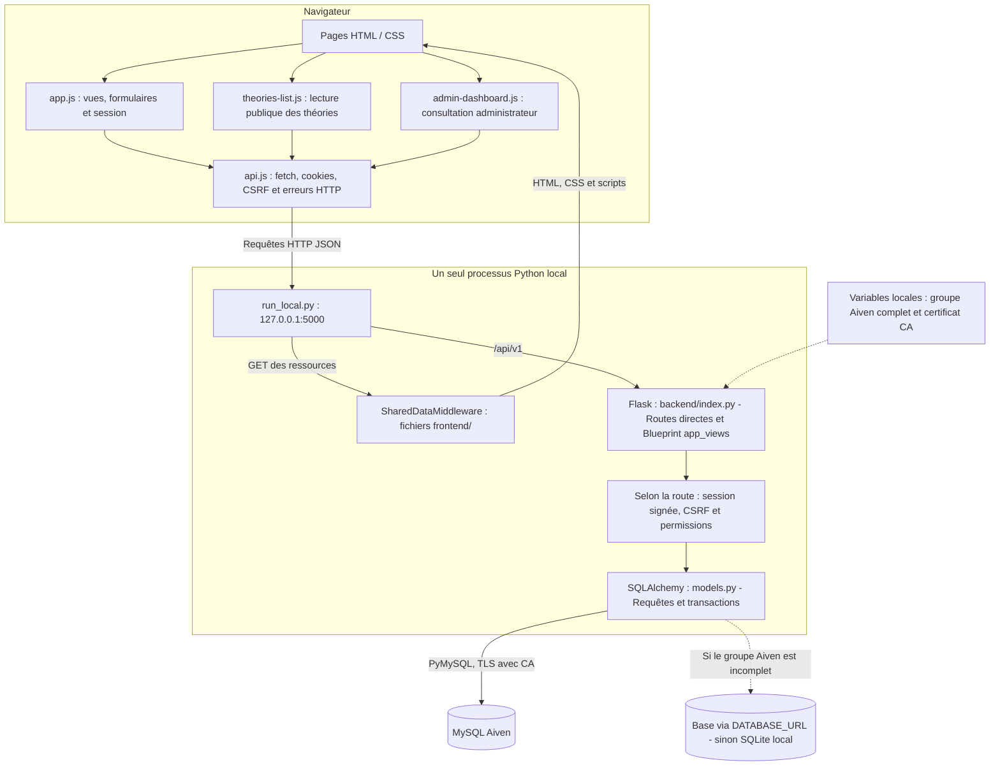
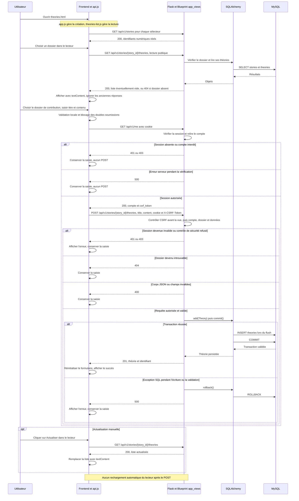

# Fiche commune — Soutenance

[Retour au sommaire de soutenance](README.md)

Questions-réponses historiques récupérées de la réponse Codex de l’étape 15.1 du **25 octobre 2026**, fondée sur le commit `dec5c7ef4c753970bd94014b37b59b035e1877f1`. Audit de référence : étape 15.8.1 ; préparation documentaire : étape 15.8.2, au commit `857190654457b15d7324adde8c920d9fdd3db0c8`.

Les formulations des questions et des réponses courtes originales sont conservées. Les explications, exemples, identifiants de repérage et références facilitent la révision. **VALIDÉE** signifie conforme aux sources ; ce statut ne constitue pas une validation en production.

Empreinte SHA-256 du texte historique complet : `218cf13b814a1f20a4258f1f6b24ab600b296bc62baab1c23610a36905ace4cd`.

**Portée des preuves :** les résultats de tests et de rendu Mermaid sont historiques. Aucun test fonctionnel, rendu de diagramme, serveur, migration ou accès Aiven n’est exécuté pendant cette préparation. Les droits des illustrations restent à confirmer.

## Sommaire

- [Repères pour comprendre](#repères-pour-comprendre)
- [Questions du jury](#questions-du-jury)
- [Organisation de la prise de parole](#organisation-de-la-prise-de-parole)

Accès direct aux 22 questions :

[COM-01](#com-01) · [COM-02](#com-02) · [COM-03](#com-03) · [COM-04](#com-04) · [COM-05](#com-05) · [COM-06](#com-06)

[COM-07](#com-07) · [COM-08](#com-08) · [COM-09](#com-09) · [COM-10](#com-10) · [COM-11](#com-11) · [COM-12](#com-12)

[COM-13](#com-13) · [COM-14](#com-14) · [COM-15](#com-15) · [COM-16](#com-16) · [COM-17](#com-17) · [COM-18](#com-18)

[COM-19](#com-19) · [COM-20](#com-20) · [COM-21](#com-21) · [COM-22](#com-22)

## Repères pour comprendre

### 1. Présentation orale d’environ une minute

> « Les Petits Enquêteurs est un projet de portfolio réalisé dans le cadre de Holberton School. Il permet de découvrir des dossiers d’enquête et de contribuer à leur analyse.
>
> Un visiteur peut consulter les histoires, les Cold Cases et les théories publiées. Un membre connecté peut proposer une nouvelle histoire ou rédiger une théorie. Un administrateur peut consulter les compteurs, les propositions et les signalements.
>
> L’interface utilise HTML, CSS et JavaScript. Elle communique en JSON avec une API Flask. Le backend contrôle les données et les permissions, puis utilise SQLAlchemy pour accéder à la base.
>
> Selon notre répartition, Mahamadou intervient sur la base et l’intégration, Mélissa sur le frontend, et Sylvie sur le backend.
>
> Nous présentons le périmètre réellement disponible. Certaines fonctions existent seulement dans l’API, et le traitement administratif des propositions reste à développer. »

### 2. Présentation orale d’environ trois minutes

> « Bonjour. Nous présentons Les Petits Enquêteurs, notre projet de portfolio réalisé dans le cadre de Holberton School.
>
> Le site permet de consulter des dossiers d’enquête, de partager des théories et de proposer de nouvelles histoires. Nous avons distingué trois profils : le visiteur, le membre connecté et l’administrateur.
>
> Le visiteur peut parcourir les histoires et les Cold Cases. Il peut ouvrir un dossier à partir de son lien et consulter les théories associées. Le membre peut créer une théorie et envoyer une proposition d’histoire. L’administrateur dispose d’un tableau de consultation avec des compteurs, les propositions et les signalements.
>
> L’application est organisée en trois couches. Le frontend utilise HTML pour la structure, CSS pour la présentation et JavaScript pour les interactions. Les appels HTTP sont centralisés dans api.js.
>
> Le backend utilise Flask. Ses routes reçoivent du JSON, vérifient les données et contrôlent les permissions. SQLAlchemy permet ensuite de lire ou d’écrire dans la base.
>
> Le modèle de données comporte neuf tables et dix clés étrangères. Nous séparons notamment les histoires, les théories, les commentaires et les propositions. Quatre migrations Alembic décrivent l’évolution du schéma.
>
> La sécurité repose sur plusieurs contrôles. Les mots de passe sont hachés avec Werkzeug. Les sessions utilisent un cookie signé. Les écritures authentifiées sont protégées par un jeton CSRF, selon les règles prévues par les routes. Le serveur relit également le compte pour vérifier son rôle et son état de bannissement.
>
> Pour l’expérience utilisateur, les contributions conservent leur saisie après un échec. Les doubles soumissions sont bloquées pendant l’envoi. Les images disposent de plusieurs solutions de remplacement, et le lecteur de théories évite d’afficher une ancienne réponse après un changement de dossier.
>
> Le README rapporte une campagne de 439 tests réussis. Ces tests utilisent notamment SQLite en mémoire et des interfaces simulées. Ils ne remplacent pas une validation complète de la base MySQL distante.
>
> Notre répartition annoncée est la suivante : Mahamadou pour la base et l’intégration, Mélissa pour le frontend, Sylvie pour Flask et l’API.
>
> Nous terminerons par une démonstration des parcours disponibles, puis par les limites et les améliorations envisagées. »

### 3. Architecture complète

**À dire simplement**

> « Le navigateur affiche les pages. JavaScript appelle Flask. Flask vérifie la demande et utilise SQLAlchemy pour accéder à la base. La réponse revient en JSON, puis JavaScript met la page à jour. »

Le lanceur [run_local.py](../../run_local.py) sert le frontend et l’API avec **un seul processus local**, sur `127.0.0.1:5000`, sans debug ni reloader.

Il ne crée pas de données et n’applique pas de migrations.

#### Diagramme d’architecture existant

Diagramme repris de la variante approuvée du [README principal](../../README.md). Sa syntaxe, son rendu dans un navigateur local et la validité XML de son SVG ont été validés le 25 octobre 2026 avec Mermaid 11.16.0 lors de la campagne antérieure. Il s’agit d’une **preuve historique** ; aucun rendu n’est relancé ici. L’affichage sur GitHub reste **non vérifié**.

### 4. Rôle de chaque membre

La répartition suivante est **communiquée par l’équipe et reprise dans les README**. Elle n’attribue pas chaque fichier ou chaque correction à une personne.

| Membre | Responsabilité annoncée | Sujet à présenter |
|---|---|---|
| Mahamadou | MySQL, SQLAlchemy et intégration | Tables, relations, migrations, connexion et circulation des données |
| Mélissa | HTML, CSS et JavaScript | Pages, interactions, appels API, erreurs et responsive |
| Sylvie | Flask et API REST | Routes, validation, authentification, permissions et transactions |

Pour une contribution précise, chacun doit citer uniquement ce qu’il peut confirmer personnellement.

### 5. Scénario de démonstration

**Protocole proposé, non exécuté pendant cette mission.**

#### Conditions nécessaires

- Dépendances et configuration déjà préparées.
- Base de démonstration explicitement choisie et utilisable.
- Au moins un dossier existant.
- Catégories compatibles avec les identifiants attendus par le frontend.
- Un compte membre et un compte administrateur préparés.
- Autorisation d’utiliser cette base pour les créations de démonstration.

La reproduction depuis un clone vierge reste **non vérifiée**. Aucun script complet de peuplement initial n’est fourni.

#### Parcours conseillé

| Étape | Action | Résultat attendu |
|---:|---|---|
| 1 | Démarrer `run_local.py` dans l’environnement préparé | Site et API sur la même origine |
| 2 | Ouvrir l’accueil | Jusqu’à trois dossiers récents |
| 3 | Ouvrir Histoires, puis rechercher un mot du titre affiché | Filtrage local des cartes |
| 4 | Ouvrir un dossier depuis sa carte | Titre, résumé, récit et image |
| 5 | Ouvrir Théories sans connexion et choisir un dossier | Consultation publique ou état vide explicite |
| 6 | Se connecter avec le compte membre | Retour à l’accueil et compte reconnu |
| 7 | Créer une théorie avec un titre repérable | Réponse `201`, message de succès, formulaire réinitialisé |
| 8 | Choisir ce dossier dans le lecteur et cliquer sur Actualiser | Théorie visible dans la liste |
| 9 | Envoyer une proposition avec une catégorie | Message de succès ; proposition en `pending` |
| 10 | Se déconnecter depuis l’accueil | Retour à l’affichage anonyme |
| 11 | Se connecter avec le compte administrateur | Accès aux données du tableau |
| 12 | Consulter les propositions | Proposition de démonstration présente, sans action de publication |
| 13 | Présenter Swagger | Liste des opérations et fonctions disponibles seulement dans l’API |

Les identifiants doivent venir des données réellement renvoyées. Ne pas reprendre un identifiant arbitraire d’un test.

Pour montrer la conservation d’une saisie, une démonstration complémentaire peut être préparée dans un environnement isolé. Elle doit éviter toute modification improvisée de la base ou du code pendant la soutenance.

### 6. Parcours d’une théorie

Le diagramme existant rassemble la lecture publique, la création et les principaux refus. Certains contrôles sont regroupés pour la lisibilité.

Diagramme repris de la variante approuvée du [README principal](../../README.md). Sa syntaxe, son rendu dans un navigateur local et la validité XML de son SVG ont été validés le 25 octobre 2026 avec Mermaid 11.16.0 lors de la campagne antérieure. Il s’agit d’une **preuve historique** ; aucun rendu n’est relancé ici. L’affichage sur GitHub reste **non vérifié**.

### 7. Difficultés techniques et réponses observables

Ces éléments décrivent des problèmes traités par les sources. Ils ne constituent pas une attribution individuelle ni un récit confirmé de tous les incidents de développement.

| Difficulté | Réponse présente | Niveau de preuve |
|---|---|---|
| Raccorder pages et API | Appels centralisés et lanceur sur une même origine | **Vérifié dans les sources** |
| Utiliser les bons dossiers | Sélecteurs alimentés par les identifiants API | **Vérifié dans les sources** |
| Perdre une contribution après un échec | Réinitialisation uniquement après le succès attendu | **Vérifié dans les sources** |
| Soumettre deux fois | Indicateur `sending` et contrôles désactivés | **Vérifié dans les sources** |
| Afficher une ancienne réponse | Annulation et numéro de version des requêtes | **Vérifié dans les sources** |
| Gérer les images manquantes | Repli borné jusqu’au SVG, puis texte | **Vérifié dans les sources** |
| Autoriser un ancien administrateur ou un compte banni | Relecture du compte en base | **Vérifié dans les sources** |
| Maintenir deux compteurs de signalements | Suppression du compteur historique et calcul depuis `reports` | **Vérifié dans les sources** |
| Comparer le formulaire avec CRLF ou LF | Normalisation présente dans le test de préservation | Code **vérifié dans les sources** ; succès de campagne = **preuve historique** |

### 8. Limites et améliorations futures

| Limite actuelle | Amélioration possible |
|---|---|
| Administration de consultation | Concevoir un parcours de traitement des propositions et signalements |
| Fonctions accessibles seulement par API | Ajouter leurs interfaces avec les mêmes contrôles serveur |
| Catégories codées avec `1` et `2` | Charger une configuration de catégories explicite |
| Listes non paginées | Ajouter une pagination |
| Comptages supplémentaires par élément | Regrouper les comptages |
| Aucun peuplement initial complet | Fournir un jeu fictif reproductible |
| Installation vierge non validée de bout en bout | Vérifier le parcours dans un environnement isolé |
| Dates sans fuseau explicite dans l’API | Uniformiser leur représentation |
| Pas de récupération de mot de passe | Concevoir un parcours sécurisé |
| Droits des illustrations non documentés | Confirmer provenance et conditions d’utilisation |
| Tests frontend simulés | Compléter avec des essais sur navigateur réel |

Ces améliorations sont des pistes. Elles ne sont pas présentées comme réalisées.

## Questions du jury

### COM-01

**Question du jury**

Quel problème votre projet traite-t-il ?

**Réponse courte à dire**

Il rassemble la consultation de dossiers d’enquête et les contributions des membres dans une même application.

**Explication simple**

Le périmètre associe lecture publique et contributions de membres.

**Exemple concret**

Lire un dossier, puis proposer une théorie.

**Référence technique**

[README.md](../../README.md#L3)

**Statut de validation**

**VALIDÉE — conforme aux sources.**

### COM-02

**Question du jury**

À qui s’adresse le site ?

**Réponse courte à dire**

Aux visiteurs qui lisent, aux membres qui contribuent et aux administrateurs qui consultent les données de suivi.

**Explication simple**

Les droits dépendent du rôle et de la connexion.

**Exemple concret**

Visiteur : lecture ; administrateur : consultation des propositions.

**Référence technique**

[README.md](../../README.md#L5)

**Statut de validation**

**VALIDÉE — conforme aux sources.**

### COM-03

**Question du jury**

Quel est le parcours principal ?

**Réponse courte à dire**

Lire un dossier, consulter ses théories, puis se connecter pour contribuer.

**Explication simple**

Le parcours relie les écrans à un même dossier identifié par l’API.

**Exemple concret**

Ouvrir dossier.html?slug=..., puis consulter ses théories.

**Référence technique**

[frontend/app.js](../../frontend/app.js#L139)

**Statut de validation**

**VALIDÉE — conforme aux sources.**

### COM-04

**Question du jury**

Comment les trois couches communiquent-elles ?

**Réponse courte à dire**

Le frontend envoie une requête HTTP JSON à Flask. Flask utilise SQLAlchemy, puis renvoie une réponse au navigateur.

**Explication simple**

Chaque couche remplit une responsabilité avant de transmettre le résultat à la suivante.

**Exemple concret**

Navigateur vers Flask, puis requête SQLAlchemy.

**Référence technique**

[frontend/api.js](../../frontend/api.js#L31)

**Statut de validation**

**VALIDÉE — conforme aux sources.**

### COM-05

**Question du jury**

Pourquoi séparer frontend et backend ?

**Réponse courte à dire**

Le frontend gère l’interaction. Le backend centralise les validations, permissions et accès aux données.

**Explication simple**

Les règles de sécurité ne doivent pas dépendre de l’affichage du navigateur.

**Exemple concret**

Les contrôles serveur restent actifs sans bouton visible.

**Référence technique**

[backend/api/v1/views/permissions.py](../../backend/api/v1/views/permissions.py#L47)

**Statut de validation**

**VALIDÉE — conforme aux sources.**

### COM-06

**Question du jury**

Quel est l’intérêt de l’API ?

**Réponse courte à dire**

Elle fournit un contrat commun pour consulter et modifier les données. Plusieurs pages peuvent utiliser les mêmes opérations.

**Explication simple**

Le même contrat de données peut être utilisé par plusieurs écrans.

**Exemple concret**

getStories() sert aux listes et aux sélecteurs.

**Référence technique**

[frontend/api.js](../../frontend/api.js#L146)

**Statut de validation**

**VALIDÉE — conforme aux sources.**

### COM-07

**Question du jury**

Combien de tables avez-vous ?

**Réponse courte à dire**

Neuf modèles sont présents. Ils séparent les comptes, dossiers et différents types de contribution.

**Explication simple**

Chaque modèle décrit un type de donnée à conserver.

**Exemple concret**

User, Story, Theory et six autres modèles.

**Référence technique**

[backend/models.py](../../backend/models.py#L10)

**Statut de validation**

**VALIDÉE — conforme aux sources.**

### COM-08

**Question du jury**

Pourquoi une proposition n’est-elle pas directement une histoire ?

**Réponse courte à dire**

Elle représente un contenu soumis à examen. Elle reste en `pending`, et sa transformation en histoire n’est pas implémentée.

**Explication simple**

Recevoir une proposition et publier une histoire sont deux opérations différentes.

**Exemple concret**

La création fixe status='pending'.

**Référence technique**

[backend/api/v1/views/proposals.py](../../backend/api/v1/views/proposals.py#L47)

**Statut de validation**

**VALIDÉE — conforme aux sources.**

### COM-09

**Question du jury**

Les théories sont-elles modérées avant affichage ?

**Réponse courte à dire**

Aucune étape de modération préalable n’est implémentée. Une théorie enregistrée est consultable.

**Explication simple**

Le lecteur interroge directement les théories enregistrées du dossier.

**Exemple concret**

GET public sans filtre de statut de modération.

**Référence technique**

[backend/api/v1/views/theories.py](../../backend/api/v1/views/theories.py#L31)

**Statut de validation**

**VALIDÉE — conforme aux sources.**

### COM-10

**Question du jury**

Peut-on contribuer sans compte ?

**Réponse courte à dire**

Les lectures prévues sont publiques. La création de théories et de propositions exige un compte connecté et non banni.

**Explication simple**

L’auteur des contributions est déterminé à partir de la session côté serveur.

**Exemple concret**

Un utilisateur anonyme reçoit 401.

**Référence technique**

[backend/api/v1/views/theories.py](../../backend/api/v1/views/theories.py#L57)

**Statut de validation**

**VALIDÉE — conforme aux sources.**

### COM-11

**Question du jury**

Comment protégez-vous les mots de passe ?

**Réponse courte à dire**

Le backend stocke un hachage Werkzeug et vérifie le mot de passe avec la fonction dédiée.

**Explication simple**

Le hachage sert à vérifier un mot de passe sans conserver sa valeur d’origine en clair.

**Exemple concret**

Le modèle utilise Werkzeug.

**Référence technique**

[backend/models.py](../../backend/models.py#L29)

**Statut de validation**

**VALIDÉE — conforme aux sources.**

### COM-12

**Question du jury**

Qui décide qu’un compte est administrateur ?

**Réponse courte à dire**

Le backend vérifie le rôle stocké en base. L’inscription publique ne permet pas de choisir ce rôle.

**Explication simple**

Le formulaire public crée un compte classique ; le rôle est une donnée contrôlée côté serveur.

**Exemple concret**

Le JSON client ne permet pas de définir is_admin.

**Référence technique**

[backend/api/v1/views/users.py](../../backend/api/v1/views/users.py#L39)

**Statut de validation**

**VALIDÉE — conforme aux sources.**

### COM-13

**Question du jury**

Pourquoi protéger aussi les routes si le bouton est caché ?

**Réponse courte à dire**

Une requête peut être envoyée sans l’interface. L’autorisation doit donc être vérifiée côté serveur.

**Explication simple**

Un client peut appeler directement une URL même si son bouton est absent.

**Exemple concret**

La lecture des signalements exige admin_required.

**Référence technique**

[backend/api/v1/views/permissions.py](../../backend/api/v1/views/permissions.py#L47)

**Statut de validation**

**VALIDÉE — conforme aux sources.**

### COM-14

**Question du jury**

Comment gérez-vous une API indisponible ?

**Réponse courte à dire**

L’interface affiche une erreur et conserve les contributions en cours. Elle ne remplace pas automatiquement les données par `donnees.js`.

**Explication simple**

Les parcours API ne basculent pas sur le tableau historique en cas de panne.

**Exemple concret**

L’erreur est affichée ; la saisie des contributions reste dans la page.

**Référence technique**

[frontend/app.js](../../frontend/app.js#L108)

**Statut de validation**

**VALIDÉE — conforme aux sources.**

### COM-15

**Question du jury**

Que faites-vous contre les doubles soumissions ?

**Réponse courte à dire**

Les formulaires bloquent les nouveaux envois pendant la requête. Ils ne répètent pas automatiquement le POST.

**Explication simple**

Bloquer un second clic ne fournit pas une garantie universelle d’unicité côté serveur.

**Exemple concret**

sending bloque les soumissions simultanées du formulaire.

**Référence technique**

[frontend/app.js](../../frontend/app.js#L313)

**Statut de validation**

**VALIDÉE — conforme aux sources.**

### COM-16

**Question du jury**

Que prouvent les 439 tests ?

**Réponse courte à dire**

Le README rapporte leur réussite dans la campagne de référence. Leur portée dépend des environnements isolés et des simulations utilisés.

**Explication simple**

Le nombre de réussites est rapporté par le README, et non observé par une nouvelle campagne ici.

**Exemple concret**

205 + 226 + 8 = 439.

**Référence technique**

[README.md](../../README.md#L546)

**Statut de validation**

**VALIDÉE — preuve historique rapportée dans le README, sans nouvelle exécution.**

### COM-17

**Question du jury**

Ces tests prouvent-ils que toute la production fonctionne ?

**Réponse courte à dire**

Non. Ils ne valident pas à eux seuls MySQL distant, le rendu réel, le déploiement ou une installation vierge complète.

**Explication simple**

Les simulations et SQLite couvrent un périmètre précis, pas tous les environnements réels.

**Exemple concret**

La connexion Aiven et les migrations déployées restent non vérifiées.

**Référence technique**

[README.md](../../README.md#L553)

**Statut de validation**

**VALIDÉE — conforme aux sources.**

### COM-18

**Question du jury**

Le tableau de bord peut-il bannir ou publier ?

**Réponse courte à dire**

Son interface permet seulement la consultation. Le bannissement existe dans l’API ; la publication de propositions reste à développer.

**Explication simple**

Une route API peut exister sans qu’un bouton correspondant soit livré.

**Exemple concret**

L’API de bannissement existe ; le tableau ne propose aucune action de bannissement.

**Référence technique**

[frontend/admin-dashboard.js](../../frontend/admin-dashboard.js#L127)

**Statut de validation**

**VALIDÉE — conforme aux sources.**

### COM-19

**Question du jury**

Les votes et les likes suivent-ils la même règle ?

**Réponse courte à dire**

Un vote est unique par utilisateur et histoire. Les likes sont des incréments répétés autorisés.

**Explication simple**

Les votes possèdent une contrainte d’unicité, alors que les likes sont des compteurs.

**Exemple concret**

Un second vote est refusé ; un autre like est accepté.

**Référence technique**

[backend/models.py](../../backend/models.py#L362)

**Statut de validation**

**VALIDÉE — conforme aux sources.**

### COM-20

**Question du jury**

Peut-on reproduire la démonstration depuis une base vide ?

**Réponse courte à dire**

Pas avec les migrations seules. Il faut aussi préparer les dossiers, catégories et comptes nécessaires.

**Explication simple**

Un schéma vide ne contient ni les dossiers ni les comptes nécessaires à la démonstration.

**Exemple concret**

Préparer séparément une base de démonstration isolée.

**Référence technique**

[README.md](../../README.md#L512)

**Statut de validation**

**VALIDÉE — conforme aux sources.**

### COM-21

**Question du jury**

Qu’amélioreriez-vous en priorité ?

**Réponse courte à dire**

La reproductibilité de l’installation et des données de démonstration, puis la pagination et les parcours d’administration.

**Explication simple**

Cet ordre d’amélioration est une proposition pédagogique à faire approuver par l’équipe.

**Exemple concret**

Priorité suggérée : rendre l’installation reproductible avant d’étendre l’administration.

**Référence technique**

[README.md](../../README.md#L605)

**Statut de validation**

**NON CONFIRMÉE — priorité proposée, à confirmer par l'équipe.**

### COM-22

**Question du jury**

Comment avez-vous réparti le travail ?

**Réponse courte à dire**

Selon la répartition communiquée : Mahamadou pour la base et l’intégration, Mélissa pour le frontend, Sylvie pour le backend. Les contributions précises doivent être confirmées par chacun.

**Explication simple**

La répartition est confirmée par la demande de l’équipe ; elle ne prouve pas l’auteur de chaque modification.

**Exemple concret**

Chacun doit expliquer et confirmer ses contributions personnelles.

**Référence technique**

[README.md](../../README.md#L9)

**Statut de validation**

**VALIDÉE — conforme aux sources.**

## Organisation de la prise de parole

Exemple pour une soutenance de **12 minutes**, hors questions :

| Durée | Intervenant | Contenu |
|---|---|---|
| 1 min | Mélissa | Projet, utilisateurs et parcours |
| 2 min | Mahamadou | Tables, relations, migrations et connexion |
| 2 min | Sylvie | API, session, permissions et validations |
| 2 min | Mélissa | Pages, appels API, erreurs et responsive |
| 3 min | Équipe | Démonstration ; chacun explique sa couche |
| 1 min | Mahamadou | Intégration et portée des tests |
| 1 min | Sylvie | Limites et améliorations |

Transitions possibles :

> Mélissa : « Le formulaire transmet maintenant la contribution à Flask. Sylvie va expliquer les contrôles du serveur. »

> Sylvie : « Une fois la demande autorisée, SQLAlchemy prépare l’écriture. Mahamadou va expliquer les contraintes de la base. »

[Retour au sommaire de soutenance](README.md)
