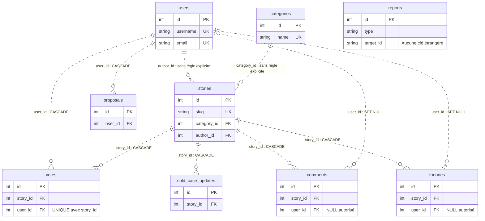

# Fiche Mahamadou — Base de données et intégration

[Retour au sommaire de soutenance](README.md)

Questions-réponses historiques récupérées de la réponse Codex de l’étape 15.1 du **25 octobre 2026**, fondée sur le commit `dec5c7ef4c753970bd94014b37b59b035e1877f1`. Audit de référence : étape 15.8.1 ; préparation documentaire : étape 15.8.2, au commit `857190654457b15d7324adde8c920d9fdd3db0c8`.

Les formulations des questions et des réponses courtes originales sont conservées. Les explications, exemples, identifiants de repérage et références facilitent la révision. **VALIDÉE** signifie conforme aux sources ; ce statut ne constitue pas une validation en production.

Empreinte SHA-256 du texte historique complet : `218cf13b814a1f20a4258f1f6b24ab600b296bc62baab1c23610a36905ace4cd`.

**Portée des preuves :** les résultats de tests et de rendu Mermaid sont historiques. Aucun test fonctionnel, rendu de diagramme, serveur, migration ou accès Aiven n’est exécuté pendant cette préparation. Les droits des illustrations restent à confirmer.

## Sommaire

- [Repères pour comprendre](#repères-pour-comprendre)
- [Questions du jury](#questions-du-jury)

Accès direct aux 18 questions :

[MAH-01](#mah-01) · [MAH-02](#mah-02) · [MAH-03](#mah-03) · [MAH-04](#mah-04) · [MAH-05](#mah-05) · [MAH-06](#mah-06)

[MAH-07](#mah-07) · [MAH-08](#mah-08) · [MAH-09](#mah-09) · [MAH-10](#mah-10) · [MAH-11](#mah-11) · [MAH-12](#mah-12)

[MAH-13](#mah-13) · [MAH-14](#mah-14) · [MAH-15](#mah-15) · [MAH-16](#mah-16) · [MAH-17](#mah-17) · [MAH-18](#mah-18)

## Repères pour comprendre

**Phrase à retenir à l’oral**

> « La base conserve les comptes, les dossiers et les contributions. SQLAlchemy permet au backend Python de manipuler ces données. Les contraintes maintiennent leur cohérence, et Alembic décrit les évolutions du schéma. »

Sources principales : [models.py](../../backend/models.py), [configuration Flask](../../backend/index.py), [migrations](../../migrations/versions).

### 1. MySQL et les neuf tables

**MySQL** est un système de gestion de base de données relationnelle. Il organise les données dans des tables reliées.

Dans le projet, il conserve les informations après la fermeture du navigateur ou du serveur. Le navigateur passe par Flask pour consulter ou modifier ces informations.

Les **neuf modèles SQLAlchemy** sont vérifiés dans les sources.

| Modèle / table | Fonction | Exemple d’information |
|---|---|---|
| `User` / `users` | Comptes des utilisateurs | Pseudo, email, mot de passe haché, rôle, bannissement |
| `Category` / `categories` | Classement des dossiers | Nom et description d’une catégorie |
| `Story` / `stories` | Dossiers d’enquête | Titre, slug, résumé, récit, référence d’image |
| `Theory` / `theories` | Analyses proposées sur un dossier | Titre, contenu, auteur, compteur de likes |
| `Comment` / `comments` | Commentaires d’un dossier | Texte, auteur, pseudo conservé, likes |
| `Vote` / `votes` | Votes des utilisateurs pour les dossiers | Utilisateur et dossier concernés |
| `Proposal` / `proposals` | Propositions de nouvelles histoires | Titre, contenu, statut |
| `Report` / `reports` | Signalements | Type, identifiant de cible, motif, statut |
| `ColdCaseUpdate` / `cold_case_updates` | Mises à jour d’un dossier | Contenu et dossier concerné |

Une proposition est distincte d’une histoire. Elle est enregistrée en `pending`. Aucun parcours d’acceptation ou de publication automatique n’est implémenté.

### 2. Clés primaires, clés étrangères et unicité

Une **clé primaire** identifie une ligne de manière unique.

Exemple réel :

```python
id = db.Column(db.Integer, primary_key=True)
```

Chaque table possède un identifiant `id`. Deux histoires peuvent avoir des titres proches, mais leurs identifiants restent différents.

Une **clé étrangère** référence une ligne d’une autre table.

Exemple réel dans `Theory` :

```python
story_id = db.Column(
    db.Integer,
    db.ForeignKey(
        "stories.id",
        name="fk_theories_story",
        ondelete="CASCADE"
    ),
    nullable=False
)
```

Cela rattache chaque théorie à une histoire existante.

Une **contrainte unique** interdit un doublon. Les unicités déclarées sont :

- `users.username` ;
- `users.email` ;
- `categories.name` ;
- `stories.slug` ;
- le couple `votes(user_id, story_id)`.

Exemple réel :

```python
db.UniqueConstraint(
    "user_id",
    "story_id",
    name="unique_user_story_vote"
)
```

Cette dernière contrainte autorise un utilisateur à voter pour plusieurs histoires. Elle interdit plusieurs votes du même utilisateur pour la même histoire.

### 3. Les dix relations et leurs cardinalités

La **cardinalité** indique combien de lignes peuvent être associées.

Dans le tableau, « plusieurs » signifie **zéro, une ou plusieurs** lignes du côté des contributions.

| Clé étrangère | Cardinalité | Suppression déclarée |
|---|---|---|
| `stories.category_id → categories.id` | Une catégorie par histoire ; plusieurs histoires par catégorie | Sans règle `ON DELETE` explicite |
| `stories.author_id → users.id` | Un auteur par histoire ; plusieurs histoires par auteur | Sans règle explicite |
| `theories.story_id → stories.id` | Une histoire par théorie ; plusieurs théories par histoire | `CASCADE` |
| `theories.user_id → users.id` | Zéro ou un utilisateur par théorie ; plusieurs théories par utilisateur | `SET NULL` |
| `comments.story_id → stories.id` | Une histoire par commentaire ; plusieurs commentaires par histoire | `CASCADE` |
| `comments.user_id → users.id` | Zéro ou un utilisateur par commentaire ; plusieurs commentaires par utilisateur | `SET NULL` |
| `votes.story_id → stories.id` | Une histoire par vote ; plusieurs votes par histoire | `CASCADE` |
| `votes.user_id → users.id` | Un utilisateur par vote ; plusieurs votes par utilisateur | `CASCADE` |
| `proposals.user_id → users.id` | Un utilisateur par proposition ; plusieurs propositions par utilisateur | `CASCADE` |
| `cold_case_updates.story_id → stories.id` | Une histoire par mise à jour ; plusieurs mises à jour par histoire | `CASCADE` |

**Point important :** `reports.target_id` est une chaîne. Ce champ n’est pas une clé étrangère. L’API contrôle l’existence du commentaire avant de créer son signalement.

#### Diagramme relationnel existant

Diagramme repris de la variante approuvée du [README principal](../../README.md). Sa syntaxe, son rendu dans un navigateur local et la validité XML de son SVG ont été validés le 25 octobre 2026 avec Mermaid 11.16.0 lors de la campagne antérieure. Il s’agit d’une **preuve historique** ; aucun rendu n’est relancé ici. L’affichage sur GitHub reste **non vérifié**.



`PK` signifie clé primaire. `FK` signifie clé étrangère. `UK` indique une unicité individuelle.

### 4. `CASCADE`, `SET NULL` et relations SQLAlchemy

**`CASCADE`** supprime les lignes dépendantes lors de la suppression du parent, lorsque la contrainte SQL est effectivement appliquée.

Exemple : supprimer une histoire entraîne la suppression de ses théories selon la contrainte déclarée.

**`SET NULL`** conserve la ligne dépendante et retire sa référence au parent.

Exemple : après suppression d’un utilisateur, une théorie peut rester avec `user_id = NULL`.

Cette différence permet de conserver certaines contributions. Elle ne garantit pas une anonymisation complète : `Comment` conserve aussi un champ `username`.

Les collections de `Story` déclarent également :

```python
cascade="all, delete-orphan"
```

C’est un comportement de l’ORM. Il faut le distinguer des règles SQL `ON DELETE`. Les relations de `User` ne déclarent pas toutes une cascade ORM équivalente.

Enfin, les références `stories.author_id` et `stories.category_id` restent obligatoires, sans cascade explicite. Une suppression du parent peut donc être refusée tant que des histoires le référencent.

### 5. SQLAlchemy et les transactions

**SQLAlchemy** est un ORM : il fait correspondre des classes Python et des tables.

Exemple réel :

```python
Theory.query.filter_by(story_id=story_id)
```

Cette requête sélectionne les théories d’un dossier. Elle permet d’exprimer le filtre avec les modèles Python.

Une **transaction** regroupe des opérations sur la base.

Dans la création d’une théorie, le code suit ce principe :

```python
db.session.add(new_theory)
db.session.commit()
```

- `add()` prépare l’objet dans la session SQLAlchemy.
- `commit()` valide la transaction. L’insertion peut être envoyée pendant le flush associé.
- `rollback()` annule les changements non validés après une erreur.

Les routes d’écriture concernées interceptent les erreurs SQL et appellent `rollback()`. Cela évite de conserver une transaction en échec.

### 6. Les quatre migrations Alembic

Une **migration** est une évolution versionnée du schéma.

La chaîne présente dans le dépôt est :

```text
921687c1bd7c → 3111f5767fc6 → a590c8aac613 → 82deda84bc35
```

| Révision | Évolution |
|---|---|
| `921687c1bd7c` | Crée les sept tables initiales et leurs contraintes |
| `3111f5767fc6` | Remplace certaines clés étrangères pour ajouter `CASCADE` et `SET NULL` |
| `a590c8aac613` | Ajoute `reports`, `cold_case_updates` et `users.is_banned` |
| `82deda84bc35` | Supprime l’ancien compteur `comments.reports` |

Le nombre de signalements d’un commentaire est maintenant calculé depuis les lignes de `reports`.

**Nuance à connaître :** les modèles actuels et les migrations sont deux éléments différents. Les fichiers de migration décrivent les changements prévus. Leur présence ne prouve pas leur application sur Aiven.

Les valeurs `default=` et `onupdate=` des modèles sont appliquées par SQLAlchemy. Elles ne sont pas automatiquement des valeurs par défaut ou des déclencheurs permanents dans MySQL.

### 7. Connexion Flask, Aiven et TLS

Dans [backend/index.py](../../backend/index.py#L80), le backend lit six paramètres Aiven :

- hôte ;
- port ;
- utilisateur ;
- mot de passe ;
- nom de base ;
- chemin du certificat CA.

Les noms de variables sont `AIVEN_DB_HOST`, `AIVEN_DB_PORT`, `AIVEN_DB_USER`, `AIVEN_DB_PASSWORD`, `AIVEN_DB_NAME` et `AIVEN_CA_CERT`.

Si les six paramètres sont renseignés, Flask-SQLAlchemy utilise MySQL avec le pilote **PyMySQL**. Le code configure le certificat CA dans les options SSL et active `pool_pre_ping`.

**TLS** protège la communication avec le serveur de base de données. Le certificat CA sert à vérifier le certificat présenté par le serveur.

Si le groupe Aiven est incomplet, le backend utilise `DATABASE_URL`, ou le fichier SQLite local si cette variable est absente.

**Vérifié dans les sources :** cette logique de configuration existe.

**Non vérifié :** valeurs locales, disponibilité du certificat, connexion TLS réelle et révision déployée sur Aiven.

### 8. Intégration et différence entre SQLite et MySQL

Parcours réel d’une contribution :

1. Le formulaire recueille le titre et le contenu.
2. `app.js` valide la saisie et vérifie la session.
3. `api.js` envoie une requête JSON avec le cookie et le CSRF.
4. Flask contrôle la requête.
5. La route crée un objet SQLAlchemy.
6. SQLAlchemy écrit dans la base configurée.
7. Flask renvoie le résultat.
8. Le navigateur affiche le succès ou l’erreur.

Les tests backend utilisent **SQLite en mémoire** avec des données synthétiques. Les garde-fous lus dans les tests interdisent les connexions externes.

Ces tests utilisent notamment `db.create_all()`. Ils ne rejouent pas les quatre migrations historiques.

Ils peuvent vérifier des contrats HTTP et des écritures isolées. Ils ne prouvent pas le comportement complet de MySQL, ses contraintes déployées ou sa connexion TLS.

## Questions du jury

### MAH-01

**Question du jury**

À quoi sert MySQL ?

**Réponse courte à dire**

Il conserve durablement les comptes, dossiers et contributions. Le backend y accède pour lire et enregistrer les données.

**Explication simple**

Les informations restent enregistrées après la fermeture du navigateur ; la base choisie dépend de la configuration.

**Exemple concret**

Un dossier peut être relu lors d’une visite suivante.

**Référence technique**

[backend/index.py](../../backend/index.py#L80)

**Statut de validation**

**VALIDÉE — conforme aux sources.**

### MAH-02

**Question du jury**

Pourquoi utiliser plusieurs tables ?

**Réponse courte à dire**

Chaque table représente une notion. Par exemple, une histoire peut recevoir plusieurs théories sans recopier tout le dossier dans chaque théorie.

**Explication simple**

Séparer les sujets évite de recopier les mêmes informations partout.

**Exemple concret**

Une histoire possède plusieurs théories dans une table distincte.

**Référence technique**

[backend/models.py](../../backend/models.py#L62)

**Statut de validation**

**VALIDÉE — conforme aux sources.**

### MAH-03

**Question du jury**

Qu’est-ce qu’une clé primaire ?

**Réponse courte à dire**

C’est l’identifiant unique d’une ligne. Dans `stories`, il s’agit de `id`.

**Explication simple**

Un identifiant permet de distinguer deux lignes même si leur titre est identique.

**Exemple concret**

stories.id identifie un dossier.

**Référence technique**

[backend/models.py](../../backend/models.py#L67)

**Statut de validation**

**VALIDÉE — conforme aux sources.**

### MAH-04

**Question du jury**

Qu’est-ce qu’une clé étrangère ?

**Réponse courte à dire**

C’est une référence vers une autre table. `theories.story_id` rattache une théorie à son histoire.

**Explication simple**

La référence relie une contribution au dossier auquel elle appartient.

**Exemple concret**

Theory.story_id référence stories.id.

**Référence technique**

[backend/models.py](../../backend/models.py#L184)

**Statut de validation**

**VALIDÉE — conforme aux sources.**

### MAH-05

**Question du jury**

Quelle est la relation entre histoire et théorie ?

**Réponse courte à dire**

Une histoire peut avoir plusieurs théories. Chaque théorie appartient à une seule histoire.

**Explication simple**

Le lien est obligatoire pour la théorie ; une histoire peut n’avoir encore aucune théorie.

**Exemple concret**

Une liste de théories vide reste possible.

**Référence technique**

[backend/models.py](../../backend/models.py#L184)

**Statut de validation**

**VALIDÉE — conforme aux sources.**

### MAH-06

**Question du jury**

Pourquoi l’auteur d’une théorie peut-il être nul ?

**Réponse courte à dire**

La base prévoit `SET NULL` lors de la suppression de l’utilisateur. La contribution peut ainsi être conservée.

**Explication simple**

L’auteur est facultatif dans le modèle, et la règle SQL déclarée permet de conserver la contribution.

**Exemple concret**

theories.user_id peut devenir NULL si la contrainte est appliquée.

**Référence technique**

[backend/models.py](../../backend/models.py#L194)

**Statut de validation**

**VALIDÉE — conforme aux sources.**

### MAH-07

**Question du jury**

Quelle différence entre `CASCADE` et `SET NULL` ?

**Réponse courte à dire**

`CASCADE` supprime les lignes dépendantes. `SET NULL` conserve ces lignes et retire leur référence au parent.

**Explication simple**

Les deux règles décrivent le traitement des lignes liées quand un parent disparaît.

**Exemple concret**

Suppression d’histoire : CASCADE ; suppression d’auteur de théorie : SET NULL.

**Référence technique**

[backend/models.py](../../backend/models.py#L184)

**Statut de validation**

**VALIDÉE — conforme aux sources.**

### MAH-08

**Question du jury**

Comment empêcher deux votes identiques ?

**Réponse courte à dire**

La contrainte unique porte sur le couple utilisateur/histoire. L’API renvoie aussi `409` lorsqu’un vote existe déjà.

**Explication simple**

La même paire utilisateur-dossier ne peut être enregistrée deux fois selon la contrainte déclarée.

**Exemple concret**

POST /api/v1/votes/{story_id} renvoie 409 pour un doublon reconnu.

**Référence technique**

[backend/models.py](../../backend/models.py#L362)

**Statut de validation**

**VALIDÉE — conforme aux sources.**

### MAH-09

**Question du jury**

Pourquoi garder une contrainte SQL si l’API vérifie déjà ?

**Réponse courte à dire**

Deux requêtes peuvent arriver presque en même temps. La contrainte reste une protection au niveau de la base.

**Explication simple**

La base protège aussi contre deux demandes simultanées qui passent le premier contrôle.

**Exemple concret**

La route traite le conflit unique après rollback.

**Référence technique**

[backend/api/v1/views/histoires.py](../../backend/api/v1/views/histoires.py#L90)

**Statut de validation**

**VALIDÉE — conforme aux sources.**

### MAH-10

**Question du jury**

À quoi sert SQLAlchemy ?

**Réponse courte à dire**

Il permet de manipuler les tables avec des modèles Python. Par exemple, `filter_by(story_id=...)` sélectionne les contributions d’un dossier.

**Explication simple**

Les classes Python représentent les tables et servent à construire les requêtes.

**Exemple concret**

filter_by(story_id=story_id) limite la lecture au dossier choisi.

**Référence technique**

[backend/api/v1/views/theories.py](../../backend/api/v1/views/theories.py#L43)

**Statut de validation**

**VALIDÉE — conforme aux sources.**

### MAH-11

**Question du jury**

Que fait `commit()` ?

**Réponse courte à dire**

Il valide la transaction en cours. Dans la route de création, il rend persistante la nouvelle théorie si l’opération réussit.

**Explication simple**

La validation rend durables les changements de la transaction si l’écriture réussit.

**Exemple concret**

Création d’une théorie : add(), puis commit().

**Référence technique**

[backend/api/v1/views/theories.py](../../backend/api/v1/views/theories.py#L89)

**Statut de validation**

**VALIDÉE — conforme aux sources.**

### MAH-12

**Question du jury**

Que fait `rollback()` ?

**Réponse courte à dire**

Il annule la transaction non validée après une erreur. La route peut alors renvoyer une erreur sans laisser cette transaction bloquée.

**Explication simple**

Après un échec, la transaction en cours est abandonnée avant de répondre au client.

**Exemple concret**

La route renvoie 500 si l’écriture SQL échoue.

**Référence technique**

[backend/api/v1/views/theories.py](../../backend/api/v1/views/theories.py#L93)

**Statut de validation**

**VALIDÉE — conforme aux sources.**

### MAH-13

**Question du jury**

À quoi sert Alembic ?

**Réponse courte à dire**

Il décrit les évolutions du schéma dans un ordre versionné. Le projet possède quatre révisions successives.

**Explication simple**

Les migrations décrivent les transformations successives du schéma ; elles ne prouvent pas leur déploiement.

**Exemple concret**

Quatre révisions reliées par down_revision.

**Référence technique**

[migrations/versions/921687c1bd7c_baseline_schema.py](../../migrations/versions/921687c1bd7c_baseline_schema.py#L14)

**Statut de validation**

**VALIDÉE — conforme aux sources.**

### MAH-14

**Question du jury**

Pourquoi supprimer `comments.reports` ?

**Réponse courte à dire**

Les signalements possèdent leur propre table. Le compteur est calculé depuis cette table, ce qui évite de maintenir deux représentations du même nombre.

**Explication simple**

Le nombre affiché est calculé à partir des signalements réellement enregistrés.

**Exemple concret**

Report.query.filter_by(type='comment', target_id=...).count().

**Référence technique**

[backend/api/v1/views/comments.py](../../backend/api/v1/views/comments.py#L11)

**Statut de validation**

**VALIDÉE — conforme aux sources.**

### MAH-15

**Question du jury**

Pourquoi le certificat CA est-il utile ?

**Réponse courte à dire**

Il participe à la vérification du serveur pendant la connexion TLS. Le code transmet son chemin à PyMySQL.

**Explication simple**

Le code donne à PyMySQL le chemin du certificat CA ; la connexion réelle n’est pas testée ici.

**Exemple concret**

connect_args contient ssl.ca.

**Référence technique**

[backend/index.py](../../backend/index.py#L100)

**Statut de validation**

**VALIDÉE — conforme aux sources.**

### MAH-16

**Question du jury**

Les tests SQLite prouvent-ils que MySQL fonctionne ?

**Réponse courte à dire**

Ils apportent une preuve sur les comportements testés avec SQLite. La connexion et les contraintes MySQL doivent être vérifiées séparément.

**Explication simple**

Un comportement vérifié avec une base de test n’est pas automatiquement vérifié sur un autre serveur.

**Exemple concret**

Les tests créent leur schéma SQLite en mémoire.

**Référence technique**

[backend/tests/test_reports.py](../../backend/tests/test_reports.py#L25)

**Statut de validation**

**VALIDÉE — conforme aux sources.**

### MAH-17

**Question du jury**

`reports.target_id` est-il une clé étrangère ?

**Réponse courte à dire**

Non. C’est une chaîne ; l’API vérifie actuellement que le commentaire ciblé existe.

**Explication simple**

Un champ qui contient un identifiant n’est pas nécessairement une contrainte de référence SQL.

**Exemple concret**

La route /reports vérifie le commentaire ciblé.

**Référence technique**

[backend/models.py](../../backend/models.py#L425)

**Statut de validation**

**VALIDÉE — conforme aux sources.**

### MAH-18

**Question du jury**

Les migrations créent-elles les dossiers de démonstration ?

**Réponse courte à dire**

Non. Elles construisent ou modifient le schéma. Aucun peuplement initial complet et reproductible n’est fourni.

**Explication simple**

Créer les tables ne remplit pas automatiquement les dossiers et les comptes de démonstration.

**Exemple concret**

Il faut préparer séparément des données fictives.

**Référence technique**

[README.md](../../README.md#L512)

**Statut de validation**

**VALIDÉE — conforme aux sources.**

[Retour au sommaire de soutenance](README.md)
