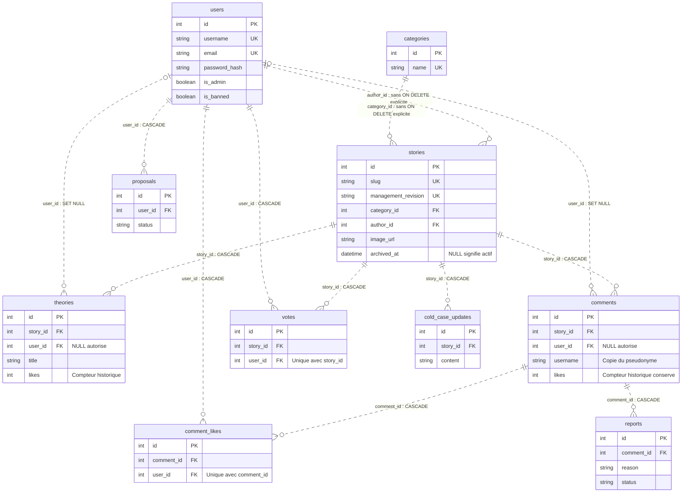

# Fiche Mahamadou — Base de données et intégration

4 novembre 2026, Europe/Paris — proposition du lot 6H.21.2, fondée sur les sources locales et le README installé au lot 6H.19.3.

**Mode de lecture :** pour chaque identifiant, A à I décrivent la réponse actuelle ; le bloc repliable qui suit conserve la réponse historique. Le statut ancien « VALIDÉE » est archivé, sans valeur de validation actuelle ou de production. Le texte de la question et toutes les réponses historiques sont conservés ; leurs anciennes références sont affichées comme repères archivés, pas comme liens de code actuels.

La réponse B est une proposition orale de l’ordre de 30 à 60 secondes selon le débit, sans chronométrage revendiqué. C permet de comprendre, D relie au projet, E donne les symboles vérifiés, F explique leur coopération, G et H préparent les relances. Le statut I distingue code implémenté, fonction partielle, validation absente et preuve historique.

Les références actives privilégient le fichier et le symbole nommé. Pour les fonctions Python indexées, un lien `MAH-F…` ouvre le contrat correspondant du [référentiel 6H.21.1](REFERENTIEL_PEDAGOGIQUE_LOT6H21_1.md). Ces identifiants sont pédagogiques, sans attribution exclusive d’auteur. Les lignes actuelles et empreintes ont été vérifiées dans le rapport, sans figer de nouveaux liens de ligne fragiles dans la fiche.

**Périmètre de cette préparation :** lecture statique et validation documentaire ; aucun test applicatif nouveau, accès SQL, serveur ou navigateur du site, migration ou action de compte. Exemples à lire, sans exécution sur la démonstration. Les copies pédagogiques commentées restent futures. Les anciennes fiches et les deux autres fiches restent intactes pendant cette proposition.

## Accès aux questions

[MAH-01](#mah-01) · [MAH-02](#mah-02) · [MAH-03](#mah-03) · [MAH-04](#mah-04) · [MAH-05](#mah-05) · [MAH-06](#mah-06) · [MAH-07](#mah-07) · [MAH-08](#mah-08) · [MAH-09](#mah-09) · [MAH-10](#mah-10) · [MAH-11](#mah-11) · [MAH-12](#mah-12) · [MAH-13](#mah-13) · [MAH-14](#mah-14) · [MAH-15](#mah-15) · [MAH-16](#mah-16) · [MAH-17](#mah-17) · [MAH-18](#mah-18)

## Repères techniques actualisés

### Dix modèles confirmés dans les sources

Le schéma applicatif de [backend/models.py](../../backend/models.py) contient **dix tables et treize clés étrangères**. Chaque table possède une clé primaire entière `id`. Le tableau décrit les autres colonnes importantes ; les types et contraintes complets restent dans les modèles.

| Modèle / table | Colonnes principales hors `id` | Contraintes et rôle |
|---|---|---|
| `User` / `users` | `username` String(100), `email` String(150), `password_hash` String(255), `is_admin`, `is_banned`, `created_at` | Pseudo et e-mail uniques séparément ; valeurs obligatoires ; rôle membre et non banni par défaut ORM. |
| `Category` / `categories` | `name` String(100), `description` Text nullable | Nom unique ; classe les dossiers. |
| `Story` / `stories` | `slug` String(150), `title` String(200), `summary`, `content`, `image_url` String(500) nullable, `category_id`, `author_id`, `created_at`, `updated_at`, `archived_at` nullable, `management_revision` String(32) | Slug et révision uniques ; auteur/catégorie obligatoires ; `archived_at = NULL` signifie actif. La révision change aux transitions de gestion. |
| `Theory` / `theories` | `story_id`, `user_id` nullable, `title` String(200), `content`, `likes`, `created_at` | Contribution à un dossier ; compteur historique de likes, sans unicité par compte. |
| `Comment` / `comments` | `story_id`, `user_id` nullable, `username` String(100) nullable, `text`, `likes`, `created_at` | Copie du pseudonyme ; `likes` conserve le compteur historique physique. Les likes individuels et signalements sont comptés depuis leurs tables. |
| `Vote` / `votes` | `story_id`, `user_id`, `created_at` | Couple `(user_id, story_id)` unique, contrainte `unique_user_story_vote` ; représente un like individuel de dossier. |
| `CommentLike` / `comment_likes` | `comment_id` indexé, `user_id`, `created_at` | Couple `(user_id, comment_id)` unique, `unique_user_comment_like` ; table déclarée InnoDB pour MySQL. |
| `Proposal` / `proposals` | `user_id`, `title` String(200), `content`, `status` String(20), `created_at`, `updated_at` | Statut ORM initial `pending`, auteur obligatoire ; aucune conversion automatique en dossier. |
| `Report` / `reports` | `comment_id` indexé, `reason`, `status` String(20), `created_at` | Vraie FK entière vers un commentaire ; pas de colonne identifiant le déclarant. `type` et `target_id` sont des propriétés Python de compatibilité. |
| `ColdCaseUpdate` / `cold_case_updates` | `story_id`, `content`, `created_at` | Mise à jour attachée au dossier ; la FK ne contrôle pas sa catégorie. |

`Report.type` renvoie `comment` ; `Report.target_id` expose l’identifiant comme chaîne pour l’ancien contrat HTTP. Ce ne sont plus deux colonnes SQL. Retirer la référence `user_id` d’une contribution ne retire ni son texte ni le pseudonyme copié : cela ne constitue pas un effacement complet de données personnelles.

### Diagramme entité-relation actuel



`PK` désigne une clé primaire, `FK` une clé étrangère et `UK` une unicité individuelle. Les deux unicités de couples ne rendent pas chaque colonne unique isolément. `||` signifie exactement un parent, `|o` zéro ou un parent et `o{` zéro à plusieurs enfants ; les traits représentent les références entre tables. Les autres colonnes descriptives et dates sont omises du diagramme pour le garder lisible.

### Treize références, cardinalités et suppression

| Référence enfant → parent | Cardinalité côté enfant / côté parent | `ON DELETE` SQL |
|---|---|---|
| `stories.category_id → categories.id` | Une catégorie obligatoire / zéro à plusieurs dossiers | Non explicité |
| `stories.author_id → users.id` | Un auteur obligatoire / zéro à plusieurs dossiers | Non explicité |
| `theories.story_id → stories.id` | Un dossier obligatoire / zéro à plusieurs théories | `CASCADE` |
| `theories.user_id → users.id` | Zéro ou un auteur / zéro à plusieurs théories | `SET NULL` |
| `comments.story_id → stories.id` | Un dossier obligatoire / zéro à plusieurs commentaires | `CASCADE` |
| `comments.user_id → users.id` | Zéro ou un auteur / zéro à plusieurs commentaires | `SET NULL` |
| `votes.story_id → stories.id` | Un dossier obligatoire / zéro à plusieurs likes | `CASCADE` |
| `votes.user_id → users.id` | Un compte obligatoire / zéro à plusieurs likes | `CASCADE` |
| `comment_likes.comment_id → comments.id` | Un commentaire obligatoire / zéro à plusieurs likes | `CASCADE` |
| `comment_likes.user_id → users.id` | Un compte obligatoire / zéro à plusieurs likes | `CASCADE` |
| `proposals.user_id → users.id` | Un auteur obligatoire / zéro à plusieurs propositions | `CASCADE` |
| `reports.comment_id → comments.id` | Un commentaire obligatoire / zéro à plusieurs signalements | `CASCADE` |
| `cold_case_updates.story_id → stories.id` | Un dossier obligatoire / zéro à plusieurs mises à jour | `CASCADE` |

Une FK assure une référence valide lorsque le moteur applique les contraintes. `CASCADE` supprime les dépendances configurées avec leur parent ; `SET NULL` conserve l’enfant en retirant la référence facultative. L’absence de règle explicite sur l’auteur et la catégorie du dossier ne doit pas être assimilée à une cascade.

Les relations `db.relationship(..., back_populates=...)` permettent de naviguer entre objets Python dans les deux sens : `Story.category`, `Category.stories`, `Story.author`, `User.stories`, puis les contributions et leurs auteurs. Elles ne remplacent pas les clés étrangères SQL.

Les dates `created_at` et les mises à jour `updated_at` utilisent les valeurs et callbacks Python de SQLAlchemy, notamment `datetime.utcnow` : ce ne sont pas des déclencheurs SQL permanents. L’API produit généralement des dates UTC sans suffixe de fuseau. `management_revision` reçoit un UUID hexadécimal côté ORM ; son défaut SQL sentinelle sert à l’évolution du schéma et est refusé par la purge tant qu’une vraie révision n’est pas présente.

Les collections `Story.comments`, `votes`, `theories`, `cold_case_updates` utilisent `cascade='all, delete-orphan'` côté ORM. `Comment.moderation_reports`, `Comment.comment_likes` et `User.comment_likes` déclarent aussi cette cascade avec `passive_deletes=True`. Les autres collections de `User` ne possèdent pas toutes ces options. Une suppression ORM et un `DELETE` SQL direct peuvent donc suivre des mécanismes différents ; les contraintes réellement actives restent nécessaires.

### Requêtes, flush et transactions

Les routes utilisent notamment `db.session.get()` pour une PK, `filter_by()` pour un slug ou un couple, `order_by()` pour les listes et `count()` pour les totaux. `joinedload()` charge le commentaire, le dossier et sa catégorie pour les signalements administratifs. Les listes ne sont pas paginées ; certains comptages sont effectués par élément et pourront être regroupés si le volume augmente.

```python
# Extraits de principes employés dans les vues ; aucun script autonome à exécuter.
story = Story.query.filter_by(slug=slug, archived_at=None).first()
db.session.add(new_vote)
db.session.flush()
vote_count = Vote.query.filter_by(story_id=story_id).count()
db.session.commit()
```

| Opération | Signification dans l’application |
|---|---|
| `add()` / `add_all()` | Place les nouveaux objets dans l’unité de travail de la session. Ne confirme pas leur durabilité. |
| `flush()` | Envoie les changements en attente dans la transaction et peut attribuer les PK ou révéler une contrainte invalide. Ne valide pas la transaction. Le mode autoflush peut également déclencher un flush avant certaines requêtes. |
| `commit()` | Déclenche le flush nécessaire puis valide la transaction. Les objets peuvent ensuite être expirés et nécessiter une nouvelle lecture. |
| `rollback()` | Annule la transaction non validée et rend la session réutilisable après une erreur gérée. Ne garantit pas qu’un commit dont l’accusé a été perdu n’a jamais abouti. |

L’unicité SQL complète les vérifications préalables : deux requêtes peuvent passer le même précontrôle. `is_unique_conflict()` distingue les doublons métier connus SQLite/MySQL des autres erreurs SQL ; les cas MySQL simulés ne prouvent pas une connexion distante.

Les écrivains de contributions demandent un dossier actif avec `with_for_update()` ; l’archivage utilise le même principe. SQLite n’offre pas le même verrou de ligne que MySQL/InnoDB. Les tests séquentiels ou les erreurs de concurrence injectées ne valident pas une concurrence réelle à plusieurs connexions MySQL.

La purge conditionnelle ajoute une vérification d’intégrité, une empreinte du dossier et de ses dépendances, une révision de gestion et une mise à jour conditionnelle avant ses suppressions. Son graphe comprend commentaires, théories, votes, mises à jour, signalements et likes de commentaires. Une transaction en échec est annulée ; une issue de commit incertaine exige une relecture, sans relance automatique du `DELETE`.

### Sept migrations Flask-Migrate / Alembic

La chaîne déclarée dans [migrations/versions/](../../migrations/versions/) est linéaire :

```text
921687c1bd7c → 3111f5767fc6 → a590c8aac613 → 82deda84bc35
             → c6c100000001 → c6c200000001 → c6g200000001
```

| Révision | Évolution décrite |
|---|---|
| `921687c1bd7c` | Schéma initial : comptes, catégories, dossiers, théories, commentaires, votes et propositions. |
| `3111f5767fc6` | Contraintes nommées et règles `CASCADE` / `SET NULL` sur les références concernées. |
| `a590c8aac613` | Signalements historiques, bannissement et mises à jour de dossiers. |
| `82deda84bc35` | Suppression du compteur redondant `comments.reports` ; comptage depuis les signalements. |
| `c6c100000001` | Ajout de `stories.archived_at`. |
| `c6c200000001` | Reprise contrôlée des cibles de signalement vers `reports.comment_id` et ajout de la révision de gestion du dossier. |
| `c6g200000001` | Table des likes individuels de commentaires, après contrôle des compteurs historiques. |

`migrations/env.py` obtient le moteur et les métadonnées depuis Flask-Migrate. Le mode offline produit des instructions ; le mode online utilise une connexion et exécute les révisions. L’enregistrement de `Migrate(app, db)` ne lance aucune migration.

Les dernières révisions restent des migrations candidates : leur présence ne démontre pas leur application à une base réelle. Les tests ciblés portent sur des schémas synthétiques ; la chaîne complète depuis une SQLite vierge et la migration MySQL/Aiven n’ont pas été validées récemment. Les noms de contraintes historiques et les différences de DDL entre moteurs demandent une vérification propre à la cible.

La reprise des signalements refuse les références incompatibles avant le premier DDL. La migration des likes refuse un compteur historique non nul ou ambigu ; elle ne fabrique pas d’auteurs. Certains retours arrière perdent un état ou suppriment une table, et le downgrade des likes refuse les lignes existantes. Aucune rétrogradation ne recrée les données déjà purgées.

`db.create_all()` crée les tables manquantes à partir des modèles ; il ne met pas à niveau les colonnes d’une ancienne table, ne rejoue pas Alembic et ne marque pas une révision déployée. Le kit et l’initialisation persistante créent un schéma neuf ; ils ne migrent pas une base historique.

### Trois stockages, des usages distincts

| Stockage | Durée et préparation | Intégrité et limites |
|---|---|---|
| SQLite mémoire | Jeu fictif neuf pour un processus ; perdu à l’arrêt | Kit : connexions `:memory:` imposées, FK activées, autres bases et réseau refusés. Les gardes des tests dépendent du harnais. |
| SQLite persistante | Fichier privé `instance/demo-persistante/portfolio.sqlite3` ; préparation unique par `init`, réouverture par `serve` | FK activées à chaque connexion ; journal `DELETE` ; format reconnu et verrou d’opération. SQLite standard ne chiffre pas le fichier. |
| MySQL/Aiven | Service distant sélectionné par six paramètres et certificat CA | PyMySQL/TLS prévu ; contraintes, moteur InnoDB, révision et concurrence à valider sur la cible. Aucune preuve de production déduite de la configuration. |

Le repli général `instance/site.db` est encore un autre fichier SQLite : il n’est pas la base persistante 5066. Les FK sont explicitement activées dans les modes confinés ; le lanceur général ne doit pas être crédité automatiquement des mêmes gardes.

Le diagramme entité-relation ci-dessus reprend exactement le bloc validé du [README actuel](../../README.md#base-de-données-et-sqlalchemy). Il distingue dix entités et treize liens, la cardinalité facultative des auteurs de contributions et les deux associations de likes. Les questions MAH-04 à MAH-09 explicitent ces choix ; MAH-13 distingue les révisions du schéma et leur déploiement. Aucun nouveau schéma pédagogique différent n’est introduit.


## Questions du jury

### MAH-01

#### A. Question originale

À quoi sert MySQL ?

#### B. Réponse courte pour l’oral — état actuel

MySQL est un système de base relationnelle : il conserve des lignes dans des tables et applique des contraintes. Notre code sait le sélectionner avec PyMySQL et une configuration Aiven, mais nos dernières démonstrations utilisent SQLite. Le kit garde ses données en mémoire, tandis que le mode persistant les conserve dans un fichier après l’arrêt. SQLAlchemy permet à Flask de travailler avec les mêmes modèles Python. Je distingue donc le moteur prévu dans la configuration, celui réellement utilisé et ce qui a été vérifié : une réussite SQLite ne prouve pas une connexion MySQL actuelle.

#### C. Explication technique approfondie

Une base relationnelle fournit un langage de requêtes, des transactions et des règles d’intégrité. MySQL est un serveur distinct de l’application ; SQLite est un moteur embarqué qui utilise une connexion mémoire ou un fichier. Fermer le navigateur ne supprime pas automatiquement les données d’aucun de ces modes ; arrêter le processus détruit en revanche la mémoire du kit.

Dans `backend/index.py`, le groupe complet de six paramètres Aiven sélectionne une URI MySQL/PyMySQL. Sinon, `DATABASE_URL` est utilisée, avec repli sur `instance/site.db`. Les lanceurs scolaires et persistants neutralisent cette sélection pour imposer leur propre stockage. `run_local.py` sert le site et l’API ; il ne choisit pas un moteur en fonction du visiteur et ne crée pas les tables.

La persistance d’un compte concerne son enregistrement, pas une connexion éternelle de l’utilisateur. Les cookies de session, la clé et les autorisations ont leur propre cycle.

#### D. Exemple concret du projet

Le catalogue public contient le slug `golden-state-killer`. `get_story_by_slug()` recherche ce slug parmi les dossiers actifs. Le même code ORM est utilisé dans une séance mémoire et dans la démonstration fichier ; seule la configuration change. Cet exemple emploie une ressource publique du catalogue, sans consulter les comptes ou les lignes de la SQLite persistante.

#### E. Fichiers et symboles actuels vérifiés

- [backend/index.py](../../backend/index.py) : initialisation du module, sélection du moteur et options de connexion avant `db.init_app(app)`.
- [backend/api/v1/views/histoires.py — `get_story_by_slug`](../../backend/api/v1/views/histoires.py) ; [MAH-F0161](REFERENTIEL_PEDAGOGIQUE_LOT6H21_1.md#mah-f0161--get_story_by_slug).
- [tools/demo_persistante.py — `application`](../../tools/demo_persistante.py) ; [MAH-F0068](REFERENTIEL_PEDAGOGIQUE_LOT6H21_1.md#mah-f0068--application).
- [tools/recette_lot6g4.py — `main`](../../tools/recette_lot6g4.py) ; [MAH-F0121](REFERENTIEL_PEDAGOGIQUE_LOT6H21_1.md#mah-f0121--main).
- [run_local.py — `main`](../../run_local.py) ; [MAH-F0048](REFERENTIEL_PEDAGOGIQUE_LOT6H21_1.md#mah-f0048--main).

#### F. Rôle des fonctions et interactions

Le lanceur prépare l’environnement avant de charger Flask. La configuration est fournie à `db.init_app(app)` ; la vue demande ensuite un objet Story à la session SQLAlchemy. Le pilote dialogue avec le moteur choisi. Enfin, `Story.to_dict()` fournit les champs sérialisables à Flask. Aucun accès direct du JavaScript à MySQL n’intervient dans ce chemin.

#### G. Erreurs fréquentes et confusions

- Présenter Aiven comme moteur actuellement validé alors que seule sa branche de configuration a été lue.
- Confondre conservation de la base, durée d’une session et mémoire du navigateur.

#### H. Relance possible du jury

**Question :** Pourquoi garder plusieurs modes ?

**Réponse :** Le kit permet une démonstration fictive sans toucher à un fichier durable ; le mode persistant conserve les contributions ; le lanceur général reste configurable. Cette séparation aide à maîtriser les données et les limites des preuves.

#### I. Statut et portée des preuves

Implémenté : choix du moteur et deux démonstrations. Non validé : disponibilité actuelle de MySQL/Aiven et déploiement.

<details>
<summary>Réponse historique conservée — état antérieur, à ne pas réciter comme état actuel</summary>

**Lecture de l’archive :** les formulations ci-dessous restent celles de la fiche initiale. Ses exemples, statuts et anciennes références ont leur contexte historique ; les liens et preuves actuels sont en E et I.

**Réponse courte à dire**

Il conserve durablement les comptes, dossiers et contributions. Le backend y accède pour lire et enregistrer les données.

**Explication simple**

Les informations restent enregistrées après la fermeture du navigateur ; la base choisie dépend de la configuration.

**Exemple concret**

Un dossier peut être relu lors d’une visite suivante.

**Référence technique**

`backend/index.py → ../../backend/index.py#L86`

**Statut de validation historique — ne pas confondre avec I**

**VALIDÉE — conforme aux sources.**

</details>

### MAH-02

#### A. Question originale

Pourquoi utiliser plusieurs tables ?

#### B. Réponse courte pour l’oral — état actuel

Nous séparons les informations selon leur rôle : comptes, catégories, dossiers et contributions. Une théorie référence son dossier par une clé étrangère, au lieu de recopier le récit complet. Le modèle actuel comporte dix tables, avec une table supplémentaire pour les likes individuels de commentaires. Cette organisation limite les doublons et les incohérences lorsqu’une information change. Nous ne supprimons pourtant pas toute répétition : le commentaire conserve volontairement une copie du pseudonyme. Il faut expliquer ce choix et ses conséquences, plutôt que dire que notre base est parfaitement normalisée parce qu’elle contient plusieurs tables.

#### C. Explication technique approfondie

La normalisation cherche à placer chaque fait au bon endroit et à éviter les anomalies d’insertion, de modification et de suppression. Si le titre d’un dossier était répété dans chacune de ses théories, un changement pourrait laisser plusieurs titres contradictoires. `story_id` conserve le lien ; la table Story reste la source du titre et du récit.

À un premier niveau, chaque colonne représente une valeur du modèle et les lignes sont identifiées. Les dépendances d’un fait envers sa clé, puis l’absence de dépendances transitives inutiles, guident les deuxième et troisième formes normales. Il ne suffit pas de compter des tables pour certifier ces formes : aucun audit formel complet des dépendances fonctionnelles n’est revendiqué ici.

`Vote` et `CommentLike` représentent des associations compte/cible avec un couple unique. `Comment.username` est une duplication assumée pour conserver le pseudonyme affiché ; elle doit être prise en compte pour les droits et un éventuel effacement.

#### D. Exemple concret du projet

Une Story peut recevoir plusieurs Theory. Le contenu du dossier reste dans `stories.content`, et chaque analyse dans `theories.content` avec `story_id`. Une Proposal possède sa propre table : une soumission en attente n’est pas encore une Story publique. Les deux objets n’ont pas le même état métier, même s’ils possèdent un titre et un contenu.

#### E. Fichiers et symboles actuels vérifiés

- [backend/models.py — `Story`](../../backend/models.py).
- [backend/models.py — `Theory`](../../backend/models.py).
- [backend/models.py — `Proposal`](../../backend/models.py).
- [backend/models.py — `CommentLike`](../../backend/models.py).

#### F. Rôle des fonctions et interactions

Les classes décrivent les tables. Les attributs ForeignKey expriment les références SQL ; `relationship()` expose les objets liés. `get_theories()` filtre les Theory par le dossier demandé et `create_proposal()` crée une autre ressource. La séparation des modèles se retrouve ainsi dans les routes, la visibilité et les validations de chaque opération.

#### G. Erreurs fréquentes et confusions

- Déduire automatiquement la troisième forme normale du nombre de tables.
- Qualifier le pseudonyme copié d’anonymisation ou croire qu’il disparaît avec user_id.

#### H. Relance possible du jury

**Question :** Pourquoi ne pas enregistrer toutes les théories dans une colonne JSON de Story ?

**Réponse :** Des lignes séparées donnent un auteur, une date et des contraintes par contribution, et permettent de les sélectionner indépendamment. Un document JSON pourrait convenir à d’autres besoins, mais ce n’est pas le modèle relationnel implémenté ici.

#### I. Statut et portée des preuves

Implémenté : séparation des dix modèles. Non validé : certification formelle de toutes les formes normales.

<details>
<summary>Réponse historique conservée — état antérieur, à ne pas réciter comme état actuel</summary>

**Lecture de l’archive :** les formulations ci-dessous restent celles de la fiche initiale. Ses exemples, statuts et anciennes références ont leur contexte historique ; les liens et preuves actuels sont en E et I.

**Réponse courte à dire**

Chaque table représente une notion. Par exemple, une histoire peut recevoir plusieurs théories sans recopier tout le dossier dans chaque théorie.

**Explication simple**

Séparer les sujets évite de recopier les mêmes informations partout.

**Exemple concret**

Une histoire possède plusieurs théories dans une table distincte.

**Référence technique**

`backend/models.py → ../../backend/models.py#L83`

**Statut de validation historique — ne pas confondre avec I**

**VALIDÉE — conforme aux sources.**

</details>

### MAH-03

#### A. Question originale

Qu’est-ce qu’une clé primaire ?

#### B. Réponse courte pour l’oral — état actuel

Une clé primaire identifie une ligne de manière unique dans sa table. Nos dix modèles utilisent un identifiant entier `id`. Deux dossiers peuvent avoir des titres similaires ; leur clé permet de les distinguer. Le slug possède aussi une contrainte unique, mais il sert surtout aux liens lisibles du navigateur. Les contributions se rattachent à l’identifiant numérique du dossier. Je ne dois pas confondre une clé primaire avec le rang d’une carte dans une liste, ni croire qu’elle impose des numéros continus ou qu’un identifiant seul donne une permission d’accès.

#### C. Explication technique approfondie

Une PK impose l’unicité et l’absence de valeur nulle. Elle donne une identité à l’enregistrement, indépendamment de ses champs descriptifs. Dans les modèles, `db.Column(db.Integer, primary_key=True)` déclare cette contrainte. La stratégie exacte d’attribution relève du moteur et du schéma effectivement créé ; aucun parcours ne devrait supposer qu’une série d’identifiants n’a jamais de trou.

Une contrainte `unique=True` sur `Story.slug` est une autre clé candidate, utilisée ici pour une recherche éditoriale. Le choix de l’API explique la différence : le dossier est ouvert par slug, puis ses commentaires ou théories sont demandés par la PK renvoyée.

Les identifiants de ressource sont bornés dans des helpers à un entier positif jusqu’à 2 147 483 647. Cette validation protège les requêtes des entrées hors domaine ; l’authentification et la visibilité restent des contrôles supplémentaires.

#### D. Exemple concret du projet

`get_story_by_slug()` récupère un dossier et renvoie son `id`. `loadStory()` utilise la réponse pour monter les commentaires et le contrôle de like. Aucun numéro de la base privée n’est nécessaire à l’explication : le dossier choisi dans le navigateur fournit lui-même la référence autorisée.

#### E. Fichiers et symboles actuels vérifiés

- [backend/models.py — `Story`](../../backend/models.py).
- [backend/api/v1/views/histoires.py — `get_story_by_slug`](../../backend/api/v1/views/histoires.py) ; [MAH-F0161](REFERENTIEL_PEDAGOGIQUE_LOT6H21_1.md#mah-f0161--get_story_by_slug).
- [backend/api/v1/views/write_support.py — `get_resource`](../../backend/api/v1/views/write_support.py) ; [MAH-F0211](REFERENTIEL_PEDAGOGIQUE_LOT6H21_1.md#mah-f0211--get_resource).
- [frontend/app.js — `loadStory`](../../frontend/app.js).

#### F. Rôle des fonctions et interactions

La définition de Story fixe la PK et le slug unique. La vue résout le slug et sérialise l’identifiant. Les fonctions frontend utilisent cet identifiant pour les routes enfant ; `get_resource()` ou `get_active_story()` contrôle ensuite son domaine et son existence. L’affichage d’un id dans un JSON ne remplace aucun de ces contrôles.

#### G. Erreurs fréquentes et confusions

- Utiliser l’index du tableau JavaScript comme story_id.
- Présenter un titre comme clé ou supposer que connaître une PK autorise l’écriture.

#### H. Relance possible du jury

**Question :** Le slug peut-il remplacer toutes les clés étrangères ?

**Réponse :** Il serait possible de concevoir un autre schéma, mais les FK actuelles référencent la PK entière. Le slug reste un identifiant éditorial unique ; changer cette décision demanderait une vraie évolution du modèle, des migrations et des routes.

#### I. Statut et portée des preuves

Implémenté : PK entières et slug unique dans les modèles ; contraintes d’une cible réelle à vérifier séparément.

<details>
<summary>Réponse historique conservée — état antérieur, à ne pas réciter comme état actuel</summary>

**Lecture de l’archive :** les formulations ci-dessous restent celles de la fiche initiale. Ses exemples, statuts et anciennes références ont leur contexte historique ; les liens et preuves actuels sont en E et I.

**Réponse courte à dire**

C’est l’identifiant unique d’une ligne. Dans `stories`, il s’agit de `id`.

**Explication simple**

Un identifiant permet de distinguer deux lignes même si leur titre est identique.

**Exemple concret**

stories.id identifie un dossier.

**Référence technique**

`backend/models.py → ../../backend/models.py#L88`

**Statut de validation historique — ne pas confondre avec I**

**VALIDÉE — conforme aux sources.**

</details>

### MAH-04

#### A. Question originale

Qu’est-ce qu’une clé étrangère ?

#### B. Réponse courte pour l’oral — état actuel

Une clé étrangère est une contrainte qui relie une colonne à une clé d’une autre table. Dans notre projet, `Theory.story_id` référence `Story.id` et doit être renseigné. Elle empêche une théorie de pointer vers un dossier inexistant lorsque les contraintes du moteur sont actives. Le schéma actuel déclare treize clés étrangères, dont celle qui rattache désormais un signalement à son commentaire. Ce n’est pas seulement un numéro qui ressemble à un identifiant : la référence doit être déclarée et effectivement appliquée. Une relation Python et une vérification API ont des rôles complémentaires.

#### C. Explication technique approfondie

Une FK matérialise l’intégrité référentielle : la valeur enfant doit correspondre à un parent, sauf valeur NULL autorisée. `nullable=False` sur `story_id` interdit une théorie sans dossier. `ondelete='CASCADE'` indique ce que la base doit faire lors de la suppression du parent ; il ne transforme pas une insertion invalide en insertion acceptable.

La relation ORM `Theory.story` facilite la navigation Python vers l’objet Story. Elle ne suffit pas à imposer une référence dans une commande SQL directe. De même, vérifier un dossier dans Flask est utile pour les droits, les archives et les messages, mais ne remplace pas la contrainte.

Les modes confinés activent et vérifient `PRAGMA foreign_keys=ON` sur les connexions SQLite. Cette activation doit précéder les opérations pertinentes ; une transaction déjà ouverte peut empêcher l’effet attendu. Le lanceur général ne reçoit pas automatiquement toutes les gardes du kit.

#### D. Exemple concret du projet

Le chemin `POST /api/v1/stories/{story_id}/theories` fait rechercher un dossier actif avant l’ajout de Theory. La FK garantit le lien structurel ; `get_active_story()` ajoute la règle métier « dossier non archivé ». Une FK seule n’interdit pas de contribuer à un dossier encore présent mais archivé.

#### E. Fichiers et symboles actuels vérifiés

- [backend/models.py — `Theory`](../../backend/models.py).
- [backend/models.py — `Report`](../../backend/models.py).
- [backend/api/v1/views/story_visibility.py — `get_active_story`](../../backend/api/v1/views/story_visibility.py) ; [MAH-F0200](REFERENTIEL_PEDAGOGIQUE_LOT6H21_1.md#mah-f0200--get_active_story).
- [tools/demo_persistante.py — `application`](../../tools/demo_persistante.py) ; [MAH-F0068](REFERENTIEL_PEDAGOGIQUE_LOT6H21_1.md#mah-f0068--application).

#### F. Rôle des fonctions et interactions

`post_theory()` délègue la recherche du parent à `get_active_story()`, puis construit l’enfant. Les modèles fournissent la FK aux métadonnées. Le lanceur persistant installe les contrôles de connexion ; le moteur applique les contraintes pendant l’écriture. Chaque étage couvre une partie différente du problème.

#### G. Erreurs fréquentes et confusions

- Assimiler relationship à ForeignKey.
- Annoncer des cascades SQLite sans vérifier l’activation des FK ou confondre existence et visibilité publique.

#### H. Relance possible du jury

**Question :** Pourquoi l’API vérifie-t-elle le dossier si la FK existe ?

**Réponse :** Pour traiter l’archive, les permissions et le code 404 avant de construire la contribution. La FK reste une protection structurelle, notamment face à une autre écriture ou à un accès SQL indépendant.

#### I. Statut et portée des preuves

Implémenté : treize FK déclarées et activation dans les modes confinés. Non validé : contraintes déployées de MySQL.

<details>
<summary>Réponse historique conservée — état antérieur, à ne pas réciter comme état actuel</summary>

**Lecture de l’archive :** les formulations ci-dessous restent celles de la fiche initiale. Ses exemples, statuts et anciennes références ont leur contexte historique ; les liens et preuves actuels sont en E et I.

**Réponse courte à dire**

C’est une référence vers une autre table. `theories.story_id` rattache une théorie à son histoire.

**Explication simple**

La référence relie une contribution au dossier auquel elle appartient.

**Exemple concret**

Theory.story_id référence stories.id.

**Référence technique**

`backend/models.py → ../../backend/models.py#L225`

**Statut de validation historique — ne pas confondre avec I**

**VALIDÉE — conforme aux sources.**

</details>

### MAH-05

#### A. Question originale

Quelle est la relation entre histoire et théorie ?

#### B. Réponse courte pour l’oral — état actuel

La relation entre une histoire et ses théories est de type un à plusieurs. Un dossier peut n’avoir aucune théorie ou en avoir plusieurs ; chaque théorie appartient obligatoirement à un seul dossier. Nous le représentons par `Theory.story_id` et par les relations ORM `Story.theories` et `Theory.story`. Une liste vide est donc un résultat normal, alors qu’un dossier absent ou archivé conduit à un refus de lecture publique. L’auteur de la théorie constitue une autre relation, facultative dans le schéma : il ne faut pas mélanger ces deux cardinalités.

#### C. Explication technique approfondie

La cardinalité décrit les nombres minimum et maximum de liens possibles. Du côté Theory vers Story, le minimum est un parce que la FK n’accepte pas NULL ; le maximum est un parce qu’une seule colonne référence un parent. Du côté Story vers Theory, aucun enfant n’est obligatoire et aucune unicité de `story_id` ne limite le nombre à un.

Dans SQLAlchemy, `back_populates` raccorde les deux propriétés. `story.theories` est une collection ; `theory.story` correspond à un objet parent. Les métadonnées définissent la relation ; l’accès à une collection peut déclencher une lecture selon son état de chargement.

La route publique vérifie d’abord le dossier actif, filtre les théories par sa PK et les trie par date croissante. Une réponse 200 avec tableau vide signifie que le dossier existe et n’a pas de théorie, pas que la requête SQL a échoué.

#### D. Exemple concret du projet

En ouvrant le lecteur de théories d’un dossier public, le navigateur peut recevoir `[]` et afficher « Aucune théorie publiée ». Si le dossier devient archivé, le même parcours doit afficher l’indisponibilité plutôt qu’inventer une liste vide. Les tests couvrent ces deux réponses sur des données synthétiques.

#### E. Fichiers et symboles actuels vérifiés

- [backend/models.py — `Story`](../../backend/models.py).
- [backend/models.py — `Theory`](../../backend/models.py).
- [backend/api/v1/views/theories.py — `get_theories`](../../backend/api/v1/views/theories.py) ; [MAH-F0202](REFERENTIEL_PEDAGOGIQUE_LOT6H21_1.md#mah-f0202--get_theories).
- [frontend/theories-list.js — `loadSelectedTheories`](../../frontend/theories-list.js).

#### F. Rôle des fonctions et interactions

`get_theories()` appelle `get_active_story()`, puis utilise `filter_by(story_id=...)` et `order_by()`. `theory_to_dict()` convertit les objets en valeurs JSON, notamment la date en texte ISO. `getStoryTheories()` contrôle la réponse et le lecteur transforme la liste en cartes, sans changer les liens de la base.

#### G. Erreurs fréquentes et confusions

- Dire qu’une histoire doit avoir au moins une théorie.
- Confondre zéro contribution, dossier absent et erreur de chargement.

#### H. Relance possible du jury

**Question :** Que faudrait-il pour une relation plusieurs à plusieurs ?

**Réponse :** Il faudrait représenter explicitement plusieurs liens, par exemple avec une table d’association et des contraintes adaptées. Ce n’est pas le schéma actuel des théories : chaque ligne a un seul story_id obligatoire.

#### I. Statut et portée des preuves

Implémenté : relation un-à-plusieurs et lecture publique contrôlée ; preuve dynamique antérieure sur SQLite.

<details>
<summary>Réponse historique conservée — état antérieur, à ne pas réciter comme état actuel</summary>

**Lecture de l’archive :** les formulations ci-dessous restent celles de la fiche initiale. Ses exemples, statuts et anciennes références ont leur contexte historique ; les liens et preuves actuels sont en E et I.

**Réponse courte à dire**

Une histoire peut avoir plusieurs théories. Chaque théorie appartient à une seule histoire.

**Explication simple**

Le lien est obligatoire pour la théorie ; une histoire peut n’avoir encore aucune théorie.

**Exemple concret**

Une liste de théories vide reste possible.

**Référence technique**

`backend/models.py → ../../backend/models.py#L225`

**Statut de validation historique — ne pas confondre avec I**

**VALIDÉE — conforme aux sources.**

</details>

### MAH-06

#### A. Question originale

Pourquoi l’auteur d’une théorie peut-il être nul ?

#### B. Réponse courte pour l’oral — état actuel

L’auteur d’une théorie peut être nul parce que le schéma permet de conserver une contribution après la disparition de son compte. `Theory.user_id` accepte NULL et sa clé étrangère déclare `SET NULL`. Cela décrit une règle de stockage ; cela ne signifie pas que l’interface possède déjà un effacement complet de compte. La création actuelle exige un membre actif et prend son identité dans la session. Une théorie ne naît donc pas anonymement par ce formulaire. Conserver un texte après retrait du lien auteur ne garantit pas non plus qu’il ne contienne plus de données personnelles.

#### C. Explication technique approfondie

Il faut distinguer une valeur permise par le schéma et une entrée permise par une route. Le modèle autorise `user_id=None`, notamment pour une donnée conservée après suppression du parent. `post_theory()` commence néanmoins par `get_authenticated_user()` et attribue `user_id=user.id` à la nouvelle ligne.

La règle SQL SET NULL agit si le parent est supprimé et si l’intégrité est active. Les comportements ORM et les autres dépendances de User doivent aussi être examinés : Story exige toujours un auteur, sans cascade explicite. On ne peut donc pas promettre qu’un simple DELETE de User fonctionnera pour tout compte.

Le retrait du lien est une opération structurelle, pas une anonymisation sémantique. Le texte d’une théorie peut identifier quelqu’un et Comment conserve même un pseudonyme copié. Aucun parcours complet de droits RGPD n’est déduit de cette nullabilité.

#### D. Exemple concret du projet

Un test synthétique peut représenter une Theory conservée avec `user_id=NULL`. À l’inverse, une requête anonyme au POST de création reçoit 401. Ces deux situations sont compatibles : l’une décrit un état autorisé en base, l’autre la permission de créer depuis l’API.

#### E. Fichiers et symboles actuels vérifiés

- [backend/models.py — `Theory`](../../backend/models.py).
- [backend/models.py — `Comment`](../../backend/models.py).
- [backend/models.py — `Story`](../../backend/models.py).
- [backend/api/v1/views/theories.py — `post_theory`](../../backend/api/v1/views/theories.py) ; [MAH-F0203](REFERENTIEL_PEDAGOGIQUE_LOT6H21_1.md#mah-f0203--post_theory).
- [backend/api/v1/views/permissions.py — `get_authenticated_user`](../../backend/api/v1/views/permissions.py) ; [MAH-F0177](REFERENTIEL_PEDAGOGIQUE_LOT6H21_1.md#mah-f0177--get_authenticated_user).

#### F. Rôle des fonctions et interactions

Le helper de permissions relit le compte. La vue utilise ce compte pour construire Theory ; la relation `author` permet ensuite sa navigation éventuelle. La base gère le SET NULL déclaré lors d’une suppression admissible du parent. Aucun de ces appels ne met en œuvre une procédure globale d’effacement de compte ou de sauvegardes.

#### G. Erreurs fréquentes et confusions

- Dire que nullable=True autorise automatiquement un POST anonyme.
- Assimiler suppression d’une FK, anonymisation du récit et effacement RGPD complet.

#### H. Relance possible du jury

**Question :** Le nom de l’auteur est-il forcément effacé ?

**Réponse :** Non. Le contenu peut encore nommer une personne, et un commentaire possède un champ username copié. Une procédure de droits doit examiner les données réellement conservées, pas seulement les FK.

#### I. Statut et portée des preuves

Implémenté : nullabilité et SET NULL. Partiel : gestion globale des données personnelles et absence de parcours complet d’effacement.

<details>
<summary>Réponse historique conservée — état antérieur, à ne pas réciter comme état actuel</summary>

**Lecture de l’archive :** les formulations ci-dessous restent celles de la fiche initiale. Ses exemples, statuts et anciennes références ont leur contexte historique ; les liens et preuves actuels sont en E et I.

**Réponse courte à dire**

La base prévoit `SET NULL` lors de la suppression de l’utilisateur. La contribution peut ainsi être conservée.

**Explication simple**

L’auteur est facultatif dans le modèle, et la règle SQL déclarée permet de conserver la contribution.

**Exemple concret**

theories.user_id peut devenir NULL si la contrainte est appliquée.

**Référence technique**

`backend/models.py → ../../backend/models.py#L235`

**Statut de validation historique — ne pas confondre avec I**

**VALIDÉE — conforme aux sources.**

</details>

### MAH-07

#### A. Question originale

Quelle différence entre `CASCADE` et `SET NULL` ?

#### B. Réponse courte pour l’oral — état actuel

CASCADE et SET NULL répondent à deux choix de conservation. Avec CASCADE, supprimer un parent entraîne la suppression des enfants concernés. Avec SET NULL, l’enfant reste et sa référence facultative est retirée. Nos théories suivent leur dossier par CASCADE, mais peuvent perdre leur auteur par SET NULL. Ces règles SQL sont différentes de `delete-orphan` dans SQLAlchemy. Archiver un dossier est encore autre chose : on renseigne une date sans supprimer ses enfants. Pour expliquer une suppression réelle, il faut donc nommer le parent, la relation, le moteur et les contraintes effectivement actives.

#### C. Explication technique approfondie

La décision s’applique à chaque FK, pas à toute la base en bloc. Comment et Theory dépendent de Story avec CASCADE ; leur lien vers User utilise SET NULL et accepte NULL. Vote, CommentLike et Proposal portent des liens CASCADE vers les parents correspondants. Les références obligatoires `Story.author_id` et `category_id` n’annoncent pas de cascade.

L’ORM peut aussi gérer des enfants chargés via ses collections. `cascade='all, delete-orphan'` permet notamment de supprimer un enfant devenu orphelin lorsqu’il est retiré d’une collection gérée. Cela ne rend pas une instruction SQL brute équivalente à une suppression ORM et ne remplace pas l’activation des contraintes.

La purge du projet vérifie le graphe et effectue des DELETE explicites dans un ordre contrôlé, dans une transaction. Elle conserve un dossier témoin dans les tests. L’archivage, la purge éditoriale et l’effacement d’une personne restent trois objectifs différents.

#### D. Exemple concret du projet

Un signalement référence son commentaire par `reports.comment_id` avec CASCADE : la suppression admissible du commentaire ne doit pas laisser ce signalement orphelin. En revanche, archiver la Story ne supprime ni les commentaires ni les signalements ; la consultation administrative peut encore les contextualiser.

#### E. Fichiers et symboles actuels vérifiés

- [backend/models.py — `Comment`](../../backend/models.py).
- [backend/models.py — `Report`](../../backend/models.py).
- [backend/models.py — `Theory`](../../backend/models.py).
- [backend/api/v1/views/admin_stories.py — `set_story_archive`](../../backend/api/v1/views/admin_stories.py) ; [MAH-F0147](REFERENTIEL_PEDAGOGIQUE_LOT6H21_1.md#mah-f0147--set_story_archive).
- [backend/api/v1/views/story_deletion_support.py — `delete_story`](../../backend/api/v1/views/story_deletion_support.py) ; [MAH-F0198](REFERENTIEL_PEDAGOGIQUE_LOT6H21_1.md#mah-f0198--delete_story).

#### F. Rôle des fonctions et interactions

`set_story_archive()` modifie une date et la révision, puis valide la transition. `delete_story()` vérifie l’intégrité et les confirmations, retire les dépendances du graphe et ne commit qu’après ses contrôles. Les relations des modèles guident la navigation et déclarent les contraintes ; elles ne constituent pas à elles seules l’autorisation de purger.

#### G. Erreurs fréquentes et confusions

- Prétendre que CASCADE supprime tous les enfants de tous les modèles.
- Confondre SET NULL, delete-orphan, archivage et effacement de personne.

#### H. Relance possible du jury

**Question :** Un downgrade annule-t-il les données supprimées par cascade ?

**Réponse :** Non. Il peut changer le schéma ou retirer une contrainte, mais il ne retrouve pas les lignes déjà supprimées. Revenir à un état de données demanderait une sauvegarde pertinente et une restauration explicitement maîtrisée.

#### I. Statut et portée des preuves

Implémenté : règles SQL et ORM déclarées, archivage/purge contrôlés ; aucune suppression réelle exécutée pour cette fiche.

<details>
<summary>Réponse historique conservée — état antérieur, à ne pas réciter comme état actuel</summary>

**Lecture de l’archive :** les formulations ci-dessous restent celles de la fiche initiale. Ses exemples, statuts et anciennes références ont leur contexte historique ; les liens et preuves actuels sont en E et I.

**Réponse courte à dire**

`CASCADE` supprime les lignes dépendantes. `SET NULL` conserve ces lignes et retire leur référence au parent.

**Explication simple**

Les deux règles décrivent le traitement des lignes liées quand un parent disparaît.

**Exemple concret**

Suppression d’histoire : CASCADE ; suppression d’auteur de théorie : SET NULL.

**Référence technique**

`backend/models.py → ../../backend/models.py#L225`

**Statut de validation historique — ne pas confondre avec I**

**VALIDÉE — conforme aux sources.**

</details>

### MAH-08

#### A. Question originale

Comment empêcher deux votes identiques ?

#### B. Réponse courte pour l’oral — état actuel

Nous interdisons deux votes du même compte sur le même dossier avec une contrainte unique sur le couple utilisateur-histoire. Chaque colonne seule peut se répéter : un membre peut aimer plusieurs dossiers et un dossier peut être aimé par plusieurs membres. La route vérifie d’abord si le vote existe et renvoie 409 pour un doublon reconnu. La base reste la protection finale. Les likes individuels de commentaires utilisent maintenant le même principe avec CommentLike. Il ne faut pas étendre cette garantie aux théories, dont le like demeure un compteur historique répétable.

#### C. Explication technique approfondie

`Vote.id` est la clé primaire de la ligne d’association ; `UniqueConstraint('user_id', 'story_id')` exprime l’unicité métier. Les deux FK sont obligatoires et déclarent CASCADE. Le couple unique représente une relation plusieurs-à-plusieurs entre comptes et dossiers par une table d’association, sans modifier la cardinalité de chaque FK prise séparément.

`post_story_vote()` tire l’auteur de la session, vérifie le dossier actif et cherche une ligne existante. Il ajoute le vote, appelle flush, compte les votes et commit. Un `IntegrityError` reconnu comme doublon produit un rollback et 409. Une autre erreur ne doit pas être maquillée en doublon.

Le retrait filtre le compte et la cible ensemble. Il ne supprime pas le vote d’un tiers. La contrainte composite de CommentLike reprend ce principe pour les commentaires compatibles, tout en laissant l’ancien compteur physique intact.

#### D. Exemple concret du projet

Le frontend peut demander l’état personnel avec GET, ajouter son like avec POST et le retirer avec DELETE sur `/votes/{story_id}`. Après un retrait confirmé, un nouvel ajout redevient possible. L’exemple décrit les routes et leurs relations ; il ne lit ni ne crée un vote sur la base de démonstration.

#### E. Fichiers et symboles actuels vérifiés

- [backend/models.py — `Vote`](../../backend/models.py).
- [backend/models.py — `CommentLike`](../../backend/models.py).
- [backend/api/v1/views/histoires.py — `post_story_vote`](../../backend/api/v1/views/histoires.py) ; [MAH-F0162](REFERENTIEL_PEDAGOGIQUE_LOT6H21_1.md#mah-f0162--post_story_vote).
- [backend/api/v1/views/likes.py — `handle_like`](../../backend/api/v1/views/likes.py) ; [MAH-F0173](REFERENTIEL_PEDAGOGIQUE_LOT6H21_1.md#mah-f0173--handle_like).
- [backend/api/v1/views/likes.py — `like_state`](../../backend/api/v1/views/likes.py) ; [MAH-F0172](REFERENTIEL_PEDAGOGIQUE_LOT6H21_1.md#mah-f0172--like_state).

#### F. Rôle des fonctions et interactions

La vue d’ajout utilise `get_authenticated_user()` et `get_active_story()`. `is_unique_conflict()` classe les erreurs connues. Les helpers de likes comptent les lignes et recherchent le couple courant pour `liked_by_me`. Le navigateur affiche ensuite la réponse confirmée ; il ne fabrique ni auteur ni total durable.

#### G. Erreurs fréquentes et confusions

- Déclarer user_id unique seul, ce qui limiterait un membre à un seul dossier.
- Dire que toutes les sortes de likes sont aujourd’hui répétables ou toutes individuelles.

#### H. Relance possible du jury

**Question :** Le second DELETE est-il une erreur ?

**Réponse :** Le retrait d’un like déjà absent peut renvoyer 200 avec changed=false. C’est différent du second POST, qui refuse le doublon. Il faut lire le statut et l’état métier, pas seulement le mot succès.

#### I. Statut et portée des preuves

Implémenté : unicité Vote/CommentLike et retrait personnel ; théorie historique distincte.

<details>
<summary>Réponse historique conservée — état antérieur, à ne pas réciter comme état actuel</summary>

**Lecture de l’archive :** les formulations ci-dessous restent celles de la fiche initiale. Ses exemples, statuts et anciennes références ont leur contexte historique ; les liens et preuves actuels sont en E et I.

**Réponse courte à dire**

La contrainte unique porte sur le couple utilisateur/histoire. L’API renvoie aussi `409` lorsqu’un vote existe déjà.

**Explication simple**

La même paire utilisateur-dossier ne peut être enregistrée deux fois selon la contrainte déclarée.

**Exemple concret**

POST /api/v1/votes/{story_id} renvoie 409 pour un doublon reconnu.

**Référence technique**

`backend/models.py → ../../backend/models.py#L425`

**Statut de validation historique — ne pas confondre avec I**

**VALIDÉE — conforme aux sources.**

</details>

### MAH-09

#### A. Question originale

Pourquoi garder une contrainte SQL si l’API vérifie déjà ?

#### B. Réponse courte pour l’oral — état actuel

Le contrôle API améliore le message et évite une écriture inutile, mais il ne suffit pas face à deux requêtes proches. Elles pourraient toutes les deux lire « aucun vote », puis tenter la même insertion. La contrainte unique fait alors respecter la règle dans la base. Notre code intercepte le conflit reconnu, effectue un rollback et renvoie 409. Cela illustre une défense à plusieurs niveaux : l’interface prévient les doubles clics, l’API applique les droits et les règles, et SQL garantit l’unicité du couple. Les tests simulés ne prouvent cependant pas toute la concurrence MySQL réelle.

#### C. Explication technique approfondie

Le problème est la séparation entre un contrôle et son utilisation : l’état peut changer entre le SELECT préalable et l’INSERT. Une vérification Python ne verrouille pas automatiquement tous les écrivains possibles. Une contrainte est utile même si toutes les pages actuelles semblent envoyer une seule demande.

Le code ne traite pas indistinctement tout `IntegrityError` comme un doublon. Le helper `is_unique_conflict()` reconnaît des clés métier MySQL ou des ensembles de colonnes SQLite précis. Les autres erreurs conservent un statut serveur, afin d’éviter un diagnostic trompeur ou la fuite d’un message SQL brut.

Le verrou demandé sur le dossier actif aide à coordonner contributions et archivage pour les moteurs qui le supportent. SQLite et InnoDB n’ont pas les mêmes verrous ; il reste nécessaire de tester les entrelacements réels sur la cible. La contrainte unique porte une garantie distincte du verrou parent.

#### D. Exemple concret du projet

Dans `post_story_vote()`, le bloc try contient `add()`, `flush()`, un comptage, puis `commit()`. Si une insertion concurrente déclenche le conflit du couple, la branche IntegrityError appelle rollback avant de répondre 409. Les tests injectent aussi des erreurs MySQL reconnues, sans contacter Aiven.

#### E. Fichiers et symboles actuels vérifiés

- [backend/api/v1/views/histoires.py — `post_story_vote`](../../backend/api/v1/views/histoires.py) ; [MAH-F0162](REFERENTIEL_PEDAGOGIQUE_LOT6H21_1.md#mah-f0162--post_story_vote).
- [backend/api/v1/views/write_support.py — `is_unique_conflict`](../../backend/api/v1/views/write_support.py) ; [MAH-F0212](REFERENTIEL_PEDAGOGIQUE_LOT6H21_1.md#mah-f0212--is_unique_conflict).
- [backend/models.py — `Vote`](../../backend/models.py).
- [backend/api/v1/views/story_visibility.py — `get_active_story`](../../backend/api/v1/views/story_visibility.py) ; [MAH-F0200](REFERENTIEL_PEDAGOGIQUE_LOT6H21_1.md#mah-f0200--get_active_story).

#### F. Rôle des fonctions et interactions

Le précontrôle utilise le même couple que la contrainte. L’exception est transmise au classificateur ; la vue décide ensuite entre conflit métier et erreur 500. Le rollback clôt l’échec transactionnel avant le retour HTTP. Le frontend doit traiter ce retour et relire l’état approprié, sans déduire la base de son ancien compteur affiché.

#### G. Erreurs fréquentes et confusions

- Assimiler un test de doublon séquentiel à une preuve de concurrence multi-connexion.
- Traduire toute erreur de contrainte en 409 ou promettre une exécution exactement une fois.

#### H. Relance possible du jury

**Question :** Le drapeau sending suffit-il si la personne ouvre deux onglets ?

**Réponse :** Non. Il agit seulement dans l’instance de formulaire concernée. Deux contextes ou un client HTTP indépendant peuvent envoyer d’autres requêtes ; la contrainte SQL reste nécessaire.

#### I. Statut et portée des preuves

Implémenté : contrainte et traitement des erreurs. Non validé : concurrence réelle MySQL/InnoDB de production.

<details>
<summary>Réponse historique conservée — état antérieur, à ne pas réciter comme état actuel</summary>

**Lecture de l’archive :** les formulations ci-dessous restent celles de la fiche initiale. Ses exemples, statuts et anciennes références ont leur contexte historique ; les liens et preuves actuels sont en E et I.

**Réponse courte à dire**

Deux requêtes peuvent arriver presque en même temps. La contrainte reste une protection au niveau de la base.

**Explication simple**

La base protège aussi contre deux demandes simultanées qui passent le premier contrôle.

**Exemple concret**

La route traite le conflit unique après rollback.

**Référence technique**

`backend/api/v1/views/histoires.py → ../../backend/api/v1/views/histoires.py#L99`

**Statut de validation historique — ne pas confondre avec I**

**VALIDÉE — conforme aux sources.**

</details>

### MAH-10

#### A. Question originale

À quoi sert SQLAlchemy ?

#### B. Réponse courte pour l’oral — état actuel

SQLAlchemy relie nos classes Python aux tables et permet de construire des requêtes avec leurs attributs. Flask-SQLAlchemy l’intègre au contexte de l’application et fournit la session utilisée par les vues. Nous pouvons sélectionner les théories d’un dossier, ajouter une contribution, mettre à jour un compteur ou retirer un like. Cela ne dispense pas de comprendre le SQL produit, les transactions et les contraintes. Les relations ORM facilitent la navigation entre objets, mais ne remplacent pas les clés étrangères. Enfin, déclarer un modèle ne signifie pas que le schéma d’une base existante a déjà été mis à jour.

#### C. Explication technique approfondie

L’ORM associe une classe mappée à une table et une instance à une ligne. La session suit l’état des objets et regroupe leurs changements dans une unité de travail. `filter_by()` construit un filtre, tandis que `all()` ou `first()` exécute la lecture utile ; certaines lectures peuvent aussi provoquer un autoflush des changements en attente.

Les quatre opérations se retrouvent dans le projet : SELECT pour les dossiers et contributions ; INSERT lors du flush d’une nouvelle Theory ; UPDATE pour `User.is_banned`, l’archivage ou l’incrément SQL de `Theory.likes` ; DELETE pour le retrait ciblé d’un Vote ou la purge conditionnelle. Ces effets n’ont pas tous la même permission ou le même contrat HTTP.

Les expressions de la bibliothèque séparent les valeurs liées de la structure des requêtes ordinaires. Cela aide à éviter la concaténation de saisies dans le SQL, sans transformer automatiquement toute application utilisant un ORM en application sûre. Validation, permissions, schéma et transactions restent nécessaires.

#### D. Exemple concret du projet

Lecture SQL conceptuellement équivalente à la recherche publique d’un dossier, sans valeur privée ni exécution :

```sql
SELECT id, slug, title
FROM stories
WHERE slug = :slug AND archived_at IS NULL;
```

`:slug` représente une valeur liée ; ce n’est pas une concaténation SQL. La vraie vue utilise `Story.query.filter_by(slug=slug, archived_at=None).first()`. Les champs réellement renvoyés par l’API sont plus nombreux que cette projection pédagogique.

#### E. Fichiers et symboles actuels vérifiés

- [backend/models.py — `Story`](../../backend/models.py).
- [backend/api/v1/views/theories.py — `get_theories`](../../backend/api/v1/views/theories.py) ; [MAH-F0202](REFERENTIEL_PEDAGOGIQUE_LOT6H21_1.md#mah-f0202--get_theories).
- [backend/api/v1/views/theories.py — `like_theory`](../../backend/api/v1/views/theories.py) ; [MAH-F0204](REFERENTIEL_PEDAGOGIQUE_LOT6H21_1.md#mah-f0204--like_theory).
- [backend/api/v1/views/likes.py — `handle_like`](../../backend/api/v1/views/likes.py) ; [MAH-F0173](REFERENTIEL_PEDAGOGIQUE_LOT6H21_1.md#mah-f0173--handle_like).
- [backend/api/v1/views/admin_users_support.py — `ban_user_account`](../../backend/api/v1/views/admin_users_support.py) ; [MAH-F0154](REFERENTIEL_PEDAGOGIQUE_LOT6H21_1.md#mah-f0154--ban_user_account).

#### F. Rôle des fonctions et interactions

La configuration attache `db` à Flask. Une vue construit ses expressions à partir des classes ; la session obtient une connexion au moteur et traite les objets. Les sérialiseurs produisent ensuite des dictionnaires et des dates textuelles pour `jsonify()`. Le navigateur reçoit du JSON, jamais une instance SQLAlchemy ou une connexion de base.

#### G. Erreurs fréquentes et confusions

- Croire que filter_by valide la permission ou que relationship crée automatiquement une contrainte SQL.
- Confondre une classe déclarée, une ligne Python en mémoire et une ligne réellement commitée.

#### H. Relance possible du jury

**Question :** Pourquoi comprendre SQL si vous utilisez l’ORM ?

**Réponse :** Pour expliquer les cardinalités, les contraintes, les transactions et le coût des requêtes. Une boucle de count par dossier peut multiplier les SELECT même si le code Python paraît court ; l’ORM ne supprime pas ces questions.

#### I. Statut et portée des preuves

Implémenté : ORM, SELECT/INSERT/UPDATE/DELETE dans les parcours cités ; absence de validation MySQL récente.

<details>
<summary>Réponse historique conservée — état antérieur, à ne pas réciter comme état actuel</summary>

**Lecture de l’archive :** les formulations ci-dessous restent celles de la fiche initiale. Ses exemples, statuts et anciennes références ont leur contexte historique ; les liens et preuves actuels sont en E et I.

**Réponse courte à dire**

Il permet de manipuler les tables avec des modèles Python. Par exemple, `filter_by(story_id=...)` sélectionne les contributions d’un dossier.

**Explication simple**

Les classes Python représentent les tables et servent à construire les requêtes.

**Exemple concret**

filter_by(story_id=story_id) limite la lecture au dossier choisi.

**Référence technique**

`backend/api/v1/views/theories.py → ../../backend/api/v1/views/theories.py#L48`

**Statut de validation historique — ne pas confondre avec I**

**VALIDÉE — conforme aux sources.**

</details>

### MAH-11

#### A. Question originale

Que fait `commit()` ?

#### B. Réponse courte pour l’oral — état actuel

Commit valide la transaction en cours. Avec SQLAlchemy, il provoque d’abord le flush nécessaire : les INSERT ou modifications en attente sont envoyés à la base, puis la transaction est confirmée. Flush seul n’est donc pas une validation définitive. Dans notre route de théorie, add prépare l’objet et commit confirme l’écriture. La conservation après l’arrêt dépend ensuite du stockage : une transaction réussie dans la mémoire du kit ne transforme pas cette mémoire en fichier durable. Enfin, une réponse perdue après un commit possible oblige le client à vérifier le résultat, sans répéter automatiquement sa publication.

#### C. Explication technique approfondie

Une transaction regroupe des changements qui doivent être traités ensemble. Son atomicité vise le tout ou rien des opérations incluses avant validation ; elle ne couvre pas automatiquement le DOM, le transport HTTP ou une action effectuée en dehors de la transaction. La durabilité dépend du moteur et de ses garanties, pas du seul mot commit dans Python.

`add()` inscrit l’objet dans la session. Le flush émet les écritures, attribue éventuellement un identifiant et vérifie des contraintes ; il reste réversible par rollback tant que la transaction n’a pas été validée. `post_story_vote()` utilise explicitement flush avant de calculer un total dans cette même transaction. `post_theory()` laisse commit déclencher ce flush.

Après commit, des attributs ORM peuvent être expirés et provoquer une nouvelle lecture lors de la sérialisation. De plus, le serveur peut avoir validé l’écriture sans que le navigateur reçoive une réponse exploitable. Une notification d’erreur réseau n’est donc pas une preuve d’absence de ligne.

#### D. Exemple concret du projet

Extrait exact du bloc d’écriture de `post_theory()`, expliqué sans l’exécuter :

```python
db.session.add(new_theory)
db.session.commit()
```

L’objet `new_theory` est construit auparavant à partir du dossier actif, du compte de session et des textes validés. Cet extrait n’est pas un script autonome ni une commande de démarrage.

#### E. Fichiers et symboles actuels vérifiés

- [backend/api/v1/views/theories.py — `post_theory`](../../backend/api/v1/views/theories.py) ; [MAH-F0203](REFERENTIEL_PEDAGOGIQUE_LOT6H21_1.md#mah-f0203--post_theory).
- [backend/api/v1/views/histoires.py — `post_story_vote`](../../backend/api/v1/views/histoires.py) ; [MAH-F0162](REFERENTIEL_PEDAGOGIQUE_LOT6H21_1.md#mah-f0162--post_story_vote).
- [backend/api/v1/views/story_deletion_support.py — `delete_story`](../../backend/api/v1/views/story_deletion_support.py) ; [MAH-F0198](REFERENTIEL_PEDAGOGIQUE_LOT6H21_1.md#mah-f0198--delete_story).
- [frontend/api.js — `createTheory`](../../frontend/api.js).

#### F. Rôle des fonctions et interactions

La vue valide les entrées avant l’ajout, puis gère l’exception d’écriture. Le client `createTheory()` attend 201 et vérifie le dossier, l’id et les textes retournés. Le contrôleur du formulaire efface la saisie seulement après cette confirmation. La transaction SQL et cette confirmation UI sont liées par le protocole, mais ne forment pas une transaction distribuée unique.

#### G. Erreurs fréquentes et confusions

- Dire que flush rend immédiatement l’écriture définitive.
- Assimiler commit en mémoire à conservation sur disque ou un timeout à absence certaine d’écriture.

#### H. Relance possible du jury

**Question :** Pourquoi faire flush avant count ?

**Réponse :** Pour que l’insertion en attente soit envoyée et prise en compte dans la transaction avant de préparer le total. Commit reste nécessaire pour valider ; un échec après flush peut encore conduire à un rollback.

#### I. Statut et portée des preuves

Implémenté : flush et commit dans les vues. Validations historiques SQLite ; aucune garantie nouvelle sur un moteur distant.

<details>
<summary>Réponse historique conservée — état antérieur, à ne pas réciter comme état actuel</summary>

**Lecture de l’archive :** les formulations ci-dessous restent celles de la fiche initiale. Ses exemples, statuts et anciennes références ont leur contexte historique ; les liens et preuves actuels sont en E et I.

**Réponse courte à dire**

Il valide la transaction en cours. Dans la route de création, il rend persistante la nouvelle théorie si l’opération réussit.

**Explication simple**

La validation rend durables les changements de la transaction si l’écriture réussit.

**Exemple concret**

Création d’une théorie : add(), puis commit().

**Référence technique**

`backend/api/v1/views/theories.py → ../../backend/api/v1/views/theories.py#L96`

**Statut de validation historique — ne pas confondre avec I**

**VALIDÉE — conforme aux sources.**

</details>

### MAH-12

#### A. Question originale

Que fait `rollback()` ?

#### B. Réponse courte pour l’oral — état actuel

Rollback abandonne les changements d’une transaction qui n’a pas été validée et permet de réutiliser la session après une erreur gérée. Dans nos routes, une erreur SQL pendant une création déclenche ce rollback avant une réponse d’échec. Il peut annuler une insertion déjà envoyée par flush, pas seulement une modification encore dans l’objet Python. En revanche, il n’efface pas rétroactivement une transaction déjà commitée. Si l’accusé de commit a été perdu, un rollback local ne prouve pas que la base n’a rien enregistré : nous devons alors annoncer un résultat incertain et le vérifier.

#### C. Explication technique approfondie

Une exception SQL peut survenir à la lecture, au flush ou au commit. Les vues concernées interceptent `SQLAlchemyError` et appellent `db.session.rollback()`. Une session restée en échec ne doit pas être réutilisée comme si la transaction avait réussi ; le rollback clôt cet état transactionnel.

La classification métier intervient après cette remise en état : un doublon unique reconnu peut devenir 409, une panne non reconnue 500. Cela permet de ne pas exposer le message détaillé du pilote, qui pourrait contenir des informations internes. Le contrôle `get_active_story()` effectue lui aussi un rollback avant de signaler une indisponibilité de lecture.

La purge distingue particulièrement une erreur de commit dont l’issue est inconnue. Sa réponse 503 avec code métier demande une vérification ; elle ne promet pas qu’un rollback local a annulé un COMMIT déjà accepté par le moteur. Les essais synthétiques vérifient aussi des annulations après de vrais changements non validés.

#### D. Exemple concret du projet

Dans `post_theory()`, `except SQLAlchemyError` appelle `rollback()` puis `api_error(..., 500)`. Dans `delete_story()`, une erreur au commit peut donner `DELETE_STATUS_UNKNOWN`. Ces branches traitent des situations différentes ; ni l’une ni l’autre n’autorise le navigateur à rejouer aveuglément une suppression.

#### E. Fichiers et symboles actuels vérifiés

- [backend/api/v1/views/theories.py — `post_theory`](../../backend/api/v1/views/theories.py) ; [MAH-F0203](REFERENTIEL_PEDAGOGIQUE_LOT6H21_1.md#mah-f0203--post_theory).
- [backend/api/v1/views/write_support.py — `api_error`](../../backend/api/v1/views/write_support.py) ; [MAH-F0208](REFERENTIEL_PEDAGOGIQUE_LOT6H21_1.md#mah-f0208--api_error).
- [backend/api/v1/views/story_visibility.py — `get_active_story`](../../backend/api/v1/views/story_visibility.py) ; [MAH-F0200](REFERENTIEL_PEDAGOGIQUE_LOT6H21_1.md#mah-f0200--get_active_story).
- [backend/api/v1/views/story_deletion_support.py — `delete_story`](../../backend/api/v1/views/story_deletion_support.py) ; [MAH-F0198](REFERENTIEL_PEDAGOGIQUE_LOT6H21_1.md#mah-f0198--delete_story).
- [backend/api/v1/views/story_deletion_support.py — `run_deletion_action`](../../backend/api/v1/views/story_deletion_support.py) ; [MAH-F0199](REFERENTIEL_PEDAGOGIQUE_LOT6H21_1.md#mah-f0199--run_deletion_action).

#### F. Rôle des fonctions et interactions

La session transporte les opérations en attente ; le gestionnaire d’erreur la remet dans un état utilisable. `api_error()` construit seulement une réponse JSON et son statut : ce helper ne réalise pas lui-même le rollback. Dans la purge, `run_deletion_action()` gère les refus métier et certaines exceptions autour de l’action déléguée.

#### G. Erreurs fréquentes et confusions

- Présenter rollback comme une restauration de sauvegarde ou un undo après commit.
- Confondre une erreur de transport avec une preuve de rollback dans le moteur.

#### H. Relance possible du jury

**Question :** Rollback annule-t-il les changements d’un autre utilisateur ?

**Réponse :** Il concerne la transaction de la session courante et les changements qui lui appartiennent. Il ne remet pas toute la base à une date antérieure et n’annule pas les transactions déjà validées d’autres connexions.

#### I. Statut et portée des preuves

Implémenté : gestion transactionnelle des erreurs citées. Non validé : comportement de toutes les pannes possibles en production.

<details>
<summary>Réponse historique conservée — état antérieur, à ne pas réciter comme état actuel</summary>

**Lecture de l’archive :** les formulations ci-dessous restent celles de la fiche initiale. Ses exemples, statuts et anciennes références ont leur contexte historique ; les liens et preuves actuels sont en E et I.

**Réponse courte à dire**

Il annule la transaction non validée après une erreur. La route peut alors renvoyer une erreur sans laisser cette transaction bloquée.

**Explication simple**

Après un échec, la transaction en cours est abandonnée avant de répondre au client.

**Exemple concret**

La route renvoie 500 si l’écriture SQL échoue.

**Référence technique**

`backend/api/v1/views/theories.py → ../../backend/api/v1/views/theories.py#L103`

**Statut de validation historique — ne pas confondre avec I**

**VALIDÉE — conforme aux sources.**

</details>

### MAH-13

#### A. Question originale

À quoi sert Alembic ?

#### B. Réponse courte pour l’oral — état actuel

Alembic décrit les évolutions du schéma dans un historique ordonné, et Flask-Migrate le relie à notre application. Nous avons maintenant sept révisions, et non les quatre de l’ancienne réponse. Elles couvrent notamment le schéma initial, les règles de suppression, les signalements, l’archivage, la révision de gestion et les likes individuels de commentaires. Leur présence ne prouve pas qu’une base donnée les a reçues. Créer les tables neuves avec create_all est encore une autre opération. Nous n’appliquons aucune migration à la démonstration pour réviser cette fiche, et la chaîne complète MySQL reste à valider séparément.

#### C. Explication technique approfondie

Chaque fichier possède `revision`, `down_revision`, `upgrade()` et `downgrade()`. Les liens forment la chaîne des sept révisions détaillée dans les repères de cette fiche. L’ordre de noms alphabétique des fichiers ne remplace pas cette filiation. Alembic conserve normalement la révision appliquée dans son propre suivi ; le compte des modèles applicatifs ne doit pas inclure une table de suivi comme onzième modèle.

`migrations/env.py` reçoit le moteur et les métadonnées de Flask-Migrate. `get_metadata()` expose le schéma déclaré pour les comparaisons ; le mode offline produit des instructions et le mode online les exécute sur une connexion. Une génération automatique éventuelle demande une revue humaine : elle ne comprend pas à elle seule les décisions de reprise de données.

Les migrations récentes contrôlent les historiques avant leur DDL. Une cible de signalement invalide ou un ancien compteur de likes non attribuable peut bloquer la reprise. Un downgrade peut perdre un état ou être refusé ; il ne ressuscite pas des contributions supprimées.

#### D. Exemple concret du projet

La révision `c6c200000001` transforme l’ancien signalement à cible textuelle en FK `comment_id`, et ajoute une révision de gestion de Story. `c6g200000001` prépare CommentLike après contrôle des historiques. Les deux fichiers existent ; cette observation n’est ni un upgrade exécuté ni la lecture de la révision de la SQLite active.

#### E. Fichiers et symboles actuels vérifiés

- [migrations/env.py — `get_metadata`](../../migrations/env.py) ; [MAH-F0015](REFERENTIEL_PEDAGOGIQUE_LOT6H21_1.md#mah-f0015--get_metadata).
- [migrations/env.py — `run_migrations_offline`](../../migrations/env.py) ; [MAH-F0016](REFERENTIEL_PEDAGOGIQUE_LOT6H21_1.md#mah-f0016--run_migrations_offline).
- [migrations/env.py — `run_migrations_online`](../../migrations/env.py) ; [MAH-F0017](REFERENTIEL_PEDAGOGIQUE_LOT6H21_1.md#mah-f0017--run_migrations_online).
- [migrations/versions/c6c200000001_comment_reports_and_story_revision.py — `inspect_legacy`](../../migrations/versions/c6c200000001_comment_reports_and_story_revision.py) ; [MAH-F0029](REFERENTIEL_PEDAGOGIQUE_LOT6H21_1.md#mah-f0029--inspect_legacy).
- [migrations/versions/c6g200000001_add_comment_likes.py — `upgrade`](../../migrations/versions/c6g200000001_add_comment_likes.py) ; [MAH-F0033](REFERENTIEL_PEDAGOGIQUE_LOT6H21_1.md#mah-f0033--upgrade).

#### F. Rôle des fonctions et interactions

Flask enregistre `Migrate(app, db)` sans lancer de migration. L’environnement Alembic obtient ensuite le moteur et les métadonnées si une maintenance est appelée. Les fonctions `inspect_legacy()` lisent et valident les données historiques ; `upgrade()` applique les transformations prévues seulement après ces contrôles. Les lanceurs de démonstration préfèrent une création neuve explicite et ne font pas cet upgrade au démarrage.

#### G. Erreurs fréquentes et confusions

- Réciter quatre migrations ou compter les fichiers sans suivre down_revision.
- Assimiler create_all, autogenerate, upgrade et déploiement réussi.

#### H. Relance possible du jury

**Question :** Pourquoi ne pas lancer db upgrade à chaque démarrage ?

**Réponse :** Une migration peut modifier des données, être incompatible avec un historique ou demander une maintenance coordonnée. Le service ordinaire doit ouvrir un état reconnu ; la migration demande une validation et une autorisation distinctes sur la bonne cible.

#### I. Statut et portée des preuves

Implémenté : sept révisions et intégration Alembic. Non validé : chaîne complète sur une cible réelle MySQL ou SQLite historique.

<details>
<summary>Réponse historique conservée — état antérieur, à ne pas réciter comme état actuel</summary>

**Lecture de l’archive :** les formulations ci-dessous restent celles de la fiche initiale. Ses exemples, statuts et anciennes références ont leur contexte historique ; les liens et preuves actuels sont en E et I.

**Réponse courte à dire**

Il décrit les évolutions du schéma dans un ordre versionné. Le projet possède quatre révisions successives.

**Explication simple**

Les migrations décrivent les transformations successives du schéma ; elles ne prouvent pas leur déploiement.

**Exemple concret**

Quatre révisions reliées par down_revision.

**Référence technique**

`migrations/versions/921687c1bd7c_baseline_schema.py → ../../migrations/versions/921687c1bd7c_baseline_schema.py#L14`

**Statut de validation historique — ne pas confondre avec I**

**VALIDÉE — conforme aux sources.**

</details>

### MAH-14

#### A. Question originale

Pourquoi supprimer `comments.reports` ?

#### B. Réponse courte pour l’oral — état actuel

Nous avons retiré le compteur comments.reports parce que les signalements existent comme lignes dans leur propre table. Le nombre affiché peut être calculé depuis ces lignes, ce qui évite de maintenir un compteur susceptible de diverger. Le code actuel compte les Report avec `comment_id`, une vraie clé étrangère vers le commentaire. L’ancien exemple utilisant type et target_id comme colonnes de requête n’est donc plus valable. Ces noms restent seulement des propriétés de compatibilité dans le modèle et le JSON. Les motifs restent administratifs ; connaître le total public ne donne pas accès aux textes des signalements.

#### C. Explication technique approfondie

Deux représentations d’un même nombre demanderaient de synchroniser chaque ajout, suppression et reprise. En dérivant le total avec COUNT, l’API utilise les lignes qui constituent le fait métier. Cela ne règle pas automatiquement toutes les questions de performance : compter séparément pour chaque commentaire peut produire plusieurs SELECT, et les listes ne sont pas paginées.

La migration `82deda84bc35` a retiré l’ancien compteur. Une révision suivante a transformé la référence générique du signalement en `comment_id` obligatoire et indexé. `Report.type` et `target_id` sont maintenant des propriétés Python, pas des colonnes ni des attributs hybrides utilisables comme auparavant dans `filter_by()`.

Il faut distinguer les données renvoyées par chaque route. Le commentaire public contient un nombre de signalements ; la lecture des motifs et du contexte passe par une route administrateur. Le modèle ne conserve pas l’identité du déclarant, sans pour autant garantir que son texte est anonyme.

#### D. Exemple concret du projet

Expression actuelle de `comment_to_dict()` :

```python
Report.query.filter_by(comment_id=comment.id).count()
```

Équivalent SQL pédagogique, sans exécution :

```sql
SELECT COUNT(*) FROM reports WHERE comment_id = :comment_id;
```

Le total comprend les lignes correspondantes sans filtrer leur statut ; aucun traitement complet des signalements n’est déduit de ce comptage.

#### E. Fichiers et symboles actuels vérifiés

- [backend/api/v1/views/comments.py — `comment_to_dict`](../../backend/api/v1/views/comments.py) ; [MAH-F0155](REFERENTIEL_PEDAGOGIQUE_LOT6H21_1.md#mah-f0155--comment_to_dict).
- [backend/models.py — `Report`](../../backend/models.py).
- [backend/api/v1/views/index.py — `get_admin_reports`](../../backend/api/v1/views/index.py) ; [MAH-F0166](REFERENTIEL_PEDAGOGIQUE_LOT6H21_1.md#mah-f0166--get_admin_reports).
- [migrations/versions/82deda84bc35_remove_legacy_comment_reports_counter.py — `upgrade`](../../migrations/versions/82deda84bc35_remove_legacy_comment_reports_counter.py) ; [MAH-F0021](REFERENTIEL_PEDAGOGIQUE_LOT6H21_1.md#mah-f0021--upgrade).

#### F. Rôle des fonctions et interactions

Le sérialiseur part de `Comment.to_dict()`, complète les compteurs depuis CommentLike et Report, puis la vue fournit la liste publique. `get_admin_reports()` possède un contrôle administrateur et charge le contexte commentaire/dossier/catégorie. La suppression du compteur physique et le choix de visibilité HTTP sont donc deux changements distincts.

#### G. Erreurs fréquentes et confusions

- Employer l’ancienne requête filter_by(type=..., target_id=...) sur le modèle courant.
- Confondre total des signalements, motifs consultables et signalements automatiquement traités.

#### H. Relance possible du jury

**Question :** La suppression d’un commentaire laisse-t-elle ses signalements ?

**Réponse :** La FK actuelle déclare CASCADE, et la purge les traite aussi explicitement dans son graphe contrôlé. Cette garantie suppose des contraintes actives et un schéma compatible ; elle ne doit pas être généralisée à un ancien schéma non repris.

#### I. Statut et portée des preuves

Implémenté : comptage par comment_id et accès administratif des motifs. Historique : ancienne requête générique archivée.

<details>
<summary>Réponse historique conservée — état antérieur, à ne pas réciter comme état actuel</summary>

**Lecture de l’archive :** les formulations ci-dessous restent celles de la fiche initiale. Ses exemples, statuts et anciennes références ont leur contexte historique ; les liens et preuves actuels sont en E et I.

**Réponse courte à dire**

Les signalements possèdent leur propre table. Le compteur est calculé depuis cette table, ce qui évite de maintenir deux représentations du même nombre.

**Explication simple**

Le nombre affiché est calculé à partir des signalements réellement enregistrés.

**Exemple concret**

Report.query.filter_by(type='comment', target_id=...).count().

**Référence technique**

`backend/api/v1/views/comments.py → ../../backend/api/v1/views/comments.py#L13`

**Statut de validation historique — ne pas confondre avec I**

**VALIDÉE — conforme aux sources.**

</details>

### MAH-15

#### A. Question originale

Pourquoi le certificat CA est-il utile ?

#### B. Réponse courte pour l’oral — état actuel

Le certificat d’autorité sert à établir la confiance dans le certificat présenté lors d’une connexion TLS au serveur de base. Notre branche Aiven transmet son chemin à PyMySQL dans les options SSL. Cela concerne les échanges réseau avec MySQL, pas le hachage des mots de passe des membres ni le chiffrement d’un fichier SQLite. Nous n’avons pas revérifié la connexion distante ou le certificat réel dans les derniers lots. Je peux donc expliquer ce que configure le code, mais je ne dois pas annoncer une négociation TLS réussie ou une sécurité de production démontrée.

#### C. Explication technique approfondie

TLS protège une communication en transit, tandis que le hachage de mot de passe permet une vérification sans conserver le mot de passe brut. Le chiffrement d’un stockage est encore un autre mécanisme. Un fichier SQLite standard et ses sauvegardes ne deviennent pas chiffrés parce qu’une configuration MySQL contient une option SSL.

Dans `backend/index.py`, les six paramètres Aiven doivent être présents. L’utilisateur et le mot de passe de connexion sont encodés pour l’URI. Les options du moteur fournissent le certificat dans `connect_args['ssl']['ca']` et activent séparément `pool_pre_ping=True`. Ce dernier contrôle la disponibilité d’une connexion à sa récupération ; il ne garantit ni toutes les transactions futures ni leur répétition automatique sûre.

L’existence d’un chemin ne prouve pas qu’il désigne un certificat valide, qu’il a été utilisé ou que l’ensemble des contrôles d’identité du serveur est adéquat. L’URL complète peut contenir des identifiants : `get_engine_url()` est une fonction interne à ne pas afficher dans une démonstration ou un rapport.

#### D. Exemple concret du projet

Le mécanisme lu est l’option `connect_args['ssl']['ca']` construite à partir de `AIVEN_CA_CERT`. Aucun contenu de certificat, mot de passe, URI privée ou valeur d’environnement n’est nécessaire pour expliquer ce dictionnaire. Dans les modes confinés, cette branche MySQL est neutralisée avant le chargement de Flask.

#### E. Fichiers et symboles actuels vérifiés

- [backend/index.py](../../backend/index.py) : initialisation du module, sélection du moteur et options de connexion avant `db.init_app(app)`.
- [migrations/env.py — `get_engine_url`](../../migrations/env.py) ; [MAH-F0014](REFERENTIEL_PEDAGOGIQUE_LOT6H21_1.md#mah-f0014--get_engine_url).
- [tools/demo_persistante.py — `application`](../../tools/demo_persistante.py) ; [MAH-F0068](REFERENTIEL_PEDAGOGIQUE_LOT6H21_1.md#mah-f0068--application).
- [tools/recette_lot6g4.py — `main`](../../tools/recette_lot6g4.py) ; [MAH-F0121](REFERENTIEL_PEDAGOGIQUE_LOT6H21_1.md#mah-f0121--main).

#### F. Rôle des fonctions et interactions

La sélection du moteur et le dictionnaire SSL sont construits au niveau du module index, avant `db.init_app(app)` ; ils ne sont pas réalisés par `env_to_bool()`, qui ne sert qu’aux options booléennes. Alembic récupère ensuite l’URL du moteur si sa maintenance est lancée. Les lanceurs confinés contrôlent l’environnement avant cet import pour éviter la connexion distante.

#### G. Erreurs fréquentes et confusions

- Confondre CA, clé de signature Flask et hachage des mots de passe.
- Déduire la réussite TLS, le contrôle complet d’identité ou le chiffrement SQLite de la seule présence de ssl.ca.

#### H. Relance possible du jury

**Question :** Que faudrait-il vérifier sur une vraie cible ?

**Réponse :** La provenance et la validité du certificat, les contrôles TLS effectifs du pilote et la connexion sur la cible autorisée, puis le schéma et les permissions. Cette validation n’a pas lieu dans une préparation documentaire et ne nécessite jamais de publier les secrets.

#### I. Statut et portée des preuves

Implémenté : branche de configuration SSL. Non validé : certificat réel, négociation TLS et fonctionnement actuel d’Aiven.

<details>
<summary>Réponse historique conservée — état antérieur, à ne pas réciter comme état actuel</summary>

**Lecture de l’archive :** les formulations ci-dessous restent celles de la fiche initiale. Ses exemples, statuts et anciennes références ont leur contexte historique ; les liens et preuves actuels sont en E et I.

**Réponse courte à dire**

Il participe à la vérification du serveur pendant la connexion TLS. Le code transmet son chemin à PyMySQL.

**Explication simple**

Le code donne à PyMySQL le chemin du certificat CA ; la connexion réelle n’est pas testée ici.

**Exemple concret**

connect_args contient ssl.ca.

**Référence technique**

`backend/index.py → ../../backend/index.py#L109`

**Statut de validation historique — ne pas confondre avec I**

**VALIDÉE — conforme aux sources.**

</details>

### MAH-16

#### A. Question originale

Les tests SQLite prouvent-ils que MySQL fonctionne ?

#### B. Réponse courte pour l’oral — état actuel

Les tests SQLite prouvent les comportements qu’ils exécutent avec SQLite : vraies routes Flask, validations, permissions et transactions sur des données synthétiques. Ils ne démontrent pas une connexion Aiven, les contraintes du schéma MySQL déployé ou les verrous InnoDB. Certaines erreurs MySQL sont injectées pour tester leur traduction, sans réseau. Nous séparons aussi une création de schéma par create_all d’un test de migration. Les campagnes sont datées et ne sont pas additionnées. Pour cette fiche, je m’appuie sur ces preuves antérieures et sur une nouvelle lecture des sources, sans annoncer de tests applicatifs relancés.

#### C. Explication technique approfondie

Le client Flask/WSGI appelle l’application dans le processus, sans serveur TCP. `ReportTests.setUpClass()` neutralise dotenv/Aiven, impose l’URI mémoire et bloque des connexions externes. D’autres suites ajoutent des contraintes ou dépendent du bootstrap de campagne : il ne faut pas considérer toute découverte unittest comme un confinement équivalent.

Les FK SQLite doivent être actives sur les connexions concernées. Les tests de likes, purge et certaines migrations attendent cette activation dès la préparation de leur schéma. Les migrations ciblées utilisent des schémas synthétiques ; elles ne rejouent pas systématiquement les sept révisions historiques.

Les essais persistants utilisent des fichiers temporaires et deux processus pour vérifier la réouverture. Le contrôle CSRF 6H.18.4 observe de vraies écritures et refus sur une nouvelle SQLite dédiée. Ces preuves sont plus précises qu’un compteur global, mais restent distinctes d’une concurrence réelle MySQL et de la recette Edge.

#### D. Exemple concret du projet

Le bilan 6H.20.2 rapporte 92 tests Python ciblés et une suite frontend réussie avec sortie 0. Le bilan 6H.18.4 rapporte 27 refus CSRF sans changement SQL et neuf requêtes valides. Ces résultats se rapportent à deux campagnes différentes ; on ne les additionne pas en « 128 nouveaux tests » ou en preuve de production.

#### E. Fichiers et symboles actuels vérifiés

- [backend/tests/test_reports.py — `ReportTests.setUpClass`](../../backend/tests/test_reports.py).
- [backend/tests/test_likes.py — `LikesTests`](../../backend/tests/test_likes.py).
- [tests/test_demo_persistante.py — `PersistentTests`](../../tests/test_demo_persistante.py).
- [backend/api/v1/views/theories.py — `post_theory`](../../backend/api/v1/views/theories.py) ; [MAH-F0203](REFERENTIEL_PEDAGOGIQUE_LOT6H21_1.md#mah-f0203--post_theory).

#### F. Rôle des fonctions et interactions

Le harnais prépare et garde le moteur avant l’import des vues ; les tests utilisent ensuite les mêmes fonctions de route que l’application. Leurs assertions comparent les statuts, données et effets SQL attendus. La lecture de `post_theory()` relie ces assertions aux contrôles et au commit réels, sans nécessiter l’accès à la base permanente.

#### G. Erreurs fréquentes et confusions

- Compter les méthodes, subTest, requêtes et vues Edge comme une seule unité.
- Prendre un mock d’erreur MySQL ou create_all pour une preuve de migration Aiven.

#### H. Relance possible du jury

**Question :** Comment renforcer la preuve MySQL ?

**Réponse :** Préparer une cible de validation dédiée et autorisée, y tester les migrations, contraintes, transactions et scénarios concurrents, puis conserver des résultats expurgés et datés. Les résultats SQLite resteraient utiles, mais ne seraient pas renommés en résultats MySQL.

#### I. Statut et portée des preuves

Historique : campagnes SQLite documentées. Non validé : MySQL actuel, chaîne complète et concurrence de production.

<details>
<summary>Réponse historique conservée — état antérieur, à ne pas réciter comme état actuel</summary>

**Lecture de l’archive :** les formulations ci-dessous restent celles de la fiche initiale. Ses exemples, statuts et anciennes références ont leur contexte historique ; les liens et preuves actuels sont en E et I.

**Réponse courte à dire**

Ils apportent une preuve sur les comportements testés avec SQLite. La connexion et les contraintes MySQL doivent être vérifiées séparément.

**Explication simple**

Un comportement vérifié avec une base de test n’est pas automatiquement vérifié sur un autre serveur.

**Exemple concret**

Les tests créent leur schéma SQLite en mémoire.

**Référence technique**

`backend/tests/test_reports.py → ../../backend/tests/test_reports.py#L25`

**Statut de validation historique — ne pas confondre avec I**

**VALIDÉE — conforme aux sources.**

</details>

### MAH-17

#### A. Question originale

`reports.target_id` est-il une clé étrangère ?

#### B. Réponse courte pour l’oral — état actuel

Aujourd’hui, target_id n’est pas une colonne SQL du modèle Report. C’est une propriété de compatibilité qui expose comment_id sous forme de chaîne. La vraie clé étrangère est `reports.comment_id`, obligatoire, indexée et reliée à Comment avec CASCADE. La réponse historique reste donc partiellement vraie sur le nom target_id, mais sa description d’une simple cible textuelle stockée est dépassée. L’API générique conserve son ancien format d’entrée puis valide le commentaire et construit Report avec l’entier. Cette distinction montre pourquoi il faut lire le modèle actuel, les migrations et le contrat JSON ensemble.

#### C. Explication technique approfondie

Dans l’ancien schéma, type et target_id représentaient une cible générique sans référence SQL. La reprise 6C.2 a contrôlé chaque ancien type et identifiant avant de créer `comment_id`, sa FK et son index. Elle refuse les cibles absentes ou incompatibles au lieu de les réinterpréter automatiquement.

Le modèle courant garde deux accesseurs Python : type renvoie `comment` ; target_id lit `str(self.comment_id)`. Le setter de target_id impose une chaîne décimale ASCII canonique positive et bornée. Le POST générique effectue sa propre normalisation contrôlée, puis passe directement un comment_id validé au constructeur. Ces deux chemins ne doivent pas être présentés comme le même parseur.

Le nom `target_id` dans le JSON n’indique donc pas qu’une colonne homonyme existe. L’intégrité SQL est portée par l’entier comment_id, tandis que l’API vérifie en plus que le dossier de la cible est actif et que l’auteur de la demande est autorisé.

#### D. Exemple concret du projet

`Report.to_dict()` renvoie encore `type` et `target_id` pour ses consommateurs. Dans le même fichier, la déclaration `db.ForeignKey('comments.id', ..., ondelete='CASCADE')` appartient à comment_id. Aucun identifiant concret de commentaire n’est utilisé dans cette explication ; les exemples restent des symboles de code.

#### E. Fichiers et symboles actuels vérifiés

- [backend/models.py — `Report`](../../backend/models.py).
- [backend/models.py — `Report.target_id`](../../backend/models.py) ; [MAH-F0009](REFERENTIEL_PEDAGOGIQUE_LOT6H21_1.md#mah-f0009--reporttarget_idlecture), [MAH-F0010](REFERENTIEL_PEDAGOGIQUE_LOT6H21_1.md#mah-f0010--reporttarget_idecriture).
- [backend/models.py — `Report.to_dict`](../../backend/models.py) ; [MAH-F0011](REFERENTIEL_PEDAGOGIQUE_LOT6H21_1.md#mah-f0011--reportto_dict).
- [backend/api/v1/views/index.py — `post_report`](../../backend/api/v1/views/index.py) ; [MAH-F0164](REFERENTIEL_PEDAGOGIQUE_LOT6H21_1.md#mah-f0164--post_report).
- [migrations/versions/c6c200000001_comment_reports_and_story_revision.py — `inspect_legacy`](../../migrations/versions/c6c200000001_comment_reports_and_story_revision.py) ; [MAH-F0029](REFERENTIEL_PEDAGOGIQUE_LOT6H21_1.md#mah-f0029--inspect_legacy).

#### F. Rôle des fonctions et interactions

`post_report()` contrôle JSON, type et chaîne cible, relit le commentaire puis crée Report avec comment_id. Le modèle garantit le lien déclaré et fournit les propriétés de compatibilité au sérialiseur. `inspect_legacy()` couvre le changement d’un ancien schéma, pas chaque création ordinaire ; elle n’est pas appelée au démarrage du service persistant.

#### G. Erreurs fréquentes et confusions

- Répéter que reports ne possède aucune FK.
- Confondre propriété Python, colonne SQL, champ JSON et filtre ORM utilisable.

#### H. Relance possible du jury

**Question :** Pourquoi garder target_id dans le JSON ?

**Réponse :** Pour préserver un contrat consommé par du code existant tout en renforçant le stockage. La compatibilité HTTP peut subsister avec un modèle SQL plus précis ; elle doit rester explicitement validée et documentée.

#### I. Statut et portée des preuves

Implémenté : FK comment_id et propriétés compatibles. Historique : cible générique SQL. Migration réelle non validée sur Aiven.

<details>
<summary>Réponse historique conservée — état antérieur, à ne pas réciter comme état actuel</summary>

**Lecture de l’archive :** les formulations ci-dessous restent celles de la fiche initiale. Ses exemples, statuts et anciennes références ont leur contexte historique ; les liens et preuves actuels sont en E et I.

**Réponse courte à dire**

Non. C’est une chaîne ; l’API vérifie actuellement que le commentaire ciblé existe.

**Explication simple**

Un champ qui contient un identifiant n’est pas nécessairement une contrainte de référence SQL.

**Exemple concret**

La route /reports vérifie le commentaire ciblé.

**Référence technique**

`backend/models.py → ../../backend/models.py#L512`

**Statut de validation historique — ne pas confondre avec I**

**VALIDÉE — conforme aux sources.**

</details>

### MAH-18

#### A. Question originale

Les migrations créent-elles les dossiers de démonstration ?

#### B. Réponse courte pour l’oral — état actuel

Les migrations décrivent le schéma et certaines reprises de données, mais elles ne préparent pas seules notre démonstration complète. Nous avons maintenant deux moyens reproductibles dédiés : le kit crée un jeu fictif en mémoire, et l’initialisation persistante crée une nouvelle SQLite avec six histoires, deux catégories et trois comptes. Le démarrage serve ouvre ensuite ce jeu existant sans le recréer. La phrase historique disant qu’aucun peuplement complet n’existe n’est donc plus actuelle. Une création sur installation neuve, une migration d’ancienne base et un redémarrage du service sont trois opérations distinctes, avec des effets et autorisations différents.

#### C. Explication technique approfondie

Dans le kit, `seed()` prépare les comptes fictifs et deux dossiers scolaires par défaut, ou les six originaux avec l’option prévue. Le stockage mémoire est perdu à l’arrêt. Le contrôle des sources impose le manifeste, la version SQLAlchemy et les gardes avant le chargement de l’application.

`initialize()` du mode persistant travaille sur une destination neuve, crée les dix tables, fixe les catégories et charge les six textes approuvés. Les accès sont recueillis dans une console privée ; les mots de passe sont hachés et la clé de session générée sans publication. Une destination déjà présente est refusée, même incomplète.

`serve()` utilise une base reconnue existante, sans create_all, migration, seed ou réactivation d’une histoire archivée. `check()` n’est pas une réparation et partage le verrou des opérations persistantes. Il ne doit pas être lancé en arrêtant le 5066 actuel pour les besoins de cette fiche.

#### D. Exemple concret du projet

Une démonstration des six originaux peut être préparée dans une nouvelle séance mémoire avec l’option `--histoires-originales`. Le mode persistant a une initialisation unique distincte de `serve`. Les six slugs et textes sont ceux du catalogue ; aucune contribution ou identité de la SQLite privée n’est copiée pour cette préparation pédagogique.

#### E. Fichiers et symboles actuels vérifiés

- [tools/recette_lot6g4.py — `seed`](../../tools/recette_lot6g4.py) ; [MAH-F0113](REFERENTIEL_PEDAGOGIQUE_LOT6H21_1.md#mah-f0113--seed).
- [tools/recette_lot6g4.py — `load_historical_stories`](../../tools/recette_lot6g4.py) ; [MAH-F0108](REFERENTIEL_PEDAGOGIQUE_LOT6H21_1.md#mah-f0108--load_historical_stories).
- [tools/demo_persistante.py — `initialize`](../../tools/demo_persistante.py) ; [MAH-F0083](REFERENTIEL_PEDAGOGIQUE_LOT6H21_1.md#mah-f0083--initialize).
- [tools/demo_persistante.py — `serve`](../../tools/demo_persistante.py) ; [MAH-F0088](REFERENTIEL_PEDAGOGIQUE_LOT6H21_1.md#mah-f0088--serve).
- [tools/demo_persistante.py — `check`](../../tools/demo_persistante.py) ; [MAH-F0084](REFERENTIEL_PEDAGOGIQUE_LOT6H21_1.md#mah-f0084--check).

#### F. Rôle des fonctions et interactions

Le catalogue validé fournit les récits. Le seed mémoire ou l’initialisation neuve construit les objets et les valide dans son environnement dédié. Le service ordinaire assemble ensuite Flask et la distribution WSGI sans repeupler la base. `run_local.main()` reste un autre lanceur configuré ; il ne fournit pas automatiquement le jeu des deux démonstrations.

#### G. Erreurs fréquentes et confusions

- Conseiller init, restore ou db upgrade comme une commande de redémarrage ordinaire.
- Croire que le kit et le service persistant partagent ou transfèrent leurs comptes et contributions.

#### H. Relance possible du jury

**Question :** Une installation vide avec seulement les tables suffit-elle ?

**Réponse :** Non pour reproduire ce parcours : il faut les catégories, histoires et rôles attendus. Les deux lanceurs dédiés préparent ces données de façon explicite ; cela ne prouve pas qu’un clone distant contient déjà tous les ajouts locaux non publiés.

#### I. Statut et portée des preuves

Implémenté : seed mémoire et initialisation persistante. Partiel : reproduction de tous les ajouts depuis un clone publié et validation des autres cibles.

<details>
<summary>Réponse historique conservée — état antérieur, à ne pas réciter comme état actuel</summary>

**Lecture de l’archive :** les formulations ci-dessous restent celles de la fiche initiale. Ses exemples, statuts et anciennes références ont leur contexte historique ; les liens et preuves actuels sont en E et I.

**Réponse courte à dire**

Non. Elles construisent ou modifient le schéma. Aucun peuplement initial complet et reproductible n’est fourni.

**Explication simple**

Créer les tables ne remplit pas automatiquement les dossiers et les comptes de démonstration.

**Exemple concret**

Il faut préparer séparément des données fictives.

**Référence technique**

`README.md → ../../README.md#installation-locale`

**Statut de validation historique — ne pas confondre avec I**

**VALIDÉE — conforme aux sources.**

</details>

## Documentation de travail

[README actuel](../../README.md) · [Référentiel](REFERENTIEL_PEDAGOGIQUE_LOT6H21_1.md) · [Inventaire des fonctions](INVENTAIRE_PEDAGOGIQUE_LOT6H21_1.json) · [Conventions des copies futures](CONVENTIONS_COPIES_PEDAGOGIQUES_LOT6H21_1.md) · [Sommaire de soutenance](README.md)

La proposition présente 18 questions avec leurs formulations et réponses historiques préservées. Les questions des autres fiches, les sources et les trois documents 6H.21.1 restent inchangés.
