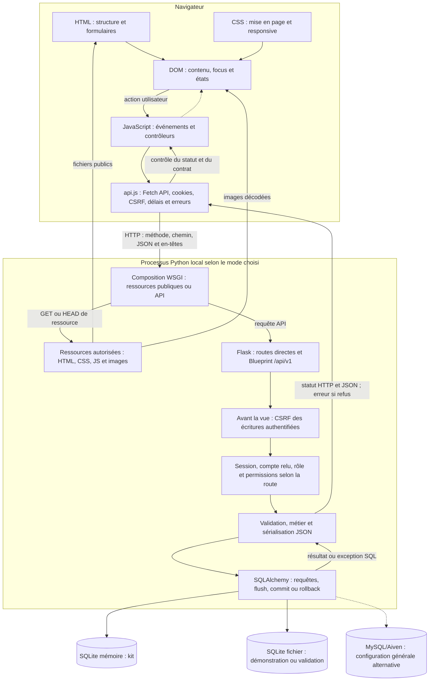

# Fiche Mélissa — Frontend et interactions API

4 novembre 2026, Europe/Paris — proposition du lot 6H.21.3, fondée sur les sources locales et le README installé au lot 6H.19.3.

**Mode de lecture :** pour chaque identifiant, A à I décrivent la réponse actuelle ; le bloc repliable qui suit conserve la réponse historique. Le statut ancien « VALIDÉE » est archivé, sans valeur de validation actuelle ou de production. Le texte de la question et toutes les réponses historiques sont conservés ; leurs anciennes références sont affichées comme repères archivés, pas comme liens de code actuels.

La réponse B est une proposition orale de l’ordre de 30 à 60 secondes selon le débit, sans chronométrage revendiqué. C permet de comprendre, D relie au projet, E donne les symboles vérifiés, F explique leur coopération, G et H préparent les relances. Le statut I distingue code implémenté, fonction partielle, validation absente et preuve historique.

Les références actives citent le fichier, le symbole ou élément précis et sa ligne contrôlée au 4 novembre 2026. Pour les fonctions Python indexées, un lien `MAH-F…` ouvre le contrat correspondant du [référentiel 6H.21.1](REFERENTIEL_PEDAGOGIQUE_LOT6H21_1.md). Ces identifiants sont pédagogiques, sans attribution exclusive d’auteur. Les liens #L visent les définitions ou instructions relues, pas seulement une ligne dans les bornes. Ils sont datés : une modification future nécessitera une nouvelle vérification. Les anciennes références restent uniquement dans les archives.

**Périmètre de cette préparation :** lecture statique et validation documentaire ; aucun test applicatif nouveau, accès SQL, serveur ou navigateur du site, migration ou action de compte. Exemples à lire, sans exécution sur la démonstration. Les copies pédagogiques commentées restent futures. Les anciennes fiches et les deux autres fiches restent intactes pendant cette proposition.

## Accès aux questions

[MEL-01](#mel-01) · [MEL-02](#mel-02) · [MEL-03](#mel-03) · [MEL-04](#mel-04) · [MEL-05](#mel-05) · [MEL-06](#mel-06) · [MEL-07](#mel-07) · [MEL-08](#mel-08) · [MEL-09](#mel-09) · [MEL-10](#mel-10) · [MEL-11](#mel-11) · [MEL-12](#mel-12) · [MEL-13](#mel-13) · [MEL-14](#mel-14) · [MEL-15](#mel-15) · [MEL-16](#mel-16) · [MEL-17](#mel-17) · [MEL-18](#mel-18)

## Guide actuel avant les questions

### Pages, modules et responsabilités

| Source active | Ce qu’il faut savoir montrer |
|---|---|
| [index.html](../../frontend/index.html) | Accueil et cartes récentes ; éléments remplis depuis l’API. |
| [histoires.html](../../frontend/histoires.html) et [coldcases.html](../../frontend/coldcases.html) | Listes par catégorie et recherche locale. |
| [dossier.html](../../frontend/dossier.html) | Slug, texte, image, like, commentaires et formulaire de signalement. |
| [theories.html](../../frontend/theories.html) | Formulaire et lecteur indépendants, liste de dossiers et messages d’état. |
| [inscription.html](../../frontend/inscription.html) et [connexion.html](../../frontend/connexion.html) | Champs identifiés, notices et session membre. |
| [admin-connexion.html](../../frontend/admin-connexion.html) et [admin-dashboard.html](../../frontend/admin-dashboard.html) | Connexion commune avec contrôle de rôle, dashboard et panneaux. |
| [proposer-histoire.html](../../frontend/proposer-histoire.html) | Proposition authentifiée ; pas une publication automatique. |
| [api.js](../../frontend/api.js) | Transport, timeout/annulation, JSON, CSRF et contrats de réponse. |
| [app.js](../../frontend/app.js) | Catalogue, recherche, fiches, images, session et formulaires communs. |
| [comments.js](../../frontend/comments.js) | Liste, création et signalement, conservation des saisies et invalidations. |
| [likes.js](../../frontend/likes.js) | État personnel, intention, retrait, confirmations et résultats incertains. |
| [theories-list.js](../../frontend/theories-list.js) | Chargement public, dates, texte sûr et réponses tardives du lecteur. |
| [admin-dashboard.js](../../frontend/admin-dashboard.js) | Session admin, cinq lectures coordonnées, sept indicateurs et listes. |
| [admin-users.js](../../frontend/admin-users.js) | Utilisateurs, confirmation de ban, verrou et relecture. |
| [admin-stories.js](../../frontend/admin-stories.js) | Archives/restauration, aperçu, dialogue et suppression conditionnelle. |
| [styles.css](../../frontend/styles.css) | Cascade, grilles, focus, [hidden], notices et images. |

Les dix pages actives sont contrôlées par leurs chemins réels dans les liens de source ci-dessous. donnees.js reste historique et n’est pas une source de repli automatique. Les scripts n’introduisent ni framework frontend ni stockage durable universel des brouillons. Le HTML structure ; CSS présente ; le DOM représente ; les contrôleurs réagissent ; api.js transporte ; Flask valide et persiste.

### Architecture à expliquer



Ce bloc reprend exactement le diagramme validé du [README](../../README.md#architecture-de-lapplication). Les requêtes JSON relient contrôleurs, client HTTP, routes et modèles. Le moteur sélectionné dépend du processus ; les modes SQLite mémoire/fichier et MySQL ne sont pas trois écritures simultanées. Une image utilise sa propre requête HTTP. Le DOM ne reçoit pas directement un objet SQLAlchemy.

### Trajet concret et états d’interface

Pour une théorie : événement submit → preventDefault → verrou local avant await → validation locale → /me → api.createTheory → hook CSRF → compte, dossier actif et validation serveur → ORM/commit → JSON 201 cohérent → message et reset. Le lecteur public se recharge volontairement ; il n’existe pas de canal temps réel. Une issue d’écriture incertaine ne doit pas déclencher un replay automatique.

Un AbortController limite le travail et les réponses utilisables côté client ; il ne garantit pas l’annulation SQL d’un POST déjà traité. Les versions d’une lecture empêchent une réponse ancienne de remplacer une sélection récente. Le verrou de formulaire, la cohérence d’identité et les contraintes SQL répondent à des problèmes différents. Les propositions n’ont pas toutes les garanties de confirmation forte et de blocage incertain propres aux théories.

Extrait réel de makeCard(), à lire sans l’exécuter :

```javascript
title.textContent = story.title;
```

Le titre devient un nœud texte, pas du HTML interprété. Les liens et sources d’image demandent leurs propres contrôles ; textContent ne valide pas une URL. Aucun exemple ne nécessite d’ouvrir un compte ou de saisir un secret.

### CSS et accessibilité : garanties ciblées

La grille passe de trois colonnes à deux sous 780 px puis une sous 560 px. Les pages à 390/320 px utilisent le second seuil ; 1280 px reste le cas large. Les labels doivent désigner les champs, les boutons conserver leur rôle/type, les messages aria-live annoncer les états et le focus rester visible. Le sélecteur :where a une spécificité nulle pour son argument, mais les autres parties du sélecteur gardent la leur. Les règles [hidden] explicites évitent qu’une règle display de composant rende un élément masqué visible.

Ces mécanismes dans le code et les observations Edge ciblées ne constituent pas un audit WCAG/RGAA complet. Lire la page au clavier et contrôler zoom, lecteur d’écran et appareil réel restent des travaux distincts. Les contrastes du bilan RGPD concernent les notices mesurées, pas chaque composant du site.

### Images : disque, référence, HTTP et rendu

Les six fichiers PNG sont stockés localement dans [frontend/images/](../../frontend/images/), pour environ **15,1 Mio** au total. Leurs noms et slugs sont détaillés dans le catalogue plus haut et dans le [registre des images](../../frontend/images/README.md).

| Niveau | Données et traitement |
|---|---|
| Disque | Les octets des six PNG et du SVG restent des fichiers du dossier d’images. Aucun téléversement de pièce jointe n’est implémenté. |
| Base | `Story.image_url` peut conserver une référence textuelle ; aucune colonne BLOB ne stocke ces six illustrations. |
| Association frontend | `originalStoryIllustrations` dans `app.js` associe les six fichiers par slug stable, indépendamment de l’ordre ou du numéro des histoires reçues. |
| HTTP | La composition WSGI/Flask autorise `/images/...` et transmet les fichiers avec leur type, notamment `image/png` dans le mode persistant. Le kit strict n’autorise que son SVG. |
| Navigateur | L’image est décodée et affichée avec proportions conservées, `object-fit: contain`, texte alternatif et légende « Illustration générée par IA ». |

L’ordre de sélection est une URL HTTP(S) utilisable fournie par l’API, puis l’image locale du slug, puis [default-story.svg](../../frontend/images/default-story.svg). Si ce dernier échoue, un message d’indisponibilité remplace l’image. La mention IA est associée aux illustrations locales reconnues ; une URL externe arbitraire ou le SVG ne reçoit pas indûment cette attribution.

Ces illustrations ne sont pas des photographies ou preuves authentiques des affaires. L’outil, l’opérateur, la date précise de génération et une licence libre des six PNG ne sont pas établis par leur seule présence. Le SVG de remplacement possède une provenance documentaire distincte.

Pour un clone GitHub complet, les PNG, le catalogue et les correspondances nécessaires doivent figurer dans une sélection de publication autorisée. À l’état examiné, les PNG sont non suivis localement : leur publication actuelle n’est pas présumée. Un futur déploiement devra livrer les fichiers au serveur, vérifier les chemins, types MIME, droits de diffusion et cache. Publier le code ne déploie pas le service. Les anciens WebP retirés localement ne sont pas requis pour ces six dossiers et ne sont pas réintroduits.

### Rôles, environnements et limites communes

Mélissa explique structure, rendu et contrôleurs frontend ; Sylvie explique HTTP, vues, validations et permissions ; Mahamadou explique schéma, ORM, migrations et intégration. Les frontières sont partagées : aucun identifiant pédagogique MAH-F ne constitue une preuve d’auteur exclusif. Voir les fiches [Mahamadou](fiche-mahamadou.md) et [commune](fiche-commune.md), conservées telles quelles pendant ce lot.

| Environnement | Usage et précaution |
|---|---|
| Kit scolaire SQLite mémoire, port 5064 | Catalogue de démonstration et contrôles bornés ; pas une persistance après arrêt. |
| Démonstration SQLite persistante, port 5066 | Comptes et données conservés ; serveur existant laissé intact. init pour une installation neuve est distinct de serve. |
| Lanceur général, port 5000 | Choix de configuration ; groupe Aiven complet prioritaire sur DATABASE_URL, puis repli SQLite. |
| Validations isolées | Fixtures mémoire ou fichier temporaire, configuration neutralisée et garde de connexions ; aucun état déduit de la base privée. |

L’application n’est pas déployée publiquement. Dix modèles, treize FK et sept migrations sont présents ; cela ne prouve pas une révision MySQL déployée ni les garanties de verrouillage d’un moteur non testé. Certains ajouts restent locaux ou non suivis : un chemin présent aujourd’hui n’est pas garanti dans un futur clone avant inclusion Git. Aucun secret, identifiant de connexion ou donnée privée ne figure dans les exemples.

Les notices d’information existent aux emplacements concernés. Le cookie de session nécessaire et les protections applicatives sont réels ; le brouillon interne de confidentialité reste non publié. L’absence de page publique est un chantier juridique, pas une réussite de conformité. Responsable/contact, bases légales, conservation, destinataires/hébergement, droits, sauvegardes et incidents restent à arbitrer. Ban, archive et purge d’un dossier ne forment pas un effacement complet de compte.

### Lire les preuves sans les additionner

### Campagnes distinctes : résultats historiques, pas de nouveau total

| Date / campagne | Résultat réellement consigné | Périmètre et limites |
|---|---|---|
| 25 octobre 2026, README historique de main ; réexécution documentée le 29 octobre | 205 backend, 226 frontend et 8 lanceur, soit 439 dans chacune de ces campagnes distinctes | Ancien périmètre ; ne valide pas les fonctions ajoutées depuis. Les campagnes ne s’additionnent pas. |
| 1er novembre 2026, correctifs 6G.5 | 311 backend, 513 frontend et 30 contrats/lanceur : 854 dans cette seule campagne finale | Après correctif de cache ; sept tests historiques de migrations exclus, six essais de migration des likes sur mémoire synthétique sous garde ; aucun MySQL. |
| 3 novembre 2026, livraison scolaire 6H.11 | Installation hors ligne et `pip check` ; 30 tests Python, 12 tests frontend d’images ; 43 requêtes WSGI, sept groupes PASS | Sélection livrée de 118 fichiers, sans les six nouveaux PNG ; aucune relance générale des 854 tests. |
| 3 novembre 2026, implémentation persistante après 6H.16B.1 | 21 tests persistants réussis ; 26 tests kit/catalogue et deux parcours mémoire réussis séparément | SQLite jetables, réouverture entre processus, sauvegarde/restauration ; rapport d’exécution externe, distinct du bilan de préparation 6H.16B.1. |
| 4 novembre 2026, 6H.17.3 | 53 tests frontend ciblés, puis 590 frontend complets ; 13 tests kit | Campagnes ciblée/complète qui se recouvrent ; images/texte aussi vérifiés dans Edge en lecture seule. |
| 4 novembre 2026, 6H.18.2 | 265 tests frontend ciblés, puis 567 frontend complets, sans échec | Messages, confirmations et résultats incertains ; DOM/API simulés. La baisse par rapport à 590 ne démontre pas à elle seule une perte de couverture. |
| 4 novembre 2026, 6H.18.3 | Parcours Edge authentifiés autorisés documentés ; réserve sur un essai CSRF négatif | Le contrôleur n’avait pas établi l’en-tête réellement envoyé ; un envoi a eu lieu, sans preuve de contournement. Pas de requalification de ce bilan. |
| 4 novembre 2026, 6H.18.4 | Neuf variantes : 27 refus CSRF 403 sans changement SQL, neuf requêtes valides avec les effets attendus | Application réelle et nouvelle SQLite temporaire, sans serveur ni Edge ; lève la réserve backend ciblée, sans reconstituer l’ancien essai navigateur. |
| 4 novembre 2026, 6H.20.2 | 92 tests Python ciblés : 13 notices, 10 lanceur, 13 kit, 13 catalogue, 29 CSRF, 14 erreurs/session ; suite frontend complète réussie, sortie 0 | Copie isolée après notices ; aucun nouveau total frontend chiffré dans le bilan. Cycle de session complémentaire réussi en mémoire. |
| 4 novembre 2026, 6H.20.3 | Edge : 33 combinaisons page/largeur et trois états de signalement ; 46 captures ; PASS AVEC RÉSERVES | Anonyme, GET/HEAD locaux, aucune soumission ; mesures détaillées dans la section suivante. Preuves externes non publiées. |
| 4 novembre 2026, 6H.21.1 | Référentiel statique : 27 modules, 20 classes, 212 entrées de fonctions dont 23 lambda ; 76 questions préservées | Inventaire pédagogique, pas une campagne de tests applicatifs ; aucune copie commentée créée. |

Les comptes des lignes précédentes ne sont jamais additionnés en total global. Les sous-cas, requêtes HTTP, vues Edge et méthodes de test sont des unités différentes. Les avertissements existants sur `datetime.utcnow()` et certains flux statiques non fermés sont documentés sans correction dans le lot RGPD. Aucun pourcentage global de couverture, validation de charge, concurrence réelle MySQL ou audit de production n’est revendiqué.

Le tableau reprend les résultats et liens du README installé : aucune suite n’a été relancée pendant ce lot. Les tests DOM simulent éléments, événements et réponses ; le client Flask teste le serveur dans son harnais ; les contrôles WSGI isolés ajoutent le transport ; Edge observe un navigateur réel, selon le parcours autorisé. Ces preuves sont complémentaires et leurs nombres ne sont pas cumulables.

La recette 6H.20.3 a utilisé Edge 156.0.4314.58 dans un profil temporaire : 33 combinaisons page/largeur, trois états supplémentaires de signalement, 46 captures privées. Largeurs 1280/390/320 px, 72 notices, contraste minimal relevé de 9,57:1 dans ces notices, 234 étapes de focus ; six PNG décodés sur 18 vues. Verdict antérieur PASS AVEC RÉSERVES : aucune soumission ni connexion, pas de recette de tous les rôles, de lecteur d’écran, de zoom 200 % ni de mobile physique. Ce lot ne revendique aucune nouvelle capture ou mesure.

L’essai négatif CSRF 6H.18.3 dans Edge était non concluant ; la campagne isolée 6H.18.4 a vérifié neuf routes, 27 refus 403 sans mutation et neuf cas valides attendus. Ce résultat serveur n’est pas une réexécution Edge. Les procédures du [README](../../README.md#procédures-manuelles-dans-edge) et la [recette RGPD](RECETTE_MANUELLE_LOT6H20_2.md) restent des guides à suivre seulement dans un environnement et un périmètre autorisés.


## Questions du jury

### MEL-01

#### A. Question originale

Quel est le rôle de HTML ?

#### B. Réponse courte pour l’oral — état actuel

HTML donne la structure et le sens des zones de la page : navigation, contenu principal, titres, formulaires et messages. Dans theories.html, le formulaire de création et le lecteur public sont deux parties différentes. Les labels identifient les champs et les notices sont reliées aux contrôles avec aria-describedby. Les identifiants permettent ensuite aux scripts de retrouver ces éléments, mais ils ne constituent pas une permission de publier. CSS règle leur présentation et JavaScript leurs interactions. Cette structure aide la navigation et l’accessibilité, sans suffire à prouver à elle seule que tous les parcours sont accessibles.

#### C. Explication technique approfondie

La page déclare `lang='fr'`, son encodage et un viewport adapté. Header, nav et main organisent les repères ; les titres structurent les sections. Dans un formulaire, `label[for]` référence l’id d’un contrôle, alors que son attribut name correspond à l’entrée utilisée dans `form.elements`. Ces deux attributs ne sont pas interchangeables.

Le formulaire de théorie possède les champs story_id, title et content, un bouton submit et un message aria-live. Le lecteur possède son propre select et un bouton de type button. `required` et `maxlength` apportent des aides natives, mais ne remplacent pas les validations JavaScript ou Flask. Les contrôles restent désactivés pendant certains chargements.

Les pages chargent les scripts nécessaires dans un ordre déterminé. Les identifiants HTML constituent donc un contrat avec leurs contrôleurs. Changer un id peut casser un comportement même si la page reste visuellement semblable ; cela explique les tests de conservation des champs et associations.

#### D. Exemple concret du projet

Dans theories.html, `#theory-form` est associé à `#theory-data-notice`. Le champ de titre porte id=theory-title mais name=title. `#published-theories` est le lecteur indépendant. Aucun contenu de compte privé n’est nécessaire pour observer cette structure statique.

#### E. Fichiers, fonctions et lignes vérifiés

- [frontend/theories.html — `élément HTML #theory-form`](../../frontend/theories.html#L35) : ligne 35.
- [frontend/theories.html — `élément HTML #theory-title`](../../frontend/theories.html#L42) : ligne 42.
- [frontend/theories.html — `élément HTML #published-theories`](../../frontend/theories.html#L50) : ligne 50.
- [frontend/app.js — `loadTheoryStories`](../../frontend/app.js#L313) : ligne 313.
- [frontend/theories-list.js — `loadDossiers`](../../frontend/theories-list.js#L121) : ligne 121.

#### F. Rôle des fonctions et interactions

Le navigateur construit les éléments déclarés ; app.js récupère le formulaire et alimente ses choix avec `loadTheoryStories()`. `loadDossiers()` prépare séparément le lecteur. Les deux utilisent les données de getStories(), mais conservent des états distincts. Les notices informent ; les routes Flask restent responsables de l’autorisation d’écrire.

#### G. Erreurs fréquentes et confusions

- Confondre id et name, ou transformer un bouton d’actualisation en submit involontaire.
- Présenter des attributs ARIA comme une validation exhaustive d’accessibilité ou une protection serveur.

#### H. Relance possible du jury

**Question :** Pourquoi deux sélecteurs de dossiers sur la même page ?

**Réponse :** Le lecteur doit rester public et indépendant d’une analyse en cours de rédaction. Sa sélection ne doit pas modifier le dossier du formulaire ni envoyer une contribution ; leurs identifiants et contrôleurs sont donc distincts.

#### I. Statut et portée des preuves

Implémenté : structure sémantique, labels et descriptions. Non validé : audit exhaustif avec lecteur d’écran.

<details>
<summary>Réponse historique conservée — état antérieur, à ne pas réciter comme état actuel</summary>

**Lecture de l’archive :** les formulations ci-dessous restent celles de la fiche initiale. Ses exemples, statuts et anciennes références ont leur contexte historique ; les liens et preuves actuels sont en E et I.

**Réponse courte à dire**

Il structure les pages. Dans `theories.html`, il définit le formulaire et la zone de lecture des théories.

**Explication simple**

La page déclare les zones et les champs que les scripts vont utiliser.

**Exemple concret**

Le formulaire et le lecteur public sont deux zones distinctes.

**Référence technique**

`frontend/theories.html → ../../frontend/theories.html#L31`

**Statut de validation historique — ne pas confondre avec I**

**VALIDÉE — conforme aux sources.**

</details>

### MEL-02

#### A. Question originale

Quel est le rôle de CSS ?

#### B. Réponse courte pour l’oral — état actuel

CSS organise les couleurs, espacements, grilles et adaptations de largeur. La cascade choisit la déclaration applicable selon sa priorité, sa spécificité et son ordre lorsque ces critères sont égaux. Notre grille de cartes passe de trois colonnes à deux sous 780 pixels, puis à une sous 560. Certaines règles plus précises complètent les règles générales : les illustrations IA utilisent contain, même si la classe d’image générale prévoit cover. Le responsive ne se réduit donc pas à une media query. Nous vérifions aussi les retours à la ligne, les contrôles désactivés et le focus, sans confondre lecture du CSS et rendu navigateur.

#### C. Explication technique approfondie

Le sélecteur universel applique border-box ; body définit notamment la typographie et des propriétés héritées. Une classe comme `.cards` cible la grille, un id comme `#session-controls` une zone précise. Les sélecteurs composés et les pseudo-classes décrivent des états ou contextes. `:where()` apporte une spécificité nulle pour sa propre liste ; le reste du sélecteur conserve sa contribution. L’ordre n’est donc pas la seule règle à regarder.

La grille de base utilise repeat(3,minmax(0,1fr)), puis les media queries modifient les colonnes. Flex-wrap, max-width, min-width et overflow-wrap limitent les contraintes de contenu. Le focus visible des boutons et les états disabled possèdent leurs propres couleurs et contours.

La règle générale `.story-image` utilise cover. Le sélecteur `.story-media[data-illustration='true'] .story-image` impose contain pour montrer les PNG reconnus en entier. Une phrase « toutes les images sont recadrées » ou « toutes sont contain » serait inexacte. Les mesures Edge antérieures restent une preuve ciblée, pas une nouvelle mesure de cette fiche.

#### D. Exemple concret du projet

À 390 px, la règle max-width:560px place les cartes sur une colonne et réduit certains espacements. Une illustration reconnue par le slug reçoit data-illustration=true ; son sélecteur spécifique conserve ses proportions. Le texte de légende reste hors de l’image, sans être rogné avec son cadre.

#### E. Fichiers, fonctions et lignes vérifiés

- [frontend/styles.css — `sélecteur CSS .cards`](../../frontend/styles.css#L180) : ligne 180.
- [frontend/styles.css — `instruction / bloc @media(max-width:780px)`](../../frontend/styles.css#L336) : ligne 336.
- [frontend/styles.css — `instruction / bloc @media(max-width:560px)`](../../frontend/styles.css#L348) : ligne 348.
- [frontend/styles.css — `sélecteur CSS .story-media[data-illustration="true"] .story-image`](../../frontend/styles.css#L563) : ligne 563.
- [frontend/styles.css — `instruction / bloc .btn:focus-visible`](../../frontend/styles.css#L159) : ligne 159.

#### F. Rôle des fonctions et interactions

HTML fournit classes et attributs ; createStoryImage() attribue l’état d’illustration au cadre. Le moteur CSS applique alors le bon sélecteur et les media queries selon la largeur. JavaScript n’a pas besoin de recalculer le nombre de colonnes. Les tests DOM contrôlent certains attributs, mais Edge est nécessaire pour observer le rendu et le débordement effectifs.

#### G. Erreurs fréquentes et confusions

- Dire que la dernière règle gagne toujours sans examiner priorité et spécificité.
- Répéter l’ancien object-fit:cover pour les six PNG ou déduire un test mobile physique d’un viewport simulé.

#### H. Relance possible du jury

**Question :** Pourquoi écrire une règle pour [hidden] ?

**Réponse :** Certains composants possèdent aussi une règle display de présentation. Le CSS explicite le masquage des images, légendes et commentaires concernés, afin que cet état ne soit pas neutralisé par une règle de composant. Il faut vérifier les sélecteurs effectivement présents, pas généraliser à toutes les balises.

#### I. Statut et portée des preuves

Implémenté : cascade et responsive cités. Historique : contrôles Edge ciblés ; accessibilité complète non validée.

<details>
<summary>Réponse historique conservée — état antérieur, à ne pas réciter comme état actuel</summary>

**Lecture de l’archive :** les formulations ci-dessous restent celles de la fiche initiale. Ses exemples, statuts et anciennes références ont leur contexte historique ; les liens et preuves actuels sont en E et I.

**Réponse courte à dire**

Il organise l’apparence et les adaptations d’écran. Les media queries réduisent le nombre de colonnes des cartes.

**Explication simple**

La présentation change suivant la largeur disponible.

**Exemple concret**

La grille passe de trois à deux, puis une colonne.

**Référence technique**

`frontend/styles.css → ../../frontend/styles.css#L318`

**Statut de validation historique — ne pas confondre avec I**

**VALIDÉE — conforme aux sources.**

</details>

### MEL-03

#### A. Question originale

Quel est le rôle de JavaScript ?

#### B. Réponse courte pour l’oral — état actuel

JavaScript relie la page aux actions et aux données du serveur. Les événements déclenchent une lecture ou une soumission, puis les fonctions asynchrones attendent l’API et mettent le DOM à jour. Dans notre formulaire de théorie, le script intercepte submit, valide les champs, vérifie la session et attend une création confirmée. Les commentaires, likes et panneaux administratifs disposent aussi de contrôleurs dédiés. Le site reste composé de plusieurs pages HTML ; il ne s’agit pas d’une application qui transforme toutes les navigations en appels API. Le navigateur guide l’action, tandis que Flask décide des permissions et de l’enregistrement.

#### C. Explication technique approfondie

Un script chargé s’exécute dans le navigateur et peut enregistrer des écouteurs d’événements. Plusieurs blocs d’app.js vérifient d’abord si l’élément de page existe ; cela permet de partager ce fichier entre l’accueil, une fiche et les formulaires. Les contrôleurs spécialisés exposent des fonctions utilisées seulement lorsqu’une zone est présente.

Submit, input, change, click, error, pagehide et pageshow répondent à des situations différentes. Le clic de like n’a pas le même effet que la saisie de recherche ; l’erreur d’image fait avancer le repli sans modifier un dossier SQL. Les actions réseau ont des attentes et des erreurs possibles, donc l’état local doit rester cohérent pendant et après leur traitement.

Les fonctions API centralisent la communication. Les contrôleurs interprètent ensuite la réponse et décident du message, de la réinitialisation ou d’une relecture. Ils ne possèdent pas la connexion SQL et ne peuvent pas rendre fiable un rôle simplement en l’affichant.

#### D. Exemple concret du projet

Le bloc qui écoute `theoryForm.addEventListener('submit', ...)` finit par appeler createTheory(). La vue post_theory() effectue ensuite les contrôles serveur et le commit. Le succès de la promesse client n’efface la saisie qu’après les vérifications du contrat prévu.

#### E. Fichiers, fonctions et lignes vérifiés

- [frontend/app.js — `instruction / bloc theoryForm.addEventListener('submit'`](../../frontend/app.js#L349) : ligne 349.
- [frontend/api.js — `createTheory`](../../frontend/api.js#L159) : ligne 159.
- [backend/api/v1/views/theories.py — `post_theory`](../../backend/api/v1/views/theories.py#L64) : ligne 64 ; [MAH-F0203](REFERENTIEL_PEDAGOGIQUE_LOT6H21_1.md#mah-f0203--post_theory).
- [frontend/comments.js — `mountStoryComments`](../../frontend/comments.js#L2) : ligne 2.
- [frontend/likes.js — `mountStoryLike`](../../frontend/likes.js#L157) : ligne 157.

#### F. Rôle des fonctions et interactions

app.js orchestre le formulaire et monte les zones d’une fiche après chargement du dossier. api.js prépare HTTP ; les vues Flask valident et sérialisent ; les contrôleurs spécialisés rendent leurs résultats. Cette chaîne explique à la fois l’interaction visible et la limite : une modification locale du JavaScript n’accorde pas de permission au serveur.

#### G. Erreurs fréquentes et confusions

- Assimiler JavaScript à la base de données ou supposer que tout changement de page est intercepté.
- Annoncer un succès dès le clic, avant la réponse contrôlée.

#### H. Relance possible du jury

**Question :** Pourquoi séparer comments.js et likes.js d’app.js ?

**Réponse :** Ils portent leurs propres états, événements et règles de cycle de vie. Leurs points d’entrée reçoivent la cible réelle depuis la fiche ; cette séparation permet d’expliquer et tester le comportement sans dupliquer tout le chargement des dossiers.

#### I. Statut et portée des preuves

Implémenté : événements, appels asynchrones et contrôleurs spécialisés. Validations dynamiques antérieures selon leur périmètre.

<details>
<summary>Réponse historique conservée — état antérieur, à ne pas réciter comme état actuel</summary>

**Lecture de l’archive :** les formulations ci-dessous restent celles de la fiche initiale. Ses exemples, statuts et anciennes références ont leur contexte historique ; les liens et preuves actuels sont en E et I.

**Réponse courte à dire**

Il gère les interactions et les appels API. Par exemple, il soumet une théorie sans recharger toute la page.

**Explication simple**

Les événements du navigateur déclenchent des actions et des requêtes.

**Exemple concret**

submit lance une création de théorie.

**Référence technique**

`frontend/app.js → ../../frontend/app.js#L255`

**Statut de validation historique — ne pas confondre avec I**

**VALIDÉE — conforme aux sources.**

</details>

### MEL-04

#### A. Question originale

Pourquoi centraliser les appels dans `api.js` ?

#### B. Réponse courte pour l’oral — état actuel

api.js centralise le contrat de transport pour éviter que chaque page réinvente cookies, CSRF, JSON, délai et traitement des erreurs. Sa fonction apiRequest construit la requête relative à /api/v1, attend la réponse et contrôle le statut. Des fonctions métier comme createTheory ou getStoryComments vérifient ensuite les champs utiles. Le contrôleur de page garde la décision d’affichage. Cette séparation rend les erreurs plus cohérentes, mais ne signifie pas que toutes les réponses API ont le même format. Elle n’effectue pas de répétition automatique des écritures et ne remplace pas les permissions de Flask.

#### C. Explication technique approfondie

apiRequest extrait ses options, valide le délai puis construit les en-têtes. Un corps fourni entraîne Content-Type:application/json. Le CSRF en mémoire est ajouté aux méthodes d’écriture concernées, hors login ; credentials:include laisse le navigateur gérer le cookie. Les seuls en-têtes conditionnels supplémentaires autorisés sont ceux prévus pour la purge.

Le même AbortController reçoit l’annulation demandée par la page et le minuteur. Le finally libère ces ressources. Les refus 401/403 peuvent déclencher un callback d’accès avant même la lecture complète du corps, pour nettoyer une interface privée. Un HTTP non réussi, un JSON illisible ou un statut inattendu deviennent des erreurs distinctes.

Le transport ne sait pas à lui seul si un objet Theory correspond au bon dossier ou au texte envoyé. createTheory() et les lecteurs spécialisés ajoutent ces contrôles. createProposal() contrôle son statut et JSON sans fournir exactement les mêmes vérifications métier ; il faut décrire chaque fonction, pas supposer une validation uniforme.

#### D. Exemple concret du projet

createTheory() appelle apiRequest avec POST et expectedStatus=201, puis compare les champs de la théorie renvoyée. getStoryTheories() exige une liste de contributions du bon dossier, avec identifiants cohérents et sans doublon. Ces deux contrats partagent le transport tout en validant des structures différentes.

#### E. Fichiers, fonctions et lignes vérifiés

- [frontend/api.js — `apiRequest`](../../frontend/api.js#L8) : ligne 8.
- [frontend/api.js — `createTheory`](../../frontend/api.js#L159) : ligne 159.
- [frontend/api.js — `getStoryTheories`](../../frontend/api.js#L204) : ligne 204.
- [frontend/api.js — `createProposal`](../../frontend/api.js#L150) : ligne 150.
- [frontend/api.js — `getStoryComments`](../../frontend/api.js#L432) : ligne 432.

#### F. Rôle des fonctions et interactions

Le contrôleur donne une intention à une fonction métier ; celle-ci délègue l’échange à apiRequest, contrôle le résultat utile et le rend à la page. Flask conserve ses propres validations. Cette composition permet aux tests de simuler les réponses réseau sans remplacer la logique JavaScript qu’ils veulent observer.

#### G. Erreurs fréquentes et confusions

- Présenter apiRequest comme une autorisation ou une validation métier universelle.
- Oublier le nettoyage des minuteurs, ou laisser une option libre remplacer le CSRF et les credentials communs.

#### H. Relance possible du jury

**Question :** Pourquoi ne pas rappeler automatiquement une requête en échec ?

**Réponse :** Une réponse perdue peut survenir après le commit. Le transport n’a pas une preuve générale d’absence d’effet ni une clé d’idempotence pour toutes les créations. La page doit interpréter la situation et vérifier l’état, sans replay automatique de POST ou DELETE.

#### I. Statut et portée des preuves

Implémenté : transport central et contrats spécialisés ; pas de garantie universelle d’idempotence.

<details>
<summary>Réponse historique conservée — état antérieur, à ne pas réciter comme état actuel</summary>

**Lecture de l’archive :** les formulations ci-dessous restent celles de la fiche initiale. Ses exemples, statuts et anciennes références ont leur contexte historique ; les liens et preuves actuels sont en E et I.

**Réponse courte à dire**

Cela regroupe les règles communes : cookies, CSRF, JSON, délai et erreurs. Chaque page utilise les mêmes fonctions.

**Explication simple**

Une seule fonction applique les mêmes règles de communication aux différents écrans.

**Exemple concret**

apiRequest() gère le délai et les erreurs HTTP.

**Référence technique**

`frontend/api.js → ../../frontend/api.js#L8`

**Statut de validation historique — ne pas confondre avec I**

**VALIDÉE — conforme aux sources.**

</details>

### MEL-05

#### A. Question originale

Que fait `app.js` ?

#### B. Réponse courte pour l’oral — état actuel

app.js est le contrôleur partagé des pages publiques : dossiers, recherche, images, session et plusieurs formulaires. Il vérifie les éléments présents avant d’activer le parcours correspondant. Les listes appellent getStories, la fiche résout son slug et transmet l’id reçu aux commentaires et likes. La recherche filtre les titres et résumés déjà chargés, sans requête SQL à chaque frappe. Ce fichier ne remplace pas les contrôleurs dédiés au lecteur ou à l’administration. L’ancien donnees.js n’est pas utilisé comme solution de secours lorsque l’API échoue : l’erreur doit rester visible et explicite.

#### C. Explication technique approfondie

`data-story-type` indique le type de liste. L’accueil retient au plus trois dossiers récents ; les rubriques filtrent selon les catégories configurées puis appliquent l’ordre éditorial des six originaux. Les autres dossiers conservent leur ordre relatif. Une catégorie inconnue reçoit un traitement explicite, sans être arbitrairement classée dans l’une des deux rubriques.

Le champ de recherche compare en minuscules françaises le titre et le résumé à la saisie nettoyée. L’état « aucun résultat » est distinct d’une liste source vide. La fiche utilise URLSearchParams, demande le slug encodé à l’API, rend le récit comme texte et adapte le lien de retour selon la catégorie.

Les formulaires et l’affichage de compte partagent aussi app.js. refreshSession() contrôle /me ; pagehide/pageshow et focus aident à éviter un état périmé. Ces mécanismes ne constituent pas une surveillance serveur continue. Les panneaux admin demeurent dans leurs modules séparés.

#### D. Exemple concret du projet

loadStories() obtient les objets, construit pageStories puis appelle showCards(), qui passe chaque dossier à makeCard(). Le lien de carte utilise le slug ; loadStory() récupère ensuite la PK réelle et monte les contributions. Le numéro visuel ou le rang d’une carte ne devient jamais l’identifiant d’écriture.

#### E. Fichiers, fonctions et lignes vérifiés

- [frontend/app.js — `loadStories`](../../frontend/app.js#L165) : ligne 165.
- [frontend/app.js — `showCards`](../../frontend/app.js#L149) : ligne 149.
- [frontend/app.js — `makeCard`](../../frontend/app.js#L126) : ligne 126.
- [frontend/app.js — `loadStory`](../../frontend/app.js#L244) : ligne 244.
- [frontend/app.js — `refreshSession`](../../frontend/app.js#L621) : ligne 621.
- [frontend/app.js — `instruction / bloc if (search) search.addEventListener('input'`](../../frontend/app.js#L154) : ligne 154.

#### F. Rôle des fonctions et interactions

getStories() et getStoryBySlug() vérifient le JSON avant de le remettre aux fonctions d’affichage. makeCard() utilise le constructeur d’image commun. loadStory() délègue les commentaires et likes aux fonctions disponibles. Les contrôles de formulaire restent une autre branche du même fichier, activée seulement si le formulaire existe.

#### G. Erreurs fréquentes et confusions

- Utiliser le rang de réponse comme id ou présenter la recherche locale comme un moteur SQL global.
- Dire qu’app.js gère seul tous les panneaux admin ou qu’il rétablit des données depuis donnees.js.

#### H. Relance possible du jury

**Question :** Pourquoi conserver des catégories 1 et 2 est-il une limite ?

**Réponse :** L’interface suppose ces identifiants pour classer les dossiers. Les deux démonstrations les préparent, mais une autre base doit les respecter ou l’interface doit évoluer. Une catégorie présente en base n’est pas automatiquement connue du tableau JavaScript.

#### I. Statut et portée des preuves

Implémenté : parcours partagés et recherche locale. Partiel : catégories configurées par identifiants fixes et absence de pagination.

<details>
<summary>Réponse historique conservée — état antérieur, à ne pas réciter comme état actuel</summary>

**Lecture de l’archive :** les formulations ci-dessous restent celles de la fiche initiale. Ses exemples, statuts et anciennes références ont leur contexte historique ; les liens et preuves actuels sont en E et I.

**Réponse courte à dire**

Il gère les parcours communs : affichage des dossiers, recherche, images, session et formulaires.

**Explication simple**

Ce script relie les éléments communs de l’interface aux fonctions API.

**Exemple concret**

loadStories() remplit les cartes depuis getStories().

**Référence technique**

`frontend/app.js → ../../frontend/app.js#L121`

**Statut de validation historique — ne pas confondre avec I**

**VALIDÉE — conforme aux sources.**

</details>

### MEL-06

#### A. Question originale

Pourquoi un script séparé pour les théories publiées ?

#### B. Réponse courte pour l’oral — état actuel

Le lecteur de théories a son propre état et peut fonctionner sans connexion. Il ne doit ni modifier la sélection du formulaire ni publier une analyse lorsqu’on consulte un dossier. Son script charge les choix, vérifie la sélection, affiche chargement, liste vide ou erreur, et propose une actualisation volontaire. Il protège aussi contre les réponses tardives avec une annulation et un numéro de version. Après une création, le lecteur ne se recharge pas automatiquement. Cette séparation rend le comportement plus prévisible et permet de tester lecture publique et création authentifiée sans les confondre.

#### C. Explication technique approfondie

L’IIFE du lecteur se termine si sa section n’existe pas. loadDossiers() obtient les histoires et valide leurs identifiants avant de remplir le select. loadSelectedTheories() n’accepte qu’une sélection connue. beginRequest() invalide l’ancienne requête, installe un AbortController, vide l’ancienne liste et marque l’attente.

Le compteur requestVersion reste nécessaire : une réponse peut arriver malgré l’annulation ou avoir déjà été traitée par une couche intermédiaire. Le contrôleur ne rend le résultat que si sa version est encore courante. finishRequest() ne doit pas réactiver le bouton au nom d’une ancienne sélection.

theoryCard() construit titre, date et paragraphes avec textContent. Les dates sans suffixe suivent la convention UTC de cette API puis sont affichées à l’heure de Paris ; cette présentation ne change pas le stockage. Une liste vide est un 200 valide, un dossier absent ou archivé un 404, et une panne un état d’erreur.

#### D. Exemple concret du projet

La personne sélectionne un dossier puis un autre avant la fin de la première lecture. cancelRequest() incrémente la version et annule l’ancienne demande ; même si sa réponse termine ensuite, elle ne doit pas remplacer les cartes de la sélection récente. Il s’agit de lectures, pas d’annulation d’un commit.

#### E. Fichiers, fonctions et lignes vérifiés

- [frontend/theories-list.js — `loadDossiers`](../../frontend/theories-list.js#L121) : ligne 121.
- [frontend/theories-list.js — `loadSelectedTheories`](../../frontend/theories-list.js#L87) : ligne 87.
- [frontend/theories-list.js — `beginRequest`](../../frontend/theories-list.js#L27) : ligne 27.
- [frontend/theories-list.js — `finishRequest`](../../frontend/theories-list.js#L39) : ligne 39.
- [frontend/theories-list.js — `theoryCard`](../../frontend/theories-list.js#L69) : ligne 69.
- [frontend/api.js — `getStoryTheories`](../../frontend/api.js#L204) : ligne 204.

#### F. Rôle des fonctions et interactions

Le lecteur utilise getStories() pour ses choix et getStoryTheories() pour les contributions. Flask vérifie le dossier actif et sérialise les lignes ; le client vérifie leur structure et le contrôleur décide si la réponse est encore pertinente. Le formulaire d’app.js garde ses propres champs et sa propre confirmation.

#### G. Erreurs fréquentes et confusions

- Confondre annulation locale, réponse ignorée et annulation d’une transaction SQL.
- Annoncer une mise à jour automatique du lecteur après création.

#### H. Relance possible du jury

**Question :** Pourquoi AbortController ne suffit-il pas toujours ?

**Réponse :** L’annulation est une demande au transport et peut arriver trop tard. La vérification de version reste une règle locale d’affichage : seul le chargement encore courant peut remplacer les résultats et terminer l’état d’attente.

#### I. Statut et portée des preuves

Implémenté : lecteur public indépendant, gestion des versions et actualisation manuelle ; cas simulés historiquement testés.

<details>
<summary>Réponse historique conservée — état antérieur, à ne pas réciter comme état actuel</summary>

**Lecture de l’archive :** les formulations ci-dessous restent celles de la fiche initiale. Ses exemples, statuts et anciennes références ont leur contexte historique ; les liens et preuves actuels sont en E et I.

**Réponse courte à dire**

Le lecteur possède sa propre sélection et ses propres états. Il peut fonctionner publiquement, indépendamment du formulaire connecté.

**Explication simple**

Lire les théories ne nécessite pas de remplir le formulaire de contribution.

**Exemple concret**

Le lecteur possède son propre sélecteur et un bouton Actualiser.

**Référence technique**

`frontend/theories-list.js → ../../frontend/theories-list.js#L87`

**Statut de validation historique — ne pas confondre avec I**

**VALIDÉE — conforme aux sources.**

</details>

### MEL-07

#### A. Question originale

Qu’est-ce que le DOM ?

#### B. Réponse courte pour l’oral — état actuel

Le DOM est l’arbre d’objets représentant la page dans le navigateur. JavaScript peut y retrouver un formulaire, créer une carte et modifier un texte ou un état. Dans le projet, makeCard construit un article et ses enfants, puis showCards remplace la liste. Nous utilisons textContent pour les titres, résumés et contributions reçus afin qu’ils restent du texte et ne deviennent pas du HTML exécuté. Cela ne sécurise pas automatiquement une URL ou toutes les autres opérations : les liens, images et données JSON possèdent leurs propres contrôles. Le DOM n’est ni la base ni une sauvegarde durable de la saisie.

#### C. Explication technique approfondie

createElement() crée un nœud ; append() lui ajoute des enfants ; replaceChildren() remplace les résultats d’une liste. getElementById() retrouve un contrat HTML précis, et querySelector() choisit selon un sélecteur. Des propriétés comme value, hidden et disabled expriment des états différents : masquer n’est pas effacer, désactiver n’est pas autoriser côté serveur.

Les contenus de membres sont externes à l’interface. Les traiter avec textContent évite de demander au navigateur d’interpréter leur balisage. La construction d’une URL reste une autre question : les slugs sont encodés dans les liens et les sources d’images sont limitées aux protocoles prévus.

Les réponses tardives et changements de session doivent aussi invalider des vues DOM existantes. Le dashboard efface ses listes et remplace les compteurs par un état inconnu après refus. Une donnée affichée parce qu’elle était autrefois autorisée ne devient pas fiable indéfiniment.

#### D. Exemple concret du projet

Extrait réel de makeCard(), à lire sans exécuter :

```javascript
title.textContent = story.title;
```

Le commentaire utilisateur suit le même principe dans render() de comments.js. Le nom de variable ne suffit pas comme preuve : les références ci-dessous pointent les instructions dans leurs fonctions actuelles.

#### E. Fichiers, fonctions et lignes vérifiés

- [frontend/app.js — `makeCard`](../../frontend/app.js#L126) : ligne 126.
- [frontend/app.js — `showCards`](../../frontend/app.js#L149) : ligne 149.
- [frontend/comments.js — `render`](../../frontend/comments.js#L58) : ligne 58.
- [frontend/theories-list.js — `theoryCard`](../../frontend/theories-list.js#L69) : ligne 69.
- [frontend/admin-dashboard.js — `clearData`](../../frontend/admin-dashboard.js#L37) : ligne 37.

#### F. Rôle des fonctions et interactions

La fonction API fournit des données validées en structure ; makeCard(), theoryCard() ou render() construisent les nœuds. Les contrôleurs de page les installent dans la zone HTML prévue. Flask n’envoie pas d’objet DOM ou ORM à monter directement : il transmet des valeurs JSON qui doivent encore être traitées dans ce contexte d’affichage.

#### G. Erreurs fréquentes et confusions

- Remplacer textContent par innerHTML pour une contribution non fiable sans concevoir une politique de traitement adaptée.
- Croire que hidden protège les données, ou que textContent valide aussi le href d’un lien.

#### H. Relance possible du jury

**Question :** Les intertitres du récit sont-ils du HTML reçu de la base ?

**Réponse :** Non. loadStory() compare les lignes aux intertitres approuvés pour le slug, crée un h2 ou un paragraphe, puis affecte le texte. La forme est décidée par le contrôleur, sans exécuter le HTML historique du catalogue.

#### I. Statut et portée des preuves

Implémenté : DOM construit et contenus concernés rendus comme texte ; aucune garantie générale sur un futur HTML arbitraire.

<details>
<summary>Réponse historique conservée — état antérieur, à ne pas réciter comme état actuel</summary>

**Lecture de l’archive :** les formulations ci-dessous restent celles de la fiche initiale. Ses exemples, statuts et anciennes références ont leur contexte historique ; les liens et preuves actuels sont en E et I.

**Réponse courte à dire**

C’est la représentation de la page manipulée par JavaScript. `createElement()` permet par exemple de construire une carte de dossier.

**Explication simple**

JavaScript peut créer et modifier les éléments visibles de la page.

**Exemple concret**

makeCard() crée un article et lui ajoute un titre.

**Référence technique**

`frontend/app.js → ../../frontend/app.js#L82`

**Statut de validation historique — ne pas confondre avec I**

**VALIDÉE — conforme aux sources.**

</details>

### MEL-08

#### A. Question originale

Pourquoi utiliser `preventDefault()` ?

#### B. Réponse courte pour l’oral — état actuel

preventDefault empêche le comportement par défaut de l’événement. Pour submit, notre contrôleur évite ainsi l’envoi HTML classique et le changement de page, afin de valider puis d’appeler l’API lui-même. Il faut le faire pendant le traitement de l’événement ; écrire async ne bloque pas automatiquement le navigateur. Cette méthode ne protège pourtant ni contre un second clic ni contre une requête envoyée autrement. Nous ajoutons un verrou local, les validations et les permissions Flask. Dans certains dialogues, preventDefault intervient aussi sur l’événement d’annulation pour conserver un cycle de fermeture cohérent, sans lancer une action destructive.

#### C. Explication technique approfondie

Un formulaire peut être soumis au clavier ou par son bouton ; écouter submit couvre ce parcours mieux qu’écouter uniquement le clic. Le contrôleur empêche l’action native, examine sending et l’état incertain éventuel, valide les entrées, puis attend /me avant le POST. Les champs ne sont effacés qu’après le succès exigé.

La propagation est un autre mécanisme : preventDefault n’est pas stopPropagation. Il ne supprime pas les écouteurs suivants et ne retire pas les contraintes de validation natives. Un bouton de type button possède aussi un rôle distinct d’un submit, sans avoir besoin d’inventer un envoi à empêcher.

Le dialogue de suppression des archives intercepte cancel et appelle son mécanisme finish(null). L’objectif est de résoudre la promesse une seule fois et retirer le dialogue proprement. Cette annulation locale n’est pas une preuve d’annulation d’une écriture déjà partie ; le DELETE n’est envoyé qu’après les confirmations prévues.

#### D. Exemple concret du projet

Le handler de théorie commence par `event.preventDefault()` puis vérifie `sending || uncertainTheory`. Les formulaires commentaire et signalement appellent ensuite submit(kind) dans leur contrôleur. Ce sont des traitements enregistrés dans les vrais scripts, pas un mécanisme ajouté pour cette documentation.

#### E. Fichiers, fonctions et lignes vérifiés

- [frontend/app.js — `instruction / bloc theoryForm.addEventListener('submit'`](../../frontend/app.js#L349) : ligne 349.
- [frontend/comments.js — `instruction / bloc commentForm.addEventListener('submit'`](../../frontend/comments.js#L204) : ligne 204.
- [frontend/comments.js — `submit`](../../frontend/comments.js#L144) : ligne 144.
- [frontend/admin-stories.js — `askPermanentDeletion`](../../frontend/admin-stories.js#L45) : ligne 45.

#### F. Rôle des fonctions et interactions

Le navigateur transmet l’événement au handler ; celui-ci empêche l’action native puis délègue la logique asynchrone. La fonction API et Flask effectuent ensuite leurs contrôles respectifs. Pour le dialogue, finish() clôt l’interface et résout son choix ; permanentlyDelete() décide de poursuivre ou de s’arrêter selon cette valeur.

#### G. Erreurs fréquentes et confusions

- Croire qu’async ou await empêche seul l’envoi natif.
- Confondre empêcher l’action par défaut, empêcher la propagation et annuler un commit serveur.

#### H. Relance possible du jury

**Question :** Pourquoi ne pas utiliser seulement click ?

**Réponse :** Une soumission peut venir du clavier et le formulaire constitue la bonne frontière de validation. Un clic peut aussi être ignoré sur un bouton désactivé ; le serveur doit malgré tout rester protégé contre des requêtes indépendantes du navigateur.

#### I. Statut et portée des preuves

Implémenté : soumissions et dialogue contrôlés ; action native, verrou et sécurité serveur restent distincts.

<details>
<summary>Réponse historique conservée — état antérieur, à ne pas réciter comme état actuel</summary>

**Lecture de l’archive :** les formulations ci-dessous restent celles de la fiche initiale. Ses exemples, statuts et anciennes références ont leur contexte historique ; les liens et preuves actuels sont en E et I.

**Réponse courte à dire**

Il empêche l’envoi HTML classique du formulaire. Le script peut valider les données et traiter la réponse de Flask.

**Explication simple**

Le navigateur ne doit pas envoyer le formulaire par son mécanisme classique en plus du script.

**Exemple concret**

La validation précède createTheory().

**Référence technique**

`frontend/app.js → ../../frontend/app.js#L255`

**Statut de validation historique — ne pas confondre avec I**

**VALIDÉE — conforme aux sources.**

</details>

### MEL-09

#### A. Question originale

Qu’est-ce qu’une promesse ?

#### B. Réponse courte pour l’oral — état actuel

Une promesse représente l’issue future d’une opération : en attente, réussie ou rejetée. Une fonction async renvoie une promesse et await suspend la suite de cette fonction jusqu’au résultat, sans bloquer toute l’interface. Notre transport attend fetch, puis la lecture du JSON. Le tableau administrateur utilise aussi Promise.all pour plusieurs lectures après avoir vérifié la session. Il faut gérer les rejets avec try/catch et terminer les états d’attente dans finally. Une promesse résolue ne signifie pas automatiquement succès métier : fetch peut fournir une réponse 403 et un JSON peut être incohérent.

#### C. Explication technique approfondie

Le lancement d’une requête et la disponibilité de sa réponse sont séparés. await rend l’écriture du flux plus lisible, mais ne supprime pas les événements qui peuvent arriver entre deux attentes : nouveau clic, changement de dossier, départ de page ou modification de session. Les contrôleurs capturent donc l’intention et vérifient encore leur version ou leur état après les await.

Promise.all attend l’ensemble des promesses fournies et rejette dès qu’une échoue. Cela n’annule pas automatiquement les autres requêtes. Le dashboard utilise son AbortController et son nettoyage d’erreur en complément, après une vérification d’accès initiale.

La lecture du corps via response.json() est elle-même asynchrone et peut échouer. L’annulation ou le délai sont encore des issues distinctes. Le finally libère minuteur et écouteur dans apiRequest ; il ne doit pas présenter un ancien chargement comme le résultat courant d’un nouveau parcours.

#### D. Exemple concret du projet

loadDashboard() attend d’abord getCurrentUser(). Il lance ensuite cinq lectures avec Promise.all : statistiques, dossiers actifs, propositions, signalements et archives. Il vérifie la version avant displayData(), puis charge le panneau utilisateurs. Ce n’est pas une transaction SQL unique ni un instantané atomique de toute la base.

#### E. Fichiers, fonctions et lignes vérifiés

- [frontend/api.js — `apiRequest`](../../frontend/api.js#L8) : ligne 8.
- [frontend/admin-dashboard.js — `loadDashboard`](../../frontend/admin-dashboard.js#L183) : ligne 183.
- [frontend/theories-list.js — `loadSelectedTheories`](../../frontend/theories-list.js#L87) : ligne 87.
- [frontend/admin-stories.js — `askPermanentDeletion`](../../frontend/admin-stories.js#L45) : ligne 45.

#### F. Rôle des fonctions et interactions

Les fonctions métier renvoient les promesses du transport ; les contrôleurs attendent leurs valeurs pour modifier le DOM. Le dialogue fournit une autre promesse, résolue par un choix humain local. Flask traite les requêtes séparément ; les contraintes de cohérence des listes après plusieurs GET doivent donc rester explicites dans le navigateur.

#### G. Erreurs fréquentes et confusions

- Dire qu’await bloque tout le navigateur ou que Promise.all annule les autres appels à la première erreur.
- Assimiler promesse résolue, HTTP réussi, JSON valide et résultat métier confirmé.

#### H. Relance possible du jury

**Question :** Une personne peut-elle changer de dossier pendant une attente ?

**Réponse :** Oui, sauf contrôle local explicite. Le lecteur traite ce cas avec annulation et version. Le formulaire verrouille certains champs pendant l’envoi. Ces décisions appartiennent aux contrôleurs ; elles ne sont pas fournies automatiquement par await.

#### I. Statut et portée des preuves

Implémenté : promesses, async/await et coordination de lectures ; pas d’instantané SQL global garanti par Promise.all.

<details>
<summary>Réponse historique conservée — état antérieur, à ne pas réciter comme état actuel</summary>

**Lecture de l’archive :** les formulations ci-dessous restent celles de la fiche initiale. Ses exemples, statuts et anciennes références ont leur contexte historique ; les liens et preuves actuels sont en E et I.

**Réponse courte à dire**

Elle représente un résultat futur. Le code utilise `await` pour attendre la réponse d’un appel API.

**Explication simple**

Une requête prend du temps : await attend son résultat sans produire immédiatement une réponse.

**Exemple concret**

Le script attend fetch(), puis la lecture du JSON.

**Référence technique**

`frontend/api.js → ../../frontend/api.js#L46`

**Statut de validation historique — ne pas confondre avec I**

**VALIDÉE — conforme aux sources.**

</details>

### MEL-10

#### A. Question originale

Pourquoi vérifier `response.ok` ?

#### B. Réponse courte pour l’oral — état actuel

response.ok indique que le statut HTTP appartient à la plage des succès. Fetch peut recevoir normalement une réponse 400, 403 ou 500 ; il faut donc examiner le statut pour ne pas annoncer une réussite. Notre client contrôle aussi le JSON et, selon la fonction, un code attendu comme 201. Pour une théorie, il vérifie ensuite l’identifiant, le dossier et les textes retournés. Ces niveaux sont complémentaires : un HTTP réussi peut avoir un corps illisible ou incohérent. Le contrôleur conserve alors un message adapté et, après un envoi au résultat incertain, ne recommence pas automatiquement la création.

#### C. Explication technique approfondie

apiRequest lit le corps lorsque c’est possible, puis construit une erreur HTTP avec message ou error selon la réponse. Il conserve le statut pour que la page distingue une session absente, un refus, une ressource introuvable ou un conflit. Le callback onAccessDenied permet de nettoyer les données privées dès un refus, même si son corps est inexploitable.

La vérification expectedStatus est plus stricte que response.ok. Un 200 ne confirme pas la création de théorie qui exige 201 ; un 204 n’apporte pas le corps attendu par ce client. Après le transport, createTheory() vérifie encore status=success et la cohérence de l’objet.

Il faut également distinguer la confirmation d’écriture de la relecture du compteur. Dans les likes, une écriture peut être confirmée puis son GET de suivi échouer. Le message indique alors l’action confirmée et l’indisponibilité du compteur, sans transformer cette seconde panne en échec certain du premier traitement.

#### D. Exemple concret du projet

createTheory() demande 201 et contrôle que saved.story_id correspond au dossier choisi ainsi que les mêmes title/content. Le contrôle de like utilise de son côté confirmed avant de relire l’état. Ces exemples montrent pourquoi une vérification unique de response.ok ne suffit pas à piloter toute l’interface.

#### E. Fichiers, fonctions et lignes vérifiés

- [frontend/api.js — `apiRequest`](../../frontend/api.js#L8) : ligne 8.
- [frontend/api.js — `createTheory`](../../frontend/api.js#L159) : ligne 159.
- [frontend/api.js — `changeLike`](../../frontend/api.js#L483) : ligne 483.
- [frontend/likes.js — `createLikeControl`](../../frontend/likes.js#L2) : ligne 2.
- [frontend/admin-dashboard.js — `blockAccess`](../../frontend/admin-dashboard.js#L62) : ligne 62.

#### F. Rôle des fonctions et interactions

Le transport qualifie statut et corps, la fonction métier confirme la structure utile, puis la page choisit son message et son état. Le backend reste la source de la réponse et des effets SQL. Le client doit décrire ce qui est confirmé, ce qui reste inconnu et ce qui a seulement échoué lors d’une lecture suivante.

#### G. Erreurs fréquentes et confusions

- Traiter tout fetch résolu comme un succès, ou tout 2xx comme le contrat attendu.
- Confondre erreur d’écriture et erreur de relecture après une écriture confirmée.

#### H. Relance possible du jury

**Question :** Un 403 prouve-t-il que le rôle est insuffisant ?

**Réponse :** Pas nécessairement. Il peut venir du rôle, du bannissement ou du CSRF. Le frontend adapte son message au contexte sans inventer une cause plus précise que la réponse. Les tests isolent les différentes branches côté serveur.

#### I. Statut et portée des preuves

Implémenté : contrôle HTTP, JSON et confirmations ciblées ; toutes les routes n’ont pas une enveloppe JSON uniforme.

<details>
<summary>Réponse historique conservée — état antérieur, à ne pas réciter comme état actuel</summary>

**Lecture de l’archive :** les formulations ci-dessous restent celles de la fiche initiale. Ses exemples, statuts et anciennes références ont leur contexte historique ; les liens et preuves actuels sont en E et I.

**Réponse courte à dire**

Une réponse HTTP en erreur peut quand même être reçue par `fetch`. Cette vérification évite d’afficher un succès après un refus serveur.

**Explication simple**

Recevoir une réponse ne signifie pas que l’opération a réussi.

**Exemple concret**

Une réponse 403 devient une erreur affichée.

**Référence technique**

`frontend/api.js → ../../frontend/api.js#L81`

**Statut de validation historique — ne pas confondre avec I**

**VALIDÉE — conforme aux sources.**

</details>

### MEL-11

#### A. Question originale

Comment le cookie accompagne-t-il les requêtes ?

#### B. Réponse courte pour l’oral — état actuel

Le navigateur gère le cookie de session et api.js utilise credentials:include pour ses requêtes. Le script n’a pas besoin de lire la valeur du cookie HttpOnly. Le jeton CSRF est différent : il est reçu dans le JSON de login ou de /me, puis conservé en mémoire JavaScript. Les règles de domaine, de protocole et de session du navigateur restent applicables ; include ne contourne pas un cookie Secure ou une permission serveur. Les ports ne séparent pas à eux seuls les cookies d’un même hôte. Pour montrer plusieurs identités, nous utilisons des contextes réellement indépendants, sans exporter leurs cookies.

#### C. Explication technique approfondie

Flask utilise une session signée, non chiffrée. HttpOnly limite la lecture directe du cookie par JavaScript, SameSite=Lax restreint certains envois intersites et Secure dépend de la configuration. Les démonstrations HTTP de boucle locale ne constituent pas une configuration HTTPS de production. La session ne stocke pas le mot de passe brut.

getCurrentUser() interroge /me avec cache:no-store et met à jour le CSRF en mémoire. Les contrôles de compte affichés dans app.js suivent la réponse réelle ; une erreur inattendue donne un état inconnu plutôt qu’un ancien utilisateur présenté comme certain. Login renouvelle la session ; logout ne vide le jeton local qu’après confirmation.

Le mode persistant possède son propre nom de cookie et sa clé. Plusieurs onglets d’un même profil partagent leur état ; fermer une page n’est pas nécessairement se déconnecter. L’interface doit aussi traiter les changements de session et les retours depuis le cache de navigation.

#### D. Exemple concret du projet

Dans le fetch commun, la propriété `credentials: 'include'` accompagne la requête. La fonction login() reçoit séparément data.csrf_token, et getCurrentUser() le rafraîchit. Aucune valeur de cookie, de clé ou de jeton valide n’est reproduite dans cet exemple.

#### E. Fichiers, fonctions et lignes vérifiés

- [frontend/api.js — `apiRequest`](../../frontend/api.js#L8) : ligne 8.
- [frontend/api.js — `login`](../../frontend/api.js#L115) : ligne 115.
- [frontend/api.js — `getCurrentUser`](../../frontend/api.js#L126) : ligne 126.
- [frontend/api.js — `logout`](../../frontend/api.js#L133) : ligne 133.
- [frontend/app.js — `refreshSession`](../../frontend/app.js#L621) : ligne 621.
- [frontend/app.js — `disconnect`](../../frontend/app.js#L639) : ligne 639.

#### F. Rôle des fonctions et interactions

Flask émet ou supprime le cookie ; le navigateur le transmet selon ses règles. Le client maintient seulement le jeton utile et les contrôleurs actualisent l’affichage. Les vues protégées relisent encore le compte : l’état du menu n’est pas l’autorisation. Une déconnexion incertaine entraîne une relecture, sans répétition automatique du POST.

#### G. Erreurs fréquentes et confusions

- Confondre cookie de session et jeton CSRF, ou dire que signé signifie chiffré.
- Croire que deux ports ou deux onglets donnent automatiquement deux identités isolées.

#### H. Relance possible du jury

**Question :** Pourquoi ne pas placer la session dans localStorage ?

**Réponse :** Ce n’est pas le mécanisme implémenté : le cookie HttpOnly est géré par le navigateur et le CSRF reste en mémoire. Introduire un stockage d’authentification côté script changerait le modèle de sécurité et demanderait une conception propre, pas une simple adaptation de cette fiche.

#### I. Statut et portée des preuves

Implémenté : cookies, état de session et CSRF en mémoire ; production HTTPS et révocation centrale complète non validées.

<details>
<summary>Réponse historique conservée — état antérieur, à ne pas réciter comme état actuel</summary>

**Lecture de l’archive :** les formulations ci-dessous restent celles de la fiche initiale. Ses exemples, statuts et anciennes références ont leur contexte historique ; les liens et preuves actuels sont en E et I.

**Réponse courte à dire**

`api.js` utilise `credentials: 'include'`. Le navigateur gère l’envoi du cookie ; le script ne lit pas sa valeur.

**Explication simple**

Le navigateur transmet les cookies selon ses règles ; le script n’a pas à lire le cookie HttpOnly.

**Exemple concret**

credentials: 'include' accompagne les requêtes.

**Référence technique**

`frontend/api.js → ../../frontend/api.js#L51`

**Statut de validation historique — ne pas confondre avec I**

**VALIDÉE — conforme aux sources.**

</details>

### MEL-12

#### A. Question originale

À quoi sert le CSRF ?

#### B. Réponse courte pour l’oral — état actuel

Le CSRF aide le serveur à refuser une écriture utilisant une session sans le jeton attendu. Comme le navigateur peut envoyer son cookie automatiquement, notre client ajoute X-CSRF-Token à certaines méthodes d’écriture après avoir reçu le jeton de login ou de /me. Le serveur vérifie ce jeton avant la vue. Login est exempté et les requêtes anonymes passent ce filtre, mais leurs permissions de route restent nécessaires. Le CSRF ne donne donc pas une identité ou un rôle. Une requête autorisée comme membre peut encore être refusée si son jeton manque, même quand un bouton est visible.

#### C. Explication technique approfondie

apiRequest prévoit POST, PUT, PATCH et DELETE et exclut le chemin login. Il ajoute l’en-tête si le jeton en mémoire existe. La présence de PUT/PATCH dans ce code ne signifie pas qu’une route correspondante est déclarée : le contrat actuel n’en compte aucune.

protect_session_requests_from_csrf vérifie les écritures portant un user_id de session, sauf login. Il exige deux chaînes ASCII non vides puis utilise secrets.compare_digest(). Une requête sans session ne passe pas par ce contrôle, mais un POST de théorie appelle ensuite get_authenticated_user() et peut répondre 401.

Les formulaires relisent /me pour vérifier leur session et obtenir le jeton courant avant l’écriture. À la reconnexion, le serveur efface l’ancien état et crée un nouveau CSRF. CORS et SameSite ne remplacent pas ce contrôle. Un rejet 403 doit être distingué d’un succès, et son absence d’effet doit être vérifiée dans un environnement approprié.

#### D. Exemple concret du projet

Le formulaire de théorie attend getCurrentUser() avant createTheory(). Le client transmet son JSON et l’en-tête prévu ; le serveur contrôle le CSRF avant de chercher le dossier et d’enregistrer la contribution. Ce chemin est expliqué sans montrer une valeur de jeton ni envoyer de formulaire.

#### E. Fichiers, fonctions et lignes vérifiés

- [frontend/api.js — `apiRequest`](../../frontend/api.js#L8) : ligne 8.
- [frontend/api.js — `getCurrentUser`](../../frontend/api.js#L126) : ligne 126.
- [frontend/app.js — `instruction / bloc theoryForm.addEventListener('submit'`](../../frontend/app.js#L349) : ligne 349.
- [backend/index.py — `protect_session_requests_from_csrf`](../../backend/index.py#L171) : ligne 171 ; [MAH-F0037](REFERENTIEL_PEDAGOGIQUE_LOT6H21_1.md#mah-f0037--protect_session_requests_from_csrf).
- [backend/index.py — `get_csrf_token`](../../backend/index.py#L156) : ligne 156 ; [MAH-F0036](REFERENTIEL_PEDAGOGIQUE_LOT6H21_1.md#mah-f0036--get_csrf_token).

#### F. Rôle des fonctions et interactions

Le contrôleur vérifie la session ; le transport ajoute le jeton reçu ; le filtre global contrôle la requête avant la vue. La permission relit ensuite User et la vue valide la cible et les champs. Ces interactions rendent les refus explicables sans transformer le CSRF en contrôle de rôle ou en validation du contenu.

#### G. Erreurs fréquentes et confusions

- Déduire une publication anonyme de l’exemption du filtre CSRF.
- Inventer des routes PUT/PATCH ou présenter le jeton comme un mot de passe à afficher ou exporter.

#### H. Relance possible du jury

**Question :** Une inscription doit-elle toujours envoyer ce jeton ?

**Réponse :** Une inscription anonyme est permise sans session authentifiée. Le formulaire accepte le 401 de /me dans ce cas. Si une session est déjà présente, son CSRF s’applique ; le même POST peut donc avoir des prérequis différents selon l’état réel de session.

#### I. Statut et portée des preuves

Implémenté : filtre CSRF et transport. Historique : tests ciblés ; aucune nouvelle requête CSRF dans ce lot.

<details>
<summary>Réponse historique conservée — état antérieur, à ne pas réciter comme état actuel</summary>

**Lecture de l’archive :** les formulations ci-dessous restent celles de la fiche initiale. Ses exemples, statuts et anciennes références ont leur contexte historique ; les liens et preuves actuels sont en E et I.

**Réponse courte à dire**

Il protège les écritures utilisant la session. Le jeton obtenu auprès du serveur est transmis dans `X-CSRF-Token`.

**Explication simple**

Le jeton permet au serveur de vérifier une écriture utilisant la session ; la connexion est exemptée.

**Exemple concret**

Le client envoie X-CSRF-Token.

**Référence technique**

`backend/index.py → ../../backend/index.py#L171`

**Statut de validation historique — ne pas confondre avec I**

**VALIDÉE — conforme aux sources.**

</details>

### MEL-13

#### A. Question originale

La validation frontend suffit-elle ?

#### B. Réponse courte pour l’oral — état actuel

La validation frontend aide à corriger rapidement une saisie, mais elle ne suffit pas à protéger les données. Une personne peut envoyer un JSON sans utiliser notre formulaire. Flask doit donc refaire les contrôles de types, de champs, de taille et de permission, et la base applique ses contraintes. Nous vérifions aussi que le dossier choisi correspond à une vraie option chargée depuis l’API. La taille du contenu se mesure en octets UTF-8, différente du nombre de caractères. Enfin, l’auteur et le rôle ne viennent pas d’un champ que le client peut décider : ils sont déterminés et relus côté serveur.

#### C. Explication technique approfondie

Le formulaire de théorie nettoie titre et contenu, vérifie un identifiant de la liste, un titre de 200 caractères maximum et un contenu de 65 535 octets UTF-8 au plus. Les contrôles d’encodage évitent certains remplacements silencieux de caractères invalides. Les commentaires possèdent leur propre fonction validatedText() avec contrôle des demi-surrogates.

Flask attend un objet JSON et utilise required_text() pour ses chaînes et limites selon la route. La création contrôle encore le dossier actif et construit user_id depuis le compte. Ces aides ne sont pas strictement identiques sur toutes les entrées : la route générique reports a son propre traitement et la proposition ajoute la catégorie dans son contenu.

L’unicité du vote ne dépend pas d’une validation de formulaire : une contrainte SQL couvre aussi des écritures concurrentes. Les trois niveaux répondent donc à des problèmes différents, et une erreur de validation n’est pas la même chose qu’une erreur de transaction ou de rôle.

#### D. Exemple concret du projet

Un titre de théorie non vide peut rester invalide s’il dépasse la limite ; un contenu court en caractères peut occuper plusieurs octets par caractère. Pour la proposition, le préfixe de catégorie compte dans les octets envoyés. Aucun exemple ne doit attribuer une taille maximale à toutes les routes sans lire leur validateur.

#### E. Fichiers, fonctions et lignes vérifiés

- [frontend/app.js — `instruction / bloc theoryForm.addEventListener('submit'`](../../frontend/app.js#L349) : ligne 349.
- [frontend/comments.js — `validatedText`](../../frontend/comments.js#L132) : ligne 132.
- [backend/api/v1/views/write_support.py — `json_object`](../../backend/api/v1/views/write_support.py#L20) : ligne 20 ; [MAH-F0209](REFERENTIEL_PEDAGOGIQUE_LOT6H21_1.md#mah-f0209--json_object).
- [backend/api/v1/views/write_support.py — `required_text`](../../backend/api/v1/views/write_support.py#L32) : ligne 32 ; [MAH-F0210](REFERENTIEL_PEDAGOGIQUE_LOT6H21_1.md#mah-f0210--required_text).
- [backend/api/v1/views/theories.py — `post_theory`](../../backend/api/v1/views/theories.py#L64) : ligne 64 ; [MAH-F0203](REFERENTIEL_PEDAGOGIQUE_LOT6H21_1.md#mah-f0203--post_theory).
- [backend/api/v1/views/users.py — `register_user`](../../backend/api/v1/views/users.py#L50) : ligne 50 ; [MAH-F0207](REFERENTIEL_PEDAGOGIQUE_LOT6H21_1.md#mah-f0207--register_user).

#### F. Rôle des fonctions et interactions

Les contrôleurs affichent les erreurs de saisie et conservent les valeurs pertinentes ; les helpers serveur revalident des entrées non fiables ; la vue impose auteur et cible ; le moteur décide finalement des contraintes transactionnelles. Les fonctions API contrôlent ensuite la réponse pour éviter qu’un succès incohérent efface le formulaire.

#### G. Erreurs fréquentes et confusions

- Confondre maxlength HTML, nombre de caractères et octets UTF-8.
- Croire qu’un user_id ou is_admin envoyé par le navigateur doit être accepté parce que le formulaire l’a validé.

#### H. Relance possible du jury

**Question :** Pourquoi vérifier la réponse après avoir vérifié l’entrée ?

**Réponse :** L’API peut être indisponible, renvoyer un mauvais statut ou une donnée incohérente. La qualité de la saisie ne prouve pas que l’enregistrement a réussi ni qu’il vise le bon dossier. Le contrat de retour reste une vérification distincte.

#### I. Statut et portée des preuves

Implémenté : validations à plusieurs niveaux, avec différences explicites selon les routes.

<details>
<summary>Réponse historique conservée — état antérieur, à ne pas réciter comme état actuel</summary>

**Lecture de l’archive :** les formulations ci-dessous restent celles de la fiche initiale. Ses exemples, statuts et anciennes références ont leur contexte historique ; les liens et preuves actuels sont en E et I.

**Réponse courte à dire**

Non. Elle aide l’utilisateur, mais Flask doit refaire les contrôles car le client peut être modifié.

**Explication simple**

Une personne peut envoyer une requête directement, en dehors du formulaire officiel.

**Exemple concret**

Le titre et le contenu sont également contrôlés par Flask.

**Référence technique**

`backend/api/v1/views/write_support.py → ../../backend/api/v1/views/write_support.py#L32`

**Statut de validation historique — ne pas confondre avec I**

**VALIDÉE — conforme aux sources.**

</details>

### MEL-14

#### A. Question originale

Pourquoi conserver les champs après une erreur ?

#### B. Réponse courte pour l’oral — état actuel

Conserver une contribution en cas d’erreur évite de demander à la personne de tout retaper. Les formulaires concernés n’effacent pas leurs textes avant la confirmation attendue. Le code récent distingue aussi un refus connu d’une issue incertaine après envoi : dans ce dernier cas, il conserve la saisie et bloque une nouvelle publication aveugle. Cette règle ne s’applique pas aux mots de passe, qui sont effacés après les tentatives prévues. Elle ne constitue pas non plus une sauvegarde durable. Chaque formulaire a son propre contrat ; une confirmation de théorie est plus détaillée qu’une simple réception de JSON avec le statut attendu.

#### C. Explication technique approfondie

Dans la théorie, les valeurs sont capturées avant les attentes. Le contrôle demande /me, envoie le POST et attend la validation de createTheory(). reset() vient après ce succès. Les erreurs 400/401/403/404 et les pannes ne doivent pas toutes produire le même message. Après le départ du POST, un 5xx, un statut inattendu ou une réponse inexploitable peut laisser l’écriture incertaine.

Le contrôleur des commentaires possède uncertainComment et uncertainReport. Un commentaire confirmé est ajouté à la liste locale avec sa donnée enregistrée ; un signalement confirmé referme et efface son formulaire. L’annulation volontaire du signalement efface aussi le motif, ce qui est différent d’une erreur d’envoi.

La proposition conserve sa saisie après échec et attend le succès 201 du transport. Elle ne possède pas exactement toutes les confirmations et blocages d’incertitude de la théorie. Les fiches doivent donc exposer ces limites au lieu d’annoncer une garantie uniforme de toutes les créations.

#### D. Exemple concret du projet

Dans le formulaire de théorie, `theoryForm.reset()` intervient après `await createTheory(...)`. Dans comments.js, le texte du commentaire est effacé après réception du commentaire validé ; les mots de passe des formulaires de connexion et d’inscription sont effacés dans leur finally. Aucun envoi n’est réalisé ici.

#### E. Fichiers, fonctions et lignes vérifiés

- [frontend/app.js — `instruction / bloc theoryForm.reset();`](../../frontend/app.js#L395) : ligne 395.
- [frontend/app.js — `instruction / bloc proposalForm.reset();`](../../frontend/app.js#L475) : ligne 475.
- [frontend/app.js — `instruction / bloc loginForm.elements.password.value = '';`](../../frontend/app.js#L553) : ligne 553.
- [frontend/comments.js — `submit`](../../frontend/comments.js#L144) : ligne 144.
- [frontend/comments.js — `closeReport`](../../frontend/comments.js#L50) : ligne 50.
- [frontend/api.js — `createTheory`](../../frontend/api.js#L159) : ligne 159.

#### F. Rôle des fonctions et interactions

Le contrat API retourne une confirmation à la fonction de page ; celle-ci modifie alors les champs et messages. Le transport ne décide pas seul du reset. Les fonctions de signalement distinguent fermeture volontaire, confirmation et erreur. Cette interaction permet d’expliquer la conservation par scénario plutôt que par une règle absolue sur tous les champs.

#### G. Erreurs fréquentes et confusions

- Promettre que tous les champs, y compris le mot de passe, sont toujours conservés.
- Présenter une réponse perdue comme l’assurance qu’aucune contribution n’existe ou généraliser uncertainTheory à Proposal.

#### H. Relance possible du jury

**Question :** Pourquoi bloquer un nouvel envoi si le texte est encore affiché ?

**Réponse :** Le texte visible est seulement un état local. Le premier envoi peut déjà être enregistré ; le conserver sert à ne pas le perdre, mais ne permet pas d’en déduire l’absence de commit. La personne doit vérifier la liste ou faire vérifier le signalement.

#### I. Statut et portée des preuves

Implémenté : conservation et confirmations des parcours cités. Partiel : garanties non uniformes entre formulaires, sans sauvegarde durable.

<details>
<summary>Réponse historique conservée — état antérieur, à ne pas réciter comme état actuel</summary>

**Lecture de l’archive :** les formulations ci-dessous restent celles de la fiche initiale. Ses exemples, statuts et anciennes références ont leur contexte historique ; les liens et preuves actuels sont en E et I.

**Réponse courte à dire**

Cela évite de perdre une contribution. Les formulaires de proposition et de théorie se réinitialisent seulement après le succès attendu.

**Explication simple**

Un échec ne doit pas obliger à retaper la contribution encore présente dans la page.

**Exemple concret**

reset() n’intervient qu’après la création réussie.

**Référence technique**

`frontend/app.js → ../../frontend/app.js#L298`

**Statut de validation historique — ne pas confondre avec I**

**VALIDÉE — conforme aux sources.**

</details>

### MEL-15

#### A. Question originale

Cette conservation survit-elle à un rechargement ?

#### B. Réponse courte pour l’oral — état actuel

La conservation après une erreur concerne le formulaire encore ouvert. Le projet n’implémente pas de brouillon durable dans localStorage, sessionStorage ou une API de sauvegarde. Quitter ou recharger la page peut donc faire perdre la saisie ; un comportement de restauration propre au navigateur n’est pas une garantie donnée par notre code. Les retours depuis le cache de navigation posent aussi un problème d’état : ils ne doivent pas réactiver un ancien compte ou un like sans vérification. Les contrôleurs traitent ce retour, mais ils ne transforment pas pour autant le formulaire en document sauvegardé durablement.

#### C. Explication technique approfondie

Une variable JavaScript, un nœud DOM et un stockage applicatif n’ont pas le même cycle de vie. Le drapeau sending et le contenu d’un textarea appartiennent à l’instance courante de la page. Aucun appel du projet ne persiste automatiquement ce brouillon pour une session future. Cette absence peut être expliquée sans promettre un comportement identique de tous les navigateurs.

Les événements pagehide et pageshow sont utilisés pour invalider des lectures et des vues. Les commentaires marquent le départ et demandent un rechargement complet au retour depuis le cache ; les likes disposent leurs contrôles. L’affichage commun de session relit /me et émet un changement d’état si nécessaire.

Concevoir un vrai brouillon demanderait une durée, une séparation par compte, une politique de suppression et des décisions de confidentialité. Le stocker dans le navigateur sans cadre pourrait conserver des données sur une machine partagée. Ce travail reste une proposition, pas une fonctionnalité livrée ni une correction réalisée pendant ce lot.

#### D. Exemple concret du projet

Le callback pageshow des commentaires affiche une invitation à recharger après un retour depuis le cache. mountStoryLike() remplace son ancien contrôle par une demande de vérification. Ces messages préservent la prudence sur l’état, sans enregistrer le commentaire en localStorage.

#### E. Fichiers, fonctions et lignes vérifiés

- [frontend/comments.js — `instruction / bloc window.addEventListener('pagehide'`](../../frontend/comments.js#L220) : ligne 220.
- [frontend/comments.js — `instruction / bloc window.addEventListener('pageshow'`](../../frontend/comments.js#L226) : ligne 226.
- [frontend/likes.js — `mountStoryLike`](../../frontend/likes.js#L157) : ligne 157.
- [frontend/app.js — `refreshSession`](../../frontend/app.js#L621) : ligne 621.

#### F. Rôle des fonctions et interactions

Chaque contrôleur nettoie ou invalide ses ressources au départ. La fonction de session relit l’identité, et les boutons personnels ne doivent pas reprendre un ancien état sans contrôle. La base ne reçoit aucune sauvegarde de brouillon par ces fonctions : seules les routes d’envoi explicitement appelées peuvent créer les contributions.

#### G. Erreurs fréquentes et confusions

- Confondre DOM restauré par un navigateur et brouillon durable garanti par l’application.
- Ajouter un stockage de texte personnel dans la documentation comme s’il existait déjà.

#### H. Relance possible du jury

**Question :** Un brouillon serait-il une bonne amélioration ?

**Réponse :** Il peut l’être, mais il faut décider où il vit, pour quel compte, combien de temps et comment il est retiré. Il faut ensuite vérifier sécurité, confidentialité et cas de changement d’identité. Aucune de ces garanties n’est apportée par l’état actuel du textarea.

#### I. Statut et portée des preuves

Partiel : conservation dans la page implémentée ; brouillon durable non implémenté.

<details>
<summary>Réponse historique conservée — état antérieur, à ne pas réciter comme état actuel</summary>

**Lecture de l’archive :** les formulations ci-dessous restent celles de la fiche initiale. Ses exemples, statuts et anciennes références ont leur contexte historique ; les liens et preuves actuels sont en E et I.

**Réponse courte à dire**

Aucune sauvegarde durable de brouillon n’est implémentée. La conservation concerne le formulaire encore ouvert.

**Explication simple**

Aucun brouillon n’est enregistré dans un stockage durable par ces formulaires.

**Exemple concret**

Recharger ou quitter la page peut faire perdre la saisie.

**Référence technique**

`frontend/app.js → ../../frontend/app.js#L318`

**Statut de validation historique — ne pas confondre avec I**

**VALIDÉE — conforme aux sources.**

</details>

### MEL-16

#### A. Question originale

Comment éviter les doubles envois ?

#### B. Réponse courte pour l’oral — état actuel

Nous bloquons les envois concurrents dans le contrôleur avant sa première attente, puis désactivons les commandes concernées. Les états sending, busy ou pending couvrent les parcours correspondants, parfois jusqu’à la relecture du serveur. Une réponse incertaine peut maintenir le blocage au-delà de la fin du réseau pour éviter un doublon. Cela protège surtout l’instance locale, pas tous les onglets ou clients. Les likes possèdent aussi une unicité SQL et vérifient que le compte n’a pas changé avant d’envoyer l’intention capturée. Aucun bouton désactivé ne remplace une permission ou une contrainte serveur.

#### C. Explication technique approfondie

Le formulaire de théorie positionne sending avant la vérification de session et capture les valeurs. Le contrôleur commentaire partage un verrou entre commentaire, signalement et certaines actions de likes, afin de ne pas mélanger une cible sélectionnée et une liste rechargée. Les champs redeviennent accessibles selon le résultat et les drapeaux d’incertitude.

Le like capture wanted et l’identité précédemment lue. Il relit /me et l’état personnel, puis n’envoie rien si le compte a changé ou si l’état voulu est déjà atteint. Après confirmation il relit le compteur ; après 409 il relit au lieu de répéter. Les commandes administratives gardent aussi leur verrou pendant la relecture globale des listes.

Ces mécanismes diffèrent de l’unicité d’une ligne Vote ou CommentLike dans SQL. Deux clients indépendants peuvent envoyer deux demandes ; un commentaire de même texte n’est pas automatiquement interdit par une contrainte. La garantie universelle « exactement une fois » ne découle pas de sending.

#### D. Exemple concret du projet

Le bouton du like ne fait pas simplement « inverser le nombre ». createLikeControl() capture l’intention avant /me, vérifie l’identité courante et appelle changeLike() seulement si une action reste utile. L’affichage s’appuie ensuite sur les réponses, pas sur un incrément durable calculé au clic.

#### E. Fichiers, fonctions et lignes vérifiés

- [frontend/app.js — `instruction / bloc if (sending || uncertainTheory) return;`](../../frontend/app.js#L351) : ligne 351.
- [frontend/comments.js — `controls`](../../frontend/comments.js#L35) : ligne 35.
- [frontend/comments.js — `submit`](../../frontend/comments.js#L144) : ligne 144.
- [frontend/likes.js — `createLikeControl`](../../frontend/likes.js#L2) : ligne 2.
- [frontend/admin-stories.js — `change`](../../frontend/admin-stories.js#L154) : ligne 154.
- [frontend/api.js — `changeLike`](../../frontend/api.js#L483) : ligne 483.

#### F. Rôle des fonctions et interactions

Les contrôleurs rendent l’interface indisponible avant leurs await ; le transport envoie une seule intention ; le backend vérifie compte, cible et contraintes. La relecture confirme ce qui peut être affiché. Les tests DOM simulent doubles clics et réponses tardives, tandis que les contraintes SQLite sont vérifiées dans d’autres suites et environnements.

#### G. Erreurs fréquentes et confusions

- Dire que remettre sending=false suffit dans tous les cas, même après une issue incertaine.
- Confondre verrou local, identité recontrôlée et verrou ou unicité SQL.

#### H. Relance possible du jury

**Question :** Pourquoi ne pas afficher immédiatement le nouveau total ?

**Réponse :** Le serveur peut refuser, une autre personne peut avoir modifié le total et la réponse peut être perdue. Le projet préfère afficher l’état confirmé ou indiquer qu’il est inconnu. Une mise à jour optimiste demanderait une autre conception et ses cas de réconciliation.

#### I. Statut et portée des preuves

Implémenté : verrous locaux, contrôles d’identité et relectures ; pas d’idempotence universelle de toutes les créations.

<details>
<summary>Réponse historique conservée — état antérieur, à ne pas réciter comme état actuel</summary>

**Lecture de l’archive :** les formulations ci-dessous restent celles de la fiche initiale. Ses exemples, statuts et anciennes références ont leur contexte historique ; les liens et preuves actuels sont en E et I.

**Réponse courte à dire**

Le code utilise un indicateur `sending` et désactive les contrôles pendant la requête. Cela bloque les doubles soumissions dans ce parcours.

**Explication simple**

Pendant la requête, un indicateur empêche un nouveau départ de la même soumission.

**Exemple concret**

sending est remis à false à la fin de l’envoi.

**Référence technique**

`frontend/app.js → ../../frontend/app.js#L337`

**Statut de validation historique — ne pas confondre avec I**

**VALIDÉE — conforme aux sources.**

</details>

### MEL-17

#### A. Question originale

Que se passe-t-il si une image échoue ?

#### B. Réponse courte pour l’oral — état actuel

Le constructeur d’image essaie des sources ordonnées : une URL API utilisable, l’image locale associée au slug, puis le SVG. Il déduplique les sources et s’arrête après le dernier échec en affichant un message borné. Les six PNG restent des fichiers sur disque, pas des données binaires dans la base. Pour une illustration locale reconnue, le cadre reçoit ses proportions et la mention Illustration générée par IA, avec contain pour la montrer entière. Une image externe différente ou le SVG ne reçoit pas automatiquement cette attribution. Les droits et la provenance précise restent à confirmer avant diffusion publique.

#### C. Explication technique approfondie

originalStoryIllustrations associe chaque slug original au PNG et à ses dimensions. Cette association ne dépend ni du rang d’une liste ni des valeurs numériques privées de la base. getStoryImageSources() accepte seulement une URL résolue en HTTP(S), ajoute le repli local connu, puis default-story.svg et déduplique.

createStoryImage() construit cadre, image et légende éventuelle. L’événement error avance l’index sans boucle sur le dernier repli. selectSource() détermine si la source courante est exactement l’illustration reconnue : il adapte dimensions, attribut data-illustration, alt et visibilité de la légende. Les cartes chargent en lazy ; les fiches en eager.

Le mode persistant distribue les fichiers via la composition WSGI/Flask avec leur type MIME. Le kit strict n’autorise parmi les images que son SVG. Une réussite du kit n’est donc pas une preuve de distribution des PNG. Les validations Edge précédentes ont contrôlé les six images ; cette fiche ne refait pas ces GET.

#### D. Exemple concret du projet

Le slug public anthonioz correspond à mystere-anthonioz.png. Le navigateur charge ce fichier séparément du JSON de la Story. Si une URL API différente garde la priorité, le constructeur ne lui attribue pas faussement la provenance IA de ce PNG ; si les replis échouent, le message remplace l’image cassée.

#### E. Fichiers, fonctions et lignes vérifiés

- [frontend/app.js — `getOriginalStoryIllustration`](../../frontend/app.js#L35) : ligne 35.
- [frontend/app.js — `getStoryImageSources`](../../frontend/app.js#L47) : ligne 47.
- [frontend/app.js — `createStoryImage`](../../frontend/app.js#L66) : ligne 66.
- [frontend/app.js — `selectSource`](../../frontend/app.js#L90) : ligne 90.
- [frontend/styles.css — `sélecteur CSS .story-media[data-illustration="true"] .story-image`](../../frontend/styles.css#L563) : ligne 563.
- [run_local.py — `create_local_app`](../../run_local.py#L17) : ligne 17 ; [MAH-F0044](REFERENTIEL_PEDAGOGIQUE_LOT6H21_1.md#mah-f0044--create_local_app).

#### F. Rôle des fonctions et interactions

Le modèle peut fournir image_url comme référence ; le frontend ajoute sa correspondance par slug ; le middleware sert les octets autorisés ; le navigateur les décode. La classe CSS dépend de l’attribut décidé par selectSource(). Cette chaîne distingue stockage, référence SQL, transport HTTP et affichage, sans modifier les six fichiers originaux.

#### G. Erreurs fréquentes et confusions

- Réciter les quatre WebP comme ressources des six originaux ou attribuer l’IA à toute image reçue.
- Confondre SVG de repli et PNG, ou présence locale et publication GitHub/déploiement.

#### H. Relance possible du jury

**Question :** Pourquoi object-fit:contain ne suffit-il pas à associer la bonne image ?

**Réponse :** Il règle le rendu d’une source déjà choisie, pas la correspondance métier. Cette dernière vient du slug et du constructeur. Une image peut conserver parfaitement ses proportions tout en étant attribuée au mauvais dossier si cette association est incorrecte.

#### I. Statut et portée des preuves

Implémenté : six PNG, replis et attribution IA conditionnelle. Historique : Edge ciblé ; droits de diffusion détaillés non confirmés.

<details>
<summary>Réponse historique conservée — état antérieur, à ne pas réciter comme état actuel</summary>

**Lecture de l’archive :** les formulations ci-dessous restent celles de la fiche initiale. Ses exemples, statuts et anciennes références ont leur contexte historique ; les liens et preuves actuels sont en E et I.

**Réponse courte à dire**

Le script essaie la source suivante. Après les derniers replis, il masque l’image cassée et affiche un message.

**Explication simple**

Chaque erreur déclenche le prochain repli, jusqu’à épuisement des sources.

**Exemple concret**

API, illustration locale, SVG, puis message texte.

**Référence technique**

`frontend/app.js → ../../frontend/app.js#L43`

**Statut de validation historique — ne pas confondre avec I**

**VALIDÉE — conforme aux sources.**

</details>

### MEL-18

#### A. Question originale

La page administrateur est-elle privée ?

#### B. Réponse courte pour l’oral — état actuel

Le HTML du tableau de bord peut être téléchargé, mais ses données et actions réservées sont contrôlées par Flask. Le contrôle JavaScript de session guide l’interface ; il ne donne pas un droit d’accès. Le tableau actuel affiche sept indicateurs, propositions et signalements contextualisés, puis des panneaux pour utilisateurs et dossiers. Il permet notamment le bannissement et les transitions d’archives, avec une purge conditionnelle. Il ne publie pas les propositions en attente. Les vues sont nettoyées après refus ou changement de session afin de ne pas conserver un ancien résultat privé comme s’il était encore autorisé.

#### C. Explication technique approfondie

loadDashboard() vérifie /me et is_admin avant les lectures parallèles. Chaque route privée relit pourtant le compte à son tour. Le client surveille version et annulation, nettoie les listes et marque les compteurs inconnus en cas d’échec ; une panne n’est pas affichée comme zéro. Un changement de session invalide également les panneaux.

displayData() combine plusieurs sources : trois nombres de stats, dossiers actifs et catégories, propositions pending. Les archives sont distinctes. createAdminUsersPanel() vérifie les accès et organise la confirmation du ban ; createAdminStoriesPanel() gère filtres, archives, restauration et dialogue de suppression. Les mots de statut Acceptée/Traité dans l’affichage ne créent pas une action de publication ou de traitement inexistante.

L’archivage conserve le graphe. La purge demande un aperçu, un titre exact, un accord et des préconditions serveur ; une issue incertaine conduit à relire sans replay. Le dialogue et le focus peuvent être étudiés dans les sources, mais la dernière recette RGPD anonyme ne prouve pas tous ces parcours administratifs.

#### D. Exemple concret du projet

Le serveur peut répondre 403 à GET /admin/reports pour un membre, alors que celui-ci a déjà chargé admin-dashboard.html. Le callback blockAccess() masque les données et invalide les lectures. Cette réaction UI complète l’autorisation de la route ; elle ne la remplace pas.

#### E. Fichiers, fonctions et lignes vérifiés

- [frontend/admin-dashboard.js — `loadDashboard`](../../frontend/admin-dashboard.js#L183) : ligne 183.
- [frontend/admin-dashboard.js — `displayData`](../../frontend/admin-dashboard.js#L155) : ligne 155.
- [frontend/admin-dashboard.js — `blockAccess`](../../frontend/admin-dashboard.js#L62) : ligne 62.
- [frontend/admin-users.js — `createAdminUsersPanel`](../../frontend/admin-users.js#L5) : ligne 5.
- [frontend/admin-stories.js — `createAdminStoriesPanel`](../../frontend/admin-stories.js#L5) : ligne 5.
- [backend/api/v1/views/permissions.py — `admin_required`](../../backend/api/v1/views/permissions.py#L52) : ligne 52 ; [MAH-F0178](REFERENTIEL_PEDAGOGIQUE_LOT6H21_1.md#mah-f0178--admin_required).

#### F. Rôle des fonctions et interactions

Le dashboard coordonne les lectures et remet aux panneaux les options d’annulation et refus. Chaque panneau délègue les appels à api.js ; Flask contrôle rôle et CSRF, puis les helpers métier traitent les cibles. Les contrôleurs relisent ensuite l’état et les compteurs. Aucune inspection du cookie ni exposition de motifs privés n’est nécessaire à cette explication.

#### G. Erreurs fréquentes et confusions

- Qualifier le HTML de coffre privé ou croire qu’un menu caché protège la route.
- Répéter l’ancienne administration consultative, ou confondre statuts affichés et publication implémentée.

#### H. Relance possible du jury

**Question :** Que prouvent les tests DOM du tableau ?

**Réponse :** Ils exécutent les contrôleurs avec des éléments et réponses simulés pour examiner états, refus, messages et confirmations. Ils ne prouvent pas à eux seuls le rendu clavier/mobile dans Edge, l’intégrité MySQL ou un déploiement public. Les campagnes réelles ont leurs propres périmètres datés.

#### I. Statut et portée des preuves

Partiel : administration actuelle implémentée selon les parcours cités ; publication des propositions et audit d’accessibilité complet absents.

<details>
<summary>Réponse historique conservée — état antérieur, à ne pas réciter comme état actuel</summary>

**Lecture de l’archive :** les formulations ci-dessous restent celles de la fiche initiale. Ses exemples, statuts et anciennes références ont leur contexte historique ; les liens et preuves actuels sont en E et I.

**Réponse courte à dire**

Le HTML est accessible, mais les données protégées exigent une autorisation serveur. Le contrôle JavaScript du rôle améliore l’interface sans remplacer Flask.

**Explication simple**

La protection porte sur les données et les routes ; cacher une page ne remplace pas l’autorisation.

**Exemple concret**

Flask exige admin_required pour les propositions et signalements.

**Référence technique**

`frontend/admin-dashboard.js → ../../frontend/admin-dashboard.js#L175`

**Statut de validation historique — ne pas confondre avec I**

**VALIDÉE — conforme aux sources.**

</details>

## Documentation de travail

[README actuel](../../README.md) · [Référentiel](REFERENTIEL_PEDAGOGIQUE_LOT6H21_1.md) · [Inventaire des fonctions](INVENTAIRE_PEDAGOGIQUE_LOT6H21_1.json) · [Conventions des copies futures](CONVENTIONS_COPIES_PEDAGOGIQUES_LOT6H21_1.md) · [Sommaire de soutenance](README.md)

La proposition présente 18 questions avec leurs formulations et réponses historiques préservées. Les questions des autres fiches, les sources et les trois documents 6H.21.1 restent inchangés.
