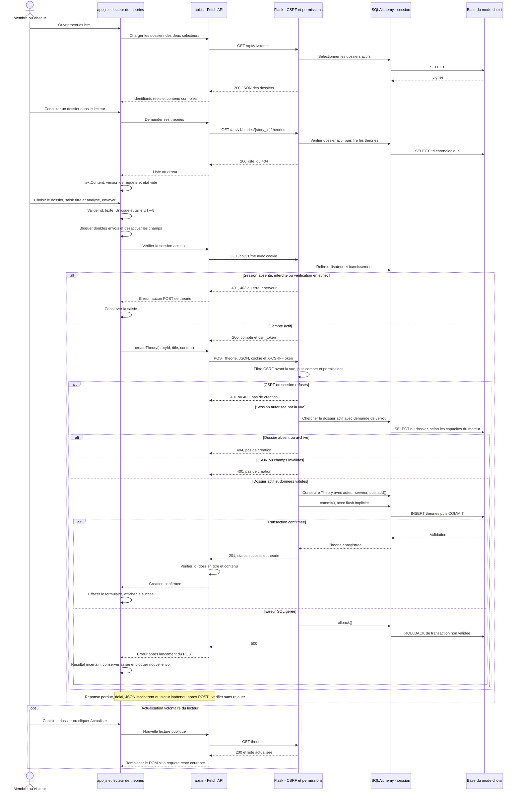
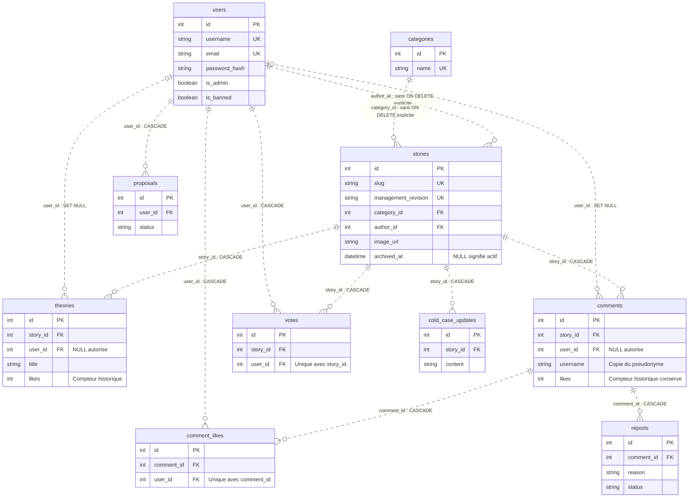

# Fiche Sylvie — Backend Flask, API et sécurité

4 novembre 2026, Europe/Paris — proposition du lot 6H.21.3, fondée sur les sources locales et le README installé au lot 6H.19.3.

**Mode de lecture :** pour chaque identifiant, A à I décrivent la réponse actuelle ; le bloc repliable qui suit conserve la réponse historique. Le statut ancien « VALIDÉE » est archivé, sans valeur de validation actuelle ou de production. Le texte de la question et toutes les réponses historiques sont conservés ; leurs anciennes références sont affichées comme repères archivés, pas comme liens de code actuels.

La réponse B est une proposition orale de l’ordre de 30 à 60 secondes selon le débit, sans chronométrage revendiqué. C permet de comprendre, D relie au projet, E donne les symboles vérifiés, F explique leur coopération, G et H préparent les relances. Le statut I distingue code implémenté, fonction partielle, validation absente et preuve historique.

Les références actives citent le fichier, le symbole ou élément précis et sa ligne contrôlée au 4 novembre 2026. Pour les fonctions Python indexées, un lien `MAH-F…` ouvre le contrat correspondant du [référentiel 6H.21.1](REFERENTIEL_PEDAGOGIQUE_LOT6H21_1.md). Ces identifiants sont pédagogiques, sans attribution exclusive d’auteur. Les liens #L visent les définitions ou instructions relues, pas seulement une ligne dans les bornes. Ils sont datés : une modification future nécessitera une nouvelle vérification. Les anciennes références restent uniquement dans les archives.

**Périmètre de cette préparation :** lecture statique et validation documentaire ; aucun test applicatif nouveau, accès SQL, serveur ou navigateur du site, migration ou action de compte. Exemples à lire, sans exécution sur la démonstration. Les copies pédagogiques commentées restent futures. Les anciennes fiches et les deux autres fiches restent intactes pendant cette proposition.

## Accès aux questions

[SYL-01](#syl-01) · [SYL-02](#syl-02) · [SYL-03](#syl-03) · [SYL-04](#syl-04) · [SYL-05](#syl-05) · [SYL-06](#syl-06) · [SYL-07](#syl-07) · [SYL-08](#syl-08) · [SYL-09](#syl-09) · [SYL-10](#syl-10) · [SYL-11](#syl-11) · [SYL-12](#syl-12) · [SYL-13](#syl-13) · [SYL-14](#syl-14) · [SYL-15](#syl-15) · [SYL-16](#syl-16) · [SYL-17](#syl-17) · [SYL-18](#syl-18)

## Guide actuel avant les questions

### Du processus Python au contrat HTTP

backend/index.py crée l’unique application, charge sa configuration, initialise db/Migrate, configure session/CORS et monte app_views. backend/api/v1/app.py réexporte cet objet pour compatibilité. Le Blueprint charge les modules de vues. Les routes login, me, logout et stats sont déclarées directement dans index.py. Les contextes Flask et l’unité de travail SQLAlchemy ont des rôles distincts.

Flask-RESTX est une dépendance présente ; le routage effectif est Flask et swagger.json reste un contrat OpenAPI 3.0.3 maintenu séparément. Aucun générateur Resource/namespace ni mécanisme OAuth n’est déduit d’un nom ou d’une dépendance. L’UI Swagger utilise un CDN et ne prépare pas automatiquement les protocoles CSRF et de purge. Try it out peut écrire : cette fiche n’en lance aucun essai.

### Inventaire vérifié des opérations

36 opérations sur 27 chemins : 17 GET, 15 POST, quatre DELETE ; zéro PUT/PATCH métier. HEAD/OPTIONS automatiques exclus. Les couples méthode/chemin extraits des décorateurs concordent avec OpenAPI. Les permissions et commentaires de ce tableau reprennent le README installé ; cette égalité de chemins ne prouve pas tous les schémas JSON.

| Méthode | Chemin | Traitement / vue | Permission | Paramètres principaux | Codes HTTP |
|---|---|---|---|---|---|
| GET | `/api/v1/users` | Lister les comptes — `get_users` | Admin | Aucun | 200, 401, 403, 500 |
| POST | `/api/v1/users` | Inscrire un membre — `register_user` | Public ; session existante contrôlée | JSON : username, email, password | 201, 400, 401, 403, 500 |
| POST | `/api/v1/login` | Ouvrir la session — `login_user` | Public ; exempt CSRF | JSON : username, password | 200, 400, 401, 403, 500 |
| GET | `/api/v1/me` | Relire compte et CSRF — `get_current_user` | Membre | Cookie de session | 200, 401, 403, 500 |
| POST | `/api/v1/logout` | Fermer la session courante — `logout_user` | Public ; CSRF si connecté | Aucun corps requis | 200, 403, 500 |

| Méthode | Chemin | Traitement / vue | Permission | Paramètres principaux | Codes HTTP |
|---|---|---|---|---|---|
| GET | `/api/v1/stories` | Lister les dossiers actifs et leurs votes — `get_stories` | Public | Aucun | 200, 500 |
| GET | `/api/v1/stories/slug/{slug}` | Lire un dossier actif — `get_story_by_slug` | Public | Chemin : slug | 200, 404, 500 |
| GET | `/api/v1/coldcases/{case_id}/updates` | Lire les mises à jour — `get_case_updates` | Public | Chemin : case_id | 200, 404, 500 |

| Méthode | Chemin | Traitement / vue | Permission | Paramètres principaux | Codes HTTP |
|---|---|---|---|---|---|
| GET | `/api/v1/stories/{story_id}/comments` | Lire les commentaires — `get_story_comments` | Public | Chemin : story_id | 200, 404, 500 |
| POST | `/api/v1/stories/{story_id}/comments` | Publier un commentaire — `post_story_comment` | Membre | Chemin : story_id ; JSON : text | 201, 400, 401, 403, 404, 500 |
| POST | `/api/v1/comments/{comment_id}/like` | Ajouter son like au commentaire — `like_comment` | Membre | Chemin : comment_id | 200, 401, 403, 404, 409, 500 |
| POST | `/api/v1/votes/{story_id}` | Ajouter son like au dossier — `post_story_vote` | Membre | Chemin : story_id | 201, 401, 403, 404, 409, 500 |
| GET | `/api/v1/votes/{story_id}` | Lire ou retirer son like — `personal_story_like` | Membre | Chemin : story_id | 200, 401, 403, 404, 500 |
| DELETE | `/api/v1/votes/{story_id}` | Lire ou retirer son like — `personal_story_like` | Membre | Chemin : story_id | 200, 401, 403, 404, 500 |
| GET | `/api/v1/comments/{comment_id}/like` | Lire ou retirer son like — `personal_comment_like` | Membre | Chemin : comment_id | 200, 401, 403, 404, 409, 500 |
| DELETE | `/api/v1/comments/{comment_id}/like` | Lire ou retirer son like — `personal_comment_like` | Membre | Chemin : comment_id | 200, 401, 403, 404, 409, 500 |

| Méthode | Chemin | Traitement / vue | Permission | Paramètres principaux | Codes HTTP |
|---|---|---|---|---|---|
| GET | `/api/v1/proposals` | Lire les propositions — `get_proposals` | Admin | Aucun | 200, 401, 403, 500 |
| POST | `/api/v1/proposals` | Enregistrer une proposition pending — `create_proposal` | Membre | JSON : title, content | 201, 400, 401, 403, 500 |
| GET | `/api/v1/stories/{story_id}/theories` | Lire les théories — `get_theories` | Public | Chemin : story_id | 200, 404, 500 |
| POST | `/api/v1/stories/{story_id}/theories` | Publier une théorie — `post_theory` | Membre | Chemin : story_id ; JSON : title, content | 201, 400, 401, 403, 404, 500 |
| POST | `/api/v1/theories/{theory_id}/like` | Incrémenter le compteur historique — `like_theory` | Membre | Chemin : theory_id | 200, 401, 403, 404, 500 |

| Méthode | Chemin | Traitement / vue | Permission | Paramètres principaux | Codes HTTP |
|---|---|---|---|---|---|
| POST | `/api/v1/comments/{comment_id}/report` | Signaler le commentaire ciblé — `report_comment` | Membre | Chemin : comment_id ; JSON : reason | 201, 400, 401, 403, 404, 500 |
| POST | `/api/v1/reports` | Signaler par ancien contrat générique — `post_report` | Membre | JSON : type=comment, target_id chaîne positive, reason | 201, 400, 401, 403, 404, 500 |
| GET | `/api/v1/admin/reports` | Lire motifs et contexte des signalements — `get_admin_reports` | Admin | Aucun | 200, 401, 403, 500 |
| DELETE | `/api/v1/admin/users/{username}/ban` | Bannir sans supprimer le compte — `ban_user` | Admin | Chemin : username | 200, 401, 403, 404, 409, 500 |
| POST | `/api/v1/admin/users/{user_id}/ban` | Bannir par identifiant stable — `ban_user_by_id` | Admin | Chemin : user_id | 200, 401, 403, 404, 409, 500 |

| Méthode | Chemin | Traitement / vue | Permission | Paramètres principaux | Codes HTTP |
|---|---|---|---|---|---|
| GET | `/api/v1/admin/stories` | Lister les dossiers administratifs — `get_admin_stories` | Admin | Requête : state=active, archived ou all | 200, 400, 401, 403, 500 |
| GET | `/api/v1/admin/stories/{story_id}` | Lire dossier et contributions, archives incluses — `get_admin_story` | Admin | Chemin : story_id | 200, 401, 403, 404, 500 |
| POST | `/api/v1/admin/stories/{story_id}/archive` | Archiver le dossier — `archive_story` | Admin | Chemin : story_id | 200, 401, 403, 404, 500 |
| POST | `/api/v1/admin/stories/{story_id}/restore` | Restaurer le dossier — `restore_story` | Admin | Chemin : story_id | 200, 401, 403, 404, 500 |
| GET | `/api/v1/admin/stories/{story_id}/deletion-preview` | Préparer un aperçu de purge — `get_story_deletion_preview` | Admin | Chemin : story_id ; dossier déjà archivé | 200, 401, 403, 404, 409, 500, 503 |
| POST | `/api/v1/admin/stories/{story_id}/deletion-confirmations` | Confirmer le titre et les contributions — `confirm_story_deletion` | Admin | Chemin : story_id ; JSON : preview_token, typed_title, confirm_contributions=true | 200, 400, 401, 403, 404, 409, 412, 428, 500, 503 |
| DELETE | `/api/v1/admin/stories/{story_id}` | Supprimer le graphe confirmé — `delete_story_permanently` | Admin | Chemin : story_id ; en-têtes : If-Match, X-Deletion-Confirmation ; aucun corps | 200, 400, 401, 403, 404, 409, 412, 428, 500, 503 |

| Méthode | Chemin | Traitement / vue | Permission | Paramètres principaux | Codes HTTP |
|---|---|---|---|---|---|
| GET | `/api/v1/swagger.json` | Lire le contrat JSON — `get_swagger_json` | Public | Aucun | 200, 404, 500 |
| GET | `/api/v1/swagger` | Afficher Swagger UI — `oauth_swagger` | Public | Aucun | 200, 500 |
| GET | `/api/v1/stats` | Lire trois nombres agrégés — `get_stats` | Public | Aucun | 200, 500 |

### Séquence d’une contribution



Ce diagramme reprend exactement la [séquence du README](../../README.md#parcours-détaillé--publier-une-théorie). Le client valide pour aider, le serveur valide pour protéger. Le hook CSRF précède la vue ; get_authenticated_user() relit le compte ; get_active_story(..., lock=True) protège la cible selon le moteur ; required_text() vérifie les entrées. L’auteur vient du compte serveur. theory_to_dict() choisit le JSON et convertit la date. Un commit et une réponse reçue/cohérente sont deux étapes différentes.

Extrait réel de post_theory(), à situer dans son bloc try et à lire sans exécution :

```python
db.session.add(new_theory)
db.session.commit()
```

Ces instructions ne suffisent pas seules : la vue les précède des validations et les accompagne d’un traitement SQLAlchemyError avec rollback. Elle renvoie ensuite le JSON status/theory avec 201. Le client vérifie le statut et les champs reçus avant de confirmer l’affichage. Une liste vide renvoyée par une lecture valide est différente d’un 404 ou d’une panne.

| Contribution | Stockage, visibilité et limite |
|---|---|
| Commentaire | Auteur et pseudonyme, dossier actif, texte validé ; lecture publique contextualisée. |
| Théorie | Story/User, titre/contenu et date ; lecteur public ; compteur de likes historique répétable. |
| Proposition | Compte, texte et statut ; liste admin ; aucune publication automatique ou action de validation inventée. |
| Signalement | FK comment_id et raison ; propriétés type/target_id de compatibilité ; contexte réservé à l’administration. Aucun reporter_id inventé ; un texte libre peut contenir des données personnelles. |
| Like histoire/commentaire | Association individuelle unique, état personnel et retrait ; compteur historique de commentaire non nul refusé avec 409. |

### Graphe ORM et transactions



Ce bloc reprend exactement le [diagramme ER du README](../../README.md#base-de-données-et-sqlalchemy) : dix entités et treize FK. Les relations optionnelles d’auteur ne doivent pas être transformées en garanties d’anonymat. Les FK, l’unicité et les validations applicatives se complètent. Les modèles et migrations relèvent principalement de Mahamadou ; les vues et helpers transactionnels sont des points d’intégration à expliquer ensemble.

add prépare ; flush envoie les instructions sans garantir leur validation définitive ; commit valide ; rollback annule ce qui reste non validé et rétablit la transaction en échec. Une réponse perdue ou une issue de commit inconnue n’est pas une preuve d’absence d’écriture. Les gestionnaires d’erreurs API et les blocs SQL des vues n’uniformisent pas toutes les erreurs ; les enveloppes JSON restent hétérogènes.

### Administration et accès aux données

La route publique /stats fournit trois agrégats : utilisateurs, commentaires et signalements, sans liste individuelle. Le dashboard combine ces trois nombres avec dossiers actifs/résolus/non résolus et propositions pending pour sept indicateurs ; les lectures ne sont pas un unique instantané SQL. admin_required relit le rôle pour les listes et actions privées, qui utilisent leurs chemins réservés et des protections de cache. Une archive reste physiquement présente mais absente des chemins publics, même pour un administrateur.

Le ban conserve le compte et ses contributions ; les administrateurs cibles sont protégés. Archive/restore modifient archived_at et la révision de gestion. La purge d’une archive exige aperçu borné, intégrité du moteur, jeton signé lié à la session, titre exact, accord, révision/empreinte et en-têtes conditionnels. Précondition absente : 428 ; état périmé : 412 ; issue inconnue possible : 503 avec code dédié. DELETE seul n’est pas une procédure complète et n’est pas une commande de démonstration ordinaire.

### Rôles, environnements et limites communes

Mélissa explique structure, rendu et contrôleurs frontend ; Sylvie explique HTTP, vues, validations et permissions ; Mahamadou explique schéma, ORM, migrations et intégration. Les frontières sont partagées : aucun identifiant pédagogique MAH-F ne constitue une preuve d’auteur exclusif. Voir les fiches [Mahamadou](fiche-mahamadou.md) et [commune](fiche-commune.md), conservées telles quelles pendant ce lot.

| Environnement | Usage et précaution |
|---|---|
| Kit scolaire SQLite mémoire, port 5064 | Catalogue de démonstration et contrôles bornés ; pas une persistance après arrêt. |
| Démonstration SQLite persistante, port 5066 | Comptes et données conservés ; serveur existant laissé intact. init pour une installation neuve est distinct de serve. |
| Lanceur général, port 5000 | Choix de configuration ; groupe Aiven complet prioritaire sur DATABASE_URL, puis repli SQLite. |
| Validations isolées | Fixtures mémoire ou fichier temporaire, configuration neutralisée et garde de connexions ; aucun état déduit de la base privée. |

L’application n’est pas déployée publiquement. Dix modèles, treize FK et sept migrations sont présents ; cela ne prouve pas une révision MySQL déployée ni les garanties de verrouillage d’un moteur non testé. Certains ajouts restent locaux ou non suivis : un chemin présent aujourd’hui n’est pas garanti dans un futur clone avant inclusion Git. Aucun secret, identifiant de connexion ou donnée privée ne figure dans les exemples.

Les notices d’information existent aux emplacements concernés. Le cookie de session nécessaire et les protections applicatives sont réels ; le brouillon interne de confidentialité reste non publié. L’absence de page publique est un chantier juridique, pas une réussite de conformité. Responsable/contact, bases légales, conservation, destinataires/hébergement, droits, sauvegardes et incidents restent à arbitrer. Ban, archive et purge d’un dossier ne forment pas un effacement complet de compte.

### Lire les preuves sans les additionner

### Campagnes distinctes : résultats historiques, pas de nouveau total

| Date / campagne | Résultat réellement consigné | Périmètre et limites |
|---|---|---|
| 25 octobre 2026, README historique de main ; réexécution documentée le 29 octobre | 205 backend, 226 frontend et 8 lanceur, soit 439 dans chacune de ces campagnes distinctes | Ancien périmètre ; ne valide pas les fonctions ajoutées depuis. Les campagnes ne s’additionnent pas. |
| 1er novembre 2026, correctifs 6G.5 | 311 backend, 513 frontend et 30 contrats/lanceur : 854 dans cette seule campagne finale | Après correctif de cache ; sept tests historiques de migrations exclus, six essais de migration des likes sur mémoire synthétique sous garde ; aucun MySQL. |
| 3 novembre 2026, livraison scolaire 6H.11 | Installation hors ligne et `pip check` ; 30 tests Python, 12 tests frontend d’images ; 43 requêtes WSGI, sept groupes PASS | Sélection livrée de 118 fichiers, sans les six nouveaux PNG ; aucune relance générale des 854 tests. |
| 3 novembre 2026, implémentation persistante après 6H.16B.1 | 21 tests persistants réussis ; 26 tests kit/catalogue et deux parcours mémoire réussis séparément | SQLite jetables, réouverture entre processus, sauvegarde/restauration ; rapport d’exécution externe, distinct du bilan de préparation 6H.16B.1. |
| 4 novembre 2026, 6H.17.3 | 53 tests frontend ciblés, puis 590 frontend complets ; 13 tests kit | Campagnes ciblée/complète qui se recouvrent ; images/texte aussi vérifiés dans Edge en lecture seule. |
| 4 novembre 2026, 6H.18.2 | 265 tests frontend ciblés, puis 567 frontend complets, sans échec | Messages, confirmations et résultats incertains ; DOM/API simulés. La baisse par rapport à 590 ne démontre pas à elle seule une perte de couverture. |
| 4 novembre 2026, 6H.18.3 | Parcours Edge authentifiés autorisés documentés ; réserve sur un essai CSRF négatif | Le contrôleur n’avait pas établi l’en-tête réellement envoyé ; un envoi a eu lieu, sans preuve de contournement. Pas de requalification de ce bilan. |
| 4 novembre 2026, 6H.18.4 | Neuf variantes : 27 refus CSRF 403 sans changement SQL, neuf requêtes valides avec les effets attendus | Application réelle et nouvelle SQLite temporaire, sans serveur ni Edge ; lève la réserve backend ciblée, sans reconstituer l’ancien essai navigateur. |
| 4 novembre 2026, 6H.20.2 | 92 tests Python ciblés : 13 notices, 10 lanceur, 13 kit, 13 catalogue, 29 CSRF, 14 erreurs/session ; suite frontend complète réussie, sortie 0 | Copie isolée après notices ; aucun nouveau total frontend chiffré dans le bilan. Cycle de session complémentaire réussi en mémoire. |
| 4 novembre 2026, 6H.20.3 | Edge : 33 combinaisons page/largeur et trois états de signalement ; 46 captures ; PASS AVEC RÉSERVES | Anonyme, GET/HEAD locaux, aucune soumission ; mesures détaillées dans la section suivante. Preuves externes non publiées. |
| 4 novembre 2026, 6H.21.1 | Référentiel statique : 27 modules, 20 classes, 212 entrées de fonctions dont 23 lambda ; 76 questions préservées | Inventaire pédagogique, pas une campagne de tests applicatifs ; aucune copie commentée créée. |

Les comptes des lignes précédentes ne sont jamais additionnés en total global. Les sous-cas, requêtes HTTP, vues Edge et méthodes de test sont des unités différentes. Les avertissements existants sur `datetime.utcnow()` et certains flux statiques non fermés sont documentés sans correction dans le lot RGPD. Aucun pourcentage global de couverture, validation de charge, concurrence réelle MySQL ou audit de production n’est revendiqué.

Le tableau reprend les résultats et liens du README installé : aucune suite n’a été relancée pendant ce lot. Les tests DOM simulent éléments, événements et réponses ; le client Flask teste le serveur dans son harnais ; les contrôles WSGI isolés ajoutent le transport ; Edge observe un navigateur réel, selon le parcours autorisé. Ces preuves sont complémentaires et leurs nombres ne sont pas cumulables.

La recette 6H.20.3 a utilisé Edge 156.0.4314.58 dans un profil temporaire : 33 combinaisons page/largeur, trois états supplémentaires de signalement, 46 captures privées. Largeurs 1280/390/320 px, 72 notices, contraste minimal relevé de 9,57:1 dans ces notices, 234 étapes de focus ; six PNG décodés sur 18 vues. Verdict antérieur PASS AVEC RÉSERVES : aucune soumission ni connexion, pas de recette de tous les rôles, de lecteur d’écran, de zoom 200 % ni de mobile physique. Ce lot ne revendique aucune nouvelle capture ou mesure.

L’essai négatif CSRF 6H.18.3 dans Edge était non concluant ; la campagne isolée 6H.18.4 a vérifié neuf routes, 27 refus 403 sans mutation et neuf cas valides attendus. Ce résultat serveur n’est pas une réexécution Edge. Les procédures du [README](../../README.md#procédures-manuelles-dans-edge) et la [recette RGPD](RECETTE_MANUELLE_LOT6H20_2.md) restent des guides à suivre seulement dans un environnement et un périmètre autorisés.


## Questions du jury

### SYL-01

#### A. Question originale

À quoi sert Flask ?

#### B. Réponse courte pour l’oral — état actuel

Flask reçoit une requête HTTP, choisit une route et produit une réponse. Dans notre projet, backend/index.py crée et configure l’application, initialise SQLAlchemy et enregistre le Blueprint de l’API. Les vues valident les entrées, vérifient les droits et utilisent les modèles pour lire ou écrire. Le navigateur reçoit du JSON et adapte son interface ; les fichiers HTML et images suivent une distribution distincte. L’application actuelle est locale. La présence du framework, d’un serveur de développement et de paramètres MySQL ne démontre ni déploiement public, ni disponibilité, ni sécurité de production.

#### C. Explication technique approfondie

L’objet Flask porte configuration, registre des routes, hooks et gestionnaires d’erreurs. Les imports des vues enregistrent leurs décorateurs ; un import mal organisé peut donc empêcher une route d’exister. Le module principal charge la configuration et appelle db.init_app(app). L’extension Migrate est enregistrée mais ne lance pas spontanément les migrations.

Le contexte de requête permet à request et session de désigner la requête courante sans les transmettre à toutes les fonctions. Ce n’est pas une variable métier partagée entre tous les visiteurs. La session Flask est transportée dans un cookie signé ; la session SQLAlchemy est l’unité de travail ORM : ce sont deux mécanismes différents.

backend/api/v1/app.py réexporte l’application existante pour compatibilité. run_local.py compose la distribution frontend et l’API dans son mode local. Les données choisies dépendent du processus : kit SQLite mémoire, démonstration persistante ou configuration générale. Ne pas lancer ces modes pour simplement lire cette fiche.

#### D. Exemple concret du projet

Un POST de théorie passe par Flask, le contrôle CSRF, le helper d’authentification et la fonction post_theory(). Celle-ci utilise Story et Theory puis commit(). La réponse 201 est ensuite contrôlée par api.js. Les octets d’un PNG sont servis dans une autre requête que ce JSON.

#### E. Fichiers, fonctions et lignes vérifiés

- [backend/index.py — `initialisation / contrat du module`](../../backend/index.py#L21) : ligne 21.
- [backend/api/v1/app.py — `initialisation / contrat du module`](../../backend/api/v1/app.py#L15) : ligne 15.
- [backend/api/v1/views/theories.py — `post_theory`](../../backend/api/v1/views/theories.py#L64) : ligne 64 ; [MAH-F0203](REFERENTIEL_PEDAGOGIQUE_LOT6H21_1.md#mah-f0203--post_theory).
- [run_local.py — `create_local_app`](../../run_local.py#L17) : ligne 17 ; [MAH-F0044](REFERENTIEL_PEDAGOGIQUE_LOT6H21_1.md#mah-f0044--create_local_app).

#### F. Rôle des fonctions et interactions

Sylvie explique la frontière HTTP, les vues et leurs réponses ; Mahamadou explique modèles et transactions ; Mélissa explique l’appel et le rendu. Une configuration commune et un contrat JSON les relient. Le module de compatibilité réutilise l’objet existant, sans créer une deuxième application ou une deuxième base.

#### G. Erreurs fréquentes et confusions

- Confondre session HTTP, session SQLAlchemy et base persistante.
- Déduire un déploiement ou des migrations exécutées de leur présence dans les sources.

#### H. Relance possible du jury

**Question :** À quoi sert un contexte de requête ?

**Réponse :** Il associe les objets comme request et session à la requête traitée. Flask gère ce contexte pendant le traitement. Un script ou un test qui utilise l’application hors requête doit préparer le contexte adapté ; cela ne justifie pas de partager un utilisateur courant dans une variable globale.

#### I. Statut et portée des preuves

Implémenté : application Flask locale et composition WSGI. Non validé dans ce lot : déploiement public ou MySQL en production.

<details>
<summary>Réponse historique conservée — état antérieur, à ne pas réciter comme état actuel</summary>

**Lecture de l’archive :** les formulations ci-dessous restent celles de la fiche initiale. Ses exemples, statuts et anciennes références ont leur contexte historique ; les liens et preuves actuels sont en E et I.

**Réponse courte à dire**

Il reçoit les requêtes et produit les réponses. Dans la connexion, il lit le JSON, contrôle le compte et prépare la session.

**Explication simple**

Flask associe une adresse et une méthode HTTP à une fonction qui prépare une réponse.

**Exemple concret**

POST /api/v1/login vérifie le mot de passe.

**Référence technique**

`backend/index.py → ../../backend/index.py#L266`

**Statut de validation historique — ne pas confondre avec I**

**VALIDÉE — conforme aux sources.**

</details>

### SYL-02

#### A. Question originale

Qu’est-ce qu’un Blueprint ?

#### B. Réponse courte pour l’oral — état actuel

Un Blueprint regroupe des routes et leurs éléments d’organisation avant leur enregistrement dans l’application Flask. Notre objet app_views porte le préfixe /api/v1. Les modules de vues importés ajoutent leurs routes à cet objet ; backend/index.py l’enregistre sur l’application. Cela sépare les responsabilités sans créer un serveur par fichier. Le préfixe évite de le répéter dans chaque décorateur. L’authentification et les permissions restent des contrôles explicites : ranger une route dans le Blueprint ne la rend pas automatiquement privée ou administrateur.

#### C. Explication technique approfondie

Le constructeur Blueprint prépare un ensemble d’opérations différées. Les décorateurs app_views.route() enregistrent les règles sur ce Blueprint, et register_blueprint() les rattache à l’application. Les vues sont réparties entre users, histoires, theories, comments, proposals, likes et les modules administratifs ; leurs imports font partie du câblage réel.

Le chemin final combine url_prefix et chemin local. Ainsi, un décorateur sur /stories/<int:story_id>/theories n’expose pas le chemin à la racine mais /api/v1/stories/{story_id}/theories. Le nom de la fonction constitue aussi un endpoint interne, distinct du chemin HTTP. Plusieurs méthodes et fonctions peuvent partager un même chemin.

Un décorateur de permission enveloppe la fonction appelée après le routage. Le hook CSRF agit à l’échelle de l’application avant la vue, selon méthode et session. La documentation OpenAPI décrit ces contrats séparément ; le Blueprint n’est pas une génération automatique de swagger.json.

#### D. Exemple concret du projet

Le client appelle GET /api/v1/stories. Le chemin /stories de histoires.py devient public sous le préfixe app_views. Pour POST /api/v1/stories/{story_id}/theories, le même regroupement s’applique, mais get_authenticated_user() et les validations métier introduisent des exigences supplémentaires avant toute écriture ORM.

#### E. Fichiers, fonctions et lignes vérifiés

- [backend/api/v1/views/__init__.py — `liaison Python app_views`](../../backend/api/v1/views/__init__.py#L5) : ligne 5.
- [backend/index.py — `instruction / bloc app.register_blueprint(app_views)`](../../backend/index.py#L376) : ligne 376.
- [backend/api/v1/views/histoires.py — `get_stories`](../../backend/api/v1/views/histoires.py#L14) : ligne 14 ; [MAH-F0160](REFERENTIEL_PEDAGOGIQUE_LOT6H21_1.md#mah-f0160--get_stories).
- [backend/api/v1/views/theories.py — `post_theory`](../../backend/api/v1/views/theories.py#L64) : ligne 64 ; [MAH-F0203](REFERENTIEL_PEDAGOGIQUE_LOT6H21_1.md#mah-f0203--post_theory).
- [backend/api/v1/views/permissions.py — `get_authenticated_user`](../../backend/api/v1/views/permissions.py#L10) : ligne 10 ; [MAH-F0177](REFERENTIEL_PEDAGOGIQUE_LOT6H21_1.md#mah-f0177--get_authenticated_user).

#### F. Rôle des fonctions et interactions

L’initialisation importe les modules ; chaque vue associe un chemin, une méthode et une fonction. Le module principal monte ce registre et ajoute ses propres routes directes. api.js utilise les chemins finaux. Le référentiel de fonctions décrit les callables, mais il ne remplace pas ce câblage d’import et d’enregistrement.

#### G. Erreurs fréquentes et confusions

- Assimiler Blueprint à une application ou à un mécanisme automatique d’autorisation.
- Oublier le préfixe ou croire que le fichier OpenAPI enregistre les routes Flask.

#### H. Relance possible du jury

**Question :** Une fonction Python suffit-elle à exposer une API ?

**Réponse :** Non. Elle doit être reliée au routage, son module doit être chargé et le Blueprint enregistré s’il intervient. Une fonction auxiliaire de validation n’est pas une opération HTTP simplement parce qu’elle se trouve dans views/.

#### I. Statut et portée des preuves

Implémenté : Blueprint app_views enregistré ; permissions et contrat OpenAPI restent des mécanismes distincts.

<details>
<summary>Réponse historique conservée — état antérieur, à ne pas réciter comme état actuel</summary>

**Lecture de l’archive :** les formulations ci-dessous restent celles de la fiche initiale. Ses exemples, statuts et anciennes références ont leur contexte historique ; les liens et preuves actuels sont en E et I.

**Réponse courte à dire**

C’est un groupe de routes. `app_views` rassemble les routes métier sous `/api/v1`.

**Explication simple**

Regrouper les routes évite de tout déclarer dans un seul fichier.

**Exemple concret**

app_views porte le préfixe /api/v1.

**Référence technique**

`backend/api/v1/views/__init__.py → ../../backend/api/v1/views/__init__.py#L5`

**Statut de validation historique — ne pas confondre avec I**

**VALIDÉE — conforme aux sources.**

</details>

### SYL-03

#### A. Question originale

Combien de Blueprints principaux sont présents ?

#### B. Réponse courte pour l’oral — état actuel

Le projet utilise un Blueprint principal, app_views, avec le préfixe /api/v1. Les nombreux fichiers de vues alimentent cet objet commun ; ils ne représentent pas autant de Blueprints. Certaines routes sont directement déclarées sur app, notamment la connexion, la session courante, la déconnexion et les statistiques. Le fichier backend/api/v1/app.py conserve une entrée de compatibilité vers la même application. Je distingue donc le nombre de Blueprints, les modules Python, les chemins et les opérations HTTP : ces nombres répondent à des questions différentes et ne doivent pas être confondus.

#### C. Explication technique approfondie

L’audit des constructions Blueprint et de leur enregistrement confirme app_views. Le module views/__init__.py crée l’objet et charge les vues. Le module principal utilise app.register_blueprint(app_views), puis déclare également des fonctions associées directement à app.route(). Le préfixe /api/v1 peut donc apparaître soit à l’enregistrement du Blueprint, soit dans le chemin d’une route directe.

Les opérations directes restent soumises aux hooks de l’application. Elles ne contournent pas automatiquement la politique CSRF ; celle-ci possède des exemptions explicites. Le réexport de compatibilité ne constitue pas un autre processus, et une application de validation isolée peut envelopper la même logique avec une configuration différente.

Pour vérifier une architecture, il faut suivre les définitions, imports et enregistrements. Compter les dossiers views ou les occurrences du mot API dans les noms produirait une explication trompeuse. Le nombre de routes est audité séparément à partir des décorateurs et comparé à OpenAPI.

#### D. Exemple concret du projet

login_user() et get_current_user() se trouvent dans backend/index.py, tandis que post_theory() se trouve dans un module du Blueprint. Pourtant, le client utilise le préfixe /api/v1 pour ces appels. La présence du même préfixe HTTP ne permet pas de déduire où le décorateur est enregistré.

#### E. Fichiers, fonctions et lignes vérifiés

- [backend/api/v1/views/__init__.py — `liaison Python app_views`](../../backend/api/v1/views/__init__.py#L5) : ligne 5.
- [backend/index.py — `login_user`](../../backend/index.py#L269) : ligne 269 ; [MAH-F0041](REFERENTIEL_PEDAGOGIQUE_LOT6H21_1.md#mah-f0041--login_user).
- [backend/index.py — `get_current_user`](../../backend/index.py#L342) : ligne 342 ; [MAH-F0042](REFERENTIEL_PEDAGOGIQUE_LOT6H21_1.md#mah-f0042--get_current_user).
- [backend/index.py — `logout_user`](../../backend/index.py#L366) : ligne 366 ; [MAH-F0043](REFERENTIEL_PEDAGOGIQUE_LOT6H21_1.md#mah-f0043--logout_user).
- [backend/index.py — `get_stats`](../../backend/index.py#L245) : ligne 245 ; [MAH-F0040](REFERENTIEL_PEDAGOGIQUE_LOT6H21_1.md#mah-f0040--get_stats).

#### F. Rôle des fonctions et interactions

Le câblage Flask est partagé avec l’intégration ; Sylvie doit savoir localiser les vues et Mahamadou le choix des extensions et des données. Mélissa ne dépend pas du nombre de modules : son client dépend des chemins et réponses. Une réorganisation Python devrait préserver ou faire évoluer explicitement ce contrat.

#### G. Erreurs fréquentes et confusions

- Compter les fichiers Python comme des Blueprints.
- Inventer une application indépendante dans le fichier de compatibilité ou oublier les routes directes.

#### H. Relance possible du jury

**Question :** Pourquoi garder des routes directes ?

**Réponse :** C’est l’organisation actuelle du dépôt, avec des responsabilités historiques dans index.py. On peut en discuter les limites de lisibilité et de couplage, mais un audit documentaire doit la décrire fidèlement. Une éventuelle refonte du câblage serait un autre lot avec tests.

#### I. Statut et portée des preuves

Implémenté : un Blueprint principal. Historique : organisation de certaines routes directes, sans refonte pendant ce lot.

<details>
<summary>Réponse historique conservée — état antérieur, à ne pas réciter comme état actuel</summary>

**Lecture de l’archive :** les formulations ci-dessous restent celles de la fiche initiale. Ses exemples, statuts et anciennes références ont leur contexte historique ; les liens et preuves actuels sont en E et I.

**Réponse courte à dire**

Un Blueprint `app_views` est déclaré. Certaines routes sont directement attachées à l’application Flask.

**Explication simple**

Le regroupement métier et les routes directes appartiennent à la même application.

**Exemple concret**

app.py réexporte l’application de backend/index.py.

**Référence technique**

`backend/api/v1/app.py → ../../backend/api/v1/app.py#L1`

**Statut de validation historique — ne pas confondre avec I**

**VALIDÉE — conforme aux sources.**

</details>

### SYL-04

#### A. Question originale

Pourquoi compter 24 opérations plutôt que 24 URL ?

#### B. Réponse courte pour l’oral — état actuel

La formulation conserve l’ancien nombre, mais l’audit actuel confirme 36 opérations explicites sur 27 chemins. Une opération combine une méthode et un chemin : GET et POST sur le même chemin sont deux contrats différents. Il y a 17 GET, 15 POST et 4 DELETE ; aucune route PUT ou PATCH n’est déclarée. Les méthodes HEAD et OPTIONS ajoutées par Flask ne sont pas comptées ici. Les décorateurs ont été comparés au fichier OpenAPI. Je garde donc la question historique tout en annonçant les chiffres et le périmètre réellement vérifiés.

#### C. Explication technique approfondie

L’audit lit les décorateurs route des fonctions Python, applique le préfixe du Blueprint et convertit les paramètres Flask en notation OpenAPI. L’ensemble de couples méthode-chemin obtenu doit être égal à celui de swagger.json. Ce contrôle détecte une opération oubliée ou un chemin périmé sans démarrer Flask.

Le nombre de chemins est la cardinalité des chemins distincts ; celui des opérations est la cardinalité des couples. Une même URL paramétrée représente un chemin de contrat, pas une opération différente pour chaque identifiant réel. HEAD et OPTIONS implicites ne sont pas des vues métier supplémentaires dans ce décompte.

REST décrit des ressources et des conventions ; notre API possède aussi des transitions explicites en POST, par exemple archive et restore. Le DELETE historique de bannissement ne supprime pas une ligne. Les noms et méthodes ne dispensent donc pas de lire le comportement réel, les droits et les réponses. Ce contrôle statique ne prouve pas toutes les réponses en exécution.

#### D. Exemple concret du projet

GET /api/v1/users et POST /api/v1/users partagent un chemin mais pas une finalité : lecture réservée d’une liste d’un côté, inscription de l’autre. Le tableau des 36 opérations ci-dessus permet d’expliquer chaque permission sans utiliser un identifiant ou une donnée de la SQLite de démonstration.

#### E. Fichiers, fonctions et lignes vérifiés

- [backend/api/v1/views/users.py — `get_users`](../../backend/api/v1/views/users.py#L37) : ligne 37 ; [MAH-F0206](REFERENTIEL_PEDAGOGIQUE_LOT6H21_1.md#mah-f0206--get_users).
- [backend/api/v1/views/users.py — `register_user`](../../backend/api/v1/views/users.py#L50) : ligne 50 ; [MAH-F0207](REFERENTIEL_PEDAGOGIQUE_LOT6H21_1.md#mah-f0207--register_user).
- [backend/api/v1/views/admin_stories.py — `archive_story`](../../backend/api/v1/views/admin_stories.py#L117) : ligne 117 ; [MAH-F0148](REFERENTIEL_PEDAGOGIQUE_LOT6H21_1.md#mah-f0148--archive_story).
- [backend/api/v1/swagger.json — `initialisation / contrat du module`](../../backend/api/v1/swagger.json#L1) : ligne 1.

#### F. Rôle des fonctions et interactions

Les vues définissent l’exécution ; OpenAPI décrit le contrat ; api.js fournit les appels utilisés par le frontend. L’audit croise ces sources mais ne suppose pas que toutes les routes ont une interface dédiée. Les tests valident des cas déterminés dans leurs environnements, distinctement du décompte des décorateurs.

#### G. Erreurs fréquentes et confusions

- Réciter 24 ou 25 comme état actuel, ou additionner les URL concrètes avec chaque identifiant.
- Présenter PUT/PATCH comme implémentés ou inclure silencieusement HEAD/OPTIONS dans ce total.

#### H. Relance possible du jury

**Question :** L’égalité entre OpenAPI et les décorateurs suffit-elle ?

**Réponse :** Elle confirme ici chemins et méthodes, pas l’exactitude de chaque schéma, permission ou code d’erreur en toute situation. Des tests de contrat, d’accès et de charge utile complètent cette vérification. La documentation ne remplace ni ces tests ni une recette navigateur.

#### I. Statut et portée des preuves

Implémenté et vérifié statiquement : 36 opérations sur 27 chemins ; ancien nombre 24 conservé uniquement dans la question historique.

<details>
<summary>Réponse historique conservée — état antérieur, à ne pas réciter comme état actuel</summary>

**Lecture de l’archive :** les formulations ci-dessous restent celles de la fiche initiale. Ses exemples, statuts et anciennes références ont leur contexte historique ; les liens et preuves actuels sont en E et I.

**Réponse courte à dire**

Une même URL peut accepter plusieurs méthodes. `GET /users` et `POST /users` constituent deux opérations.

**Explication simple**

La méthode fait partie du contrat, même lorsque le chemin est identique.

**Exemple concret**

GET /users liste ; POST /users inscrit.

**Référence technique**

`backend/api/v1/views/users.py → ../../backend/api/v1/views/users.py#L34`

**Statut de validation historique — ne pas confondre avec I**

**VALIDÉE — conforme aux sources.**

</details>

### SYL-05

#### A. Question originale

Que fait la route `DELETE .../ban` ?

#### B. Réponse courte pour l’oral — état actuel

Le DELETE historique de bannissement conserve le compte et change son état ; ce n’est pas une suppression SQL. Le projet propose aussi le POST administratif ciblant un identifiant stable, utilisé par le panneau actuel. Le serveur relit l’administrateur et la cible, refuse une cible administrateur et applique le bannissement. Les permissions ultérieures refusent le compte banni même s’il possède encore un ancien cookie. L’interface demande une confirmation puis relit l’état. Je ne présente pas cette action comme un effacement RGPD, une suppression de contributions ou une fonction de débannissement.

#### C. Explication technique approfondie

Les routes de bannissement délèguent la logique à un helper commun. Cela évite que l’ancienne entrée par nom et l’entrée administrative par identifiant divergent sur les protections. La cible est verrouillée/recontrôlée dans l’unité de travail, et les comptes administrateurs sont protégés. Une cible déjà bannie doit être expliquée selon la réponse réelle, sans inventer une nouvelle suppression.

Le décorateur admin_required contrôle le compte acteur en base. Une authentification antérieure n’accorde pas un droit permanent : le rôle et le statut actuels priment. Le frontend relit aussi /me avant d’agir, mais cette précaution d’interface n’est pas la frontière d’autorisation.

Le ban conserve les relations, les textes et l’identité du compte. C’est une mesure de modération. L’absence de route de débannissement et d’effacement complet est une limite fonctionnelle à annoncer. Une erreur ou un timeout après envoi n’autorise pas à rejouer aveuglément la requête ; le panneau consulte de nouveau l’état serveur.

#### D. Exemple concret du projet

Le panneau administrateur choisit une ligne utilisateur et appelle l’action par identifiant après confirmation. Si le compte sélectionné est administrateur, le backend répond 409 au lieu de bannir. Un membre banni qui tente ensuite une contribution reçoit un refus malgré son cookie antérieur.

#### E. Fichiers, fonctions et lignes vérifiés

- [backend/api/v1/views/index.py — `ban_user`](../../backend/api/v1/views/index.py#L139) : ligne 139 ; [MAH-F0167](REFERENTIEL_PEDAGOGIQUE_LOT6H21_1.md#mah-f0167--ban_user).
- [backend/api/v1/views/admin_users_support.py — `initialisation / contrat du module`](../../backend/api/v1/views/admin_users_support.py#L1) : ligne 1.
- [backend/api/v1/views/permissions.py — `admin_required`](../../backend/api/v1/views/permissions.py#L52) : ligne 52 ; [MAH-F0178](REFERENTIEL_PEDAGOGIQUE_LOT6H21_1.md#mah-f0178--admin_required).
- [backend/api/v1/views/permissions.py — `get_authenticated_user`](../../backend/api/v1/views/permissions.py#L10) : ligne 10 ; [MAH-F0177](REFERENTIEL_PEDAGOGIQUE_LOT6H21_1.md#mah-f0177--get_authenticated_user).
- [frontend/admin-users.js — `ban`](../../frontend/admin-users.js#L116) : ligne 116.

#### F. Rôle des fonctions et interactions

admin-users.js organise confirmation, verrou et relecture ; api.js transporte le POST avec cookie et CSRF ; la vue contrôle l’acteur et délègue au helper partagé. SQLAlchemy persiste le statut, puis les décorateurs de toutes les contributions relisent cet état. La responsabilité API est commune à la logique de données, sans attribution exclusive de chaque ligne.

#### G. Erreurs fréquentes et confusions

- Interpréter DELETE comme preuve de suppression du compte.
- Confondre bannissement, débannissement absent, purge d’histoire et droit d’effacement.

#### H. Relance possible du jury

**Question :** Pourquoi protéger aussi les autres administrateurs ?

**Réponse :** Le helper applique une règle métier explicite aux cibles administratrices. Le bouton ou la confirmation du navigateur ne peuvent l’assouplir. La question de créer ou retirer un rôle relève d’une politique distincte ; elle ne doit pas être inventée comme fonctionnalité de ce panneau.

#### I. Statut et portée des preuves

Implémenté : ban serveur et panneau administratif ; historique : DELETE conservé. Partiel : aucune gestion complète du cycle de vie ou effacement de compte.

<details>
<summary>Réponse historique conservée — état antérieur, à ne pas réciter comme état actuel</summary>

**Lecture de l’archive :** les formulations ci-dessous restent celles de la fiche initiale. Ses exemples, statuts et anciennes références ont leur contexte historique ; les liens et preuves actuels sont en E et I.

**Réponse courte à dire**

Elle marque le compte comme banni. Elle ne supprime pas sa ligne.

**Explication simple**

Le nom d’une méthode HTTP ne suffit pas à décrire son effet : il faut lire le traitement.

**Exemple concret**

Le compte reçoit is_banned = True.

**Référence technique**

`backend/api/v1/views/index.py → ../../backend/api/v1/views/index.py#L113`

**Statut de validation historique — ne pas confondre avec I**

**VALIDÉE — conforme aux sources.**

</details>

### SYL-06

#### A. Question originale

Comment le mot de passe est-il stocké ?

#### B. Réponse courte pour l’oral — état actuel

Le backend conserve un hachage de mot de passe produit par Werkzeug, puis vérifie le candidat avec la fonction de vérification correspondante. Il ne chiffre pas le mot de passe pour le récupérer et ne le renvoie pas dans le JSON public. L’inscription vérifie la politique actuelle et ignore une tentative de choisir le rôle administrateur. La connexion se fait avec le nom d’utilisateur. Le hachage protège une partie du risque de stockage, mais ne prouve pas à lui seul la sécurité complète : limitation des tentatives, récupération et vérification d’adresse ne sont pas livrées comme fonctions complètes.

#### C. Explication technique approfondie

User.set_password() construit le hachage ; User.check_password() vérifie un texte candidat sans comparer un mot de passe en clair enregistré. Le format produit contient les informations nécessaires à la vérification, notamment le sel et la méthode. Il ne faut pas promettre un algorithme fixe différent de celui réellement choisi par la version de Werkzeug installée.

La route d’inscription valide les champs et la politique de mot de passe avant la création. Les espaces du mot de passe ne doivent pas être retirés comme ceux d’un titre ; changer silencieusement le secret transformerait la valeur choisie. La politique actuelle exige de 8 à 50 caractères et les catégories prévues par le validateur, pas une affirmation générale de robustesse.

La sérialisation utilisateur sélectionne les données exposées et exclut password_hash. Les logs, erreurs et exemples de documentation ne doivent pas afficher de secret. Ce lot n’ouvre ni mot de passe de démonstration, ni cookie, ni fichier de configuration sensible.

#### D. Exemple concret du projet

Lors d’une inscription, register_user() valide la charge utile, crée un User puis appelle set_password(). À la connexion, login_user() utilise check_password(). La réponse transmet une représentation autorisée et un jeton CSRF, pas le mot de passe ni son hachage.

#### E. Fichiers, fonctions et lignes vérifiés

- [backend/models.py — `User.set_password`](../../backend/models.py#L43) : ligne 43 ; [MAH-F0001](REFERENTIEL_PEDAGOGIQUE_LOT6H21_1.md#mah-f0001--userset_password).
- [backend/models.py — `User.check_password`](../../backend/models.py#L48) : ligne 48 ; [MAH-F0002](REFERENTIEL_PEDAGOGIQUE_LOT6H21_1.md#mah-f0002--usercheck_password).
- [backend/models.py — `User.to_dict`](../../backend/models.py#L53) : ligne 53 ; [MAH-F0003](REFERENTIEL_PEDAGOGIQUE_LOT6H21_1.md#mah-f0003--userto_dict).
- [backend/api/v1/views/users.py — `register_user`](../../backend/api/v1/views/users.py#L50) : ligne 50 ; [MAH-F0207](REFERENTIEL_PEDAGOGIQUE_LOT6H21_1.md#mah-f0207--register_user).
- [backend/index.py — `login_user`](../../backend/index.py#L269) : ligne 269 ; [MAH-F0041](REFERENTIEL_PEDAGOGIQUE_LOT6H21_1.md#mah-f0041--login_user).

#### F. Rôle des fonctions et interactions

La vue possède la validation HTTP et les codes de réponse ; le modèle encapsule hachage et vérification ; SQLAlchemy stocke le résultat. Le frontend efface le champ password après la tentative, contrairement aux brouillons éditoriaux souvent conservés après erreur. Aucune de ces couches ne doit réintroduire le secret dans un message de diagnostic.

#### G. Erreurs fréquentes et confusions

- Dire que le mot de passe est chiffré et déchiffrable.
- Inventer une récupération de compte, une vérification d’email ou une protection automatique contre les tentatives massives.

#### H. Relance possible du jury

**Question :** Le sel doit-il rester secret ?

**Réponse :** Il évite notamment que deux mots de passe identiques produisent systématiquement le même stockage et rend les précalculs moins réutilisables. Il peut accompagner le hachage. La clé de session, elle, a un autre rôle et doit rester secrète ; la confondre avec un sel serait une erreur.

#### I. Statut et portée des preuves

Implémenté : hachage, vérification et politique d’entrée. Partiel : sécurité du cycle de vie de compte et exploitation publique à compléter.

<details>
<summary>Réponse historique conservée — état antérieur, à ne pas réciter comme état actuel</summary>

**Lecture de l’archive :** les formulations ci-dessous restent celles de la fiche initiale. Ses exemples, statuts et anciennes références ont leur contexte historique ; les liens et preuves actuels sont en E et I.

**Réponse courte à dire**

Le modèle stocke le hachage produit par Werkzeug. La connexion compare le mot de passe fourni à ce hachage.

**Explication simple**

Le serveur vérifie le mot de passe avec une fonction de hachage ; il ne le stocke pas en clair.

**Exemple concret**

set_password() et check_password().

**Référence technique**

`backend/models.py → ../../backend/models.py#L43`

**Statut de validation historique — ne pas confondre avec I**

**VALIDÉE — conforme aux sources.**

</details>

### SYL-07

#### A. Question originale

Un cookie signé est-il confidentiel ?

#### B. Réponse courte pour l’oral — état actuel

Le cookie de session Flask est signé : une modification invalide sa signature, mais son contenu n’est pas chiffré par cette signature. Il ne faut donc pas y placer de secret métier en supposant qu’il est illisible. Notre configuration active HttpOnly et SameSite Lax, avec Secure dépendant de l’environnement. HttpOnly empêche le JavaScript de lire ce cookie par document.cookie ; il n’empêche pas le navigateur de l’envoyer. Le frontend utilise credentials:include. HTTPS, configuration de production et gestion de la clé restent nécessaires avant une ouverture publique ; leur présence en variables ne prouve pas leur déploiement.

#### C. Explication technique approfondie

La session Flask standard encode les données côté client et les signe avec SECRET_KEY. Le serveur peut vérifier l’intégrité, mais un utilisateur capable de lire son propre cookie peut en comprendre le contenu. Le cookie ne constitue pas une table serveur contenant tous les droits à jour : les décorateurs relisent le compte.

HttpOnly, Secure et SameSite répondent à des questions différentes : accès depuis JavaScript, transport HTTPS et envoi selon le contexte de navigation. SameSite Lax n’est pas un remplacement universel du contrôle CSRF. Le client conserve séparément le jeton CSRF en mémoire et l’envoie dans un en-tête pour les écritures concernées.

Une rotation de clé et une configuration de production impliquent des décisions d’exploitation, non validées par cette fiche. Le mode HTTP local et un futur service HTTPS ne doivent pas partager des suppositions implicites. Aucune inspection ou export de cookie réel n’est nécessaire pour expliquer ces propriétés dans les sources.

#### D. Exemple concret du projet

apiRequest() demande credentials:'include' ; le navigateur peut donc joindre le cookie selon ses règles. GET /me relit le compte et fournit la session applicative au frontend. Le code JavaScript n’a pas besoin de décoder le cookie signé pour afficher le nom ou contrôler le panneau administrateur.

#### E. Fichiers, fonctions et lignes vérifiés

- [backend/index.py — `instruction / bloc SESSION_COOKIE_HTTPONLY`](../../backend/index.py#L137) : ligne 137.
- [backend/index.py — `instruction / bloc SESSION_COOKIE_SAMESITE`](../../backend/index.py#L138) : ligne 138.
- [backend/index.py — `get_current_user`](../../backend/index.py#L342) : ligne 342 ; [MAH-F0042](REFERENTIEL_PEDAGOGIQUE_LOT6H21_1.md#mah-f0042--get_current_user).
- [frontend/api.js — `apiRequest`](../../frontend/api.js#L8) : ligne 8.

#### F. Rôle des fonctions et interactions

Flask signe et vérifie la session ; le navigateur décide de l’envoi selon l’origine et les attributs ; api.js exprime l’intention de joindre les credentials. Les décorateurs donnent ensuite l’autorisation réelle à partir de la base. CORS, session et CSRF interagissent mais ne sont ni un chiffrement ni une garantie globale d’accès.

#### G. Erreurs fréquentes et confusions

- Présenter signé comme chiffré ou HttpOnly comme absence d’envoi du cookie.
- Annoncer HTTPS et Secure effectivement déployés sur la seule lecture d’une option.

#### H. Relance possible du jury

**Question :** Le jeton CSRF est-il le mot de passe ?

**Réponse :** Non. Il sert à vérifier une écriture associée à la session et se renouvelle selon le cycle prévu. Le frontend peut le lire via les réponses autorisées et l’envoyer dans l’en-tête dédié. Le mot de passe sert à l’authentification initiale et ne doit pas être conservé pour chaque appel.

#### I. Statut et portée des preuves

Implémenté : session signée et attributs configurés. Non validé : politique HTTPS, clé et exploitation d’un déploiement public.

<details>
<summary>Réponse historique conservée — état antérieur, à ne pas réciter comme état actuel</summary>

**Lecture de l’archive :** les formulations ci-dessous restent celles de la fiche initiale. Ses exemples, statuts et anciennes références ont leur contexte historique ; les liens et preuves actuels sont en E et I.

**Réponse courte à dire**

La signature protège son intégrité. Elle ne chiffre pas son contenu.

**Explication simple**

La signature détecte une modification du cookie mais ne cache pas son contenu.

**Exemple concret**

La session contient notamment user_id.

**Référence technique**

`backend/index.py → ../../backend/index.py#L318`

**Statut de validation historique — ne pas confondre avec I**

**VALIDÉE — conforme aux sources.**

</details>

### SYL-08

#### A. Question originale

Pourquoi relire le compte en base ?

#### B. Réponse courte pour l’oral — état actuel

Une session indique une identité antérieure, pas l’état définitif du compte. Les protections relisent donc User dans la base pour vérifier que le compte existe, reste actif et possède encore le rôle nécessaire. Un utilisateur banni ou un compte supprimé ne garde pas des droits simplement parce que son cookie était valide. L’interface relit aussi /me pour adapter ses boutons et éviter de mélanger deux identités. Mais le contrôle décisif reste celui de chaque requête serveur. Cette approche demande une lecture supplémentaire et ne remplace pas les verrous métier d’une transaction sensible.

#### C. Explication technique approfondie

get_authenticated_user() extrait l’identifiant de la session puis recherche le compte. Une session absente ou pointant vers un compte inexistant conduit à 401 ; le compte banni est refusé et la session est nettoyée selon le code. admin_required ajoute la vérification du rôle actuel. L’objet utilisateur autorisé est transmis à la vue, qui ne doit pas faire confiance à un auteur fourni dans le JSON.

La route /me permet au frontend de récupérer une représentation du compte et le jeton CSRF. Les contrôleurs comparent l’identité attendue avant de poursuivre une action commencée sous une autre session. Les réponses tardives sont invalidées par version ou annulation ; cela concerne l’affichage et non l’annulation garantie d’une écriture déjà partie.

Un contrôle de compte avant requête n’élimine pas toutes les courses entre transactions. Les helpers de ban, visibilité et purge recontrôlent ou verrouillent les entités nécessaires dans leur unité de travail. Il faut distinguer authentification, autorisation courante et cohérence SQL.

#### D. Exemple concret du projet

Un membre ouvre un formulaire, puis son compte est banni dans un environnement de test autorisé. Un futur POST de commentaire doit être refusé par get_authenticated_user() même si la page affiche encore temporairement un ancien nom. Le frontend conserve le texte et affiche le refus plutôt que de considérer l’ancien affichage comme preuve d’accès.

#### E. Fichiers, fonctions et lignes vérifiés

- [backend/api/v1/views/permissions.py — `get_authenticated_user`](../../backend/api/v1/views/permissions.py#L10) : ligne 10 ; [MAH-F0177](REFERENTIEL_PEDAGOGIQUE_LOT6H21_1.md#mah-f0177--get_authenticated_user).
- [backend/api/v1/views/permissions.py — `admin_required`](../../backend/api/v1/views/permissions.py#L52) : ligne 52 ; [MAH-F0178](REFERENTIEL_PEDAGOGIQUE_LOT6H21_1.md#mah-f0178--admin_required).
- [backend/index.py — `get_current_user`](../../backend/index.py#L342) : ligne 342 ; [MAH-F0042](REFERENTIEL_PEDAGOGIQUE_LOT6H21_1.md#mah-f0042--get_current_user).
- [frontend/app.js — `refreshSession`](../../frontend/app.js#L621) : ligne 621.
- [backend/api/v1/views/comments.py — `post_story_comment`](../../backend/api/v1/views/comments.py#L56) : ligne 56 ; [MAH-F0157](REFERENTIEL_PEDAGOGIQUE_LOT6H21_1.md#mah-f0157--post_story_comment).

#### F. Rôle des fonctions et interactions

Les décorateurs fournissent un compte courant à la vue ; celle-ci associe l’auteur à partir de ce compte. api.js interprète les refus et les contrôleurs invalident leurs vues locales. Le helper de données protège ensuite les ressources et transactions nécessaires. La fiche Mahamadou détaille ces verrous ; Sylvie doit situer leur déclenchement depuis HTTP.

#### G. Erreurs fréquentes et confusions

- Faire confiance à is_admin envoyé par le navigateur ou aux seuls champs du cookie.
- Confondre relecture avant action et garantie d’absence de toute concurrence pendant le commit.

#### H. Relance possible du jury

**Question :** Pourquoi relire /me si le serveur recontrôle déjà ?

**Réponse :** Pour présenter une interface cohérente, ne pas envoyer une intention sous une identité différente et obtenir le jeton courant. Cela réduit des erreurs utilisateur, sans créer un droit supplémentaire. Un client peut ignorer cette lecture ; les routes doivent donc rester protégées indépendamment.

#### I. Statut et portée des preuves

Implémenté : relecture serveur du compte et coordination frontend. Limite : les garanties concurrentes dépendent aussi des helpers transactionnels.

<details>
<summary>Réponse historique conservée — état antérieur, à ne pas réciter comme état actuel</summary>

**Lecture de l’archive :** les formulations ci-dessous restent celles de la fiche initiale. Ses exemples, statuts et anciennes références ont leur contexte historique ; les liens et preuves actuels sont en E et I.

**Réponse courte à dire**

Son rôle ou son état peut avoir changé depuis la connexion. La vérification permet notamment de refuser un compte banni.

**Explication simple**

Un compte peut être banni ou perdre son rôle après sa connexion.

**Exemple concret**

get_authenticated_user() relit User.

**Référence technique**

`backend/api/v1/views/permissions.py → ../../backend/api/v1/views/permissions.py#L10`

**Statut de validation historique — ne pas confondre avec I**

**VALIDÉE — conforme aux sources.**

</details>

### SYL-09

#### A. Question originale

Peut-on devenir administrateur en modifiant le JavaScript ?

#### B. Réponse courte pour l’oral — état actuel

Modifier le JavaScript ou afficher un bouton ne transforme pas un membre en administrateur. Les routes réservées utilisent admin_required, qui relit le compte et son rôle en base. Une inscription publique ne peut pas s’accorder is_admin en ajoutant un champ JSON. Le tableau de bord HTML peut être téléchargé ; les listes et actions privées restent filtrées côté serveur. Les trois agrégats de /stats sont publics, sans exposer ces listes. Les fonctions disponibles sont précises : consultation, ban et gestion des archives, avec purge conditionnelle. Je ne présente ni une promotion de compte ni la publication des propositions comme actions actuellement disponibles.

#### C. Explication technique approfondie

L’autorisation doit se trouver sur le chemin d’exécution qui accède aux données ou les modifie. Un if JavaScript est modifiable par le client ; un décorateur serveur relisant User ne l’est pas par cette manipulation. La route d’inscription construit les valeurs autorisées et n’utilise pas un rôle libre fourni par l’appelant.

Les routes administratives renvoient notamment utilisateurs, propositions et signalements. Les trois agrégats de /stats sont publics ; cela ne rend pas publics les motifs ou informations de contexte réservés. Un échec doit entraîner le nettoyage de la vue frontend afin qu’un résultat privé antérieur ne soit pas affiché comme encore autorisé.

Archive et restauration conservent le graphe ; la suppression définitive exige un aperçu et des préconditions. L’accès à ces opérations reste vérifié en plus du jeton CSRF. Un jeton valide ne fait pas d’un membre un administrateur, et le droit administrateur ne dispense pas des préconditions métier.

#### D. Exemple concret du projet

GET /api/v1/admin/reports est réservé ; le client normal ne peut pas l’autoriser en changeant une variable. Le serveur vérifie le rôle avant de sérialiser les signalements contextualisés. Le panneau utilise blockAccess() pour vider l’affichage en cas de 401 ou 403.

#### E. Fichiers, fonctions et lignes vérifiés

- [backend/api/v1/views/permissions.py — `admin_required`](../../backend/api/v1/views/permissions.py#L52) : ligne 52 ; [MAH-F0178](REFERENTIEL_PEDAGOGIQUE_LOT6H21_1.md#mah-f0178--admin_required).
- [backend/api/v1/views/users.py — `register_user`](../../backend/api/v1/views/users.py#L50) : ligne 50 ; [MAH-F0207](REFERENTIEL_PEDAGOGIQUE_LOT6H21_1.md#mah-f0207--register_user).
- [backend/index.py — `get_stats`](../../backend/index.py#L245) : ligne 245 ; [MAH-F0040](REFERENTIEL_PEDAGOGIQUE_LOT6H21_1.md#mah-f0040--get_stats).
- [frontend/admin-dashboard.js — `blockAccess`](../../frontend/admin-dashboard.js#L62) : ligne 62.
- [backend/api/v1/views/admin_stories.py — `archive_story`](../../backend/api/v1/views/admin_stories.py#L117) : ligne 117 ; [MAH-F0148](REFERENTIEL_PEDAGOGIQUE_LOT6H21_1.md#mah-f0148--archive_story).

#### F. Rôle des fonctions et interactions

Sylvie explique le décorateur et le filtrage de la réponse ; Mahamadou explique le stockage des rôles et le graphe conservé ; Mélissa explique boutons et nettoyage. Les tests de permission doivent appeler directement l’API avec plusieurs profils fictifs, sans considérer le masquage du menu comme une preuve de protection.

#### G. Erreurs fréquentes et confusions

- Confondre cacher le lien d’administration et autoriser l’accès aux données.
- Attribuer au jeton CSRF le rôle de permission, ou inventer promotion et publication.

#### H. Relance possible du jury

**Question :** Un administrateur peut-il lire une histoire archivée par la route publique ?

**Réponse :** Le contrat public exclut les archives, y compris pour un administrateur. Les vues administratives dédiées fournissent le contexte réservé. Un rôle élevé n’annule pas toutes les règles de visibilité de chaque chemin ; il faut suivre le contrat de la route utilisée.

#### I. Statut et portée des preuves

Implémenté : autorisation serveur et administration ciblée. Partiel : publication des propositions, promotion et cycle de compte non livrés comme fonctions complètes.

<details>
<summary>Réponse historique conservée — état antérieur, à ne pas réciter comme état actuel</summary>

**Lecture de l’archive :** les formulations ci-dessous restent celles de la fiche initiale. Ses exemples, statuts et anciennes références ont leur contexte historique ; les liens et preuves actuels sont en E et I.

**Réponse courte à dire**

Les routes administrateur vérifient `user.is_admin` côté serveur. Modifier l’affichage ne donne pas cette permission.

**Explication simple**

Le rôle est vérifié sur le compte en base avant l’exécution des routes protégées.

**Exemple concret**

admin_required vérifie user.is_admin.

**Référence technique**

`backend/api/v1/views/permissions.py → ../../backend/api/v1/views/permissions.py#L49`

**Statut de validation historique — ne pas confondre avec I**

**VALIDÉE — conforme aux sources.**

</details>

### SYL-10

#### A. Question originale

Pourquoi utiliser un jeton CSRF ?

#### B. Réponse courte pour l’oral — état actuel

Un navigateur joint automatiquement son cookie dans certains contextes ; une requête ne prouve donc pas à elle seule une intention autorisée. Le jeton CSRF apporte un contrôle supplémentaire pour les écritures associées à une session. Flask le crée et le fournit à la connexion ou à /me. api.js le conserve en mémoire et l’envoie dans X-CSRF-Token. Le hook compare ce jeton avant la vue. Ce mécanisme n’accorde aucun rôle, ne chiffre pas les données et ne remplace pas les validations. Les protections de session, CORS et CSRF répondent à des questions complémentaires.

#### C. Explication technique approfondie

get_csrf_token() crée une valeur aléatoire liée à la session si elle manque. Le navigateur la reçoit dans une réponse JSON autorisée, sans lire le cookie HttpOnly. apiRequest() ajoute l’en-tête aux méthodes d’écriture concernées et retire le jeton lors d’une déconnexion confirmée ou d’un refus de session selon le chemin.

protect_session_requests_from_csrf() s’exécute avant les vues. Pour une session contenant user_id et une méthode protégée, il exige des chaînes ASCII non vides puis utilise secrets.compare_digest. Un jeton absent, incorrect ou de type inattendu produit un refus sans appeler la logique d’écriture. Le contrôle ne consiste pas à comparer un rôle envoyé dans le formulaire.

Un XSS exécuté dans l’origine peut compromettre cette protection ; textContent et les autres mesures de rendu restent donc importants. L’absence d’erreur dans une seule tentative Edge ne valide pas toute la matrice CSRF. La campagne isolée 6H.18.4 a précisément repris les cas négatifs avec contrôle SQL, après une tentative navigateur non concluante.

#### D. Exemple concret du projet

Pour créer une théorie, le contrôleur relit /me, puis api.js transporte le cookie et X-CSRF-Token. Dans une base de validation dédiée, le même POST sans cet en-tête sous session authentifiée doit recevoir 403 avant post_theory(). Cet exemple est une lecture de contrat, pas une action à exécuter sur 5066.

#### E. Fichiers, fonctions et lignes vérifiés

- [backend/index.py — `get_csrf_token`](../../backend/index.py#L156) : ligne 156 ; [MAH-F0036](REFERENTIEL_PEDAGOGIQUE_LOT6H21_1.md#mah-f0036--get_csrf_token).
- [backend/index.py — `protect_session_requests_from_csrf`](../../backend/index.py#L171) : ligne 171 ; [MAH-F0037](REFERENTIEL_PEDAGOGIQUE_LOT6H21_1.md#mah-f0037--protect_session_requests_from_csrf).
- [frontend/api.js — `apiRequest`](../../frontend/api.js#L8) : ligne 8.
- [backend/api/v1/views/theories.py — `post_theory`](../../backend/api/v1/views/theories.py#L64) : ligne 64 ; [MAH-F0203](REFERENTIEL_PEDAGOGIQUE_LOT6H21_1.md#mah-f0203--post_theory).
- [backend/tests/test_csrf.py — `initialisation / contrat du module`](../../backend/tests/test_csrf.py#L1) : ligne 1.

#### F. Rôle des fonctions et interactions

Flask émet et vérifie le jeton ; le client HTTP le transporte ; le contrôleur organise la relecture de session ; la vue vérifie ensuite compte, cible et champs. Les tests du hook et les campagnes WSGI isolées couvrent le refus avant mutation. Le code de rendu ne doit pas interpréter les textes utilisateurs comme du HTML.

#### G. Erreurs fréquentes et confusions

- Dire que CSRF authentifie l’administrateur ou remplace le contrôle de compte.
- Présenter la tentative négative Edge non concluante comme preuve d’une faille ou d’une protection validée.

#### H. Relance possible du jury

**Question :** Pourquoi compare_digest ?

**Réponse :** Il évite une comparaison de secret naïve dont le temps peut dépendre du préfixe commun. Le code contrôle aussi les types et l’encodage attendu. Ce choix ne supprime ni le besoin d’un jeton aléatoire ni les risques de XSS ou de mauvaise configuration de session.

#### I. Statut et portée des preuves

Implémenté : émission et filtre CSRF. Historique : campagnes isolées documentées ; aucun nouvel envoi ni test navigateur dans ce lot.

<details>
<summary>Réponse historique conservée — état antérieur, à ne pas réciter comme état actuel</summary>

**Lecture de l’archive :** les formulations ci-dessous restent celles de la fiche initiale. Ses exemples, statuts et anciennes références ont leur contexte historique ; les liens et preuves actuels sont en E et I.

**Réponse courte à dire**

Le navigateur envoie son cookie automatiquement. Le jeton permet de contrôler les écritures utilisant cette session.

**Explication simple**

Le cookie peut accompagner automatiquement une requête ; le serveur attend aussi le jeton prévu.

**Exemple concret**

secrets.compare_digest() compare les jetons.

**Référence technique**

`backend/index.py → ../../backend/index.py#L171`

**Statut de validation historique — ne pas confondre avec I**

**VALIDÉE — conforme aux sources.**

</details>

### SYL-11

#### A. Question originale

Toutes les routes POST exigent-elles ce jeton ?

#### B. Réponse courte pour l’oral — état actuel

Non, le filtre ne demande pas ce jeton à tout POST sans distinction. Il protège POST, PUT, PATCH et DELETE lorsqu’une session porte déjà user_id. Login est explicitement exempté ; les requêtes anonymes passent ce filtre, puis restent soumises aux permissions de la route. L’inscription et la déconnexion anonymes ont donc un cas différent d’une contribution authentifiée. À l’inverse, une inscription envoyée avec une session existante entre dans le contrôle. Il faut expliquer cet ordre réel, et ne pas déduire de l’absence de contrôle CSRF qu’un anonyme a le droit de contribuer.

#### C. Explication technique approfondie

Le hook teste d’abord la méthode, puis l’exemption du chemin login, puis la présence d’une identité de session. Un GET ne déclenche pas ce contrôle ; cela ne rend pas publique une lecture administrative. Une requête anonyme peut ensuite être refusée 401 par get_authenticated_user(). Les contrôles d’accès et CSRF ne sont donc pas interchangeables.

La liste protégée contient PUT et PATCH par anticipation du filtre, bien qu’aucune opération métier de ces méthodes ne soit déclarée actuellement. Un ensemble de méthodes dans un hook ne constitue pas un inventaire de routes. La déconnexion anonyme peut réussir sans jeton ; la déconnexion authentifiée doit respecter le filtre.

Pour les tests, il faut préciser session, chemin, méthode et jeton avant d’annoncer un code attendu. Un 403 peut venir du CSRF avant même que la permission de rôle soit examinée. Les campagnes isolées comparent également l’absence de mutation SQL ; un statut seul ne raconte pas tout le parcours.

#### D. Exemple concret du projet

POST /api/v1/login ne dépend pas d’un jeton de session antérieur. POST /api/v1/proposals anonyme passe le filtre CSRF, mais la vue refuse l’absence de compte. Sous session active, ce dernier chemin demande d’abord le bon jeton, puis vérifie le compte et le contenu.

#### E. Fichiers, fonctions et lignes vérifiés

- [backend/index.py — `protect_session_requests_from_csrf`](../../backend/index.py#L171) : ligne 171 ; [MAH-F0037](REFERENTIEL_PEDAGOGIQUE_LOT6H21_1.md#mah-f0037--protect_session_requests_from_csrf).
- [backend/index.py — `login_user`](../../backend/index.py#L269) : ligne 269 ; [MAH-F0041](REFERENTIEL_PEDAGOGIQUE_LOT6H21_1.md#mah-f0041--login_user).
- [backend/index.py — `logout_user`](../../backend/index.py#L366) : ligne 366 ; [MAH-F0043](REFERENTIEL_PEDAGOGIQUE_LOT6H21_1.md#mah-f0043--logout_user).
- [backend/api/v1/views/proposals.py — `create_proposal`](../../backend/api/v1/views/proposals.py#L52) : ligne 52 ; [MAH-F0182](REFERENTIEL_PEDAGOGIQUE_LOT6H21_1.md#mah-f0182--create_proposal).
- [backend/api/v1/views/permissions.py — `get_authenticated_user`](../../backend/api/v1/views/permissions.py#L10) : ligne 10 ; [MAH-F0177](REFERENTIEL_PEDAGOGIQUE_LOT6H21_1.md#mah-f0177--get_authenticated_user).

#### F. Rôle des fonctions et interactions

Le hook travaille avant les vues ; le helper de permission travaille dans leur logique ; les validateurs examinent ensuite les données. api.js garde la connaissance du jeton et de l’exemption login pour produire la requête attendue. Les tests doivent isoler chaque étage plutôt que prendre le premier refus pour une preuve de tous les contrôles.

#### G. Erreurs fréquentes et confusions

- Transformer la liste des méthodes du hook en routes PUT/PATCH existantes.
- Dire qu’une requête anonyme exemptée de CSRF est autorisée à créer une contribution.

#### H. Relance possible du jury

**Question :** Pourquoi un membre sans jeton reçoit-il parfois 403 plutôt que 401 ?

**Réponse :** Le hook voit user_id et traite l’écriture avant l’appel de la vue. Si le jeton manque, il refuse immédiatement. Pour étudier la permission seule, le test doit fournir un jeton valide et préparer le statut du compte. L’ordre des contrôles fait partie du contrat observé.

#### I. Statut et portée des preuves

Implémenté : exemptions et ordre du filtre vérifiés dans les sources ; aucune route PUT/PATCH métier déclarée.

<details>
<summary>Réponse historique conservée — état antérieur, à ne pas réciter comme état actuel</summary>

**Lecture de l’archive :** les formulations ci-dessous restent celles de la fiche initiale. Ses exemples, statuts et anciennes références ont leur contexte historique ; les liens et preuves actuels sont en E et I.

**Réponse courte à dire**

Le contrôle dépend de la présence d’une session authentifiée. La connexion est exemptée ; l’inscription et la déconnexion anonymes restent possibles.

**Explication simple**

Le contrôle CSRF s’applique quand user_id est présent dans la session, avec une exemption pour login.

**Exemple concret**

Une inscription anonyme reste possible ; une route membre vérifie aussi le compte.

**Référence technique**

`backend/index.py → ../../backend/index.py#L171`

**Statut de validation historique — ne pas confondre avec I**

**VALIDÉE — conforme aux sources.**

</details>

### SYL-12

#### A. Question originale

Quelle différence entre 401 et 403 ?

#### B. Réponse courte pour l’oral — état actuel

Dans notre API, 401 indique notamment l’absence d’authentification ou un compte de session introuvable. Un 403 correspond notamment au refus d’un membre sur une route administrateur, à un compte banni ou au contrôle CSRF. Il faut lire le contexte, car le hook peut refuser avant la vue. Les autres codes portent aussi du sens : 400 pour une entrée invalide, 404 pour une ressource absente ou archivée dans le contrat public, 409 pour un conflit. Le frontend distingue ces cas et ne transforme pas une panne en liste vide ou en compteur zéro.

#### C. Explication technique approfondie

get_authenticated_user() renvoie un couple utilisateur/erreur. L’absence de user_id et le compte supprimé conduisent à 401 ; le compte banni à 403, avec nettoyage de session. admin_required contrôle ensuite is_admin et renvoie 403 si nécessaire. Le filtre CSRF peut produire lui aussi 403 avant cette fonction.

Le contrat conserve plusieurs formats d’erreur : certaines réponses portent status/message, d’autres error ou code. api.js doit donc traiter le statut, tenter de lire le JSON et construire un message adapté sans supposer une enveloppe universelle. Les gestionnaires d’erreurs Flask normalisent certaines erreurs API du framework, pas toutes les exceptions SQL de chaque ligne.

Pour la purge, 428 signale notamment une précondition manquante, 412 un état périmé, 503 une indisponibilité ou une issue dont le statut peut être inconnu. Une réponse réseau perdue ne permet pas de choisir arbitrairement entre succès et échec. L’interface marque l’état inconnu et relit lorsque le parcours le prévoit.

#### D. Exemple concret du projet

Une lecture GET /api/v1/admin/reports anonyme conduit au contrôle d’identité ; le même GET avec un membre actif conduit au contrôle de rôle. Une écriture authentifiée sans jeton peut être refusée avant ces étapes. Le tableau de bord efface alors les anciennes données plutôt que d’en conserver un affichage privé périmé.

#### E. Fichiers, fonctions et lignes vérifiés

- [backend/api/v1/views/permissions.py — `get_authenticated_user`](../../backend/api/v1/views/permissions.py#L10) : ligne 10 ; [MAH-F0177](REFERENTIEL_PEDAGOGIQUE_LOT6H21_1.md#mah-f0177--get_authenticated_user).
- [backend/api/v1/views/permissions.py — `admin_required`](../../backend/api/v1/views/permissions.py#L52) : ligne 52 ; [MAH-F0178](REFERENTIEL_PEDAGOGIQUE_LOT6H21_1.md#mah-f0178--admin_required).
- [backend/index.py — `handle_api_http_error`](../../backend/index.py#L227) : ligne 227 ; [MAH-F0039](REFERENTIEL_PEDAGOGIQUE_LOT6H21_1.md#mah-f0039--handle_api_http_error).
- [frontend/api.js — `apiRequest`](../../frontend/api.js#L8) : ligne 8.
- [frontend/admin-dashboard.js — `blockAccess`](../../frontend/admin-dashboard.js#L62) : ligne 62.
- [backend/api/v1/views/story_deletion_support.py — `run_deletion_action`](../../backend/api/v1/views/story_deletion_support.py#L280) : ligne 280 ; [MAH-F0199](REFERENTIEL_PEDAGOGIQUE_LOT6H21_1.md#mah-f0199--run_deletion_action).

#### F. Rôle des fonctions et interactions

Le hook et les vues choisissent les statuts ; les helpers métier fournissent les conflits ou erreurs de précondition ; le transport extrait le message ; les contrôleurs adaptent l’accès et l’affichage. Les tests doivent vérifier statut, JSON et effet SQL attendu, sans annoncer qu’un seul code garantit toute la sécurité du parcours.

#### G. Erreurs fréquentes et confusions

- Réduire tout 403 à un mauvais rôle ou tout 404 à une ligne inexistante physiquement.
- Croire que tous les JSON d’erreur ont le même schéma ou qu’une réponse perdue signifie rollback.

#### H. Relance possible du jury

**Question :** Pourquoi masquer une archive par 404 ?

**Réponse :** La route publique a pour contrat les dossiers actifs. Une archive peut exister en base tout en étant absente de ce périmètre. L’administration utilise des chemins réservés pour la consulter ; l’existence physique et la visibilité HTTP sont deux niveaux différents.

#### I. Statut et portée des preuves

Implémenté : codes différenciés et gestion frontend ; partiel : formats d’erreur encore hétérogènes, pas de garantie uniforme de chaque exception.

<details>
<summary>Réponse historique conservée — état antérieur, à ne pas réciter comme état actuel</summary>

**Lecture de l’archive :** les formulations ci-dessous restent celles de la fiche initiale. Ses exemples, statuts et anciennes références ont leur contexte historique ; les liens et preuves actuels sont en E et I.

**Réponse courte à dire**

`401` indique que l’authentification est absente ou invalide. `403` indique un refus, par exemple pour le rôle, le bannissement ou le CSRF.

**Explication simple**

Le code HTTP permet au frontend de distinguer une absence de connexion d’un refus d’accès.

**Exemple concret**

401 sans session ; 403 pour un compte banni.

**Référence technique**

`backend/api/v1/views/permissions.py → ../../backend/api/v1/views/permissions.py#L10`

**Statut de validation historique — ne pas confondre avec I**

**VALIDÉE — conforme aux sources.**

</details>

### SYL-13

#### A. Question originale

Pourquoi valider aussi dans Flask ?

#### B. Réponse courte pour l’oral — état actuel

La validation JavaScript améliore l’expérience mais un client peut la contourner. Flask valide donc le type du JSON, les champs nécessaires, les limites de longueur et les relations métier. Les helpers communs vérifient notamment qu’un objet JSON est reçu et que les textes respectent les contraintes attendues. Les titres et les contenus n’ont pas les mêmes limites : un texte doit aussi respecter sa taille UTF-8. L’auteur est déterminé par le compte serveur, pas par user_id envoyé. Toutes les anciennes routes n’utilisent pas exactement le même validateur : je décris chaque parcours sans promettre une uniformité inexistante.

#### C. Explication technique approfondie

json_object() refuse les charges qui ne sont pas un objet JSON attendu. required_text() contrôle les textes, leur caractère non vide et les limites, avec traitement des caractères invalides et du budget UTF-8 pour les colonnes texte concernées. Les contraintes SQL restent une autre protection : la validation applicative ne remplace ni FK ni unicité.

post_theory() relit le compte, verrouille un dossier actif, valide titre et contenu, crée Theory avec user.id puis commit(). theory_to_dict() convertit les champs autorisés, notamment la date en ISO. Comment et Proposal ont leurs sérialiseurs ; Report possède de vraies références de commentaire et des propriétés de compatibilité.

Les commentaires, théories et propositions n’ont pas une publication automatique commune. Les signalements réservés à la modération conservent des motifs ; leur contexte ne doit pas être exposé publiquement. Le lecteur de théories affiche le texte avec textContent, ce qui complète la validation sans transformer les données en HTML exécutable.

#### D. Exemple concret du projet

Pour POST /api/v1/stories/{story_id}/theories, title est borné par la colonne du modèle, content par le validateur texte ; story_id vient du chemin et user_id du compte relu. Une réponse 201 contient status et theory sérialisée. api.createTheory() vérifie aussi la cohérence de cette réponse avant d’effacer le formulaire.

#### E. Fichiers, fonctions et lignes vérifiés

- [backend/api/v1/views/write_support.py — `json_object`](../../backend/api/v1/views/write_support.py#L20) : ligne 20 ; [MAH-F0209](REFERENTIEL_PEDAGOGIQUE_LOT6H21_1.md#mah-f0209--json_object).
- [backend/api/v1/views/write_support.py — `required_text`](../../backend/api/v1/views/write_support.py#L32) : ligne 32 ; [MAH-F0210](REFERENTIEL_PEDAGOGIQUE_LOT6H21_1.md#mah-f0210--required_text).
- [backend/api/v1/views/theories.py — `post_theory`](../../backend/api/v1/views/theories.py#L64) : ligne 64 ; [MAH-F0203](REFERENTIEL_PEDAGOGIQUE_LOT6H21_1.md#mah-f0203--post_theory).
- [backend/api/v1/views/theories.py — `theory_to_dict`](../../backend/api/v1/views/theories.py#L14) : ligne 14 ; [MAH-F0201](REFERENTIEL_PEDAGOGIQUE_LOT6H21_1.md#mah-f0201--theory_to_dict).
- [backend/api/v1/views/comments.py — `comment_to_dict`](../../backend/api/v1/views/comments.py#L13) : ligne 13 ; [MAH-F0155](REFERENTIEL_PEDAGOGIQUE_LOT6H21_1.md#mah-f0155--comment_to_dict).
- [backend/models.py — `Report.to_dict`](../../backend/models.py#L570) : ligne 570 ; [MAH-F0011](REFERENTIEL_PEDAGOGIQUE_LOT6H21_1.md#mah-f0011--reportto_dict).

#### F. Rôle des fonctions et interactions

La vue assemble identité, cible et données ; les helpers valident les représentations ; les modèles et la base portent les relations ; les sérialiseurs définissent le JSON visible. api.js contrôle le transport et le contrat reçu, puis le contrôleur modifie le DOM. Cette chaîne rend explicites les responsabilités partagées et les limites de chaque étape.

#### G. Erreurs fréquentes et confusions

- Compter caractères et octets UTF-8 comme la même limite ou accepter un auteur fourni par le client.
- Affirmer que toutes les routes historiques, dont les signalements, utilisent exactement le même pipeline.

#### H. Relance possible du jury

**Question :** Une chaîne vide est-elle le seul texte invalide ?

**Réponse :** Non. Le type, les espaces seuls, les caractères non valides et la taille peuvent poser problème. Un texte court en caractères peut occuper davantage d’octets UTF-8. Les règles du projet doivent être lues dans le validateur concerné et comparées à la colonne, plutôt que remplacées par une règle vague.

#### I. Statut et portée des preuves

Implémenté : validation serveur et sérialisation explicite ; partiel : harmonisation de toutes les routes et publication des propositions non livrées.

<details>
<summary>Réponse historique conservée — état antérieur, à ne pas réciter comme état actuel</summary>

**Lecture de l’archive :** les formulations ci-dessous restent celles de la fiche initiale. Ses exemples, statuts et anciennes références ont leur contexte historique ; les liens et preuves actuels sont en E et I.

**Réponse courte à dire**

Le client peut être contourné. Le serveur doit protéger ses données indépendamment de l’interface.

**Explication simple**

Le serveur protège les données même si la requête ne vient pas de l’interface officielle.

**Exemple concret**

La création de théorie vérifie le dossier, le titre et le contenu.

**Référence technique**

`backend/api/v1/views/write_support.py → ../../backend/api/v1/views/write_support.py#L32`

**Statut de validation historique — ne pas confondre avec I**

**VALIDÉE — conforme aux sources.**

</details>

### SYL-14

#### A. Question originale

Comment éviter un double vote ?

#### B. Réponse courte pour l’oral — état actuel

Pour les votes d’histoire, le backend vérifie si le couple utilisateur-histoire existe, puis une contrainte d’unicité en base protège aussi contre deux requêtes concurrentes. Le contrôle préalable sert au message ; la contrainte est essentielle quand les requêtes arrivent ensemble. Un doublon est traité en conflit 409 avec rollback de la transaction en échec. Le couple est issu du compte relu et de l’histoire active, jamais d’un auteur libre. Le client bloque aussi ses doubles clics, mais cette protection locale ne suffit pas contre deux onglets ou un appel direct à l’API.

#### C. Explication technique approfondie

Vote matérialise une relation entre User et Story. La contrainte unique_user_story_vote interdit de stocker deux lignes pour le même couple. post_story_vote() vérifie compte et dossier actif, cherche un vote préexistant, puis ajoute et valide. Le chemin d’erreur distingue un conflit d’unicité attendu des autres erreurs SQL ; toute IntegrityError ne doit pas être déclarée automatiquement doublon métier.

Deux transactions peuvent toutes deux ne voir aucune ligne au contrôle préalable. C’est à l’écriture que la base arbitre. SQLAlchemy doit ensuite effectuer rollback() pour retrouver une session utilisable après une erreur de flush/commit. Les résultats de concurrence sur un moteur ne constituent pas une preuve de tous les niveaux d’isolation sur MySQL.

Le retrait personnel filtre également par user_id et story_id. Il n’efface pas les likes d’autrui. L’interface conserve une intention et relit l’état ; un 409 ne déclenche pas automatiquement un deuxième POST. Cette combinaison traite les doubles clics et les courses à des niveaux distincts.

#### D. Exemple concret du projet

Un membre aime une histoire, puis répète le POST de vote dans un environnement isolé. La seconde création ne doit pas ajouter de ligne et répond 409. DELETE /api/v1/votes/{story_id} retire seulement le vote de la session courante ; la relecture fournit likes et liked_by_me.

#### E. Fichiers, fonctions et lignes vérifiés

- [backend/api/v1/views/histoires.py — `post_story_vote`](../../backend/api/v1/views/histoires.py#L66) : ligne 66 ; [MAH-F0162](REFERENTIEL_PEDAGOGIQUE_LOT6H21_1.md#mah-f0162--post_story_vote).
- [backend/models.py — `Vote`](../../backend/models.py#L376) : ligne 376.
- [backend/api/v1/views/write_support.py — `is_unique_conflict`](../../backend/api/v1/views/write_support.py#L59) : ligne 59 ; [MAH-F0212](REFERENTIEL_PEDAGOGIQUE_LOT6H21_1.md#mah-f0212--is_unique_conflict).
- [backend/api/v1/views/likes.py — `personal_story_like`](../../backend/api/v1/views/likes.py#L85) : ligne 85 ; [MAH-F0174](REFERENTIEL_PEDAGOGIQUE_LOT6H21_1.md#mah-f0174--personal_story_like).
- [backend/api/v1/views/likes.py — `handle_like`](../../backend/api/v1/views/likes.py#L27) : ligne 27 ; [MAH-F0173](REFERENTIEL_PEDAGOGIQUE_LOT6H21_1.md#mah-f0173--handle_like).
- [backend/tests/test_likes.py — `initialisation / contrat du module`](../../backend/tests/test_likes.py#L1) : ligne 1.

#### F. Rôle des fonctions et interactions

Le modèle exprime l’unicité ; la vue transforme le conflit connu en réponse HTTP ; le helper personnel filtre la propriété ; api.js et likes.js stabilisent l’intention et les messages. Les tests ORM/API vérifient état et permissions sur des données fictives, alors que les tests DOM vérifient séparément le comportement du bouton.

#### G. Erreurs fréquentes et confusions

- Considérer le SELECT préalable ou le bouton désactivé comme une garantie d’unicité concurrente.
- Masquer toute erreur SQL en 409 ou retirer tous les votes d’une histoire au lieu du vote personnel.

#### H. Relance possible du jury

**Question :** Pourquoi conserver un contrôle préalable si la contrainte existe ?

**Réponse :** Il permet de répondre simplement au cas courant et d’éviter une écriture inutile. La contrainte couvre la course restante. Les deux ont des objectifs complémentaires : confort du parcours et invariant des données. Le traitement d’erreur doit cependant rester exact pour ne pas cacher une autre panne.

#### I. Statut et portée des preuves

Implémenté : vote individuel unique et retrait personnel. Non validé dans ce lot : nouvelle campagne concurrente ou comportement MySQL déployé.

<details>
<summary>Réponse historique conservée — état antérieur, à ne pas réciter comme état actuel</summary>

**Lecture de l’archive :** les formulations ci-dessous restent celles de la fiche initiale. Ses exemples, statuts et anciennes références ont leur contexte historique ; les liens et preuves actuels sont en E et I.

**Réponse courte à dire**

La route vérifie le vote existant et la base possède une contrainte unique. Le doublon reconnu donne une réponse `409`.

**Explication simple**

Le contrôle préalable améliore la réponse ; la contrainte unique reste la barrière en base.

**Exemple concret**

Un doublon reconnu renvoie 409.

**Référence technique**

`backend/api/v1/views/histoires.py → ../../backend/api/v1/views/histoires.py#L63`

**Statut de validation historique — ne pas confondre avec I**

**VALIDÉE — conforme aux sources.**

</details>

### SYL-15

#### A. Question originale

Un utilisateur peut-il liker plusieurs fois ?

#### B. Réponse courte pour l’oral — état actuel

Il faut distinguer trois mécanismes. Le vote d’histoire et le like individuel de commentaire sont limités à une association par utilisateur et cible ; ils disposent d’une lecture personnelle et d’un retrait. Le compteur de théorie conserve en revanche l’ancien incrément répétable, sans association individuelle. Les commentaires possèdent aussi un ancien compteur physique : s’il n’est pas exactement zéro, le backend refuse le mode individuel avec LEGACY_LIKES_UNRESOLVED plutôt que d’attribuer son historique arbitrairement. L’ancienne réponse qui permettait de répéter tous les likes est donc archivée et ne décrit plus l’ensemble actuel.

#### C. Explication technique approfondie

Vote et CommentLike ont des contraintes d’unicité sur leurs couples. like_state() calcule le total depuis les associations et l’état liked_by_me depuis la session. handle_like() vérifie la visibilité et le propriétaire pour la suppression. Pour les commentaires, legacy_likes_compatible() exige un entier physique exactement nul ; un historique positif ou invalide n’est pas repris silencieusement.

like_theory() utilise une expression UPDATE qui incrémente Theory.likes directement en SQL. Cela évite l’écrasement typique d’une lecture puis réécriture du même total, mais n’impose pas une contribution unique par compte. Il n’existe pas ici de table de like individuel de théorie ou de DELETE symétrique à inventer.

Le frontend actuel affiche les likes d’histoire et commentaire par contrôleurs personnels. Il sépare action confirmée puis relecture échouée d’une écriture dont l’issue est incertaine. Une ancienne valeur non attribuable ne devient pas une preuve du like d’un utilisateur connecté. Les migrations présentes ne prouvent pas l’état d’une base de production.

#### D. Exemple concret du projet

Si Comment.likes contient un historique non nul dans une fixture isolée, la lecture personnelle répond 409 avec le code explicite. Le projet conserve cette valeur et demande une décision de reprise. Un POST de like de théorie, lui, incrémente son compteur selon le contrat historique sans créer CommentLike ni Vote.

#### E. Fichiers, fonctions et lignes vérifiés

- [backend/models.py — `CommentLike`](../../backend/models.py#L433) : ligne 433.
- [backend/api/v1/views/likes.py — `legacy_likes_compatible`](../../backend/api/v1/views/likes.py#L13) : ligne 13 ; [MAH-F0171](REFERENTIEL_PEDAGOGIQUE_LOT6H21_1.md#mah-f0171--legacy_likes_compatible).
- [backend/api/v1/views/likes.py — `like_state`](../../backend/api/v1/views/likes.py#L19) : ligne 19 ; [MAH-F0172](REFERENTIEL_PEDAGOGIQUE_LOT6H21_1.md#mah-f0172--like_state).
- [backend/api/v1/views/likes.py — `handle_like`](../../backend/api/v1/views/likes.py#L27) : ligne 27 ; [MAH-F0173](REFERENTIEL_PEDAGOGIQUE_LOT6H21_1.md#mah-f0173--handle_like).
- [backend/api/v1/views/theories.py — `like_theory`](../../backend/api/v1/views/theories.py#L121) : ligne 121 ; [MAH-F0204](REFERENTIEL_PEDAGOGIQUE_LOT6H21_1.md#mah-f0204--like_theory).
- [frontend/likes.js — `createLikeControl`](../../frontend/likes.js#L2) : ligne 2.

#### F. Rôle des fonctions et interactions

Les modèles distinguent stockage d’association et compteur ; les vues conservent les contrats historiques nécessaires ; les helpers empêchent une attribution imaginaire. Le client personnel affiche un état confirmé ou un message d’incompatibilité. Sylvie doit expliquer cette frontière avec Mahamadou, et Mélissa doit éviter de présenter un compteur historique comme une sélection personnelle.

#### G. Erreurs fréquentes et confusions

- Dire oui ou non pour tous les likes sans identifier la cible et le contrat.
- Transférer le compteur historique aux comptes actuels ou annoncer une table de likes de théories absente.

#### H. Relance possible du jury

**Question :** Un incrément SQL suffit-il à empêcher un abus ?

**Réponse :** Il évite une perte de mise à jour, pas les répétitions autorisées par le contrat ni les abus de débit. Unicité individuelle, limitation des requêtes et règle de modération sont des décisions distinctes. On ne doit pas annoncer une limitation de fréquence universelle à partir de cette expression SQL.

#### I. Statut et portée des preuves

Partiel : likes individuels histoires/commentaires implémentés ; théories historiques répétables ; reprise des anciens compteurs de commentaires non résolue.

<details>
<summary>Réponse historique conservée — état antérieur, à ne pas réciter comme état actuel</summary>

**Lecture de l’archive :** les formulations ci-dessous restent celles de la fiche initiale. Ses exemples, statuts et anciennes références ont leur contexte historique ; les liens et preuves actuels sont en E et I.

**Réponse courte à dire**

Oui. Les routes incrémentent un compteur sans unicité par utilisateur.

**Explication simple**

Aucun enregistrement n’associe chaque like à un utilisateur unique.

**Exemple concret**

La route incrémente Theory.likes.

**Référence technique**

`backend/api/v1/views/theories.py → ../../backend/api/v1/views/theories.py#L121`

**Statut de validation historique — ne pas confondre avec I**

**VALIDÉE — conforme aux sources.**

</details>

### SYL-16

#### A. Question originale

Que se passe-t-il si l’écriture SQL échoue ?

#### B. Réponse courte pour l’oral — état actuel

Une écriture ORM prépare une transaction ; commit déclenche les écritures nécessaires et tente leur validation. Les vues traitent les erreurs prévues et appellent rollback pour annuler ce qui n’est pas validé et rétablir la session. Cela ne signifie pas que toute erreur réseau prouve l’absence d’écriture. La purge distingue même une issue de commit inconnue par une réponse dédiée. Elle exige un dossier archivé, un aperçu signé et des préconditions à jour. Je sépare donc erreur avant validation, transaction validée mais réponse perdue et issue incertaine, sans promettre qu’un rollback répare un commit déjà accepté.

#### C. Explication technique approfondie

db.session.add() inscrit un objet dans l’unité de travail. flush() peut envoyer des instructions SQL sans valider définitivement la transaction ; commit() effectue le flush nécessaire puis la validation. Après une erreur SQLAlchemy, rollback() réinitialise la transaction en échec. Les vues ne capturent pas toutes leurs erreurs dans un unique bloc universel : il faut citer le parcours précis.

L’archivage modifie archived_at et management_revision, préserve les dépendances et retire l’histoire du contrat public. La restauration utilise une transition explicite. La purge a un protocole plus fort : aperçu sans verrou humain prolongé, jeton à durée limitée lié à la session, titre exact et accord, empreinte du graphe, révision et en-têtes conditionnels. Une mutation concurrente invalide les préconditions.

delete_story() supprime explicitement le graphe dans la transaction après les contrôles d’intégrité et de verrouillage. Le statut DELETE_STATUS_UNKNOWN évite de transformer une ambiguïté de validation en certitude d’échec. Le frontend relit sans rejouer automatiquement la destruction. Ni ban ni archive ne constituent un effacement complet RGPD.

#### D. Exemple concret du projet

Dans post_theory(), add et commit sont entourés du traitement SQLAlchemyError avec rollback et réponse 500. Pour une suppression d’archive, le parcours ajoute aperçu, confirmation, If-Match et X-Deletion-Confirmation. Un état changé répond 412 ; une précondition absente 428. Aucune de ces actions n’est exécutée par la préparation de cette fiche.

#### E. Fichiers, fonctions et lignes vérifiés

- [backend/api/v1/views/theories.py — `post_theory`](../../backend/api/v1/views/theories.py#L64) : ligne 64 ; [MAH-F0203](REFERENTIEL_PEDAGOGIQUE_LOT6H21_1.md#mah-f0203--post_theory).
- [backend/api/v1/views/admin_stories.py — `set_story_archive`](../../backend/api/v1/views/admin_stories.py#L92) : ligne 92 ; [MAH-F0147](REFERENTIEL_PEDAGOGIQUE_LOT6H21_1.md#mah-f0147--set_story_archive).
- [backend/api/v1/views/story_deletion_support.py — `deletion_preview`](../../backend/api/v1/views/story_deletion_support.py#L188) : ligne 188 ; [MAH-F0196](REFERENTIEL_PEDAGOGIQUE_LOT6H21_1.md#mah-f0196--deletion_preview).
- [backend/api/v1/views/story_deletion_support.py — `confirm_deletion`](../../backend/api/v1/views/story_deletion_support.py#L203) : ligne 203 ; [MAH-F0197](REFERENTIEL_PEDAGOGIQUE_LOT6H21_1.md#mah-f0197--confirm_deletion).
- [backend/api/v1/views/story_deletion_support.py — `delete_story`](../../backend/api/v1/views/story_deletion_support.py#L220) : ligne 220 ; [MAH-F0198](REFERENTIEL_PEDAGOGIQUE_LOT6H21_1.md#mah-f0198--delete_story).
- [backend/api/v1/views/story_deletion_support.py — `run_deletion_action`](../../backend/api/v1/views/story_deletion_support.py#L280) : ligne 280 ; [MAH-F0199](REFERENTIEL_PEDAGOGIQUE_LOT6H21_1.md#mah-f0199--run_deletion_action).

#### F. Rôle des fonctions et interactions

Les routes administratives définissent le protocole HTTP ; story_deletion_support protège le graphe, la session et les préconditions ; SQLAlchemy fournit transaction et expressions ; les modèles décrivent les dépendances. admin-stories.js obtient la confirmation humaine et vérifie l’état après une issue douteuse. La garantie repose sur cette coopération et les capacités du moteur utilisé.

#### G. Erreurs fréquentes et confusions

- Dire que rollback annule un commit déjà acquis ou qu’un timeout est toujours un échec certain.
- Présenter archive comme suppression physique, ou donner DELETE seul comme procédure complète de purge.

#### H. Relance possible du jury

**Question :** Pourquoi ne pas garder le verrou pendant la lecture du dialogue ?

**Réponse :** Une personne peut attendre longtemps ou fermer la page. Le projet produit un aperçu borné, puis vérifie à nouveau révision et empreinte avant suppression. Cela évite un verrou humain prolongé tout en refusant une confirmation devenue périmée. Les garanties exactes restent conditionnées au moteur et aux contrôles d’intégrité.

#### I. Statut et portée des preuves

Implémenté : transactions et protocole conditionnel de purge. Partiel : issues réseau/commit explicitement possibles ; exploitation MySQL non validée ici.

<details>
<summary>Réponse historique conservée — état antérieur, à ne pas réciter comme état actuel</summary>

**Lecture de l’archive :** les formulations ci-dessous restent celles de la fiche initiale. Ses exemples, statuts et anciennes références ont leur contexte historique ; les liens et preuves actuels sont en E et I.

**Réponse courte à dire**

Dans les blocs prévus, le serveur appelle `rollback()` et renvoie une erreur. Il ne confirme pas la création.

**Explication simple**

La création n’est confirmée qu’après la validation SQL ; les erreurs gérées annulent la transaction.

**Exemple concret**

Une erreur SQL produit rollback() et une réponse 500.

**Référence technique**

`backend/api/v1/views/proposals.py → ../../backend/api/v1/views/proposals.py#L85`

**Statut de validation historique — ne pas confondre avec I**

**VALIDÉE — conforme aux sources.**

</details>

### SYL-17

#### A. Question originale

Que prouvent les tests backend ?

#### B. Réponse courte pour l’oral — état actuel

Les tests backend vérifient des comportements définis sur des données fictives : contrats JSON, accès, validations, CSRF, transactions et cas limites. Ils ne prouvent pas automatiquement la production ou le rendu Edge. L’ancien total 205 appartient à une campagne historique. La campagne 6G.5 documente 311 tests backend, et 6H.20.2 documente 92 tests Python ciblés ; ces nombres ne s’additionnent pas en un total actuel inventé. Je précise toujours date, commande, périmètre et exclusions. Ce lot relit les sources et rapports ; il ne relance pas ces tests ni ne touche la base persistante.

#### C. Explication technique approfondie

Un client de test Flask simule HTTP dans un processus configuré, souvent avec SQLite en mémoire et fixtures. Il permet de préparer un membre, un administrateur ou un compte banni, puis de vérifier statut, JSON et effet en base. Les tests de CSRF doivent préciser la session et le jeton ; les tests de like vérifient aussi les contraintes et l’absence d’écriture inattendue.

Les campagnes WSGI isolées complètent le client de test ; les tests de contrôleurs frontend simulent le DOM ; Edge observe le navigateur réel dans son périmètre autorisé. La campagne 6H.18.4 a vérifié neuf routes, 27 refus CSRF sans mutation et neuf cas valides attendus dans une base temporaire, séparément d’Edge.

Les sept tests de migrations historiques exclus d’une campagne et les tests ciblés de migrations de likes doivent rester distingués. Une réussite SQLite mémoire ne prouve pas un schéma MySQL déployé, ses verrous, sa configuration TLS ou ses performances. Les commandes sûres et prérequis sont dans le README ; ne pas importer l’application avec une configuration de production par inadvertance.

#### D. Exemple concret du projet

test_csrf.py et test_likes.py illustrent deux objectifs différents : filtrer une écriture non autorisée avant mutation et préserver l’association individuelle et son propriétaire. Le tableau des campagnes ci-dessus relie les résultats aux bilans. Une fiche de révision n’en fait pas une nouvelle exécution datée du jour.

#### E. Fichiers, fonctions et lignes vérifiés

- [backend/tests/test_csrf.py — `initialisation / contrat du module`](../../backend/tests/test_csrf.py#L1) : ligne 1.
- [backend/tests/test_likes.py — `initialisation / contrat du module`](../../backend/tests/test_likes.py#L1) : ligne 1.
- [backend/tests/test_reports.py — `initialisation / contrat du module`](../../backend/tests/test_reports.py#L1) : ligne 1.
- [tests/test_run_local.py — `initialisation / contrat du module`](../../tests/test_run_local.py#L1) : ligne 1.
- [backend/index.py — `initialisation / contrat du module`](../../backend/index.py#L21) : ligne 21.

#### F. Rôle des fonctions et interactions

Les fixtures préparent les données et l’environnement ; le client appelle les routes réelles ; les assertions comparent réponses et état SQL. Les harnais isolent la configuration et empêchent les connexions non prévues. Les tests DOM et les rapports Edge répondent à d’autres questions ; la documentation doit conserver cette séparation et les réserves de chaque campagne.

#### G. Erreurs fréquentes et confusions

- Additionner 205, 311 et 92 ou annoncer que tous les tests prouvent MySQL et Edge.
- Rejouer une commande générique sans neutraliser les paramètres distants prioritaires et préparer l’environnement isolé.

#### H. Relance possible du jury

**Question :** Que manque-t-il avant production ?

**Réponse :** Il reste notamment à confirmer migration et intégrité du moteur cible, secrets et HTTPS, sauvegarde et restauration, performances, supervision, protections d’exploitation et décisions juridiques. Ces chantiers ne sont pas couverts par le seul nombre de tests unitaires. Aucun résultat de production ne doit être déduit d’un rapport local.

#### I. Statut et portée des preuves

Historique : résultats datés et périmètres documentés. Implémenté : suites présentes. Non validé dans ce lot : nouvelle exécution ou production MySQL.

<details>
<summary>Réponse historique conservée — état antérieur, à ne pas réciter comme état actuel</summary>

**Lecture de l’archive :** les formulations ci-dessous restent celles de la fiche initiale. Ses exemples, statuts et anciennes références ont leur contexte historique ; les liens et preuves actuels sont en E et I.

**Réponse courte à dire**

La campagne historique rapporte 205 réussites dans un environnement SQLite isolé. Elle ne constitue pas une validation complète d’Aiven ou des migrations MySQL.

**Explication simple**

Le résultat mentionné est historique et concerne un environnement isolé, sans nouvelle exécution ici.

**Exemple concret**

205 tests backend rapportés ; Aiven non revalidé.

**Référence technique**

`README.md → ../../README.md#tests-et-validation`

**Statut de validation historique — ne pas confondre avec I**

**VALIDÉE — preuve historique rapportée dans le README, sans nouvelle exécution.**

</details>

### SYL-18

#### A. Question originale

Swagger exécute-t-il les tests ?

#### B. Réponse courte pour l’oral — état actuel

Swagger présente le contrat OpenAPI et peut proposer un essai manuel ; il ne lance pas la suite de tests du projet. Notre fichier swagger.json est maintenu séparément des décorateurs Flask, et l’audit vérifie leurs chemins et méthodes. Flask-RESTX figure dans les dépendances, mais les vues actuelles ne reposent pas sur une génération automatique par Resource et namespace. L’interface Swagger charge aussi des ressources externes et ne prépare pas automatiquement tout le protocole CSRF ou de purge. Une page qui s’affiche n’est donc ni un rapport de tests, ni une preuve de conformité ou de déploiement.

#### C. Explication technique approfondie

get_swagger_json() distribue la spécification OpenAPI. oauth_swagger(), malgré son nom historique, construit l’interface de documentation ; il ne constitue pas une implémentation OAuth. Les vues métier utilisent les décorateurs Flask app.route et app_views.route. La dépendance Flask-RESTX ne suffit pas à affirmer qu’un Api, un Resource ou un namespace génère les réponses.

Le contrôle documentaire compare 36 opérations et 27 chemins. Il ne valide pas automatiquement toutes les propriétés de chaque schéma ou chaque réponse d’erreur. Les tests API restent nécessaires, ainsi que la comparaison des champs sérialisés. Un bouton Try it out peut envoyer de vraies requêtes : il doit être réservé à un environnement et une autorisation appropriés.

La session et les en-têtes CSRF ou conditionnels exigent leur propre préparation ; cette UI ne fournit pas un intercepteur CSRF universel. Les ressources CDN et l’absence de service public imposent aussi de distinguer documentation locale et autonomie hors réseau. Ce lot n’ouvre pas Swagger et ne réalise aucun essai d’écriture.

#### D. Exemple concret du projet

GET /api/v1/swagger.json décrit les chemins ; les vues de documentation renvoient le JSON ou la page UI. À l’inverse, test_csrf.py prépare une requête et affirme un statut et une absence de mutation. Lire l’un ne remplace pas exécuter l’autre dans une base isolée.

#### E. Fichiers, fonctions et lignes vérifiés

- [backend/api/v1/views/index.py — `get_swagger_json`](../../backend/api/v1/views/index.py#L153) : ligne 153 ; [MAH-F0169](REFERENTIEL_PEDAGOGIQUE_LOT6H21_1.md#mah-f0169--get_swagger_json).
- [backend/api/v1/views/index.py — `oauth_swagger`](../../backend/api/v1/views/index.py#L167) : ligne 167 ; [MAH-F0170](REFERENTIEL_PEDAGOGIQUE_LOT6H21_1.md#mah-f0170--oauth_swagger).
- [backend/api/v1/swagger.json — `initialisation / contrat du module`](../../backend/api/v1/swagger.json#L1) : ligne 1.
- [backend/tests/test_csrf.py — `initialisation / contrat du module`](../../backend/tests/test_csrf.py#L1) : ligne 1.
- [backend/api/v1/views/theories.py — `theory_to_dict`](../../backend/api/v1/views/theories.py#L14) : ligne 14 ; [MAH-F0201](REFERENTIEL_PEDAGOGIQUE_LOT6H21_1.md#mah-f0201--theory_to_dict).

#### F. Rôle des fonctions et interactions

La spécification formalise le contrat pour visiteurs et développeurs ; les vues fournissent l’exécution ; les sérialiseurs choisissent les champs ; api.js consomme un sous-ensemble de ce contrat ; les tests contrôlent des comportements concrets. Le README assemble ces preuves, sans transformer la présence d’une documentation interactive en garantie juridique ou opérationnelle.

#### G. Erreurs fréquentes et confusions

- Dire que Swagger exécute automatiquement pytest ou qu’un nom oauth_swagger prouve OAuth.
- Présenter Flask-RESTX comme générateur effectif des vues sans trouver les objets correspondants.

#### H. Relance possible du jury

**Question :** Pourquoi comparer une documentation maintenue à la main ?

**Réponse :** Une évolution de route peut laisser une opération oubliée ou périmée dans le JSON. La comparaison statique attrape certaines divergences, mais pas toutes les erreurs de schéma ou de comportement. Des tests de contrat et la revue des sérialiseurs complètent ce contrôle sans rendre inutile la documentation lisible.

#### I. Statut et portée des preuves

Implémenté : OpenAPI et UI documentaire. Historique : nom oauth_swagger ; génération RESTX et OAuth non utilisés ici ; aucun essai manuel nouveau.

<details>
<summary>Réponse historique conservée — état antérieur, à ne pas réciter comme état actuel</summary>

**Lecture de l’archive :** les formulations ci-dessous restent celles de la fiche initiale. Ses exemples, statuts et anciennes références ont leur contexte historique ; les liens et preuves actuels sont en E et I.

**Réponse courte à dire**

Non. Il documente et permet d’explorer les opérations. Les tests automatisés sont des fichiers distincts.

**Explication simple**

La documentation interactive et les suites automatisées ont des rôles différents.

**Exemple concret**

Swagger décrit les routes ; backend/tests contient les tests.

**Référence technique**

`backend/api/v1/views/index.py → ../../backend/api/v1/views/index.py#L128`

**Statut de validation historique — ne pas confondre avec I**

**VALIDÉE — conforme aux sources.**

</details>

## Documentation de travail

[README actuel](../../README.md) · [Référentiel](REFERENTIEL_PEDAGOGIQUE_LOT6H21_1.md) · [Inventaire des fonctions](INVENTAIRE_PEDAGOGIQUE_LOT6H21_1.json) · [Conventions des copies futures](CONVENTIONS_COPIES_PEDAGOGIQUES_LOT6H21_1.md) · [Sommaire de soutenance](README.md)

La proposition présente 18 questions avec leurs formulations et réponses historiques préservées. Les questions des autres fiches, les sources et les trois documents 6H.21.1 restent inchangés.
